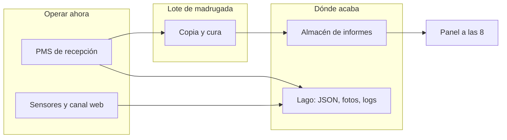
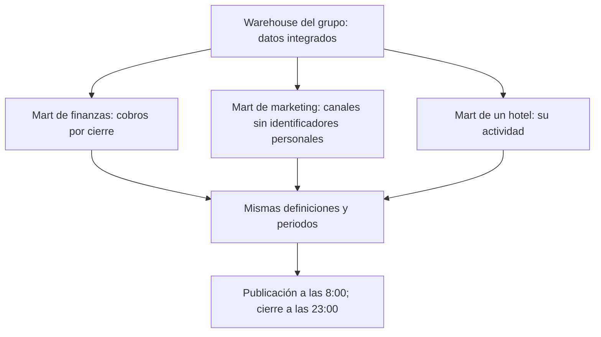
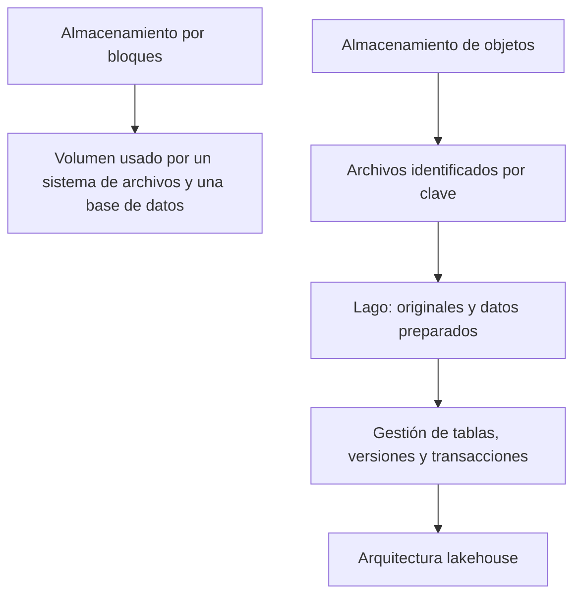
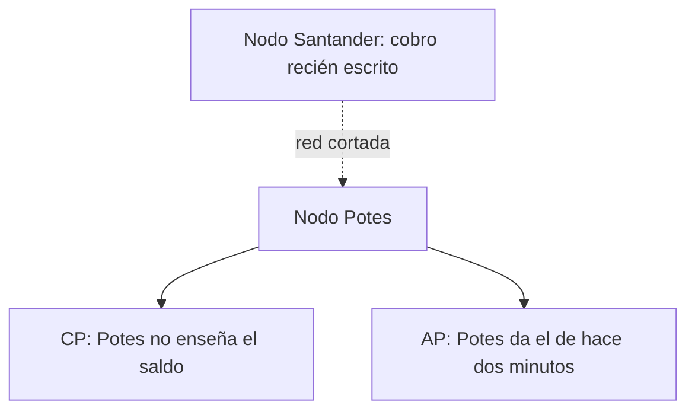

# 1.3. Conceptos de almacenamiento

!!! info "Ruta de estudio"
    **Esencial:** distinguir finalidad del almacén, modelo de datos y soporte; elegir garantías por operación.

    **Práctica guiada:** justificar dónde guardar el cobro, el histórico y el informe.

    **Ampliación:** profundizar en CAP, BASE y gestión de tablas del lakehouse. No sustituye al recorrido común; su detalle adicional solo se exige si el profesor lo anuncia antes (véase [cómo trabajar la unidad](index.md#como-trabajar-la-unidad)).

## Vídeo: el recorrido de la reserva de Ana

Sigue una reserva desde recepción hasta los informes de dirección. Esta explicación conecta las transacciones y sus garantías con la conservación de originales, el lago de datos, el almacén de informes y los datos que necesita cada departamento. La narración enlaza cada decisión con el caso de Ana y deja pausas para asimilar los conceptos. **Duración: 10 minutos y 45 segundos.**

<video controls playsinline preload="metadata" poster="../../assets/ut1/almacenamiento-natural-portada.jpg" aria-label="Almacenamiento: el recorrido de la reserva de Ana, explicación paso a paso" style="width: 100%; max-width: 960px; height: auto; border-radius: 12px;">
  <source src="../../assets/ut1/almacenamiento-natural.mp4" type="video/mp4">
  Tu navegador no permite reproducir este vídeo. Puedes descargarlo en el enlace siguiente.
</video>

El vídeo incluye subtítulos visibles y narración con voz sintética en español.

[Descargar el vídeo](../assets/ut1/almacenamiento-natural.mp4) · [Leer la transcripción](../assets/ut1/almacenamiento-natural.txt) · [Descargar los subtítulos](../assets/ut1/almacenamiento-natural.es.srt)

## Un mapa para ordenar los conceptos

Después de estudiar las máquinas en 1.2, necesitamos decidir qué guardamos en ellas y cómo lo utilizaremos. En esta página aparecen conceptos de distintos niveles. Separarlos evita comparar alternativas que pueden formar parte de una misma solución.

| Nivel de decisión | Pregunta | Conceptos |
| --- | --- | --- |
| Modelo de datos | ¿Cómo representamos y consultamos la información? | Relacional, documentos, clave-valor, grafos |
| Organización analítica | ¿Para qué reunimos los datos? | Warehouse, mart, lake, lakehouse |
| Acceso al almacenamiento | ¿Cómo escribe y lee el software? | Bloques, ficheros, objetos |
| Garantías | ¿Qué ocurre con los cambios y los fallos? | Transacciones, ACID, CAP, BASE |

Por ejemplo, un lago puede guardar ficheros Parquet en almacenamiento de objetos. Parquet es el formato del fichero, el almacenamiento de objetos es el servicio que lo conserva y el lago es la organización del conjunto. Son decisiones complementarias. Un lakehouse añade gestión de tablas sobre ese almacenamiento; por ello se estudia junto al lago, aunque no sea un mecanismo físico equivalente a los bloques.

Para seguir el caso, distinguiremos los datos operativos del PMS, las copias originales que conservamos para volver a procesarlas y las tablas preparadas para informes. La misma reserva puede aparecer en los tres lugares con funciones diferentes. La ingesta de 1.6 explicará cómo mantener ese recorrido.

Diseñar la solución (criterio **a)**) es elegir **dónde vive el dato** y **qué garantías** ofrecéis. No hace falta haber cursado un módulo de bases de datos: cada idea se explica aquí con un ejemplo, y **después** aparece la sigla, si la tiene.

En el [grupo hotelero](caso-hotel.md){target="_blank" rel="noopener"} eso ya está partido en dos relojes:

- **Recepción** pica ahora en el PMS. Un cobro **no** puede verse a medias.
- **Gerencia** abre a las **8** el panel de **ayer**. Finanzas cerró a las **23:00**; de madrugada corre el job que **copia** (no pica) ocupación e importe.

El PMS no tiene por qué estar diseñado para integrar todos los JSON, sensores y fotografías, aunque un gestor relacional pueda almacenar algunos de esos datos. El histórico de los cuatro hoteles **tampoco** es el disco de Laredo.

!!! info "Cómo se lee esta página"
    Primero **dónde** guardáis (PMS, lago, almacén de informes, *data mart*). Luego el **acceso al almacenamiento** (bloques u objetos) y cómo un *lakehouse* añade gestión de tablas sobre un lago. Al final **qué pasa si se cae o se parte la red** (transacción, ACID, CAP, BASE). Los relojes: 23:00 / job / panel de las 8.

## Base de datos relacional

Una base de datos relacional organiza la información en **tablas**. Cada fila representa una entidad o un hecho; cada columna representa un atributo. En el hotel podemos tener una tabla de hoteles, otra de reservas y otra de cobros.

El **esquema** define nombres, tipos y restricciones. Una clave primaria identifica una fila sin ambigüedad, como `id_reserva`. Una clave foránea relaciona tablas: el `id_hotel` de una reserva debe corresponder a un hotel existente. SQL permite consultar y modificar esos datos.

| Tabla | Qué representa una fila | Relación |
| --- | --- | --- |
| Hoteles | Un establecimiento | Se identifica por `id_hotel` |
| Reservas | Una reserva | Se relaciona con un hotel |
| Cobros | Un pago registrado | Se relaciona con una reserva |

Separar las tablas evita repetir la dirección del hotel en cada reserva. Para recuperar información conjunta utilizamos una unión o **join**. Un **índice** permite localizar ciertos valores sin recorrer todas las filas, aunque ocupa espacio y debe mantenerse al escribir.

Este modelo es habitual en aplicaciones operativas porque facilita expresar relaciones y restricciones. Las transacciones, que veremos después, permiten agrupar cambios relacionados. Modelo relacional y transacciones son conceptos distintos, aunque suelen utilizarse juntos.

La capacidad de crecimiento depende del gestor y de la arquitectura. Existen sistemas relacionales distribuidos y almacenes analíticos que utilizan SQL a gran escala. Por tanto, “relacional” no significa necesariamente “una sola máquina”. En nuestro caso conservamos el PMS como origen operativo y valoramos un entorno separado para los informes si su carga perjudica a recepción.

## Base de datos NoSQL

Nacen para **volumen**, **variedad** y crecer **añadiendo máquinas**. “NoSQL” no es un producto: es una **familia**. Elegir “NoSQL” sin decir cuál es como decir “voy en vehículo” sin decir si es bici o camión.

| Familia | Idea | En el hotel |
| --- | --- | --- |
| Documento | Un registro parece un JSON; no todos tienen los mismos campos | Reserva del canal web (un extra que otro no trae) |
| Clave-valor | Guardar y recuperar muy rápido con una clave (`sesion:17`) | Sesión de la web de reservas |
| *Wide-column* | Datos organizados por claves de partición y columnas o familias; el diseño depende de las consultas y del gestor | Lecturas de sensores cada 30 s |
| Grafo | Puntos unidos por relaciones | La misma tarjeta en dos hoteles (fraude) |

***Wide-column* no es Parquet.** Cassandra o HBase guardan **filas** con familias de columnas. Un fichero **columnar** (Parquet) es otra cosa: guarda *columnas* juntas para el informe. Eso va en [1.7](formatos.md){target="_blank" rel="noopener"}.

Cada familia habla un idioma distinto. Lo que veis en tutoriales de MongoDB **no** sirve igual en las otras.

La elección depende de las consultas, las relaciones y las garantías necesarias. NoSQL no implica ausencia de transacciones: algunos gestores, como [MongoDB](https://www.mongodb.com/docs/manual/core/transactions/), ofrecen transacciones entre varios documentos. Hay que comprobar su alcance, configuración y coste. En el caso mantenemos el cobro en el PMS existente; esto es una decisión del ejemplo, no una prohibición general para las bases documentales.

## Data warehouse (almacén de informes)

Un warehouse integra datos de varios orígenes con definiciones comunes. Si un hotel llama “ingreso” al precio reservado y otro al pago recibido, sumar ambas columnas produciría un informe incoherente. Antes de cargar el almacén se acuerda qué significa cada indicador y con qué detalle se conserva.

Ese nivel de detalle se denomina **granularidad** o **grano**. Una fila puede representar un cobro individual o el total de un hotel en un día. El detalle permite nuevas preguntas; el resumen acelera consultas conocidas, pero pierde información. Por ejemplo, con un total diario no podemos reconstruir los pagos individuales.

En un modelo dimensional, los **hechos** contienen medidas —importe, noches— y las **dimensiones** aportan contexto —hotel, fecha, canal—. Así podemos consultar la misma medida desde diferentes perspectivas. La frecuencia de actualización se diseña según la necesidad: en este caso es nocturna, aunque un warehouse también puede recibir cargas frecuentes.

Es un sitio **central**, pensado para **informes y decisiones** (inteligencia de negocio, *BI*), con **histórico**. Los datos **no se pican** ahí: **se copian** desde el PMS, la pasarela y, si hace falta, el lago. En nuestro caso se actualiza con cada cierre; otros almacenes reciben cargas frecuentes o continuas. No es el sitio donde recepción cobra.

Las columnas se deciden **antes** de guardar: si mañana el canal añade un campo, hay que **cambiar el modelo**. A cambio, gerencia encuentra tablas limpias (ocupación, importe, hotel), listas para el panel de las **8**.

En la nube oiréis [Snowflake](https://www.snowflake.com/){target="_blank" rel="noopener"} o BigQuery: es **este** oficio (informes), no el lago.

## Data mart (un recorte, no otro lago)

Un mart organiza datos para un ámbito concreto, como finanzas o marketing. Puede materializarse en tablas propias o en vistas sobre el almacén común. Su utilidad es reducir la complejidad para el usuario y proporcionar definiciones apropiadas a su trabajo.

La independencia de un mart no lo convierte automáticamente en incorrecto: el riesgo aparece cuando sus reglas, periodos o fuentes difieren sin documentarse. Si dos informes muestran importes distintos, primero comprobamos si ambos incluyen impuestos, devoluciones y la misma fecha de cierre.

El almacén de la cadena sirve a **toda** gerencia: ocupación e importe de Santander, Laredo, Comillas y Potes. Un **data mart** es el **mismo oficio** (tablas limpias, pregunta ya conocida, se copia, no se pica), pero **más estrecho**: un departamento o un hotel.

No es el PMS. No es el [lago](#data-lake){target="_blank" rel="noopener"}. En este caso es un recorte del warehouse que alguien ya puede abrir a las **8** sin tragarse el modelo entero ni ver columnas que no le tocan (el NIF no va al mart de marketing).

En el hotel elegimos marts dependientes del warehouse. También existen marts independientes; el riesgo es usar definiciones incompatibles sin coordinación.

En el hotel:

| Recorte | Quién lo usa | Qué hay | Qué **no** hay |
| --- | --- | --- | --- |
| Mart de **finanzas** | Cierre y fiscalidad | Importe cobrado, canal, hotel | Fotos de habitación, JSON bruto |
| Mart de **marketing** | Campañas | Canal, ocupación, temporada | NIF, fianza |
| Mart de **Laredo** | Dirección de ese hotel | Solo Laredo | Los números de Potes |

Tres maneras de alimentarlo (el nombre es de libro; el criterio es de diseño):

| Tipo | De dónde sale | En el hotel |
| --- | --- | --- |
| **Dependiente** | Del warehouse de la cadena | El panel de Laredo lee **los mismos** cobros que gerencia a las 8 |
| **Independiente** | ETL propio, sin pasar por el almacén del grupo | Comillas monta un Excel “porque mañana abre otro”. Los importes **no cuadran** con el cierre |
| **Híbrido** | Del warehouse **y** de un fichero extra | Campañas de la OTA + ocupación ya curada |

Un mart dependiente facilita compartir definiciones. Si se elige uno independiente, hay que documentar y conciliar sus reglas para evitar indicadores contradictorios.

## Data lake

Para que el lago resulte utilizable, suele organizarse en zonas: **originales** recibidos, datos **validados o preparados** y resultados **publicados**. Por ello un lago puede contener tanto datos en bruto como tablas depuradas. Cada conjunto necesita propietario, descripción, esquema cuando proceda, fecha de actualización y reglas de acceso.

Conservar el original permite repetir una transformación corregida sin volver al sistema operativo. Esta conservación tiene límites: se deben definir periodos de retención y procedimientos de eliminación. “Guardar el bruto” no significa conservar cualquier dato indefinidamente ni permitir que todos lo consulten.

El **data lake** (lago de datos) puede conservar originales y zonas de datos preparados. En su zona bruta guarda el dato **como llegó**: JSON del canal, log de la web, foto de habitación, CSV de Comillas, serie del sensor. Encaja cuando **aún no** sabéis qué preguntaréis mañana, o cuando el bruto es de muchos tipos.

Esa colección que tiene sentido tratar junta (reservas de agosto, lecturas de Potes) es un **dataset**: es *qué* vais a procesar, no *en qué motor* está.

El “cómo se interpreta” se aplica **al leer**, no al guardar. El riesgo clásico es el ***data swamp*** (ciénaga): un lago sin catálogo, sin dueño y sin calidad. Entonces “tenemos un lake” significa “tenemos un disco sucio”.

| | Data warehouse | Data lake |
| --- | --- | --- |
| Oficio | Consulta analítica con definiciones comunes | Conservar originales y conjuntos preparados para distintos usos |
| Dato | Integrado y modelado para el análisis | Zonas de originales, datos validados y resultados |
| Esquema | Definido para las tablas analíticas | Puede aplicarse al leer el original y fijarse en tablas preparadas |
| Quién lo usa | Gerencia, informes | Ingeniería y ciencia de datos |
| Pregunta | Ya la conocéis (ocupación / importe) | Puede aparecer después |

En la práctica el grupo suele tener **los dos**: el lago para el bruto y el warehouse para lo que gerencia ve a las 8. En este diseño, el *data mart* es un **recorte** de ese warehouse, no un tercer sitio para el JSON. No elegís uno “para siempre”: elegís **para cada pregunta**.

## Acceso al almacenamiento y arquitectura lakehouse { #como-se-guarda-bloque-objeto-lakehouse }

Una vez decidida la función del almacén, debemos distinguir el modo de acceso al almacenamiento de la organización analítica que construimos sobre él.

| Acceso | Cómo se utiliza | Ejemplo |
| --- | --- | --- |
| **Bloques** | Se presenta un volumen sobre el que el sistema operativo puede crear un sistema de archivos. Permite leer y escribir bloques. | Volumen que utiliza la base de datos del PMS. |
| **Ficheros** | Se accede a archivos y directorios mediante rutas. Puede ser local o compartido por red. | Una carpeta del aula o un NAS que ofrece NFS/SMB. |
| **Objetos** | Cada objeto se identifica mediante una clave y se accede a él mediante una API. | CSV o Parquet almacenados en S3 o Azure Blob. |

Un objeto puede leerse completo o por rangos de bytes si el servicio lo permite. Esto no equivale a modificar un byte arbitrario como en un volumen de bloques: normalmente se escribe una nueva versión del objeto. Esa diferencia resulta importante para elegir el servicio que necesita una aplicación.

El **lakehouse** pertenece a otro nivel: es una arquitectura que incorpora gestión de tablas sobre un lago. Formatos de tabla como Delta Lake o Apache Iceberg registran qué archivos forman una versión de la tabla y coordinan cambios. El apartado [1.7](formatos.md) desarrolla esta relación entre archivos y tablas.

Bloques y objetos describen acceso al almacenamiento. Lakehouse describe una arquitectura que puede apoyarse en almacenamiento de objetos.

En el [taller de S3](aws-academy-s3.md) crearemos un cubo privado con prefijos para originales e informes. Crear esos prefijos no construye por sí solo un warehouse o un lakehouse: faltan modelos, procesos y controles.

**Almacenamiento y cálculo pueden crecer por separado.** En un clúster Hadoop clásico, HDFS y los procesos de cálculo pueden compartir nodos. En otra arquitectura, los archivos permanecen en almacenamiento de objetos y las máquinas de cálculo se crean cuando hacen falta. El segundo diseño facilita ajustar la capacidad de proceso, pero requiere planificar el acceso por red.

La RAM permite acceso rápido a datos en uso, pero es limitada y normalmente volátil. SSD y HDD conservan los datos y ofrecen capacidades, costes y rendimientos distintos. Las diferencias dependen del acceso secuencial o aleatorio y del hardware; conviene medir la carga real en lugar de aplicar una proporción fija de velocidad.

## Qué es una transacción (hace falta para entender ACID)

En la calle, “transacción” suena a pago. En bases de datos es más concreto: **un paquete de cambios que o se hacen todos o no se hace ninguno**.

Ejemplo: transferir 50 € de la cuenta A a la B son **dos** cambios (quitar en A, poner en B). Si el sistema se cae a mitad, no podéis dejar a A sin el dinero y a B sin recibirlo. Ese paquete es la **transacción**.

En el hotel: descontar la fianza **y** registrar el cobro. Si solo ocurre uno de los dos, recepción está mintiendo.

Cuando el paquete termina bien, el sistema lo **confirma** (queda grabado). Si algo falla, **deshace** todo el paquete y el mundo queda como al principio.

## ACID: cuando el negocio no puede verse a medias

Una transacción empieza, ejecuta operaciones y termina con una confirmación (**commit**) o una cancelación (**rollback**). La base de datos protege las operaciones incluidas dentro de su ámbito. Si interviene una pasarela externa, una transacción local no deshace automáticamente un cargo externo: la aplicación necesita coordinar la operación, comprobar su estado y evitar duplicados.

El aislamiento admite distintos niveles. No todos hacen que las operaciones se comporten como si se ejecutasen una detrás de otra; ese es el objetivo del nivel serializable. Además, la consistencia depende de las reglas que realmente se hayan definido: la base no puede detectar por sí sola una regla de negocio desconocida.

Son las cuatro garantías que se piden a una base usada para esas transacciones (casi siempre, una relacional). El acrónimo se entiende con la misma transferencia de 50 €:

| Letra | Nombre | Qué exige | Si fallara |
| --- | --- | --- | --- |
| **A** | Atomicidad | Todo o nada | Se resta en A y no se suma en B |
| **C** | Consistencia | Se cumplen las reglas (un saldo no puede quedar “prohibido”) | Queda escrito un saldo negativo que el banco no admite |
| **I** | Aislamiento | Las operaciones concurrentes se coordinan según el nivel de aislamiento | Una lectura o actualización concurrente observa un estado que el nivel elegido debería impedir |
| **D** | Durabilidad | Lo confirmado **no se pierde** | Tras confirmar, un corte de luz borra el ingreso |

Los gestores pueden combinar bloqueos, versiones de las filas y registros de recuperación. Estas técnicas tienen costes, pero permiten coordinar accesos y recuperar operaciones confirmadas. El rendimiento debe compararse para una carga y unas garantías concretas; ACID no significa simplemente “base lenta”.

No toda base “relacional” cumple esto al 100 % si la configuráis en modo relajado. Para **caja, cobro o una nota que ya no se puede retractar** sí debéis exigir estas cuatro letras.

## Teorema CAP: qué pasa cuando se parte la red

Hasta ahora imaginabais **un** servidor. En un [clúster](clusters.md){target="_blank" rel="noopener"} el dato está en **varios** ordenadores. El teorema de Brewer (CAP) dice que, **si se corta la red entre ellos**, no podéis tener a la vez las tres cosas siguientes:

- **C**onsistencia: quien pregunta recibe el dato **más reciente**, o un error. Nunca un valor viejo haciéndose pasar por actual.
- **A**vailability (disponibilidad): toda solicitud recibida por un nodo que no ha fallado obtiene una respuesta de la operación; un error que rechaza la operación no satisface esta garantía.
- **P**artition tolerance: el diseño contempla que la red pueda impedir la comunicación entre grupos de nodos. Durante esa partición debe resolver el compromiso entre consistencia y disponibilidad.

Esta **C no es la C de ACID**. ACID-C son las **reglas** (un saldo no queda prohibido). CAP-C es una garantía de **consistencia fuerte (linealizabilidad)**: las operaciones se comportan como sobre una única copia actualizada, respetando el orden temporal de las operaciones completadas. No exige que todos los discos cambien físicamente a la vez. En [1.4](procesamiento.md#scv){target="_blank" rel="noopener"} hay una tercera C (precisión del análisis): tampoco es esta.

En un clúster real **P no es opcional**: un cable se corta, un *switch* se cuelga, Potes pierde enlace con Santander. La decisión de diseño suele ser:

| Tipo | Prioriza | En una frase de aula |
| --- | --- | --- |
| **CP** | C + P | “Rechazo una operación si no puedo garantizar una lectura o escritura consistente.” |
| **AP** | A + P | “Prefiero responder; ya se pondrán de acuerdo los nodos.” |
| **CA** | C + A sin partición | Puede mantenerse cuando no hay partición de red; no es una tercera solución que evite el compromiso durante una partición |

!!! example "Santander y Potes"
    El nodo de Santander acaba de registrar un pago. Se corta la red con Potes.

    - **CP:** Potes puede **negar** la lectura del saldo hasta recuperar el enlace.
    - **AP:** Potes **da un saldo** (quizá el de hace dos minutos). El cliente ve *algo*; puede no ser lo último.

Muchos productos **se configuran**. No memoricéis “Mongo es CP” como dogma: preguntad *qué hace este sistema si se parte la red*.

## BASE: disponibilidad y convergencia { #base-el-otro-extremo-de-acid }

BASE describe un enfoque frecuente en sistemas distribuidos que admiten que distintas réplicas tarden en converger. No es un teorema ni una clasificación que excluya todas las transacciones.

- **Basically Available**: se busca mantener el servicio disponible, incluso con degradaciones previstas.
- **Soft state**: el estado observado puede cambiar por sincronización entre réplicas, sin una nueva acción del usuario que consulta.
- **Eventual consistency**: si dejan de producirse cambios y la comunicación se recupera, las réplicas terminan convergiendo según las reglas del sistema. No establece por sí sola un plazo fijo.

Por ejemplo, un cambio en la descripción de un extra puede tardar en aparecer en todos los hoteles. El negocio puede admitir ese retraso. Para evitar vender dos veces la última habitación, en cambio, necesitamos garantías acordes con esa operación.

La elección se hace por operación y por requisito. Un catálogo, una reseña y un cobro no necesitan necesariamente las mismas garantías. Un sistema puede utilizar transacciones en un ámbito y replicación eventual en otro. Antes de elegir, preguntad qué consecuencias tendría una lectura desactualizada o una escritura concurrente.

## Cómo elegir (criterio a)

Recorred las preguntas **en este orden**, con el hotel:

1. ¿Hay cambios que deban confirmarse conjuntamente? → exigid transacciones y garantías adecuadas. En este caso las proporciona el PMS relacional.
2. ¿La carga incumple capacidad o plazo? → medid el cuello de botella y comparad optimizar consultas, mejorar una máquina, separar análisis y operación o distribuir. Ni cuatro hoteles obligan a usar un clúster, ni un clúster obliga a usar NoSQL.
3. ¿La pregunta ya está clara y se repetirá cada mañana a las 8 (ocupación e importe)? → **warehouse**.
4. ¿Solo un departamento o un hotel necesita ese recorte (marketing, Laredo) y no toda gerencia? → **data mart**, alimentado del warehouse. No montéis un segundo almacén a escondidas.
5. ¿Aún no sabéis qué preguntaréis o el bruto es de muchos tipos? → **lake**, y luego curáis hacia el warehouse.
6. ¿Necesitáis gestionar tablas y versiones sobre archivos del lago? → valorad un **lakehouse**. Un warehouse también permite actualizar o borrar: esa necesidad aislada no decide la arquitectura. Una eliminación lógica no borra automáticamente históricos y copias; hay que definir su conservación y limpieza.

En [1.4](procesamiento.md){target="_blank" rel="noopener"} veréis otro par de siglas (OLTP y OLAP): no son otro tipo de base, son **dos trabajos distintos** (operar en recepción frente a informar a gerencia).

Si podéis justificar esas frases con el [caso](caso-hotel.md){target="_blank" rel="noopener"}, habéis caracterizado el diseño. Eso es lo que pide el RA1, no recitar definiciones.

## Actividad

No puntúa en Moodle. Una línea de por qué.

1. El PMS debe confirmar conjuntamente dos cambios locales relacionados con una fianza. ¿Qué garantía necesita y por qué una copia en el lago no la sustituye?
2. El canal web deja un JSON de reserva con extras distintos en cada fila. ¿Dónde conservaríais el original y dónde prepararíais los campos del informe? Justificad la elección: un JSON también puede transformarse y cargarse en un warehouse.
3. Gerencia quiere ocupación e importe **a las 8**, siempre las mismas columnas. ¿Warehouse o lago?
4. Marketing quiere campañas **sin** NIF, y finanzas no tiene que ver ese recorte. ¿Lago, warehouse entero o data mart?
5. Se corta la red Santander–Potes. Potes **niega** el saldo antes que enseñar el de hace dos minutos. ¿CP o AP?

!!! tip "Comprobación"
    ACID para los cambios locales / lago para conservar originales y una tabla preparada para el informe; otras soluciones justificadas son válidas / warehouse para el informe repetido / mart para el departamento / CP ante la partición descrita.

## Autoevaluación del 1.3

Diez preguntas (A–D, **una** correcta) sobre los conceptos del apartado. No puntúan en Moodle. En **cada** una, **Comprobar respuesta**: si es correcta o no, y una explicación breve. Podéis repetir el test.

