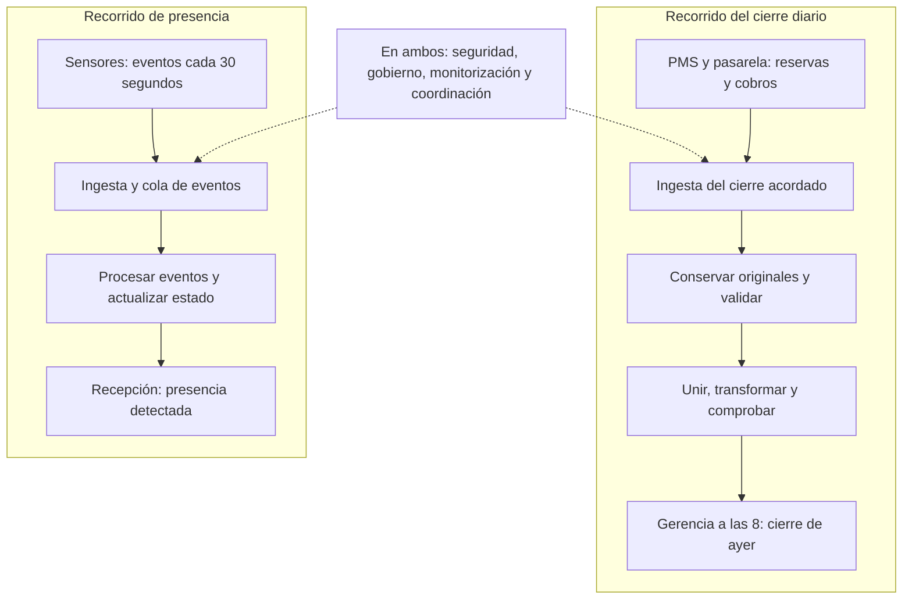
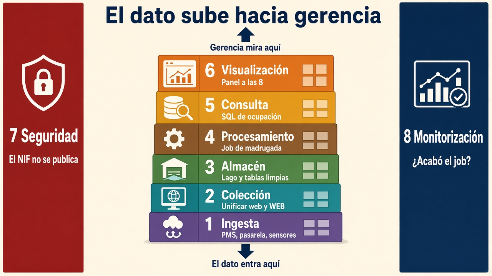
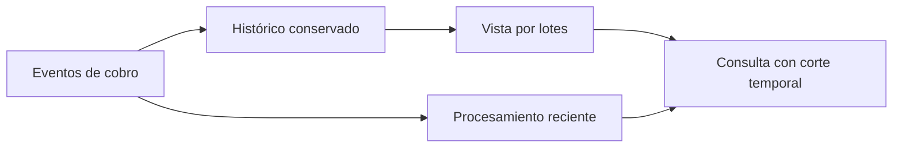
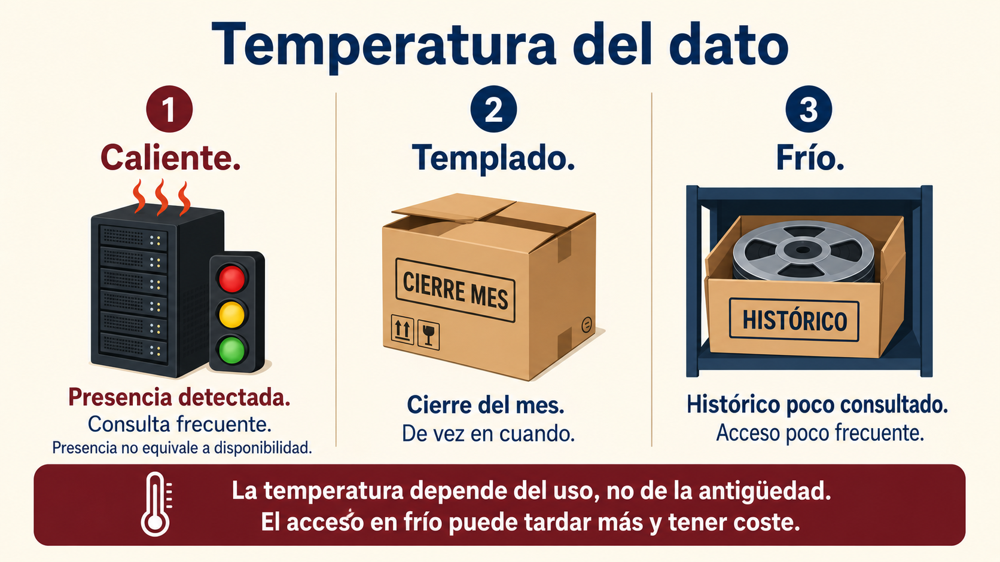

# 1.5. Arquitectura por capas y paisaje de herramientas

!!! info "Ruta de estudio"
    **Esencial:** seguir el dato por responsabilidades y reconocer controles transversales.

    **Práctica guiada:** dibujar la solución del hotel y justificar cómo se recupera.

    **Ampliación:** comparar Lambda y Kappa mediante sus vistas y el reprocesamiento. No sustituye al recorrido común; su detalle adicional solo se exige si el profesor lo anuncia antes (véase [cómo trabajar la unidad](index.md#como-trabajar-la-unidad)).

## Vídeo: del cobro de Ana al panel

Sigue el cobro de Ana para comprender cómo colaboran las capas de la arquitectura, qué controles necesita el recorrido y cómo se recupera ante fallos. La explicación de Lambda y Kappa utiliza el mismo ejemplo numérico y esquemas comparativos para distinguir ambas opciones. **Duración: 13 minutos y 17 segundos.** La comparación de Lambda y Kappa comienza aproximadamente en el **minuto 6:40**.

<video controls playsinline preload="metadata" poster="../../assets/ut1/arquitectura-revisada-portada.jpg" aria-label="Arquitectura: del cobro de Ana al panel, con explicación de Lambda y Kappa" style="width: 100%; max-width: 960px; height: auto; border-radius: 12px;">
  <source src="../../assets/ut1/arquitectura-revisada.mp4" type="video/mp4">
  Tu navegador no permite reproducir este vídeo. Puedes descargarlo en el enlace siguiente.
</video>

El vídeo incluye subtítulos visibles y narración con voz sintética en español.

[Descargar el vídeo](../assets/ut1/arquitectura-revisada.mp4) · [Leer la transcripción](../assets/ut1/arquitectura-revisada.txt) · [Descargar los subtítulos](../assets/ut1/arquitectura-revisada.es.srt)

## Cómo construir una visión de conjunto

Hasta ahora hemos estudiado necesidades, máquinas, almacenamiento y procesamiento por separado. Una arquitectura explica cómo colaboran esos elementos para entregar un resultado. Las capas que siguen representan responsabilidades: una misma herramienta puede cubrir varias y una capa puede necesitar varias herramientas.

Sigamos una reserva: el PMS la registra; un proceso extrae una copia; la integración unifica los identificadores de hotel; el almacenamiento conserva los datos; el procesamiento calcula totales; la consulta recupera los indicadores y la visualización los presenta. Cada paso necesita una entrada definida y debe producir una salida que el siguiente pueda interpretar.

Si el panel muestra un importe incorrecto, este mapa permite investigar su origen. Puede faltar un cobro en la extracción, haberse duplicado una reserva en la integración o haberse aplicado una regla incorrecta al calcular. La monitorización informa de fallos y tiempos; el linaje permite reconstruir de dónde procede el resultado.

Primero estudiaremos esas responsabilidades y después las formas de combinarlas para atender lotes y flujos. En 1.6 nos detendremos en el recorrido de entrada y transformación de los datos.

Un sistema Big Data no es “un programa que lo hace todo”. Separar responsabilidades facilita probar, sustituir componentes y explicar el diseño (criterio **a)**), incluso cuando un primer prototipo utiliza un único script.

Se parte en **capas** que se hablan entre sí. Cada capa tiene **una** responsabilidad. Así sabéis dónde encajan la [ingesta](ingesta.md){target="_blank" rel="noopener"}, el [formato](formatos.md){target="_blank" rel="noopener"}, [Pentaho](pentaho.md){target="_blank" rel="noopener"} y el cuadro de mando.

Este apartado es el **mapa del oficio** que en [1.1](por-que-big-data.md){target="_blank" rel="noopener"} llamamos ingeniería de datos: no el gráfico de las 8, sino que ese gráfico **pueda** hacerse. El hilo es el [grupo hotelero](caso-hotel.md){target="_blank" rel="noopener"}.

!!! info "Cómo se lee esta página"
    Primero el **ciclo** (fases: de que nace el dato hasta que gerencia lo usa). Luego el **edificio** (ocho capas: el dato entra abajo y gerencia mira arriba). Después **cómo se combinan** lote y flujo (Lambda / Kappa) mediante vistas históricas y recientes de los mismos hechos; los dos pipelines independientes del hotel sirven para explicar por qué no toda coexistencia de lote y flujo es Lambda. Los logos van al final: se sitúan en una capa; no se recitan.

## El ciclo (generación → consumo)

Antes de los logos, el dato recorre un ciclo. Las tecnologías cambian; **estas fases no**.

1. **Generación.** Quién, dónde y cuándo nace el dato: PMS, pasarela, sensor, un Excel de Comillas, una API.
2. **Ingesta.** Moverlo al almacén. El detalle (pipeline, push/pull/poll, ETL/ELT) está en [1.6](ingesta.md){target="_blank" rel="noopener"}.
3. **Transformación.** Cruzar, limpiar, agregar. Aquí vive Pentaho y, a escala, Spark SQL. Unificar nombres también es una transformación; en el esquema siguiente la destacamos dentro de integración para explicar su propósito. El resultado suele **añadirse** al lago, no pisar el fichero: si un huésped pide borrar el NIF, no editáis el Parquet a mano ([1.7](formatos.md){target="_blank" rel="noopener"}).
4. **Entrega** (*serving*). El dato **ya es de fiar** y se lo dais a un consumidor: panel, modelo, fichero para el científico.
5. **Consumo.** Gerencia a las 8, un analista, un entrenamiento. Si el consumidor no confía, el ciclo ha fallado **antes**.

Generación, ingesta, transformación, entrega y consumo se reconocen en ambos recorridos, pero sus fuentes, plazos y resultados son distintos. Este esquema no combina sus vistas y no representa por sí solo una arquitectura Lambda. El indicador de presencia no determina la disponibilidad comercial de una habitación.

La figura resume un ciclo posible. En este caso el cierre usa reservas y cobros; los sensores alimentan un indicador distinto. Ingestar no exige siempre pasar por un lago.

Sobre el almacén (lago, warehouse, *lakehouse*, cubo de objetos: [1.3](almacenamiento.md){target="_blank" rel="noopener"}) se apoyan ingesta, transformación y entrega. Seguridad y monitorización son **capas** que atraviesan el edificio. Gobierno, DataOps y orquestación son **corrientes** (no una novena capa): van más abajo.

### A quién servís

No es el mismo reloj.

| Entrega | Pregunta | Reloj en el hotel |
| --- | --- | --- |
| **Analítica de negocio** | ¿Qué pasó / por qué? Decisiones de **días o semanas**. | El panel de las 8 (lote). |
| **Analítica operacional** | ¿Qué hago **ahora**? | El semáforo de recepción (sensores). |
| **Analítica embebida** | El dato vive **dentro** de otra app. | “¿Queda doble al mar?” en la web de reservas. |

A veces se lleva información preparada del entorno analítico a una aplicación operativa: por ejemplo, un segmento de clientes al CRM. Esto se conoce como **reverse ETL**. Una predicción no se convierte por ello en un hecho confirmado: escribir en el PMS exige permisos, validación y reglas del negocio. Aquí basta comprender que puede existir ese retorno controlado.

## Las capas (el dato entra abajo y gerencia mira arriba)

El ciclo son **fases** (qué le pasa al dato). Las ocho capas son el **edificio** (dónde vive cada responsabilidad).

!!! info "Relacionad responsabilidades, no números"
    El ciclo describe qué ocurre con el dato. El esquema de esta página organiza seis responsabilidades del recorrido y dos transversales: seguridad y monitorización. Es un mapa didáctico, no una norma de ocho productos obligatorios.

    En 1.6 se resume el recorrido sin añadir otra numeración. Normalizar nombres y unir fuentes son transformaciones de integración; una misma herramienta puede integrar, procesar y escribir resultados. Un job coordina tareas: no es sinónimo de toda la capa de procesamiento.

### 1. Ingesta

La salida de esta capa debe permitir saber qué se ha recibido y qué falta. Además de los registros, conservamos datos de control: fuente, instante de extracción y periodo cubierto. Si una API devuelve varias páginas, hay que recorrerlas todas; si un fichero se está escribiendo todavía, conviene esperar una señal de finalización antes de incorporarlo.

Entráis a las fuentes que **ya existen**: el PMS, la pasarela, el JSON del canal, los sensores, un CSV de Comillas. **No** elegís cómo habla el origen: os adaptáis (SQL, HTTP, fichero, cola).

Si esta capa falla, el resto analiza el vacío. El detalle está en [1.6](ingesta.md){target="_blank" rel="noopener"}.

### 2. Colección / integración

Integrar exige resolver identidades y unidades. Si el código `1` significa Laredo en una fuente y Santander en otra, no podemos unir ambas tablas directamente. Necesitamos una correspondencia entre códigos locales y un identificador común. Del mismo modo, deben documentarse moneda, zona horaria y significado de los estados de reserva.

Unificáis **formato y semántica**. El mismo canal no puede llamarse `web` en Laredo y `WEB` en Potes sin un criterio. El mismo huésped no puede tener tres NIF. Aquí nace (o se rompe) la calidad.

La integración incluye armonizar significados y relacionar fuentes. Estas tareas se ejecutan mediante transformaciones. Las separamos didácticamente por su propósito, pero no son categorías excluyentes ni requieren programas distintos.

### 3. Almacenamiento

Esta responsabilidad incluye organizar conjuntos, definir cuánto tiempo se conservan y controlar quién puede leerlos. Para el hotel podemos mantener originales por fecha de recepción y tablas preparadas por fecha de negocio. Ambas fechas pueden diferir si un cobro llega con retraso. Las copias de seguridad y los procedimientos de restauración forman parte del diseño.

Lago, warehouse, *lakehouse*, HDFS, objeto en cloud… [distribuido](clusters.md){target="_blank" rel="noopener"} si el volumen lo pide. Aquí aplicáis lo de [1.3](almacenamiento.md){target="_blank" rel="noopener"}: ¿el cobro puede verse a medias o no? ¿lago, almacén de informes o los dos?

### 4. Procesamiento

Cada cálculo necesita reglas explícitas. Para el importe por hotel hay que decidir si se incluyen devoluciones, qué se hace con reservas sin pago y cómo se tratan monedas diferentes. El proceso debe producir el mismo resultado al ejecutarse sobre la misma entrada y la misma versión de las reglas, salvo que exista una variación intencionada y documentada.

Infraestructura **batch**, **streaming** o híbrida. *No* extrae valor ella sola: deja el dato **listo** (agregado, limpio, unido). El job de madrugada, Spark o un script viven aquí. Lote o flujo, en [1.4](procesamiento.md){target="_blank" rel="noopener"}.

### 5. Consulta y analítica

La consulta permite seleccionar y combinar los datos preparados. El análisis interpreta el resultado en su contexto. Un descenso de ocupación puede estar relacionado con habitaciones cerradas por reforma: el número, por sí solo, no explica la causa. El catálogo y las definiciones de indicadores ayudan a interpretar correctamente las consultas.

SQL, notebooks, modelos. Aquí sale **conocimiento**: “Laredo cancela más el viernes por la web”.

### 6. Visualización

Un resultado comprensible indica periodo, unidades, filtros y fecha de actualización. Si el panel muestra 80 %, debe aclarar qué cuenta como habitación disponible y a qué día corresponde. También debe distinguir un valor cero de un dato pendiente. Estas decisiones son tan importantes como elegir barras, líneas o una tabla.

Informes y cuadros de mando para **gerencia**. Es el criterio **e)**: fácil de interpretar. Un `.ktr` o un Parquet crudo **no** son esta capa. El panel de las 8 **sí**.

### 7. Seguridad (transversal) { #7-seguridad-transversal }

Atraviesa todas las anteriores: quién lee el NIF, cifrado, copias, amenazas internas (un práctico con más permisos de la cuenta) y externas. Principio de **menor privilegio**: solo el tiempo y las columnas que hacen falta. Enmascarar el DNI del huésped no es un adorno.

### 8. Monitorización (transversal)

Hay que observar tanto la ejecución como los datos. Un proceso puede terminar correctamente y producir cero filas por un filtro mal configurado. Por eso registramos duración, errores, filas recibidas, descartadas y publicadas, además del periodo cubierto. Una alerta útil identifica el problema y a quién corresponde revisarlo.

¿El job de anoche acabó **antes de las 8**? ¿El dato del panel es de ayer o de marzo? Auditoría. Sin esto, el prototipo de clase funciona y el de producción **miente** sin que nadie lo sepa.

!!! warning "Las dos que se olvidan en el trabajo de clase"
    Seguridad y monitorización. Un flujo “CSV → filtro → Excel” también necesita controles. Las otras seis capas, si el caso es real, también existen aunque sean simples (una carpeta con permisos y un log de Pentaho).

## Qué tiene que cumplir el edificio

Las capas de arriba son el **edificio**. La arquitectura debe cumplir los requisitos medidos de capacidad, plazo, coste y recuperación ante fallos. La distribución del almacenamiento y del cálculo son decisiones que se justifican por separado: esta tabla no exige que todos los proyectos repartan ambos entre varias máquinas.

| Aspecto que debemos justificar | En castellano | En el hotel |
| --- | --- | --- |
| **Escala** | Aumentáis capacidad dentro de los límites del diseño y comprobáis la mejora | Abrís Noja y el panel de las 8 sigue saliendo |
| **Recuperación y continuidad** | Definimos qué fallos debemos soportar, qué datos podemos perder y cuánto tiempo puede durar la recuperación | Ante un disco averiado, las copias y la restauración protegen el histórico; mantener el panel disponible durante el fallo exige mecanismos adicionales ([1.2](clusters.md){target="_blank" rel="noopener"}) |
| **Distribución del almacenamiento, si procede** | Valoramos repartir datos cuando lo justifiquen capacidad, acceso o disponibilidad; revisamos también coordinadores, red y orígenes únicos | El histórico necesita capacidad y protección adecuadas. Repartirlo no sustituye las copias de seguridad ni obliga a distribuir cada cálculo |
| **Distribución del cálculo, si procede** | Comparamos ejecución local, optimización, más recursos y reparto entre máquinas; elegimos según medidas | El job de ocupación puede ejecutarse en una máquina si cumple plazo, coste y garantías. Usar Spark o PySpark no implica que se ejecute en varias |
| **Ubicación del dato y del cálculo** | Valoramos el tráfico de red y el coste frente a la flexibilidad de separar almacenamiento y proceso | Hadoop clásico aprovecha la proximidad; en otros diseños se separan los recursos y se mide si la red permite cumplir el plazo ([1.2](clusters.md){target="_blank" rel="noopener"}, [1.3](almacenamiento.md){target="_blank" rel="noopener"}) |

!!! failure "Sobreingeniería"
    Montar Kafka + Spark + tres nubes “porque es Big Data” cuando el Excel de Comillas cabe en un PC. Primero la pregunta de gerencia; luego el edificio. Los proveedores publican listas (p. ej. *Well-Architected*): la idea es la misma, no hace falta recitar la guía.

Principios que evitan el zoo:

1. **Componentes comunes** pocos y bien elegidos: cubo de objetos, Git, orquestador, un motor de proceso.
2. **Todo falla.** **RTO:** cuánto podéis tardar en recuperar el panel (si el job muere a las 02:10, ¿llegáis a las 8?). **RPO:** hasta qué hora de reservas aceptáis **perder** (un fallo a las 22:00, ¿se pierde el día o solo la última hora?).
3. **Elástico**, también hacia abajo (noviembre: apagáis nodos; [1.2](clusters.md){target="_blank" rel="noopener"}).
4. **Viva:** el negocio cambia; la arquitectura también.
5. **Poco acoplada:** cola o API; cambiáis NiFi por un script sin reescribir el PMS.
6. **Reversible:** una decisión mala se deshace (versión del job, no “ya está en producción para siempre”).
7. **Menos privilegio:** el práctico no lee el DNI ([seguridad](#7-seguridad-transversal){target="_blank" rel="noopener"}).

## Dos caminos: lote y flujo (Lambda y Kappa)

El procesamiento por lotes y el continuo pueden coexistir en una empresa. Esa coexistencia, por sí sola, no define una arquitectura Lambda. Para entender Lambda y Kappa debemos preguntar cómo se obtienen y se reconstruyen las vistas que consultan los usuarios.

Un flujo puede calcular resultados exactos para su ámbito; usar ventanas no implica necesariamente muestrear. La dificultad está en coordinar estados, duplicados, eventos tardíos y recuperación ante fallos. Un lote, por su parte, procesa un conjunto delimitado y también necesita controles de calidad.

### Lambda: una vista histórica y una actualización reciente

Lambda combina una capa de **lote**, una capa **rápida** y una capa de **servicio o consulta**. La primera calcula vistas sobre el histórico; la segunda incorpora los eventos recientes antes de que el lote los haya integrado. La consulta utiliza las vistas necesarias sin contar dos veces los mismos hechos.

Por ejemplo, una consulta del importe acumulado puede combinar el histórico cerrado con los cobros posteriores al último corte. Cuando el siguiente lote incorpora esos cobros, la parte rápida deja de aportarlos a esa consulta. Es necesario definir la frontera temporal y mantener reglas coherentes en ambos caminos.

La ventaja es combinar una base histórica recalculable con baja latencia para eventos recientes. El coste es mantener y conciliar dos caminos. El [ejemplo de AWS sobre arquitectura Lambda](https://aws.amazon.com/blogs/big-data/build-a-big-data-lambda-architecture-for-batch-and-real-time-analytics-using-amazon-redshift/) ilustra esta separación.

En nuestro caso básico, el informe nocturno de cobros y el indicador de sensores tienen fuentes y objetivos distintos. Son dos pipelines, pero no bastan para afirmar que hemos construido Lambda. El panel de las 8 sigue mostrando el cierre de ayer; una consulta de “hoy hasta ahora” sería otro requisito.

### Kappa: procesamiento continuo con capacidad de repetición

Kappa propone mantener una vía principal de procesamiento de eventos. Si cambia una regla o hay que reconstruir una vista, se vuelven a procesar los eventos conservados. Este **replay** requiere retención suficiente, versiones de las reglas y control para no duplicar efectos en los destinos.

Un registro de eventos como Kafka puede formar parte de la solución. No es suficiente instalar una cola: hay que asegurar que conserva los eventos necesarios y que los consumidores pueden reconstruir su estado. El orden suele garantizarse dentro de cada partición, no globalmente entre todas las particiones.

Kappa no obliga a que todos los consumidores ejecuten el mismo cálculo. Puede haber varios resultados derivados del mismo flujo. La elección depende de si las vistas requeridas pueden reconstruirse de forma viable y del coste de mantener una vía adicional por lotes.

| Necesidad | Diseño que conviene estudiar |
| --- | --- |
| Solo un informe del día anterior | Un pipeline por lotes puede ser suficiente. |
| Histórico recalculable y resultados recientes combinados | Lambda, si compensa mantener ambos caminos. |
| Vistas derivadas de eventos que pueden conservarse y reproducirse | Kappa. |
| Informes de cobros y sensores con objetivos independientes | Dos pipelines; justificar cada uno sin forzar una etiqueta. |

Spark puede utilizarse para lotes y flujo, pero compartir un motor no elimina automáticamente la complejidad del estado, el tiempo de los eventos o los reintentos.

### Temperatura: no todo el dato se consulta igual

La temperatura expresa frecuencia de acceso y plazo de recuperación. No describe si el dato es correcto ni si pertenece a Lambda o Kappa.

| Temperatura | Necesidad | Ejemplo |
| --- | --- | --- |
| Caliente | Acceso frecuente con poca latencia | Estado reciente o una caché de indicadores. |
| Templado | Consultas periódicas | Informes del trimestre. |
| Frío | Consulta excepcional, recuperación más lenta aceptable | Copias históricas sujetas a una política de conservación. |

Aquí el semáforo representa presencia detectada, no disponibilidad comercial. La temperatura depende de frecuencia de acceso y plazo de recuperación; la antigüedad por sí sola no hace frío a un dato.

El almacenamiento frío suele abaratar la conservación, pero puede introducir costes de recuperación o esperas. Si el informe diario necesita releer un conjunto, ese conjunto debe estar disponible dentro del plazo previsto. La política de almacenamiento se diseña a partir del acceso real.

## Gobierno, DataOps y orquestación

Estas prácticas se complementan. Si cambia la definición de “reserva cobrada”, el gobierno del dato identifica quién aprueba el significado; DataOps permite probar y versionar el cambio; la orquestación ejecuta las tareas en el orden adecuado. El linaje permite conocer qué informes dependen de esa definición y deben recalcularse.

No son una novena capa con logo. Son **corrientes** que atraviesan el ciclo.

**Gobierno del dato.** Que se pueda **encontrar**, saber **de dónde salió** (linaje) y qué **significa** `canal`. Metadatos, catálogo, ética y privacidad (el NIF no se va a un cubo público). Sin esto el lago es ciénaga ([1.3](almacenamiento.md){target="_blank" rel="noopener"}).

**DataOps.** Entregar valor **antes**, con menos error: automatizar el job, **observar** cuando el CSV llega vacío, y tener un plan si Kitchen falla a las 02:10 (repetir, o volver a la versión de ayer). CI/CD aquí es “el flujo se prueba antes de pintar el panel”.

**Orquestación.** Quién dispara qué, en qué orden, y qué pasa si un paso muere. En aula lo veréis como **Kitchen** ([1.8](pentaho.md){target="_blank" rel="noopener"}). En industria oiréis [Apache Airflow](https://airflow.apache.org/){target="_blank" rel="noopener"}: no transforma el dato; **coordina**. Un ingeniero de datos sin orquestación es un cron a ciegas.

## Cómo se lee un paisaje (*Big Data landscape*)

Si buscáis esa expresión veréis pósters con cientos de logos. **No los memoricéis.** Situad **la capa**:

| Capa | Ejemplos que veréis | Pregunta que responde |
| --- | --- | --- |
| 1 Ingesta / mensajería | NiFi, Kafka, Kinesis; Sqoop como referencia histórica | ¿Cómo entra el dato? |
| 3 Almacén | HDFS, S3, warehouses cloud, MongoDB, HBase | ¿Dónde reposa? |
| 4 Proceso | MapReduce, Spark, Hive, Pig | ¿Quién transforma a escala? |
| Orquestación (corriente) | Airflow; jobs de Pentaho ejecutados con **Kitchen**; Oozie como referencia histórica | ¿En qué orden y qué pasa si falla? |
| 6 Visualización | Power BI, Tableau, el **e)** de este módulo (CSV/JSON o un panel) | ¿Qué ve gerencia? |

**Hadoop** fue la plataforma pionera de **lotes** sobre HDFS (un sistema de ficheros **repartido**). **Spark** cubre lotes y streaming utilizando **memoria y disco** según la operación y los recursos y convive con ese ecosistema: por eso aparece en las dos capas de Lambda. **Pentaho** se usa en este módulo para **ETL visual** (Spoon). El criterio **e)** es un fichero o un panel que gerencia entiende: **no** es abrir Report Designer ni Pentaho Server. Kappa necesita un registro de eventos retenidos y releíbles, como Kafka configurado para ello; una cola que elimina mensajes tras su confirmación no basta para reconstruir el histórico; el detalle de ingesta está en [1.6](ingesta.md){target="_blank" rel="noopener"}.

Sqoop se retiró a [Apache Attic en 2021](https://attic.apache.org/projects/sqoop.html) y Oozie en [2025](https://attic.apache.org/timeline.html): ayudan a leer arquitecturas antiguas, no son propuestas para instalar en esta UT. Kitchen ejecuta un job; las dependencias las define ese job y su lanzamiento horario requiere un planificador.

Los mapas cambian de año (nace una marca, muere otra). Las responsabilidades siguen siendo útiles, pero pueden agruparse de distintas formas: las ocho capas son el mapa didáctico de esta unidad, no una norma universal. Un mapa reciente que se cita en el ciclo: [MAD landscape](https://mad.firstmark.com/){target="_blank" rel="noopener"} (orientación, no para recitar).

## Big Data y cloud

El BOE cita cloud. Un *bucket* S3 o un Glue no cambian el razonamiento: seguís decidiendo las 5 V, dónde vive el dato, lote o stream y el formato. Cambia **quién** opera los discos y **cómo pagáis**. El cubo es almacén de **objetos**; el clúster de cálculo puede **no** vivir en las mismas máquinas ([1.3](almacenamiento.md){target="_blank" rel="noopener"}).

En varios servicios analíticos de nube pagáis por **dato escaneado**, no solo por dato guardado. Por eso en [1.7](formatos.md){target="_blank" rel="noopener"} Parquet no es “un capricho moderno”: es menos euros y menos minutos.

## Destrezas del oficio (no un tutorial)

No hace falta dominarlas todas el primer día. Sí conviene saber **que existen** y para qué las usa un ingeniero:

- Linux / consola, SSH y redes (entrar en el nodo).
- APIs REST (traer un origen que no es un CSV).
- Git (el job también es código).
- Contenedores (Docker): levantar una herramienta sin pelearos con el Windows del aula.
- SQL (lingua franca de la transformación) y un lenguaje de scripts (en clase, Python).
- Un cuaderno Jupyter para probar; a producción, el mismo flujo en un orquestador.

La ingeniería de datos y el desarrollo de producto colaboran y pueden solaparse. Sí escribe el script que evita el clic manual a las 02:00.

## El mismo oficio, otro sitio

El hotel es el hilo. El edificio se parece fuera: una comercializadora (o un ayuntamiento con contadores) no quiere perder lecturas, detectar un consumo raro y un panel a las **8**. Mismas ocho capas; otras fuentes. No hace falta cambiar de caso para entender el plano.

!!! success "Al terminar 1.5"
    Dibujad las **ocho** capas del [hotel](caso-hotel.md){target="_blank" rel="noopener"}. Poned **una** herramienta o responsabilidad en cada una y justificad la de almacenamiento. Decid si cada necesidad pide **solo lote, flujo, dos pipelines independientes, Lambda o Kappa**. Para el informe nocturno y los sensores, justificad primero sus objetivos distintos. Solo proponed Lambda si una misma consulta combina vistas históricas y recientes; para Kappa, explicad cómo conservar y reproducir los eventos. Si podéis explicarlo a un compañero que no ha leído el tema, el apartado está entendido.

## Actividad

No puntúa en Moodle. Justificad cada respuesta con el caso hotelero.

1. Situad Power BI, SQL, MongoDB, Airflow y S3 en el esquema de responsabilidades. Explicad cuándo una herramienta puede cubrir más de una.
2. ¿Por qué un informe nocturno de cobros y un flujo independiente de sensores no bastan para definir Lambda?
3. Una consulta combina un histórico cerrado con cobros recientes. ¿Cómo evitaríais contar dos veces un cobro cuando se actualiza el histórico?
4. ¿Qué condiciones necesita un replay para reconstruir una vista sin duplicar resultados?
5. El proceso termina sin errores, pero el informe tiene cero filas. ¿Qué control habría ayudado a detectarlo?

!!! tip "Comprobación razonada"
    (1) Visualización, consulta, almacenamiento, orquestación y almacenamiento, respectivamente; SQL también transforma. (2) Lambda coordina vistas histórica y reciente sobre los hechos necesarios para la consulta. (3) Un corte temporal o una identificación explícita de los eventos incluidos. (4) Eventos retenidos, reglas conocidas y escritura controlada. (5) Control de recuentos y del periodo recibido.

## Autoevaluación del 1.5

Diez preguntas (A–D, **una** correcta) sobre los conceptos del apartado. No puntúan en Moodle. En **cada** una, **Comprobar respuesta**: si es correcta o no, y una explicación breve. Podéis repetir el test.

