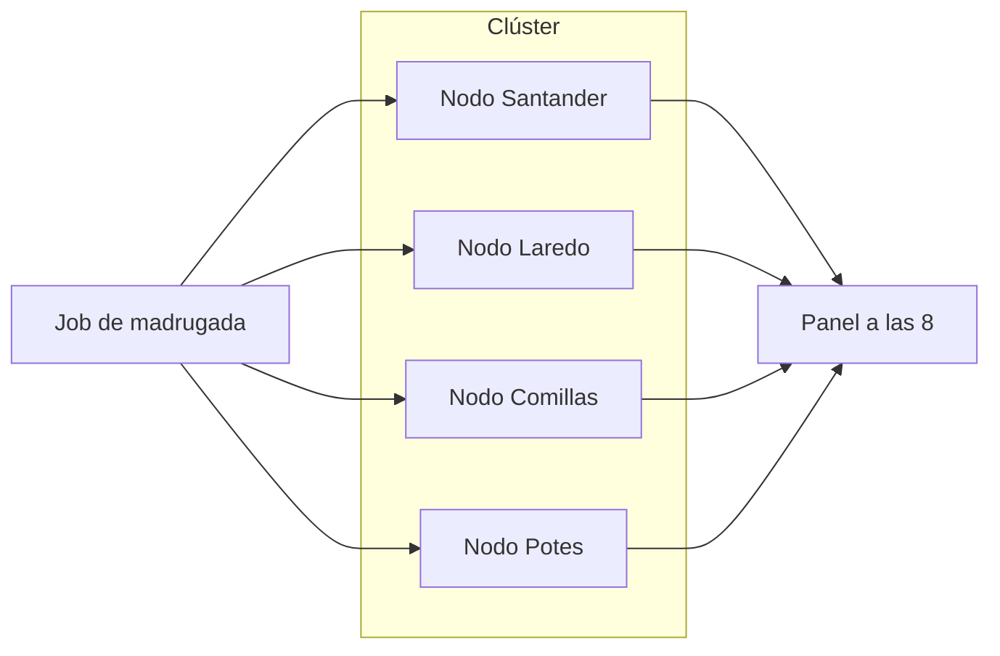

# 1.2. Clústeres de computadoras

## Vídeo: el informe del hotel entre varias máquinas

Sigue el cobro de Ana hasta el informe de las ocho para entender cómo colaboran los nodos de un clúster. La explicación recorre el reparto de tareas, las diferencias entre particiones y réplicas, la recuperación de fallos y los límites de añadir máquinas, con ejemplos paso a paso y pausas para asimilar las ideas. **Duración: 9 minutos y 55 segundos.**

<video controls playsinline preload="metadata" poster="../../assets/ut1/clusters-natural-portada.jpg" aria-label="Clústeres: el informe del hotel entre varias máquinas" style="width: 100%; max-width: 960px; height: auto; border-radius: 12px;">
  <source src="../../assets/ut1/clusters-natural.mp4" type="video/mp4">
  Tu navegador no permite reproducir este vídeo. Puedes descargarlo en el enlace siguiente.
</video>

El vídeo incluye subtítulos visibles y narración con voz sintética en español. Complementa las explicaciones y las actividades del apartado.

[Descargar el vídeo](../assets/ut1/clusters-natural.mp4) · [Leer la transcripción](../assets/ut1/clusters-natural.txt) · [Descargar los subtítulos](../assets/ut1/clusters-natural.es.srt)

## Del problema al reparto del trabajo

En 1.1 hemos identificado situaciones en las que el sistema disponible puede resultar insuficiente. En este apartado estudiamos cómo colaborarían varias máquinas. La decisión depende de una medida concreta: cuánto tarda el trabajo, cuánta memoria necesita o qué interrupción del servicio se puede aceptar. Tener cuatro hoteles, por sí solo, no demuestra que haga falta un clúster.

Supongamos que queremos sumar los cobros de un año. Podemos dividir los registros en cuatro conjuntos, calcular una suma parcial en cada nodo y sumar después los cuatro resultados. Para que funcione, cada registro debe entrar en un conjunto y las sumas deben usar las mismas reglas. Un programa coordinador asigna las tareas y comprueba su finalización. Si una tarea falla, debe poder repetirse sin contar dos veces sus resultados.

Hay dos decisiones diferentes: **particionar** reparte datos distintos entre nodos; **replicar** mantiene copias de los mismos datos. La primera ayuda a distribuir el volumen y el trabajo; la segunda permite recuperar datos o continuar el servicio ante ciertos fallos. Una réplica tampoco sustituye a una copia de seguridad: un borrado accidental puede propagarse a las réplicas.

Las propiedades que se explican a continuación describen objetivos distintos. Al terminar, debéis poder justificar si vuestro diseño busca reducir el tiempo de cálculo, mantener el servicio disponible o aumentar su capacidad. En 1.3 añadiremos otra decisión: cómo organizar los datos y qué garantías exigir al guardarlos.

Cuando una sola máquina no da más de sí, la tentación es “comprar el servidor más gordo del catálogo”. Eso funciona un tiempo (escalado **vertical**) y luego choca con un techo: precio, enchufe, lo que el fabricante vende.

Un **clúster** es otro planteamiento: varios ordenadores (**nodos**) unidos por **red** que se coordinan para un mismo trabajo. **No** son un único PC con mucha RAM: cada nodo tiene su CPU, su disco y su memoria. En Big Data es la pieza que permite crecer **añadiendo máquinas**, no solo agrandando *esa*.

Hoy se montan sobre **servidores normales** (no hace falta un *mainframe*) más un programa que **reparte** tareas y datos.

No lo confundáis con varios núcleos **dentro** de un portátil. Eso es paralelo en **una** máquina ([1.4](procesamiento.md){target="_blank" rel="noopener"}). El clúster son **varias** máquinas. Lo pondréis a prueba en la [tarea de los 500 GB](transicion-ut2.md){target="_blank" rel="noopener"}: el i7 no es un clúster.

En el [grupo hotelero](caso-hotel.md){target="_blank" rel="noopener"}: el PMS de Laredo cabe en un servidor. El job de madrugada (ocupación e importe de los cuatro hoteles) tiene que **acabar antes de las 8**. Si solo hincháis *esa* máquina, el techo llega pronto. Cuatro nodos (o más) parten el histórico; si se funde el disco de Potes, hace falta **réplica** para que el panel no se caiga.

Los nombres de nodo son **cómputo del histórico**, no la recepción de cada hotel. El PMS de Potes puede seguir en **un** servidor; el job de madrugada sí se parte.

## Qué ganáis (y qué significa cada cosa)

| Propiedad | En la práctica | En el hotel |
| --- | --- | --- |
| **Alto rendimiento** | Partís el trabajo y lo ejecutáis a la vez | El job de la noche termina **antes de las 8** *si* se puede trocear |
| **Alta disponibilidad** | Si un nodo cae, otro tiene réplica o asume el servicio | Se funde un disco en Potes: el panel **sigue** |
| **Equilibrio de carga** | No mandáis todo al mismo nodo | Laredo en agosto no se come el 100 % y Potes vacío |
| **Escalabilidad** | Añadís nodos cuando crece el dato | Abrís otro hotel sin reescribir el PMS |

Estas cuatro se apoyan entre sí. Un clúster “rápido” pero sin réplica es frágil. Uno muy replicado pero mal balanceado deja un nodo al 100 % y el resto de brazos cruzados.

### Alto rendimiento

El tiempo total incluye lectura, cálculo, comunicación y combinación de resultados. Si leer los datos consume la mayor parte del tiempo, añadir CPU apenas ayuda. Primero medimos el cuello de botella y después decidimos qué recurso aumentar.

Supongamos que un trabajo tarda 100 minutos: 20 corresponden a una fase que no podemos repartir y 80 a tareas independientes. Con cuatro trabajadores ideales, la segunda fase bajaría a 20 minutos; el total sería 40, antes de contar coordinación. El ejemplo explica por qué cuatro nodos no garantizan una aceleración de cuatro veces.

Cada nodo es un ordenador completo (CPU, RAM, disco). Si el trabajo se puede **trocear**, mandáis un trozo a cada uno y juntáis el resultado. Ocho nodos **no** convierten 8 horas en 1 hora por arte de magia: la red, el reparto y el trozo que no se puede partir se comen tiempo. A veces rinde como 6 o 7; a veces casi como 1.

La idea clásica es “llevar el cálculo al dato”: mejor mover una función pequeña que mover petabytes hacia una sola CPU. En Hadoop de libro el fichero **ya está** en el nodo que calcula. En la nube a menudo **no** (más abajo).

### Alta disponibilidad

La disponibilidad necesita mecanismos de detección y recuperación, además de copias. El sistema debe detectar que un nodo no responde, decidir qué componente asume su trabajo y evitar publicar resultados incompletos. Conviene que las réplicas no compartan todos los riesgos: dos copias en discos conectados a la misma fuente de alimentación pueden perderse juntas.

También se distingue entre mantener un servicio accesible y recuperar una tarea de cálculo. Una consulta puede continuar desde otra réplica; un cálculo interrumpido puede necesitar repetir una partición. En ambos casos importa cuánto tiempo de interrupción se admite.

Los nodos se vigilan. Si uno desaparece (luz, disco, red), el sistema puede:

- Rearrancar ese nodo o levantar otro.
- Seguir sirviendo desde una **réplica** (una copia **en marcha**, no un ZIP en un cajón).

Sin réplica, “varios ordenadores” solo es más potencia, no más seguridad. El job bien hecho **no publica** el panel a medias: o acaba, o se reintenta, o gerencia ve el de ayer.

### Equilibrio de carga

Repartir el mismo número de ficheros no garantiza repartir el mismo trabajo. Un fichero de Laredo puede contener diez veces más reservas que uno de Potes. Este reparto desigual se llama **sesgo de datos**: algunos trabajadores terminan pronto mientras otro retrasa el resultado final.

Una solución es dividir los datos en particiones de tamaño más parecido y asignar nuevas tareas a los nodos que van quedando libres. El reparto debe considerar también la ubicación de los datos, para no ahorrar tiempo de CPU a costa de transferir grandes volúmenes por la red.

Un mal balanceo es mandar todos los jobs al nodo que “siempre ha ido bien”. El algoritmo debería mirar:

- Lo grande que es el trabajo.
- Lo ocupado que está cada nodo.
- Lo potente que es cada nodo (no todos son iguales).

Si no, creáis un **cuello de botella**: la latencia media sube aunque el clúster “tenga máquinas libres”.

### Escalabilidad

La escalabilidad describe cómo cambia la capacidad cuando aumentamos los recursos. Se comprueba midiendo, por ejemplo, registros procesados por segundo con dos, cuatro y ocho nodos. Si duplicamos nodos y apenas mejora el resultado, puede existir una fase centralizada o un límite de red.

La **elasticidad** añade la posibilidad de ajustar recursos a la demanda: aumentar capacidad en temporada alta y reducirla después. Para aprovecharla, los datos deben seguir disponibles cuando se retiran máquinas de cálculo y las tareas deben poder redistribuirse.

No hace falta acertar el tamaño el día 1. Empezáis con lo que podéis pagar y crecéis. El volumen del hotel **no** se estima bien a priori: si os pasáis de pesimistas, habéis tirado el dinero; si os quedáis cortos, el job no llega a las 8.

Añadir nodos **no** convierte solo un Excel de finanzas en clúster: el programa del job tiene que **saber** partirse. El PMS de recepción puede seguir en **un** servidor.

## Escalado vertical y horizontal

| | Vertical (*scale-up*) | Horizontal (*scale-out*) |
| --- | --- | --- |
| Qué hacéis | Más CPU, RAM o disco **en la misma máquina** | **Más máquinas** en el clúster |
| Analogía | Un camión más grande | Más furgonetas (o más nodos-hotel) |
| Límite | El mejor hardware del catálogo (y su precio) | Red, coordinación, presupuesto de nodos |
| Típico en | El PMS o una base relacional en un solo servidor | Hadoop, almacenes repartidos, muchas NoSQL |

!!! warning "Cuidado con el nombre *scale-in*"
    En el material antiguo a veces se llamaba *scale-in* al vertical. En la jerga habitual:

    - **scale-up** = vertical (agrandar *una* máquina)
    - **scale-out** = horizontal (añadir máquinas)
    - **scale-in** = **quitar** nodos (reducir el clúster cuando sobra capacidad: noviembre en Laredo)

    En clase decimos **vertical** y **horizontal** y no hay duda.

El vertical **sigue existiendo** (un nodo de informes de mayor capacidad, un PMS más RAM). En Big Data **no basta solo** con eso: hay un techo de catálogo y un precio absurdo cerca de ese techo. El horizontal es el que encaja cuando el volumen no para de crecer.

## Cuándo un clúster no hace magia

Añadir nodos **no** acorta el tiempo de forma lineal si la tarea **no se puede partir**. Si cada paso depende del resultado del anterior, el segundo nodo está esperando al primero: tenéis más máquinas y el mismo cuello.

Eso se desarrolla en [1.4](procesamiento.md){target="_blank" rel="noopener"}. El clúster brilla cuando hay **independencia** entre trozos: sumar noches por hotel, procesar ficheros distintos, consultas que el motor puede repartir.

También hay coste de **coordinación**: la red, quien reparte, el momento de juntar resultados.

## El cálculo y el disco no tienen por qué ir juntos

El Hadoop “de libro” **pegaba** el fichero al nodo que lo procesaba (“lleva el cálculo al dato”). En la nube suele ser al revés: los datos viven en un **cubo de objetos** (un almacén de ficheros en red; el detalle en [1.3](almacenamiento.md){target="_blank" rel="noopener"}) y el clúster de cálculo **crece o se apaga** por su cuenta. Ganáis réplica y disco barato; pagáis red.

Las dos frases no se pisan: son **dos diseños**. Clúster clásico = dato y CPU en el mismo nodo. Nube = dato en el cubo, CPU donde haga falta.

## Relación con el RA1

Diseñar el almacenamiento masivo implica **varias** decisiones, no una sola:

- ¿Hace falta un **clúster** (el dato ya no cabe o no llega a tiempo en una máquina)?
- Eso **no** sustituye a “el cobro no puede verse a medias”: esa garantía (ACID) es de [1.3](almacenamiento.md){target="_blank" rel="noopener"}. El PMS puede seguir en un servidor; el histórico, en el clúster.
- Cómo **ingieres** (un destino o muchos nodos) y qué **formato** usas (que se pueda trocear) vienen después.

Caracterizar *si* hace falta repartir, y *qué* pasa si un nodo cae a mitad del job, es el criterio **a)**.

## Actividad

No puntúa en Moodle. Una línea de por qué.

1. Finanzas pide **más RAM** en el servidor del PMS porque agosto se atasca al picar. ¿Vertical u horizontal?
2. El job de ocupación no llega a las 8. Añadís **dos máquinas** que ya tienen copia del histórico. ¿Vertical u horizontal?
3. En noviembre apagáis dos nodos porque sobran. ¿Eso es *scale-out* o *scale-in*?
4. Se funde el disco de Potes y el panel de las 8 **sigue**. ¿Rendimiento, disponibilidad, equilibrio o escalabilidad?

!!! tip "Comprobación"
    Vertical / horizontal / *scale-in* (quitar, no crecer) / alta disponibilidad (réplica).

## Autoevaluación del 1.2

Diez preguntas (A–D, **una** correcta) sobre los conceptos del apartado. No puntúan en Moodle. En **cada** una, **Comprobar respuesta**: si es correcta o no, y una explicación breve. Podéis repetir el test.

