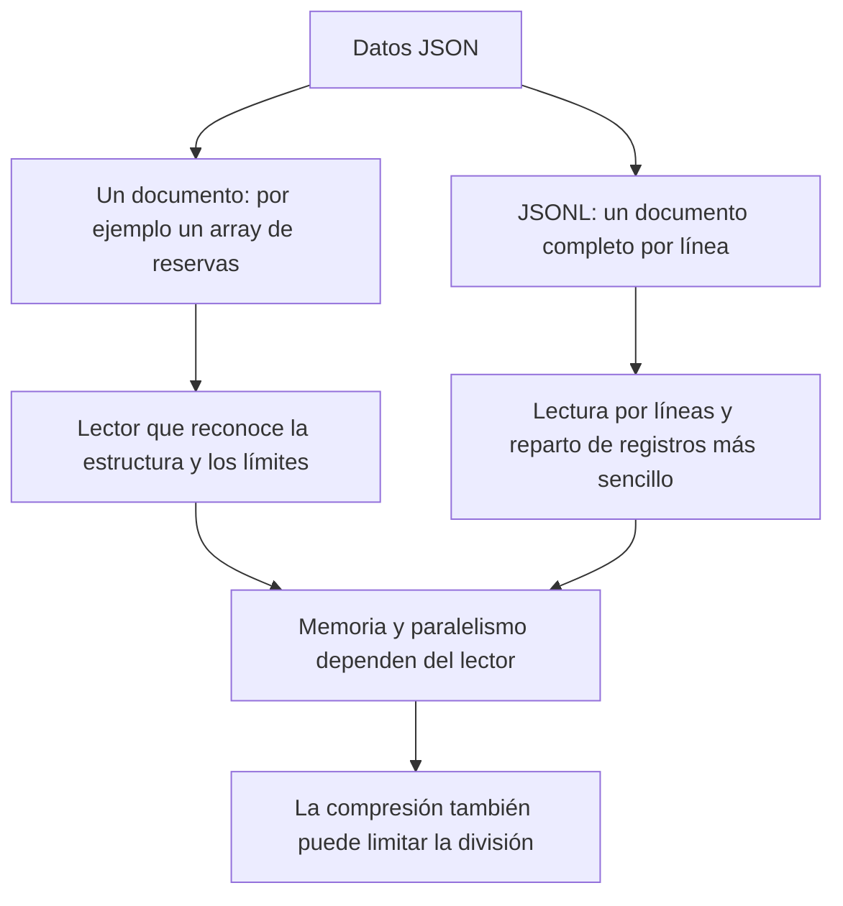
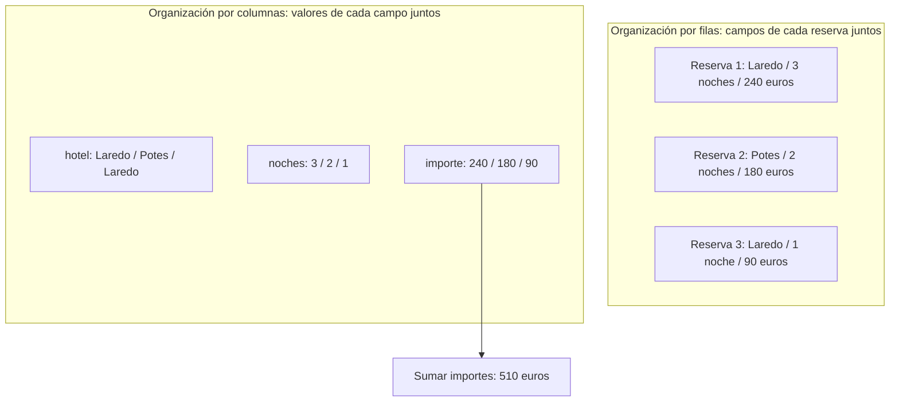

# 1.7. Formatos de datos

!!! info "Ruta de estudio"
    **Esencial:** elegir formato según tipos, consultas y consumidores; distinguir archivos, tablas y motores.

    **Práctica guiada:** generar los datos y comprobar que las conversiones conservan filas, nulos y valores.

    **Práctica guiada evaluable:** el taller medido compara tamaño, tipos, resultados y tiempos en el entorno local; se valora el procedimiento y la interpretación, no conseguir una marca de velocidad. **Ampliación:** HDFS y Delta requieren otro entorno. No sustituye al recorrido común; su detalle adicional solo se exige si el profesor lo anuncia antes (véase [cómo trabajar la unidad](index.md#como-trabajar-la-unidad)).

## Vídeo: la reserva de Ana cambia de formato

Sigue la reserva de Ana para comprender cómo elegimos la representación de los datos al intercambiarlos, conservarlos, calcular y mantener el histórico. El recorrido distingue Avro, Arrow y Parquet, explica las lecturas por filas y por columnas y muestra cómo comparar formatos sin perder datos. **Duración: 14 minutos y 58 segundos.**

<video controls playsinline preload="metadata" poster="../../assets/ut1/formatos-natural-portada.jpg" aria-label="Formatos de datos: la reserva de Ana cambia de formato" style="width: 100%; max-width: 960px; height: auto; border-radius: 12px;">
  <source src="../../assets/ut1/formatos-natural.mp4" type="video/mp4">
  Tu navegador no permite reproducir este vídeo. Puedes descargarlo en el enlace siguiente.
</video>

El vídeo incluye subtítulos visibles y narración con voz sintética en español. Complementa las explicaciones y las prácticas del apartado.

[Descargar el vídeo](../assets/ut1/formatos-natural.mp4) · [Leer la transcripción](../assets/ut1/formatos-natural.txt) · [Descargar los subtítulos](../assets/ut1/formatos-natural.es.srt)

## Del dato lógico a su representación

En 1.6 hemos definido qué datos entran, cómo se transforman y dónde terminan. Ahora decidimos cómo representarlos para que puedan intercambiarse y leerse con eficiencia. Una misma tabla de reservas puede escribirse en CSV o Parquet y mantener los mismos valores, aunque cambien el tamaño, los tipos conservados y la forma de lectura.

Conviene distinguir tres ideas: el **esquema** describe campos y tipos; el **formato** define cómo se representan; la **compresión** reduce el espacio mediante una codificación adicional. Comprimir un CSV no lo convierte en un formato columnar ni añade automáticamente tipos de datos.

Si necesitamos recuperar una reserva completa, una organización por filas puede ser adecuada. Si queremos sumar únicamente el importe de millones de reservas, una organización por columnas permite leer menos campos. La ventaja depende de la consulta y del lector empleado: no basta con cambiar la extensión.

Los talleres comparan formatos de intercambio y almacenamiento, y presentan Arrow para trabajar en memoria. Anotad en cada prueba qué datos se mantienen, qué tamaño ocupa el resultado y qué consulta se ejecuta. En 1.8 aplicaremos la lectura, transformación y escritura mediante Pentaho.


El criterio **c)** es este: **en qué forma dejáis el dato** para que el siguiente paso pueda procesarlo de forma adecuada. No es una moda. Es una decisión de diseño, igual que elegir lago o warehouse.

!!! info "Cómo se lee esta página"
    Seguimos una pregunta: **¿cómo guardamos y recuperamos las reservas sin perder información, y qué representación conviene para cada uso?** Primero creamos una tabla de referencia. Aprendemos Avro con dos reservas fáciles de inspeccionar y después lo aplicamos a las reservas de Laredo del conjunto grande. Con Arrow y Parquet repetimos el paso de ejemplo pequeño a consulta del conjunto completo. Finalmente comparamos formatos con datos equivalentes. ORC completa la comparación; los formatos de tabla y HDFS se presentan como ampliación.

    Ejecutad las celdas en orden en un mismo cuaderno. Cada taller indicará su entrada, su salida y una comprobación. Que una celda no muestre errores no basta: leeremos lo escrito y lo compararemos con su referencia.

## Un caso para no perderse

El [grupo hotelero de Cantabria](caso-hotel.md){target="_blank" rel="noopener"} (Santander, Laredo, Comillas, Potes) guarda cada reserva con **muchas** columnas en el PMS. Gerencia, a las **8**, solo quiere *ocupación e importe por hotel*. Si el fichero es un CSV de gran tamaño, el motor **lee todas las columnas** para calcular tres números. En cloud, a menudo **pagáis por lo que escaneáis**, no solo por lo que guardáis.

Esa es la pregunta del apartado: ¿el dato viaja **fila a fila** (bien para *esta* reserva en un mensaje o en el PMS) o **campo a campo** (bien para el panel)? ¿Hace falta que un humano lo abra, o que Spark lo **trocee** entre nodos?

Las prácticas **no dependen de un CSV ajeno**. Generáis el dataset en el cuaderno (Jupyter o un [Colab](https://colab.research.google.com/){target="_blank" rel="noopener"} en blanco). Esquema Avro: [reserva.avsc](../assets/practicas/reserva.avsc){target="_blank" rel="noopener"}. **Noja** es el “mañana abre otro”, no un quinto hotel del esqueleto. Este `reservas.csv` **no** es el de [Hola ETL](ingesta.md){target="_blank" rel="noopener"} (allí había cobros).

Antes de ejecutar los ejemplos, preparad las bibliotecas en una celda de Colab o Jupyter:

```python
%pip install numpy "pandas==2.3.3" avro fastavro pyarrow duckdb
```

Fijamos pandas 2.3.3 para reproducir el contrato de tipos de este taller, que utiliza `object` para el texto. Otras versiones pueden recuperar el mismo texto como `str`/`StringDtype`: una diferencia de representación no demuestra pérdida de valores. Para seguir estas comprobaciones sin adaptar el contrato, utilizad la versión indicada y anotad las versiones de las demás bibliotecas.

En una terminal se utiliza `pip install` sin `%`. Tras instalar o cambiar la versión de pandas, reiniciad el entorno de ejecución de Colab/Jupyter antes de continuar, para que no conserve una versión importada previamente. Después ejecutad las celdas de datos en orden. Las instalaciones que aparecen después recuerdan qué biblioteca corresponde a cada formato; no es necesario repetirlas si ya está instalada.

**Entrada:** datos sintéticos generados aquí, no una descarga de reservas reales. **Salida:** `df`, una tabla de pandas en memoria con 200.000 filas y ocho columnas, y `reservas.csv`, una copia de esa tabla en disco. Guardar el CSV no elimina `df`; los talleres posteriores pueden utilizarlo sin volver a leer el archivo.

```python
import numpy as np
import pandas as pd

rng = np.random.default_rng(2026)
n = 200_000
hoteles = ["Santander", "Laredo", "Comillas", "Potes", "Noja"]
df = pd.DataFrame({
    "id_reserva": np.arange(n, dtype="int32"),
    "entrada": pd.date_range("2024-01-01", periods=n, freq="min").astype(str),
    "hotel": rng.choice(hoteles, n),
    "noches": rng.integers(1, 8, n, dtype="int32"),
    "importe": rng.uniform(48, 420, n).round(2),
    "canal": rng.choice(["web", "ota", "recepcion"], n),
    "regimen": rng.choice(["SA", "AD", "MP"], n),
    "comentarios": rng.choice(["ok", "vista mar", ""], n),
})
# Contrato del taller: enteros int32, importe float64 y texto como object.
# entrada se conserva como texto; no se interpreta como datetime al leer.
TIPOS = {
    "id_reserva": "int32", "entrada": "object", "hotel": "object",
    "noches": "int32", "importe": "float64", "canal": "object",
    "regimen": "object", "comentarios": "object",
}
df = df.astype(TIPOS)
df.to_csv("reservas.csv", index=False, encoding="utf-8")
```

El generador contiene cadenas vacías (`""`) en `comentarios`, pero no valores nulos. Son estados distintos: una cadena vacía es un texto de longitud cero; un nulo indica ausencia de valor. Para recuperar estos datos desde CSV, utilizad el [contrato de lectura del taller medido](#contrato-csv-del-taller), sin dejar los tipos y los nulos a la inferencia.

Con `n = 200_000` ya notáis tamaño y tiempo. Subid a un millón si la máquina lo aguanta. `regimen` y `comentarios` están para que veáis **lo que el informe no debe leer**.

Antes de continuar, observad la referencia:

```python
print("Filas y columnas:", df.shape)
print(df.head())
print("Nulos por columna:\n", df.isna().sum())
assert df.shape == (n, 8)
assert not df.isna().any().any()
```

Con el valor inicial de `n`, deben aparecer 200.000 filas, ocho columnas y cero nulos. No confundáis las cinco filas de `head()` con el tamaño total. Conservad `df` sin sobrescribirlo: será nuestra referencia para comprobar las conversiones.

| Paso | Datos utilizados | Qué queremos comprobar |
| --- | --- | --- |
| Talleres 1 y 2 | Dos reservas escritas a mano, independientes de `df` | Cómo funcionan el esquema Avro y un importe ausente |
| Taller 3 | Todas las filas de Laredo de `df`, con cinco columnas | Guardar y recuperar una selección sin cambiar sus valores |
| Arrow y talleres 4 y 5 | Un ejemplo de dos reservas, con tres campos | Representación en memoria y conservación al escribir Parquet |
| Taller 6, DuckDB, Feather y ORC | El conjunto grande `df` | Guardar, recuperar y consultar datos de la referencia común |
| Taller medido | Conjunto completo y, por separado, selección de Laredo | Comparar tamaños y tiempos después de validar los resultados |

Los ejemplos pequeños sirven para entender el mecanismo. No compararemos sus tamaños con los archivos de 200.000 filas.

## Qué tiene que cumplir el formato

Para evaluar un formato distinguimos **legibilidad**, **tipos**, **evolución del esquema** y **acceso parcial**. Un fichero fácil de abrir a mano puede requerir más trabajo para interpretar números y fechas. Un formato binario puede conservar esa información y permitir al lector omitir partes, pero necesita herramientas compatibles.

La posibilidad de repartir una lectura depende también del lector y de la compresión. JSONL facilita localizar límites entre registros. Un array JSON puede requerir un tratamiento especial para repartirse; no significa que todo fichero JSON obligue siempre a cargarlo completo en memoria.

Para que un clúster (Hadoop, Spark) o un almacén en la nube pueda **repartir** el trabajo, el fichero tiene que dejarse **cortar en trozos**. Un array JSON grande resulta menos sencillo de repartir entre lectores independientes; hay que comprobar si el motor admite lectura incremental o división de ese formato.

Además suele pedirse:

| Exigencia | En castellano |
| --- | --- |
| Independiente del lenguaje | Lo escribe Java y lo lee Python |
| Expresivo | Nulos de verdad, anidados, un número no es el texto `"10"` |
| Compacto | Pocos bytes y poca CPU al leer |
| Que pueda crecer | Añadir un campo sin reescribir cinco años de histórico |
| Autónomo | El fichero lleva cómo interpretarlo (el esquema) |
| Comprimible | Snappy, gzip, zstd… a cambio de CPU |

Distinguimos representaciones de texto y binarias, sin asignarlas a destinos exclusivos:

| | Formatos de texto | Formatos binarios |
| --- | --- | --- |
| Ejemplos | CSV, JSON, XML | Avro, Parquet, ORC |
| Inspección | Se pueden inspeccionar con un editor de texto | Requieren un lector compatible |
| Tamaño | Depende del contenido y de la compresión | La codificación puede reducirlo; hay que medirlo |
| Esquema | Requieren acuerdos de tipos y estructura; pueden acompañarse de un esquema externo | Los archivos contenedores de estos ejemplos incluyen información de esquema |
| Usos habituales | Intercambio, API o conservación de originales | Intercambio de registros o consultas analíticas, según el formato |

Un lago puede conservar tanto CSV, JSON y XML como Avro, Parquet y ORC. Elegimos según el contrato de datos, el lector y el trabajo que necesitamos realizar; ser texto o binario no determina el destino.

**CSV.** Universal. `01` ¿texto o número? Una coma dentro de un campo requiere entrecomillado y escape correctos. Para sumar *importe* soléis arrastrar *canal* y *comentarios*.

**JSON / JSONL.** El JSON “de libro” (un objeto enorme) no se parte bien. **JSON Lines** = **una reserva por línea**:

```json
{"id_reserva": 1, "hotel": "Laredo", "noches": 3, "importe": 186.5}
{"id_reserva": 2, "hotel": "Potes", "noches": 2, "importe": null}
```

`null` es JSON. `None` es **Python**. Mezclarlos tumba el parser.



JSONL delimita cada registro por una línea. Un array JSON también puede leerse incrementalmente con un lector adecuado; no obliga a cargarlo entero en RAM.

**XML.** Sigue en facturas y administraciones. Más verboso; misma duda: ¿se puede trocear?

## Una reserva junta o un campo junto

La organización por filas favorece leer muchos campos de cada registro. Sin embargo, un fichero CSV no tiene por defecto un índice que localice directamente la reserva 17: puede ser necesario recorrerlo. La organización columnar favorece seleccionar pocas columnas de muchos registros.

En Parquet, un **grupo de filas** contiene fragmentos separados por columna. El lector puede seleccionar columnas y, con estadísticas apropiadas, descartar grupos incompatibles con un filtro. Además, particionar el conjunto por fecha puede evitar abrir archivos de otros periodos. Selección de columnas, descarte por estadísticas y particionado son optimizaciones distintas.

Estas son las **mismas tres reservas** representadas de dos formas. La agrupación muestra qué valores se mantienen juntos conceptualmente; no reproduce la codificación binaria de un formato.



Para reconstruir una reserva hacen falta sus campos. Para sumar importes de muchas reservas, una lectura columnar puede seleccionar la columna `importe` y evitar leer las demás. El resultado debe ser el mismo: cambia el trabajo de lectura, no el significado de los datos.

Pensad en mil reservas `hotel | noches | importe | comentarios`.

**Todo el registro junto** (CSV, JSON; **Avro** en un bus): reconstruir los campos de un registro es directo una vez localizado. Sumar *solo* importes obliga a saltar el resto mil veces. **Añadir** reservas al final es natural.

Eso **no** convierte Avro en el PMS. Recibir el cobro en recepción es la tabla del [1.3](almacenamiento.md){target="_blank" rel="noopener"} (ACID). Avro es el **mensaje** (Kafka): también va por filas, con esquema.

**Cada campo en su sitio** (Parquet, ORC): los importes van juntos. El panel de las **8** lee **una** racha. Reconstruir la reserva 17 cruza trozos. Cambiar *una* fila duele. Por eso se **parte** por fecha o por hotel. Encaja en el cuadro de mando; **no** como almacén de la caja ([operar frente a analizar](procesamiento.md){target="_blank" rel="noopener"}).

!!! example "A las 8 no hace falta el comentario"
    Agregar es resumir. “Importe medio en Laredo” no lee `comentarios`. Columnar + partición `hotel=Laredo` = menos disco, menos factura.

Un archivo columnar comprimido puede ocupar menos que el texto original y permitir leer menos campos. No aplicamos una proporción universal: medimos tamaño, consulta y compresión con nuestros datos. Elegir mal el formato de la [carga](ingesta.md) puede aumentar el trabajo de cada consulta.

## Comprimir no es gratis

Gzip utiliza Deflate, pero no son nombres de archivo o contenedores intercambiables. En Avro, `codec="deflate"` no genera un archivo `.gz`. La tabla orienta: verificad el códec admitido por el escritor y medid el resultado; las etiquetas de velocidad y ahorro no son garantías.

El algoritmo busca **repeticiones** (`Laredo, Laredo, Laredo…`) y las recodifica. Viaja menos por la red. A cambio, la CPU **aprieta y destapa**. La reducción depende del contenido: texto repetitivo y datos ya comprimidos pueden responder de forma muy diferente. En Big Data suele ganar el que es **rápido**, no el que más aprieta.

| Códec | Velocidad | Ahorro | Típico en |
| --- | --- | --- | --- |
| Deflate / Gzip | Depende del nivel y los datos | Depende del contenido | Deflate en Avro; Gzip en Parquet, según el lector |
| Bzip2 | Lenta | Alto | Archivado |
| Snappy | Alta | Medio | Avro, Parquet, ORC |
| Zstandard (zstd) | Alta | Alto | Parquet reciente |

En el Taller 6 escribiremos también una variante Parquet con Zstandard usando `compression="zstd"`. Así comprobaremos primero los valores y después mediremos cuánto ocupa. Aquí basta con entender la decisión; todavía no creamos otro archivo.

```bash
pip install python-snappy   # si usáis Snappy con Avro
```

No memoricéis megas de un recorte ajeno. **Medid el vuestro** al final del taller.

## Avro: el mensaje que se explica solo

Hasta aquí tenemos reservas en una tabla de pandas y una copia CSV. Imaginad ahora que recepción quiere entregar registros a otro programa: ese programa necesita saber qué campos recibe, cuáles son números y si un importe puede faltar. En CSV podemos acordarlo mediante un contrato externo, como haremos al final. **Avro ofrece otra forma de representar esos registros con un esquema explícito.**

[Avro](https://avro.apache.org/){target="_blank" rel="noopener"} es un sistema de serialización: convierte registros en bytes y permite reconstruirlos con un lector compatible. En estos talleres utilizaremos su formato de **archivo contenedor binario**, organizado por registros. No se inspecciona como un CSV en un editor de texto; lo leeremos con Python.

El **esquema** describe los campos y sus tipos. Es parecido a una ficha que dice «cada reserva tiene identificador entero, hotel de texto, noches enteras e importe numérico o ausente». El archivo contenedor guarda ese esquema en su cabecera. El esquema no contiene las reservas: describe cómo interpretarlas.

| Elemento del ejemplo | Qué representa |
| --- | --- |
| `reserva.avsc` | Un archivo de texto JSON con el esquema de las dos reservas de prueba |
| `reservas.avro` | Un archivo binario con el esquema y los registros escritos en el Taller 1 |
| `avro` / `fastavro` | Dos bibliotecas de Python capaces de leer y escribir Avro; no son dos formatos distintos |

¿Por qué lo estudiamos ahora? Porque permite comprender el intercambio de registros tipados antes de pasar a las consultas por columnas. Puede utilizarse en archivos y en mensajería, por ejemplo con [Kafka](ingesta.md){target="_blank" rel="noopener"}; **aquí no instalamos Kafka ni simulamos un PMS: escribimos y leemos archivos locales**. En mensajería puede utilizarse un identificador y un registro externo de esquemas, por lo que no todos los mensajes llevan la cabecera de un archivo contenedor.

Avro también establece reglas para que lectores y escritores puedan trabajar con versiones de esquema compatibles. Esa compatibilidad debe comprobarse; añadir cualquier campo no garantiza que cualquier lector antiguo lo entienda. Guía: [Getting started (Python)](https://avro.apache.org/docs/1.11.1/getting-started-python/){target="_blank" rel="noopener"}.

Ahora dejamos temporalmente `df` y `reservas.csv`. Empezamos con dos reservas manuales para poder ver todos sus campos y un nulo. En el Taller 3 volveremos al conjunto grande.

!!! tip "Orden de los talleres"
    1–2: Avro con nulos. 3: del `df` a Avro; forma parte de la práctica guiada y prepara `laredo.avro`, necesario para el taller medido. 4–6: Parquet; el 6 filtra **al leer**. DuckDB: preguntar sin tragarse el fichero. Luego el [taller medido](#taller-medido-lo-que-se-examina){target="_blank" rel="noopener"}.

Tipos simples: `null`, `boolean`, `int`, `long`, `float`, `double`, `bytes`, `string`.  
Compuestos: `record`, `enum`, `array`, `map`, `union`, `fixed`.

Utilizaremos `avro` y [fastavro](https://github.com/fastavro/fastavro){target="_blank" rel="noopener"}. No instaléis el antiguo paquete `avro-python3`. Cambiar de biblioteca mantiene el formato; cualquier ventaja de rendimiento debe medirse.

```bash
pip install avro fastavro
```

### Taller 1 — Una reserva con hueco

**Objetivo:** escribir dos registros y recuperarlos con sus tipos. Primero se lee el esquema; después se abre un escritor binario y se añaden registros. Cerrar el escritor completa el archivo. Finalmente, el lector reconstruye los registros y permite inspeccionar el esquema utilizado.

**Comprobación:** deben recuperarse dos reservas. La primera conserva el importe 186,5; la segunda tiene importe nulo. El nulo no significa que la estancia sea gratuita. Si cambiáis `noches` por un texto incompatible con el esquema, la escritura debe rechazarlo.

**Entrada:** dos reservas manuales y el esquema [reserva.avsc](../assets/practicas/reserva.avsc){target="_blank" rel="noopener"}. Descargadlo en la carpeta de trabajo del cuaderno; en Colab, subidlo desde el panel de archivos. **Salida:** `reservas.avro`, con dos registros, no con los datos de `reservas.csv`.

Abrid el esquema como texto antes de ejecutar el código. `record` describe un registro; `fields` enumera sus campos. En `importe`, `["null", "float"]` admite ausencia o un número, y `default: null` declara un valor por defecto para la resolución de esquemas. En este ejemplo las bibliotecas utilizadas aceptan omitir ese campo al escribir y lo representan como nulo. No interpretéis un valor por defecto como permiso universal para omitir campos en cualquier escritor o esquema.

El recorrido será **esquema → escribir registros → cerrar archivo → volver a leer → comparar**. Los modos `wb` y `rb` significan escritura y lectura binarias.

```python
import copy
import json

import avro.schema
from avro.datafile import DataFileReader, DataFileWriter
from avro.io import DatumReader, DatumWriter

with open("reserva.avsc", encoding="utf-8") as f:
    esquema_avro_pequeno = avro.schema.parse(f.read())

with open("reservas.avro", "wb") as f:
    w = DataFileWriter(f, DatumWriter(), esquema_avro_pequeno)
    w.append({"id_reserva": 1, "hotel": "Laredo", "noches": 3, "importe": 186.5})
    w.append({"id_reserva": 2, "hotel": "Potes", "noches": 2})
    w.close()

with open("reservas.avro", "rb") as f:
    r = DataFileReader(f, DatumReader())
    meta = copy.deepcopy(r.meta)
    print(json.loads(meta["avro.schema"]))
    recuperadas_avro = list(r)
    print(recuperadas_avro)
    r.close()
```

En pantalla veréis `importe: None`: eso es Python. En el fichero el nulo es Avro. Comprobad también los valores, no solo que el archivo exista:

```python
esperadas_pequenas = [
    {"id_reserva": 1, "hotel": "Laredo", "noches": 3, "importe": 186.5},
    {"id_reserva": 2, "hotel": "Potes", "noches": 2, "importe": None},
]
assert recuperadas_avro == esperadas_pequenas
print("Taller 1: dos reservas recuperadas; se conserva el importe ausente.")
```

`assert` comprueba una condición: si no se cumple, detiene la celda con un error. Investigad la diferencia antes de seguir. Hasta aquí no se ha convertido ni cambiado el CSV grande.

<span id="taller-2-lo-mismo-mas-rapido-fastavro"></span>

### Taller 2 — Mismas reservas con otra biblioteca (fastavro)

**Entrada:** las mismas dos reservas y el mismo archivo de esquema del Taller 1. **Salida:** `reservas_fa.avro`. Este taller conserva el objetivo y cambia la biblioteca. Comparad los registros leídos de ambos archivos, no sus bytes: dos escritores pueden producir archivos diferentes que representan los mismos datos. La ventaja de rendimiento debe medirse para vuestro volumen y entorno; con dos registros apenas es representativa.

```python
import json
import fastavro

with open("reserva.avsc", "rb") as f:
    esquema_fastavro_pequeno = fastavro.parse_schema(json.load(f))

filas_pequenas = [
    {"id_reserva": 1, "hotel": "Laredo", "noches": 3, "importe": 186.5},
    {"id_reserva": 2, "hotel": "Potes", "noches": 2},
]
with open("reservas_fa.avro", "wb") as f:
    fastavro.writer(f, esquema_fastavro_pequeno, filas_pequenas)

with open("reservas_fa.avro", "rb") as f:
    recuperadas_fastavro = list(fastavro.reader(f))

assert recuperadas_fastavro == recuperadas_avro == esperadas_pequenas
print("Taller 2: ambas bibliotecas recuperan las mismas reservas y el mismo nulo.")
```

### Taller 3 — Del DataFrame al Avro

Ahora volvemos a `df`, la tabla de 200.000 reservas del principio. Supongamos que otro programa solo necesita las reservas de Laredo y cinco campos de cada una. **Entrada:** ese subconjunto de `df`. **Salida:** `laredo.avro`, con todas las reservas seleccionadas, no una única reserva.

Este taller enlaza el ejemplo pequeño con los datos de referencia. Primero filtramos **filas** por hotel y después seleccionamos **columnas**. Las columnas excluidas no se convierten en nulos: simplemente no se incluyen en el archivo. Sus valores siguen en `df`, que no modificamos.

El esquema también cambia: incorpora `canal`, usa `double` para conservar la representación de `importe` del conjunto grande y no admite nulos, porque el generador no los produce. No reutilizamos el esquema de cuatro campos de los talleres 1–2. Este cambio prepara otro archivo; no es una demostración de compatibilidad entre lectores de versiones distintas.

El ejemplo utiliza números en coma flotante con fines didácticos. Para importes contables se debe acordar una representación decimal exacta o unidades enteras, como céntimos. Cambiar el formato no elimina los errores de redondeo de una representación numérica inadecuada.

**Paso 1. Preparar e inspeccionar la selección.** Ejecutad el generador si no existe `df`. Separar el filtro de la selección de columnas permite ver qué hace cada operación:

```python
columnas_laredo = ["id_reserva", "hotel", "noches", "importe", "canal"]
reservas_laredo = df.loc[df["hotel"] == "Laredo"]
laredo = reservas_laredo.loc[:, columnas_laredo].copy()
print("Filas originales:", len(df), "Filas de Laredo:", len(laredo))
print(laredo.head())
print("Nulos por columna:\n", laredo.isna().sum())
assert len(laredo) == df["hotel"].eq("Laredo").sum()
assert not laredo.isna().any().any()
```

No fijamos a mano el número de reservas de Laredo: lo obtenemos del conjunto generado. Deben conservarse sus noches, importes y canales.

**Paso 2. Definir el esquema y escribir.** `to_dict("records")` crea un diccionario por fila. Las conversiones explícitas preparan tipos de Python para el escritor; no rellenan campos con nulos. Usamos `deflate` para comprimir los bloques del archivo.

```python
from fastavro import parse_schema, writer

esquema_avro_laredo = parse_schema({
    "name": "Reserva",
    "namespace": "bda.ut1",
    "type": "record",
    "fields": [
        {"name": "id_reserva", "type": "int"},
        {"name": "hotel", "type": "string"},
        {"name": "noches", "type": "int"},
        {"name": "importe", "type": "double"},
        {"name": "canal", "type": "string"},
    ],
})
# Convertimos explícitamente a tipos de Python compatibles con el esquema
filas_laredo = [
    {
        "id_reserva": int(fila["id_reserva"]),
        "hotel": str(fila["hotel"]),
        "noches": int(fila["noches"]),
        "importe": float(fila["importe"]),
        "canal": str(fila["canal"]),
    }
    for fila in laredo.to_dict("records")
]
with open("laredo.avro", "wb") as f:
    writer(f, esquema_avro_laredo, filas_laredo, codec="deflate")
```

**Paso 3. Recuperar y contrastar.** El escritor ya ha cerrado el archivo; ahora comprobamos todos los registros y valores:

```python
from fastavro import reader

with open("laredo.avro", "rb") as f:
    recuperadas_laredo = list(reader(f))
assert len(recuperadas_laredo) == len(laredo)
assert recuperadas_laredo == filas_laredo
print("Taller 3:", len(recuperadas_laredo), "reservas de Laredo conservadas.")
```

La lectura devuelve diccionarios con tipos de Python, no columnas pandas con `dtype`. La igualdad comprueba contenido y orden; el esquema del archivo declara los tipos Avro. Para comparar después tamaño o tiempo, generaremos CSV y Parquet desde **este mismo `laredo`**, no desde las 200.000 filas completas.

Si algún día lo escribís en HDFS, cambiad el host por el de **vuestro** lab; el patrón es el de la librería `hdfs` (`InsecureClient` + `AvroWriter`). No copiéis un nombre de máquina de otro ciclo.

## Arrow: el dato *en la RAM*

Ya sabemos guardar registros con Avro. Para preparar las consultas analíticas necesitamos introducir otra pieza: **cómo representa una tabla el programa en memoria**. Aquí aparece Arrow, cuyo nombre se parece a Avro pero cumple otra función. Usaremos dos reservas con tres campos, retomando el ejemplo de Laredo y Potes y el importe ausente. No estamos leyendo `laredo.avro` ni sustituyendo `df`.

El formato en disco responde a cómo conservar y leer bytes; la representación en memoria responde a cómo trabaja el programa con los valores ya disponibles. Arrow organiza columnas con tipos y una representación explícita de los nulos. Esa disposición facilita intercambios entre herramientas compatibles.

La ausencia de copias no está garantizada en todas las conversiones: cambiar tipos o transformar a estructuras incompatibles puede requerir memoria adicional. En el ejemplo, la segunda fila conserva un importe nulo, y eso debe seguir siendo cierto tras convertir o escribir la tabla.

[Parquet](https://parquet.apache.org/){target="_blank" rel="noopener"}, [Avro](https://avro.apache.org/){target="_blank" rel="noopener"} y [ORC](https://orc.apache.org/){target="_blank" rel="noopener"} viven en **disco**. **[Arrow](https://arrow.apache.org/){target="_blank" rel="noopener"}** describe columnas **en memoria** para facilitar que herramientas compatibles compartan buffers sin copiarlos (*zero-copy*) cuando los tipos y la operación lo permiten y el procesador calcule en bloque. Docs: [PyArrow](https://arrow.apache.org/docs/python/){target="_blank" rel="noopener"}. Arrow **no** es Avro.

```bash
pip install pyarrow
```

```python
import pyarrow as pa

esquema_arrow_pequeno = pa.schema([
    ("hotel", pa.string()),
    ("noches", pa.int32()),
    ("importe", pa.float32()),
])
tabla_pequena = pa.Table.from_pydict(
    {"hotel": ["Laredo", "Potes"], "noches": [3, 2], "importe": [186.5, None]},
    schema=esquema_arrow_pequeno,
)
print(tabla_pequena)
assert tabla_pequena.num_rows == 2
assert tabla_pequena.column("importe").null_count == 1
```

En pandas, `engine="pyarrow"` selecciona el lector CSV y `dtype_backend="pyarrow"` selecciona los tipos de las columnas resultantes. Son opciones distintas. Por ejemplo: `pd.read_csv("reservas.csv", engine="pyarrow", dtype_backend="pyarrow")`. Comparad compatibilidad, tipos, nulos y tiempo antes de afirmar que una opción mejora la otra. Esta llamada ilustra las opciones del lector; no sustituye el [contrato CSV del taller](#contrato-csv-del-taller). Si probáis otro motor o backend, verificad qué opciones admite y documentad las diferencias de representación antes de comparar.

**Para conservar en disco una tabla representada con Arrow**, podemos utilizar Feather. Volvemos aquí al `df` completo: **Feather** utiliza Arrow IPC para persistir e intercambiar tablas. Es útil entre pasos de trabajo compatibles. Para el lago de esta unidad elegimos Parquet por su encaje con las consultas y herramientas previstas; Feather no está limitado a dos celdas de un cuaderno.

```python
import pyarrow.feather as feather

feather.write_feather(df, "reservas.feather")
recuperado_feather = feather.read_feather("reservas.feather")
pd.testing.assert_frame_equal(df, recuperado_feather, check_exact=True)
print("Feather: conservadas las filas, columnas, tipos y valores de df.")
```

!!! tip "Dos sitios, dos ficheros"
    Feather = “se lo paso al script de al lado”. Parquet = “lo dejo en el lago para Spark o Athena”.

## Parquet: el lago del informe

Ahora cambia la necesidad: gerencia quiere resumir muchas reservas leyendo pocos campos. Ya sabemos intercambiar registros; probaremos una organización por columnas. Primero verificamos Parquet con la tabla pequeña de Arrow y después lo aplicamos a `df` completo. No es necesario convertir antes los datos a Avro para escribir Parquet.

[Parquet](https://parquet.apache.org/){target="_blank" rel="noopener"} es **columnar**, lleva el esquema consigo y parte en *row groups*. El informe que pide `hotel` e `importe` no arrastra `canal`. pandas: `to_parquet` / `read_parquet`.

### Taller 4 — Tabla Arrow → Parquet

**Entrada:** `tabla_pequena`, creada en Arrow, con dos reservas y tres campos. **Salida:** `reservas_pequenas.parquet`. Escribimos la tabla pequeña creada en el apartado Arrow. El resultado debe mantener sus dos filas, los tres campos y el importe nulo. Después de leerlo, comparad el esquema y los valores. Este taller comprueba conservación de datos, no velocidad a gran escala.

```python
import pyarrow.parquet as pq

pq.write_table(tabla_pequena, "reservas_pequenas.parquet")
recuperada_pequena = pq.read_table("reservas_pequenas.parquet")
print(recuperada_pequena)
assert recuperada_pequena.schema == tabla_pequena.schema
assert recuperada_pequena.equals(tabla_pequena)
print("Taller 4: se conservan las dos filas, los tipos y el importe nulo.")
```

### Taller 5 — JSONL → Parquet (la L de un [ETL](ingesta.md){target="_blank" rel="noopener"})

El hotel también podría recibir esas dos reservas como texto JSONL. **Entrada:** `reservas.jsonl`, creado para este ejemplo. **Salida:** `reservas_desde_json.parquet`. Es otra vía de entrada a Parquet; no utiliza el CSV grande ni el Avro del Taller 3.

Cread primero un archivo de texto con exactamente los dos objetos mostrados, uno por línea, y guardadlo como `reservas.jsonl`. El lector infiere un esquema y produce una tabla Arrow; el escritor genera Parquet. Comprobad que la ausencia de `importe` en la segunda línea se representa como nulo, no como cero.

`reservas.jsonl`:

```json
{"hotel": "Laredo", "noches": 3, "importe": 186.5}
{"hotel": "Potes", "noches": 2}
```

También podéis crear `reservas.jsonl` desde una celda, sin salir de Colab:

```python
import json

filas_json_pequenas = [
    {"hotel": "Laredo", "noches": 3, "importe": 186.5},
    {"hotel": "Potes", "noches": 2},
]
with open("reservas.jsonl", "w", encoding="utf-8") as f:
    for reserva in filas_json_pequenas:
        f.write(json.dumps(reserva, ensure_ascii=False) + "\n")
```

Una vez creado, lo convertimos y comprobamos:

```python
import pyarrow.parquet as pq
from pyarrow import json as pajson

tabla_desde_json = pajson.read_json("reservas.jsonl")
pq.write_table(tabla_desde_json, "reservas_desde_json.parquet")
recuperada_json = pq.read_table("reservas_desde_json.parquet")
assert recuperada_json.equals(tabla_desde_json)
assert recuperada_json.to_pylist() == [
    {"hotel": "Laredo", "noches": 3, "importe": 186.5},
    {"hotel": "Potes", "noches": 2, "importe": None},
]
print(recuperada_json.schema)
print("Taller 5: dos reservas conservadas; el importe ausente sigue siendo nulo.")
```

El lector JSON puede inferir `int64` y `double`, mientras que la tabla manual de Arrow declara `int32` y `float32`. Inspeccionad ambos esquemas: conservar los valores del ejemplo no significa que los tipos inferidos sean idénticos a los elegidos a mano. Cada escritura se contrasta primero con su propia tabla de entrada.

### Taller 6 — Filtrar *al leer* (no tragarse el Parquet)

**Entrada:** el `df` grande del generador. **Salida:** `reservas.parquet`, con las 200.000 reservas, y `solo_laredo`, una tabla en memoria con las filas y columnas solicitadas. El nombre distingue este archivo del pequeño `reservas_pequenas.parquet`. Se utiliza ahora el DataFrame grande del generador. La opción `columns` solicita solo las columnas necesarias y `filters` expresa la condición que el lector puede aplicar. El ahorro efectivo depende de cómo estén distribuidos los valores y de las estadísticas disponibles: si todos los grupos contienen Laredo, el motor quizá tenga que leerlos todos, aunque descarte las filas restantes.

Comprobad que el resultado tiene únicamente `hotel` e `importe`, que todas sus filas son de Laredo y que su recuento coincide con el filtro equivalente sobre `df`. Medid después el tiempo; primero debe ser correcto.

Leer Parquet completo y filtrar después es válido, pero no aprovecha la selección de columnas y filtros en la lectura. En esta prueba solicitamos al lector solo lo necesario:

```python
df.to_parquet("reservas.parquet", index=False)
# Solo Laredo, solo las columnas del panel
solo_laredo = pd.read_parquet(
    "reservas.parquet",
    columns=["hotel", "importe"],
    filters=[("hotel", "==", "Laredo")],
)
referencia_panel = df.loc[df["hotel"] == "Laredo", ["hotel", "importe"]]
pd.testing.assert_frame_equal(
    solo_laredo.reset_index(drop=True),
    referencia_panel.reset_index(drop=True),
    check_exact=True,
)
print("Taller 6:", len(solo_laredo), "filas; coinciden todos los valores solicitados.")
```

**Otra compresión, los mismos datos.** Retomamos ahora Zstandard, presentado antes. Esta variante usa todo `df`, no solo Laredo:

```python
df.to_parquet("reservas_zstd.parquet", compression="zstd", index=False)
for ruta_parquet in ["reservas.parquet", "reservas_zstd.parquet"]:
    pd.testing.assert_frame_equal(df, pd.read_parquet(ruta_parquet), check_exact=True)
print("Parquet: ambas variantes conservan el conjunto completo.")
```

Esta lectura completa sirve para validar la conversión; no forma parte del tiempo de la consulta filtrada. En el taller medido separaremos ambas operaciones.

**Ampliación, no requisito del taller local.** La escritura en HDFS requiere el cliente y las bibliotecas de HDFS compatibles con PyArrow, conectividad y permisos; una URL por sí sola no configura el acceso. Si el clúster define `fs.defaultFS`: `df.to_parquet("hdfs://TU-NODO:PUERTO/reservas.parquet")`. En el Docker de la [UT2](../ut2/hdfs.md){target="_blank" rel="noopener"} ese puerto es el **8020** (`namenode`), no el 9000 de otras guías. DuckDB, en el apartado siguiente, permite expresar la consulta con SQL sin crear previamente un DataFrame con todo el fichero.

### Preguntar sin cargarlo: DuckDB

Con `reservas.parquet` completo del Taller 6 podemos responder ahora a gerencia: **¿cuál es el importe medio por reserva en cada hotel?** Avro y Parquet representan datos; DuckDB ejecuta consultas. La media se calcula sobre reservas sintéticas, no acredita cobros ni un porcentaje de ocupación.

[DuckDB](https://duckdb.org/){target="_blank" rel="noopener"} es SQL **dentro** del cuaderno (como SQLite, pensado para resúmenes). Procesa los archivos mediante su motor y no exige convertir previamente el conjunto completo en un DataFrame. Aun así, utiliza memoria y puede necesitar espacio temporal.

```bash
pip install duckdb
```

```python
import duckdb

resumen_sql = duckdb.sql(
    "SELECT hotel, AVG(importe) AS media, COUNT(*) AS n "
    "FROM 'reservas.parquet' GROUP BY hotel ORDER BY media DESC"
).df()
print(resumen_sql)

# Comprobación fuera del tiempo de consulta; df es la referencia original.
referencia_resumen = df.groupby("hotel", as_index=False).agg(
    media=("importe", "mean"), n=("importe", "size")
)
resultado = resumen_sql.sort_values("hotel").reset_index(drop=True)
referencia = referencia_resumen.sort_values("hotel").reset_index(drop=True)
assert resultado["hotel"].tolist() == referencia["hotel"].tolist()
assert resultado["n"].tolist() == referencia["n"].tolist()
np.testing.assert_allclose(resultado["media"], referencia["media"], rtol=1e-12, atol=1e-9)
print("DuckDB: recuentos iguales y medias equivalentes con la tolerancia indicada.")
```

Sobre el DataFrame que ya tenéis:

```python
print(duckdb.sql(
    "SELECT canal, SUM(importe) AS total FROM df GROUP BY canal"
).df())
```

Si las particiones están en subcarpetas como `reservas/anio=2026/parte.parquet`, usad el patrón recursivo `FROM 'reservas/**/*.parquet'`. La conversión a pandas puede requerir copias según tipos y representación; compartir Arrow no garantiza siempre *zero-copy*.

## ORC: cuando el ecosistema es Hive

**Entrada:** el mismo `df` completo; **salidas:** las variantes ORC siguientes. Así añadimos otra representación columnar a la comparación, manteniendo datos y pregunta. ORC también organiza datos por columnas y conserva información que ayuda a evitar lecturas innecesarias. Compararlo con Parquet exige comprobar las operaciones y versiones del motor que se utilizará. La compatibilidad del equipo y de los lectores puede pesar más que una pequeña diferencia de tamaño en una prueba aislada.

[ORC](https://orc.apache.org/){target="_blank" rel="noopener"} (*Optimized Row Columnar*) nació para **Hive**. Tiras (*stripes*) con mín/máx para **no leer** lo que no puede cumplir el filtro. Compresión habitual `zlib`. pandas `to_orc` (desde 1.5) sale **sin** comprimir si no lo pides.

```python
df.to_orc("reservas.orc")
df.to_orc("reservas_zlib.orc", engine_kwargs={"compression": "zlib"})
for ruta_orc in ["reservas.orc", "reservas_zlib.orc"]:
    pd.testing.assert_frame_equal(df, pd.read_orc(ruta_orc), check_exact=True)
print("ORC: ambas variantes conservan la tabla de referencia.")
```

```python
import pyarrow.orc as orc

tabla_grande_arrow = pa.Table.from_pandas(df, preserve_index=False)
orc.write_table(tabla_grande_arrow, "reservas_pa.orc")
assert orc.read_table("reservas_pa.orc").equals(tabla_grande_arrow)
```

Si el equipo “es Spark”, veréis más Parquet. No es que ORC sea peor: es **dónde vive el SQL**.

## Cuando el lago también tiene que *actualizar*

Hasta aquí hemos guardado y consultado archivos. La siguiente pregunta del hotel sería cómo gestionar correcciones y versiones de una tabla formada por varios archivos. Este bloque es conceptual: no añade un séptimo taller obligatorio ni requiere transformar los archivos anteriores. Un formato de archivo describe un archivo; un formato de tabla gestiona el conjunto de archivos que constituye una tabla. Al actualizar una reserva, el sistema registra una nueva versión lógica y coordina qué archivos o registros de borrado deben consultar los lectores. Los mecanismos concretos varían entre Delta Lake, Iceberg y Hudi.

Conservar versiones permite recuperar estados anteriores, pero requiere políticas de mantenimiento. Borrar una fila de la versión actual no implica necesariamente eliminar de inmediato todas sus copias históricas. Hay que distinguir la modificación lógica de la limpieza física de archivos antiguos.

Un `.parquet` suelto no os da “borra esta reserva” ni “cómo estaba el domingo”. En muchos pipelines se añaden archivos nuevos. Para actualizar o borrar registros se necesita una estrategia que gestione los archivos afectados y sus versiones. [Delta Lake](https://delta.io/){target="_blank" rel="noopener"}, [Iceberg](https://iceberg.apache.org/){target="_blank" rel="noopener"} y [Hudi](https://hudi.apache.org/){target="_blank" rel="noopener"} gestionan archivos de datos y metadatos de tabla. Los formatos de archivo admitidos y los mecanismos de actualización dependen de cada proyecto.

Eso permite viajar en el tiempo, un [ACID](almacenamiento.md){target="_blank" rel="noopener"} de **tabla** (un `MERGE` no deja la ocupación a medias) y compactar ficheros pequeños. **Eso no cobra en recepción:** el cobro sigue en el PMS. En esta UT basta la idea. En Spark lo veréis como `format("delta")`.

```python
# Ampliación: requiere una sesión Spark y Delta Lake configurados.
# df es pandas; hay que convertirlo antes de usar la API de Spark.
# spark.createDataFrame(df).write.format("delta").save("/ruta/reservas_delta")
```

## Cómo elegir (tarjeta para el examen)

Distinguid el nivel de cada elección: CSV, JSON, Avro, Feather, Parquet y ORC son formatos de archivo; Arrow describe una representación en memoria; DuckDB es un motor; Delta, Iceberg y Hudi gestionan tablas sobre archivos. No son alternativas intercambiables: un motor puede consultar una tabla cuyos datos están en Parquet.

La tabla propone opciones habituales, no correspondencias obligatorias. Comprobad que los lectores previstos admiten el formato, que el esquema conserva los datos y que la elección responde al uso.

| Situación | Opción que valorar | Por qué |
| --- | --- | --- |
| Lo tiene que leer un humano o una API | CSV / JSON | Se depura |
| Kafka, campos nuevos el mes que viene | **Avro** | Fila + esquema que evoluciona |
| Intercambiar tablas entre herramientas compatibles con Arrow | **Feather** (archivo) | Conserva tipos compatibles y permite persistir la tabla |
| Lago + “solo hotel e importe” | **Parquet** | Menos escaneo |
| Tablas Hive | **ORC** | Encaje Hive |
| Explorar en el portátil | **DuckDB** (motor) | SQL sin 500 GB en RAM |
| Picar la reserva en recepción | Ni Parquet ni ORC como almacén | Una fila se actualiza caro |
| Borrar/versionar en el lago | Delta / Iceberg / Hudi | Diario encima |

- Para intercambiar o escribir registros completos, valorad formatos por filas como Avro.
- Para **leer** pocos campos de muchas filas, valorad formatos columnares como Parquet u ORC.
- Si cambia el esquema, Avro ofrece mecanismos de evolución cuya compatibilidad hay que comprobar. Si consultáis subcampos de datos anidados, valorad Parquet y las capacidades del lector.
- ORC con Hive, Parquet con Spark y Avro en una cola son combinaciones habituales, no requisitos. Estas herramientas pueden trabajar con otros formatos; comprobad compatibilidad, consultas, evolución del esquema y rendimiento antes de elegir.

| | Escribir | Leer | Ocupa |
| --- | --- | --- | --- |
| CSV | Depende de la serialización | Requiere interpretar texto | A menudo mayor sin compresión |
| Feather | Optimizado para intercambio Arrow | Depende de tipos y lector | Depende de compresión y contenido |
| Parquet + Snappy | Incluye codificación columnar | Ventajoso al seleccionar columnas | Depende de los datos |
| Avro | Orientado a registros | Depende de campos necesarios | Depende de esquema y compresión |
| ORC | Incluye codificación columnar | Puede omitir columnas y bloques | Depende de los datos |

!!! tip "Serializar"
    Memoria → bytes (y al revés). Cada conversión puede **perder el tipo**. Elegid formato en la frontera y no traduzcáis en cada capa.

<a id="taller-medido-lo-que-se-examina"></a>

## Taller medido: comprobar y justificar la elección

Para que la comparación sea válida, utilizad las mismas filas, columnas y tipos en todas las alternativas. Registrad versiones, número de registros, tamaño del archivo, compresión y consulta. Separad el tiempo de escritura del de lectura y del de cálculo.

Repetid cada medida y explicad si los datos podían estar en caché. No comparéis una lectura completa de CSV con una consulta de dos columnas sobre Parquet sin aclarar que se están midiendo dos patrones de acceso. Además del tiempo, contrastad el resultado: recuentos, nulos y sumas deben coincidir dentro de la tolerancia numérica acordada.

### Contrato de lectura del CSV { #contrato-csv-del-taller }

Ejecutad el generador inicial, incluido `TIPOS`, antes de comparar. En este taller acordamos separador coma, codificación UTF-8, punto decimal, columnas en el orden del generador y **ningún nulo en el conjunto original**. `entrada` sigue siendo texto e `id_reserva` y `noches` siguen siendo `int32`. Usamos `object` para las columnas de texto de este ejemplo; no es una obligación para otros proyectos.

Una lectura predeterminada de pandas puede interpretar las cadenas vacías como nulos e inferir `int64` para los enteros. Esto cambia la interpretación o el tipo recuperado, no demuestra por sí solo que el archivo haya perdido los valores originales. La [documentación de `pandas.read_csv`](https://pandas.pydata.org/docs/reference/api/pandas.read_csv.html) describe `dtype`, `keep_default_na` y `na_values`.

```python
# df y TIPOS proceden del generador del principio de la página.
# Cronometrad la lectura; dejad las comprobaciones fuera de ese tiempo.
import time
from pandas.testing import assert_frame_equal

t0 = time.perf_counter()
recuperado_csv = pd.read_csv(
    "reservas.csv",
    sep=",", encoding="utf-8", decimal=".",
    dtype=TIPOS,
    keep_default_na=False,  # "" sigue siendo texto vacío, no un nulo
    engine="c", float_precision="round_trip",
)
segundos_csv = time.perf_counter() - t0

print("lectura CSV s:", segundos_csv)
print("tipos:", recuperado_csv.dtypes)
print("nulos por columna:", recuperado_csv.isna().sum())
print("comentarios vacíos:", recuperado_csv["comentarios"].eq("").sum())
assert_frame_equal(df, recuperado_csv, check_dtype=True, check_exact=True)
```

`float_precision="round_trip"` utiliza el conversor del motor C que permite recuperar los valores `float64` escritos en este ejemplo. No convierte los importes en decimales exactos: para este conjunto sintético conservamos su representación original. Con `n = 200_000` y la semilla del generador se esperan **66.695 comentarios vacíos y cero nulos** en esa columna; si cambiáis el tamaño o el generador, calculad la referencia desde `df`, no copiéis ese recuento.

Para cada formato, comprobad filas, orden de columnas, tipos, valores y posiciones de los nulos contra el `df` original. Si se altera el orden de las filas, ordenad ambos conjuntos por `id_reserva` antes de compararlos. No sustituyáis nulos por cadenas vacías ni cambiéis tipos a ciegas para que la comprobación pase. Si un lector devuelve otra representación, registradla y justificad cualquier normalización sin pérdida antes de medirla por separado. El subconjunto Avro se compara con su propia referencia, no con todo `df`.

### Si añadís nulos reales al experimento

No utilicéis la misma representación para un texto vacío y un nulo. Trabajad sobre una copia, reservad un marcador que no aparezca como texto legítimo y acordad qué columnas admiten ausencia. Este ejemplo añade un nulo solo a `comentarios`, sin cambiar el conjunto principal del taller:

```python
con_nulo = df.copy()
MARCADOR_NULO = "__AUSENTE__"
assert not con_nulo.isin([MARCADOR_NULO]).any().any()
con_nulo.loc[0, "comentarios"] = None
con_nulo.to_csv(
    "reservas_con_nulo.csv", index=False, encoding="utf-8",
    na_rep=MARCADOR_NULO,
)
recuperado_nulo = pd.read_csv(
    "reservas_con_nulo.csv", dtype=TIPOS, encoding="utf-8",
    keep_default_na=False, na_values={"comentarios": [MARCADOR_NULO]},
    engine="c", float_precision="round_trip",
)
assert_frame_equal(con_nulo.isna(), recuperado_nulo.isna())
assert con_nulo["comentarios"].eq("").sum() == recuperado_nulo["comentarios"].eq("").sum()
assert_frame_equal(
    con_nulo.fillna(MARCADOR_NULO), recuperado_nulo.fillna(MARCADOR_NULO),
    check_dtype=True, check_exact=True,
)
```

Aquí `keep_default_na=False` conserva los textos vacíos y `na_values` reconoce únicamente el marcador acordado en `comentarios`. No añadáis `na_filter=False`: desactivaría también ese reconocimiento. Si introducís ausencias en enteros, acordad un tipo que las admita, como `Int32` de pandas, y aplicadlo tanto al original como a la lectura; el `int32` de NumPy del generador no admite nulos. Este contrato acompaña al CSV: el archivo no lo incorpora como un esquema tipado.

### Medir después de comprobar

Continuad en el mismo cuaderno: ya tenéis `df`, `TIPOS` y `laredo`. Si preferís un cuaderno en blanco para entregar, repetid primero el generador, el contrato CSV y los pasos de creación y comprobación de los archivos que vais a medir, incluido el Taller 3. No basta con copiar únicamente las celdas de cronometraje.

Ahora reunimos lo aprendido en dos comparaciones separadas:

- **Conjunto completo:** las `n ≥ 200_000` filas y ocho columnas de `df`.
- **Selección de Laredo:** las mismas filas y cinco columnas de `laredo` en Avro, CSV y Parquet. Las dos reservas manuales de los primeros talleres quedan fuera de las medidas de volumen.

Preparad las otras representaciones de la selección y comprobádlas:

```python
laredo.to_csv("laredo.csv", index=False, encoding="utf-8")
laredo.to_parquet("laredo.parquet", index=False)
recuperado_laredo_csv = pd.read_csv(
    "laredo.csv", dtype={c: TIPOS[c] for c in columnas_laredo},
    keep_default_na=False, engine="c", float_precision="round_trip",
)
referencia_laredo = laredo.reset_index(drop=True)
pd.testing.assert_frame_equal(referencia_laredo, recuperado_laredo_csv, check_exact=True)
pd.testing.assert_frame_equal(
    referencia_laredo, pd.read_parquet("laredo.parquet"), check_exact=True,
)
```

El índice de pandas no es un campo de reserva; escribimos sin él y lo reiniciamos al comparar. Avro ya se contrastó con `filas_laredo` en el Taller 3. No comparéis `laredo.avro` con `reservas.csv`: contienen cantidades y columnas distintas.

Cronometrad por separado escritura y lectura, y anotad tamaños (`os.path.getsize`) de:

1. `reservas.csv`
2. `reservas.parquet` y `reservas_zstd.parquet`
3. `reservas.orc`
4. `laredo.avro` (solo Laredo y las cinco columnas del taller 3): comparadlo con CSV y Parquet generados a partir de ese mismo subconjunto, por separado de la comparación del conjunto completo
5. `reservas.feather` — comparad **tiempo de lectura** frente al CSV

Luego, **sin** cargar el Parquet entero en pandas (como el taller 6):

- importe medio por `hotel` (DuckDB);
- recuento por `canal`;
- comparad la media con una lectura completa en pandas seguida del agrupamiento. La consulta SQL anterior ya proyecta los campos necesarios; repetirla seleccionando esos mismos campos no constituye una nueva optimización. Identificad que comparáis lectura completa frente a consulta con proyección, no solo formatos.

```python
import os
import time

t0 = time.perf_counter()
df.to_parquet("reservas.parquet", index=False)
print("escritura s:", round(time.perf_counter() - t0, 3))
print("bytes:", os.path.getsize("reservas.parquet"))
```

Explicad los resultados observados, incluso si un formato no fue el más rápido esperado. Relacionad diferencias con columnas leídas, compresión, tipos y tamaño. Justificad también cómo se gestionaría la incorporación de un campo en Avro.

La entrega, si la hay, es Moodle. No hace falta ningún dataset de otro centro ni compartir el cuaderno fuera.

## Actividad

No puntúa en Moodle. Una línea de por qué.

1. El panel de las 8 solo usa `hotel` e `importe`. ¿CSV o Parquet para el lago?
2. El JSON del canal viaja por Kafka y el mes que viene añaden un campo. ¿Avro, Parquet o Feather?
3. `{"hotel": "Laredo", "importe": None}` ¿es JSON válido?
4. Para el histórico consultado con distintas herramientas, ¿por qué elegiríais Parquet frente a Feather? Relacionad la respuesta con los consumidores previstos.

!!! tip "Comprobación"
    Parquet / Avro / no (`None` es Python; en JSON es `null`) / para este lago preferimos Parquet por los lectores y consultas previstos; Feather es un formato de intercambio persistente, no una prohibición de conservar datos.

## Autoevaluación del 1.7

Diez preguntas (A–D, **una** correcta) sobre los conceptos del apartado. No puntúan en Moodle. En **cada** una, **Comprobar respuesta**: si es correcta o no, y una explicación breve. Podéis repetir el test.

<div class="dwec-quiz" data-dwec-quiz data-src="../../assets/quizzes/ut1-1-7.json"></div>

