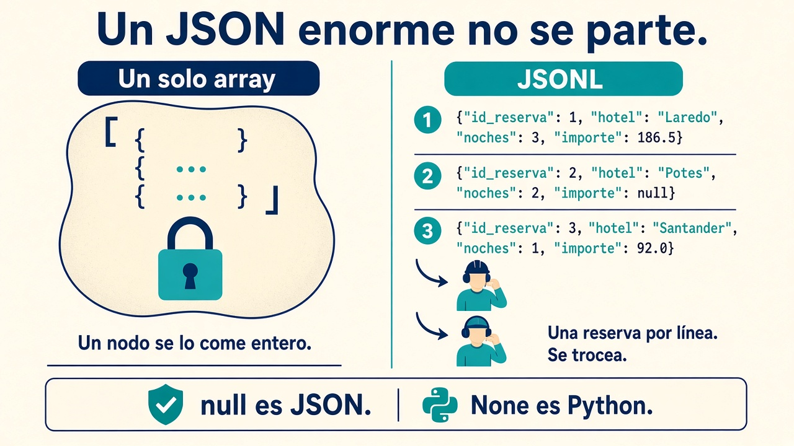
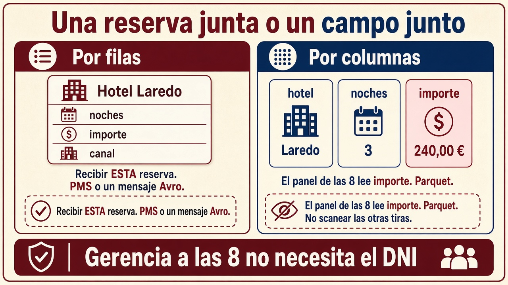

# 1.7. Formatos de datos

## Vídeo: la reserva de Ana cambia de formato

Sigue la reserva de Ana para comprender cómo elegimos la representación de los datos al intercambiarlos, conservarlos, calcular y mantener el histórico. El recorrido distingue Avro, Arrow y Parquet, explica las lecturas por filas y por columnas y muestra cómo comparar formatos sin perder datos. **Duración: 12 minutos y 24 segundos.**

<video controls playsinline preload="metadata" poster="../../assets/ut1/formatos-natural-portada.jpg" aria-label="Formatos de datos: la reserva de Ana cambia de formato" style="width: 100%; max-width: 960px; height: auto; border-radius: 12px;">
  <source src="../../assets/ut1/formatos-natural.mp4" type="video/mp4">
  Tu navegador no permite reproducir este vídeo. Puedes descargarlo en el enlace siguiente.
</video>

El vídeo incluye subtítulos visibles y narración con voz sintética en español. Complementa las explicaciones y las prácticas del apartado.

[Descargar el vídeo](../assets/ut1/formatos-natural.mp4) · [Leer la transcripción](../assets/ut1/formatos-natural.txt) · [Descargar los subtítulos](../assets/ut1/formatos-natural.es.srt)

## Del dato lógico a su representación

En 1.6 hemos definido qué datos entran, cómo se transforman y dónde terminan. Ahora decidimos cómo representarlos para que puedan intercambiarse y leerse con eficiencia. Una misma tabla de reservas puede escribirse en CSV o Parquet y mantener los mismos valores, aunque cambien el tamaño, los tipos conservados y la forma de lectura.

Conviene distinguir tres ideas: el **esquema** describe campos y tipos; el **formato** define cómo se representan; la **compresión** reduce el espacio mediante una codificación adicional. Comprimir un CSV no lo convierte en un formato columnar ni añade automáticamente tipos de datos.

Si necesitamos recuperar una reserva completa, una organización por filas puede ser adecuada. Si queremos sumar únicamente el importe de millones de reservas, una organización por columnas permite leer menos campos. La ventaja depende de la consulta y del lector empleado: no basta con cambiar la extensión.

Los talleres comparan formatos de intercambio y almacenamiento, y presentan Arrow para trabajar en memoria. Anotad en cada prueba qué datos se mantienen, qué tamaño ocupa el resultado y qué consulta se ejecuta. En 1.8 aplicaremos la lectura, transformación y escritura mediante Pentaho.


El criterio **c)** es este: **en qué forma dejáis el dato** para que el siguiente paso pueda procesarlo de forma adecuada. No es una moda. Es una decisión de diseño, igual que elegir lago o warehouse.

!!! info "Cómo se lee esta página"
    Primero el **caso** y la tarjeta (fila frente a columna). Luego **Avro** (talleres 1–2: el mensaje). Después **Parquet + DuckDB** (el lago del panel). El **taller medido** va al final. ORC y Delta son una idea, no un segundo curso. Los relojes: gerencia a las **8** ve el cierre de **ayer**.

## Un caso para no perderse

El [grupo hotelero de Cantabria](caso-hotel.md){target="_blank" rel="noopener"} (Santander, Laredo, Comillas, Potes) guarda cada reserva con **muchas** columnas en el PMS. Gerencia, a las **8**, solo quiere *ocupación e importe por hotel*. Si el fichero es un CSV de gran tamaño, el motor **lee todas las columnas** para calcular tres números. En cloud, a menudo **pagáis por lo que escaneáis**, no solo por lo que guardáis.

Esa es la pregunta del apartado: ¿el dato viaja **fila a fila** (bien para *esta* reserva en un mensaje o en el PMS) o **campo a campo** (bien para el panel)? ¿Hace falta que un humano lo abra, o que Spark lo **trocee** entre nodos?

Las prácticas **no dependen de un CSV ajeno**. Generáis el dataset en el cuaderno (Jupyter o un [Colab](https://colab.research.google.com/){target="_blank" rel="noopener"} en blanco). Esquema Avro: [reserva.avsc](../assets/practicas/reserva.avsc){target="_blank" rel="noopener"}. **Noja** es el “mañana abre otro”, no un quinto hotel del esqueleto. Este `reservas.csv` **no** es el de [Hola ETL](ingesta.md){target="_blank" rel="noopener"} (allí había cobros).

```python
import numpy as np
import pandas as pd

rng = np.random.default_rng(2026)
n = 200_000
hoteles = ["Santander", "Laredo", "Comillas", "Potes", "Noja"]
df = pd.DataFrame({
    "id_reserva": np.arange(n, dtype="int32"),
    "entrada": pd.date_range("2024-01-01", periods=n, freq="min").astype(str),
    "hotel": rng.choice(hoteles, n),
    "noches": rng.integers(1, 8, n, dtype="int32"),
    "importe": rng.uniform(48, 420, n).round(2),
    "canal": rng.choice(["web", "ota", "recepcion"], n),
    "regimen": rng.choice(["SA", "AD", "MP"], n),
    "comentarios": rng.choice(["ok", "vista mar", ""], n),
})
df.to_csv("reservas.csv", index=False)
```

Con `n = 200_000` ya notáis tamaño y tiempo. Subid a un millón si la máquina lo aguanta. `regimen` y `comentarios` están para que veáis **lo que el informe no debe leer**.

## Qué tiene que cumplir el formato

Para evaluar un formato distinguimos **legibilidad**, **tipos**, **evolución del esquema** y **acceso parcial**. Un fichero fácil de abrir a mano puede requerir más trabajo para interpretar números y fechas. Un formato binario puede conservar esa información y permitir al lector omitir partes, pero necesita herramientas compatibles.

La posibilidad de repartir una lectura depende también del lector y de la compresión. JSONL facilita localizar límites entre registros. Un array JSON puede requerir un tratamiento especial para repartirse; no significa que todo fichero JSON obligue siempre a cargarlo completo en memoria.

Para que un clúster (Hadoop, Spark) o un almacén en la nube pueda **repartir** el trabajo, el fichero tiene que dejarse **cortar en trozos**. Un array JSON grande resulta menos sencillo de repartir entre lectores independientes; hay que comprobar si el motor admite lectura incremental o división de ese formato.

Además suele pedirse:

| Exigencia | En castellano |
| --- | --- |
| Independiente del lenguaje | Lo escribe Java y lo lee Python |
| Expresivo | Nulos de verdad, anidados, un número no es el texto `"10"` |
| Compacto | Pocos bytes y poca CPU al leer |
| Que pueda crecer | Añadir un campo sin reescribir cinco años de histórico |
| Autónomo | El fichero lleva cómo interpretarlo (el esquema) |
| Comprimible | Snappy, gzip, zstd… a cambio de CPU |

Dos familias, no dos religiones:

| | Lo abre el Bloc de notas | Lo come el lago |
| --- | --- | --- |
| Ejemplos | CSV, JSON, XML | Avro, Parquet, ORC |
| Tamaño | Grande | Menor |
| Esquema | A medias o en la cabeza | Suele ir **dentro** del fichero |
| Uso | API, entrega a un compañero | Analítica a escala |

**CSV.** Universal. `01` ¿texto o número? Una coma dentro de un campo requiere entrecomillado y escape correctos. Para sumar *importe* soléis arrastrar *canal* y *comentarios*.

**JSON / JSONL.** El JSON “de libro” (un objeto enorme) no se parte bien. **JSON Lines** = **una reserva por línea**:

```json
{"id_reserva": 1, "hotel": "Laredo", "noches": 3, "importe": 186.5}
{"id_reserva": 2, "hotel": "Potes", "noches": 2, "importe": null}
```

`null` es JSON. `None` es **Python**. Mezclarlos tumba el parser.



**XML.** Sigue en facturas y administraciones. Más verboso; misma duda: ¿se puede trocear?

## Una reserva junta o un campo junto

La organización por filas favorece leer muchos campos de cada registro. Sin embargo, un fichero CSV no tiene por defecto un índice que localice directamente la reserva 17: puede ser necesario recorrerlo. La organización columnar favorece seleccionar pocas columnas de muchos registros.

En Parquet, un **grupo de filas** contiene fragmentos separados por columna. El lector puede seleccionar columnas y, con estadísticas apropiadas, descartar grupos incompatibles con un filtro. Además, particionar el conjunto por fecha puede evitar abrir archivos de otros periodos. Selección de columnas, descarte por estadísticas y particionado son optimizaciones distintas.



Pensad en mil reservas `hotel | noches | importe | comentarios`.

**Todo el registro junto** (CSV, JSON; **Avro** en un bus): reconstruir los campos de un registro es directo una vez localizado. Sumar *solo* importes obliga a saltar el resto mil veces. **Añadir** reservas al final es natural.

Eso **no** convierte Avro en el PMS. Recibir el cobro en recepción es la tabla del [1.3](almacenamiento.md){target="_blank" rel="noopener"} (ACID). Avro es el **mensaje** (Kafka): también va por filas, con esquema.

**Cada campo en su sitio** (Parquet, ORC): los importes van juntos. El panel de las **8** lee **una** racha. Reconstruir la reserva 17 cruza trozos. Cambiar *una* fila duele. Por eso se **parte** por fecha o por hotel. Encaja en el cuadro de mando; **no** como almacén de la caja ([operar frente a analizar](procesamiento.md){target="_blank" rel="noopener"}).

!!! example "A las 8 no hace falta el comentario"
    Agregar es resumir. “Importe medio en Laredo” no lee `comentarios`. Columnar + partición `hotel=Laredo` = menos disco, menos factura.

En servicios tipo Athena o BigQuery el orden de magnitud que veréis citado es: **1 TB** de texto plano puede quedar cerca de **un octavo** en columnar comprimido. La cifra exacta cambia; la idea no: **elegir mal el formato en la [carga](ingesta.md){target="_blank" rel="noopener"} se paga cada consulta**.

## Comprimir no es gratis

El algoritmo busca **repeticiones** (`Laredo, Laredo, Laredo…`) y las recodifica. Viaja menos por la red. A cambio, la CPU **aprieta y destapa**. La reducción depende del contenido: texto repetitivo y datos ya comprimidos pueden responder de forma muy diferente. En Big Data suele ganar el que es **rápido**, no el que más aprieta.

| Códec | Velocidad | Ahorro | Típico en |
| --- | --- | --- | --- |
| Gzip / deflate | Media | Medio | Avro, Parquet |
| Bzip2 | Lenta | Alto | Archivado |
| Snappy | Alta | Medio | Avro, Parquet, ORC |
| Zstandard (zstd) | Alta | Alto | Parquet reciente |

```python
df.to_parquet("reservas_zstd.parquet", compression="zstd")
```

```bash
pip install python-snappy   # si usáis Snappy con Avro
```

No memoricéis megas de un recorte ajeno. **Medid el vuestro** al final del taller.

## Avro: el mensaje que se explica solo

El esquema especifica qué campos forman cada registro y qué valores son válidos. Un campo que admite nulo debe declararlo; nulo representa ausencia de valor y se distingue de cero o de una cadena vacía. Cuando el esquema cambia, escritor y lector deben aplicar reglas compatibles.

En un **archivo contenedor Avro**, el esquema se conserva en la cabecera. En mensajería, los sistemas pueden utilizar un identificador y un registro externo de esquemas: no debe suponerse que cada mensaje contiene la cabecera completa de un archivo. Los talleres siguientes trabajan con archivos contenedores.

[Avro](https://avro.apache.org/){target="_blank" rel="noopener"} guarda **por filas**, en binario. El esquema (JSON) viaja en la **cabecera**. Quien lee sabe cómo se escribió. Encaja cuando **escribís mucho**, el esquema **cambia** y el destino es un bus ([Kafka](ingesta.md){target="_blank" rel="noopener"}), no el PMS. Guía: [Getting started (Python)](https://avro.apache.org/docs/1.11.1/getting-started-python/){target="_blank" rel="noopener"}.

!!! tip "Orden de los talleres"
    1–2: Avro con nulos. 3: del `df` a Avro (opcional). 4–6: Parquet; el 6 filtra **al leer**. DuckDB: preguntar sin tragarse el fichero. Luego el [taller medido](#taller-medido-lo-que-se-examina){target="_blank" rel="noopener"}.

Tipos simples: `null`, `boolean`, `int`, `long`, `float`, `double`, `bytes`, `string`.  
Compuestos: `record`, `enum`, `array`, `map`, `union`, `fixed`.

El paquete viejo `avro-python3` está muerto. Instalad `avro` (o **fastavro** si el volumen duele: [GitHub](https://github.com/fastavro/fastavro){target="_blank" rel="noopener"}).

```bash
pip install avro fastavro
```

### Taller 1 — Una reserva con hueco

**Objetivo:** escribir dos registros y recuperarlos con sus tipos. Primero se lee el esquema; después se abre un escritor binario y se añaden registros. Cerrar el escritor completa el archivo. Finalmente, el lector reconstruye los registros y permite inspeccionar el esquema utilizado.

**Comprobación:** deben recuperarse dos reservas. La primera conserva el importe 186,5; la segunda tiene importe nulo. El nulo no significa que la estancia sea gratuita. Si cambiáis `noches` por un texto incompatible con el esquema, la escritura debe rechazarlo.

Descargad [reserva.avsc](../assets/practicas/reserva.avsc){target="_blank" rel="noopener"}. La segunda reserva no trae importe: el esquema admite nulo.

```python
import copy
import json

import avro.schema
from avro.datafile import DataFileReader, DataFileWriter
from avro.io import DatumReader, DatumWriter

schema = avro.schema.parse(open("reserva.avsc", "rb").read())

with open("reservas.avro", "wb") as f:
    w = DataFileWriter(f, DatumWriter(), schema)
    w.append({"id_reserva": 1, "hotel": "Laredo", "noches": 3, "importe": 186.5})
    w.append({"id_reserva": 2, "hotel": "Potes", "noches": 2})
    w.close()

with open("reservas.avro", "rb") as f:
    r = DataFileReader(f, DatumReader())
    meta = copy.deepcopy(r.meta)
    print(json.loads(meta["avro.schema"]))
    print(list(r))
    r.close()
```

En pantalla veréis `importe: None`: eso es Python. En el fichero el nulo es Avro.

### Taller 2 — Lo mismo, más rápido (fastavro)

Este taller conserva el objetivo y cambia la biblioteca. Comparad los registros leídos de ambos archivos, no sus bytes: dos escritores pueden producir archivos diferentes que representan los mismos datos. La ventaja de rendimiento debe medirse para vuestro volumen y entorno; con dos registros apenas es representativa.

```python
import json
import fastavro

with open("reserva.avsc", "rb") as f:
    schema = fastavro.parse_schema(json.load(f))

filas = [
    {"id_reserva": 1, "hotel": "Laredo", "noches": 3, "importe": 186.5},
    {"id_reserva": 2, "hotel": "Potes", "noches": 2},
]
with open("reservas_fa.avro", "wb") as f:
    fastavro.writer(f, schema, filas)
```

### Taller 3 — Del DataFrame al Avro

Aquí seleccionamos Laredo y cinco columnas del conjunto generado. Por tanto, el archivo resultante no contiene todo el DataFrame original. Anotad el número de filas filtradas y verificad que coincide con el número de registros recuperados de Avro.

El ejemplo utiliza números en coma flotante con fines didácticos. Para importes contables se debe acordar una representación decimal exacta o unidades enteras, como céntimos. Cambiar el formato no elimina los errores de redondeo de una representación numérica inadecuada.

Usad el `df` del generador (o filtrarlo: solo `hotel == "Laredo"`).

```python
from fastavro import parse_schema, writer

schema = parse_schema({
    "name": "Reserva",
    "namespace": "bda.ut1",
    "type": "record",
    "fields": [
        {"name": "id_reserva", "type": "int"},
        {"name": "hotel", "type": "string"},
        {"name": "noches", "type": "int"},
        {"name": "importe", "type": "float"},
        {"name": "canal", "type": "string"},
    ],
})
laredo = df[df["hotel"] == "Laredo"][["id_reserva", "hotel", "noches", "importe", "canal"]]
# fastavro rechaza numpy.int32 / numpy.float64: pasad a int y float de Python
filas = [
    {
        "id_reserva": int(fila["id_reserva"]),
        "hotel": str(fila["hotel"]),
        "noches": int(fila["noches"]),
        "importe": float(fila["importe"]),
        "canal": str(fila["canal"]),
    }
    for fila in laredo.to_dict("records")
]
with open("laredo.avro", "wb") as f:
    writer(f, schema, filas, codec="deflate")
```

Si algún día lo escribís en HDFS, cambiad el host por el de **vuestro** lab; el patrón es el de la librería `hdfs` (`InsecureClient` + `AvroWriter`). No copiéis un nombre de máquina de otro ciclo.

## Arrow: el dato *en la RAM*

El formato en disco responde a cómo conservar y leer bytes; la representación en memoria responde a cómo trabaja el programa con los valores ya disponibles. Arrow organiza columnas con tipos y una representación explícita de los nulos. Esa disposición facilita intercambios entre herramientas compatibles.

La ausencia de copias no está garantizada en todas las conversiones: cambiar tipos o transformar a estructuras incompatibles puede requerir memoria adicional. En el ejemplo, la segunda fila conserva un importe nulo, y eso debe seguir siendo cierto tras convertir o escribir la tabla.

[Parquet](https://parquet.apache.org/){target="_blank" rel="noopener"}, [Avro](https://avro.apache.org/){target="_blank" rel="noopener"} y [ORC](https://orc.apache.org/){target="_blank" rel="noopener"} viven en **disco**. **[Arrow](https://arrow.apache.org/){target="_blank" rel="noopener"}** describe columnas **en memoria** para que Python, R o Java las compartan sin copiarlas (*zero-copy*) y el procesador calcule en bloque. Docs: [PyArrow](https://arrow.apache.org/docs/python/){target="_blank" rel="noopener"}. Arrow **no** es Avro.

```bash
pip install pyarrow
```

```python
import pyarrow as pa

schema = pa.schema([
    ("hotel", pa.string()),
    ("noches", pa.int32()),
    ("importe", pa.float32()),
])
tabla = pa.Table.from_pydict(
    {"hotel": ["Laredo", "Potes"], "noches": [3, 2], "importe": [186.5, None]},
    schema=schema,
)
print(tabla)
```

pandas 2 puede leer el CSV con motor Arrow (`dtype_backend="pyarrow"`): textos y nulos suelen ir mejor que con NumPy.

**Feather** utiliza Arrow IPC para persistir e intercambiar tablas. Es útil entre pasos de trabajo compatibles. Para el lago de esta unidad elegimos Parquet por su encaje con las consultas y herramientas previstas; Feather no está limitado a dos celdas de un cuaderno.

```python
import pyarrow.feather as feather

feather.write_feather(df, "reservas.feather")
otro = feather.read_feather("reservas.feather")
```

!!! tip "Dos sitios, dos ficheros"
    Feather = “se lo paso al script de al lado”. Parquet = “lo dejo en el lago para Spark o Athena”.

## Parquet: el lago del informe

[Parquet](https://parquet.apache.org/){target="_blank" rel="noopener"} es **columnar**, lleva el esquema consigo y parte en *row groups*. El informe que pide `hotel` e `importe` no arrastra `canal`. pandas: `to_parquet` / `read_parquet`.

### Taller 4 — Tabla Arrow → Parquet

Escribimos la tabla pequeña creada en el apartado Arrow. El resultado debe mantener sus dos filas, los tres campos y el importe nulo. Después de leerlo, comparad el esquema y los valores. Este taller comprueba conservación de datos, no velocidad a gran escala.

```python
import pyarrow.parquet as pq

pq.write_table(tabla, "reservas.parquet")
print(pq.read_table("reservas.parquet"))
```

### Taller 5 — JSONL → Parquet (la L de un [ETL](ingesta.md){target="_blank" rel="noopener"})

Cread primero un archivo de texto con exactamente los dos objetos mostrados, uno por línea, y guardadlo como `reservas.jsonl`. El lector infiere un esquema y produce una tabla Arrow; el escritor genera Parquet. Comprobad que la ausencia de `importe` en la segunda línea se representa como nulo, no como cero.

`reservas.jsonl`:

```json
{"hotel": "Laredo", "noches": 3, "importe": 186.5}
{"hotel": "Potes", "noches": 2}
```

```python
import pyarrow.parquet as pq
from pyarrow import json as pajson

pq.write_table(pajson.read_json("reservas.jsonl"), "reservas_desde_json.parquet")
```

### Taller 6 — Filtrar *al leer* (no tragarse el Parquet)

Se utiliza ahora el DataFrame grande del generador. La opción `columns` solicita solo las columnas necesarias y `filters` expresa la condición que el lector puede aplicar. El ahorro efectivo depende de cómo estén distribuidos los valores y de las estadísticas disponibles: si todos los grupos contienen Laredo, el motor quizá tenga que leerlos todos, aunque descarte las filas restantes.

Comprobad que el resultado tiene únicamente `hotel` e `importe`, que todas sus filas son de Laredo y que su recuento coincide con el filtro equivalente sobre `df`. Medid después el tiempo; primero debe ser correcto.

Escribir Parquet y luego hacer `read_parquet` **entero** + un filtro en pandas es usar el lago **como un CSV**. El formato sirve si recortáis **en la lectura**:

```python
df.to_parquet("reservas.parquet")
# Solo Laredo, solo las columnas del panel
solo_laredo = pd.read_parquet(
    "reservas.parquet",
    columns=["hotel", "importe"],
    filters=[("hotel", "==", "Laredo")],
)
```

En HDFS, si el clúster define `fs.defaultFS`: `df.to_parquet("hdfs://TU-NODO:PUERTO/reservas.parquet")`. En el Docker de la [UT2](../ut2/hdfs.md){target="_blank" rel="noopener"} ese puerto es el **8020** (`namenode`), no el 9000 de otras guías. DuckDB, en el apartado siguiente, permite expresar la consulta con SQL sin crear previamente un DataFrame con todo el fichero.

### Preguntar sin cargarlo: DuckDB

[DuckDB](https://duckdb.org/){target="_blank" rel="noopener"} es SQL **dentro** del cuaderno (como SQLite, pensado para resúmenes). Procesa los archivos mediante su motor y no exige convertir previamente el conjunto completo en un DataFrame. Aun así, utiliza memoria y puede necesitar espacio temporal.

```bash
pip install duckdb
```

```python
import duckdb

print(duckdb.sql(
    "SELECT hotel, AVG(importe) AS media, COUNT(*) AS n "
    "FROM 'reservas.parquet' GROUP BY hotel ORDER BY media DESC"
))
```

Sobre el DataFrame que ya tenéis:

```python
print(duckdb.sql(
    "SELECT canal, SUM(importe) AS total FROM df GROUP BY canal"
).df())
```

Si particionáis por año: `FROM 'reservas/*.parquet'`. Por dentro habla Arrow: pasar a pandas es casi sin copia.

## ORC: cuando el ecosistema es Hive

ORC también organiza datos por columnas y conserva información que ayuda a evitar lecturas innecesarias. Compararlo con Parquet exige comprobar las operaciones y versiones del motor que se utilizará. La compatibilidad del equipo y de los lectores puede pesar más que una pequeña diferencia de tamaño en una prueba aislada.

[ORC](https://orc.apache.org/){target="_blank" rel="noopener"} (*Optimized Row Columnar*) nació para **Hive**. Tiras (*stripes*) con mín/máx para **no leer** lo que no puede cumplir el filtro. Compresión habitual `zlib`. pandas `to_orc` (desde 1.5) sale **sin** comprimir si no lo pides.

```python
df.to_orc("reservas.orc")
df.to_orc("reservas_zlib.orc", engine_kwargs={"compression": "zlib"})
```

```python
import pyarrow.orc as orc

orc.write_table(pa.Table.from_pandas(df, preserve_index=False), "reservas_pa.orc")
```

Si el equipo “es Spark”, veréis más Parquet. No es que ORC sea peor: es **dónde vive el SQL**.

## Cuando el lago también tiene que *actualizar*

Un formato de archivo describe un archivo; un formato de tabla gestiona el conjunto de archivos que constituye una tabla. Al actualizar una reserva, el sistema registra una nueva versión lógica y coordina qué archivos o registros de borrado deben consultar los lectores. Los mecanismos concretos varían entre Delta Lake, Iceberg y Hudi.

Conservar versiones permite recuperar estados anteriores, pero requiere políticas de mantenimiento. Borrar una fila de la versión actual no implica necesariamente eliminar de inmediato todas sus copias históricas. Hay que distinguir la modificación lógica de la limpieza física de archivos antiguos.

Un `.parquet` suelto no os da “borra esta reserva” ni “cómo estaba el domingo”. En muchos pipelines se añaden archivos nuevos. Para actualizar o borrar registros se necesita una estrategia que gestione los archivos afectados y sus versiones. [Delta Lake](https://delta.io/){target="_blank" rel="noopener"}, [Iceberg](https://iceberg.apache.org/){target="_blank" rel="noopener"} y [Hudi](https://hudi.apache.org/){target="_blank" rel="noopener"} gestionan archivos de datos y metadatos de tabla. Los formatos de archivo admitidos y los mecanismos de actualización dependen de cada proyecto.

Eso permite viajar en el tiempo, un [ACID](almacenamiento.md){target="_blank" rel="noopener"} de **tabla** (un `MERGE` no deja la ocupación a medias) y compactar ficheros pequeños. **Eso no cobra en recepción:** el cobro sigue en el PMS. En esta UT basta la idea. En Spark lo veréis como `format("delta")`.

```python
# Cuando lleguéis a Spark, sobre el mismo df de reservas
# df.write.format("delta").save("/ruta/reservas_delta")
```

## Cómo elegir (tarjeta para el examen)

| Situación | Formato | Por qué |
| --- | --- | --- |
| Lo tiene que leer un humano o una API | CSV / JSON | Se depura |
| Kafka, campos nuevos el mes que viene | **Avro** | Fila + esquema que evoluciona |
| Entre dos celdas del mismo cuaderno | **Feather** | Velocidad |
| Lago + “solo hotel e importe” | **Parquet** | Menos escaneo |
| Tablas Hive | **ORC** | Encaje Hive |
| Explorar en el portátil | **DuckDB** (motor) | SQL sin 500 GB en RAM |
| Picar la reserva en recepción | Ni Parquet ni ORC como almacén | Una fila se actualiza caro |
| Borrar/versionar en el lago | Delta / Iceberg / Hudi | Diario encima |

- Muchas **escrituras** de registros completos → filas (Avro).
- **Lecturas** de tres campos de un millón → columnas.
- Esquema inquieto → Avro. Anidado y subcampos → Parquet.
- Hive → ORC. Spark → Parquet. Cola → Avro.

| | Escribir | Leer | Ocupa |
| --- | --- | --- | --- |
| CSV | Depende de la serialización | Requiere interpretar texto | A menudo mayor sin compresión |
| Feather | Optimizado para intercambio Arrow | Depende de tipos y lector | Depende de compresión y contenido |
| Parquet + Snappy | Incluye codificación columnar | Ventajoso al seleccionar columnas | Depende de los datos |
| Avro | Orientado a registros | Depende de campos necesarios | Depende de esquema y compresión |
| ORC | Incluye codificación columnar | Puede omitir columnas y bloques | Depende de los datos |

!!! tip "Serializar"
    Memoria → bytes (y al revés). Cada conversión puede **perder el tipo**. Elegid formato en la frontera y no traduzcáis en cada capa.

## Taller medido (lo que se examina)

Para que la comparación sea válida, utilizad las mismas filas, columnas y tipos en todas las alternativas. Registrad versiones, número de registros, tamaño del archivo, compresión y consulta. Separad el tiempo de escritura del de lectura y del de cálculo.

Repetid cada medida y explicad si los datos podían estar en caché. No comparéis una lectura completa de CSV con una consulta de dos columnas sobre Parquet sin aclarar que se están midiendo dos patrones de acceso. Además del tiempo, contrastad el resultado: recuentos, nulos y sumas deben coincidir dentro de la tolerancia numérica acordada.

Abrid un cuaderno **en blanco**. Generad el `df` (`n ≥ 200_000`). Cronometrad y anotad tamaños (`os.path.getsize`) de:

1. `reservas.csv`
2. `reservas.parquet` y `reservas_zstd.parquet`
3. `reservas.orc`
4. `laredo.avro` (solo Laredo y las cinco columnas del taller 3): comparadlo con CSV y Parquet generados a partir de ese mismo subconjunto, por separado de la comparación del conjunto completo
5. `reservas.feather` — comparad **tiempo de lectura** frente al CSV

Luego, **sin** cargar el Parquet entero en pandas (como el taller 6):

- importe medio por `hotel` (DuckDB);
- recuento por `canal`;
- misma media **solo con las columnas** `hotel` e `importe` (¿baja el tiempo?).

```python
import os
import time

t0 = time.perf_counter()
df.to_parquet("reservas.parquet")
print("escritura s:", round(time.perf_counter() - t0, 3))
print("bytes:", os.path.getsize("reservas.parquet"))
```

Explicad los resultados observados, incluso si un formato no fue el más rápido esperado. Relacionad diferencias con columnas leídas, compresión, tipos y tamaño. Justificad también cómo se gestionaría la incorporación de un campo en Avro.

La entrega, si la hay, es Moodle. No hace falta ningún dataset de otro centro ni compartir el cuaderno fuera.

## Actividad

No puntúa en Moodle. Una línea de por qué.

1. El panel de las 8 solo usa `hotel` e `importe`. ¿CSV o Parquet para el lago?
2. El JSON del canal viaja por Kafka y el mes que viene añaden un campo. ¿Avro, Parquet o Feather?
3. `{"hotel": "Laredo", "importe": None}` ¿es JSON válido?
4. Para el histórico consultado con distintas herramientas, ¿por qué elegiríais Parquet frente a Feather? Relacionad la respuesta con los consumidores previstos.

!!! tip "Comprobación"
    Parquet / Avro / no (`None` es Python; en JSON es `null`) / para este lago preferimos Parquet por los lectores y consultas previstos; Feather es un formato de intercambio persistente, no una prohibición de conservar datos.

## Autoevaluación del 1.7

Diez preguntas (A–D, **una** correcta) sobre los conceptos del apartado. No puntúan en Moodle. En **cada** una, **Comprobar respuesta**: si es correcta o no, y una explicación breve. Podéis repetir el test.

<div class="dwec-quiz" data-dwec-quiz data-src="../../assets/quizzes/ut1-1-7.json"></div>

