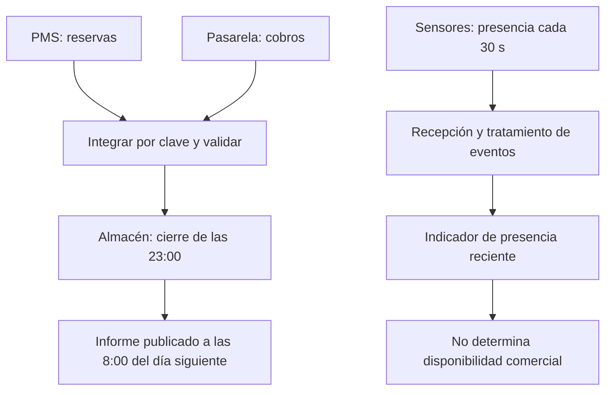
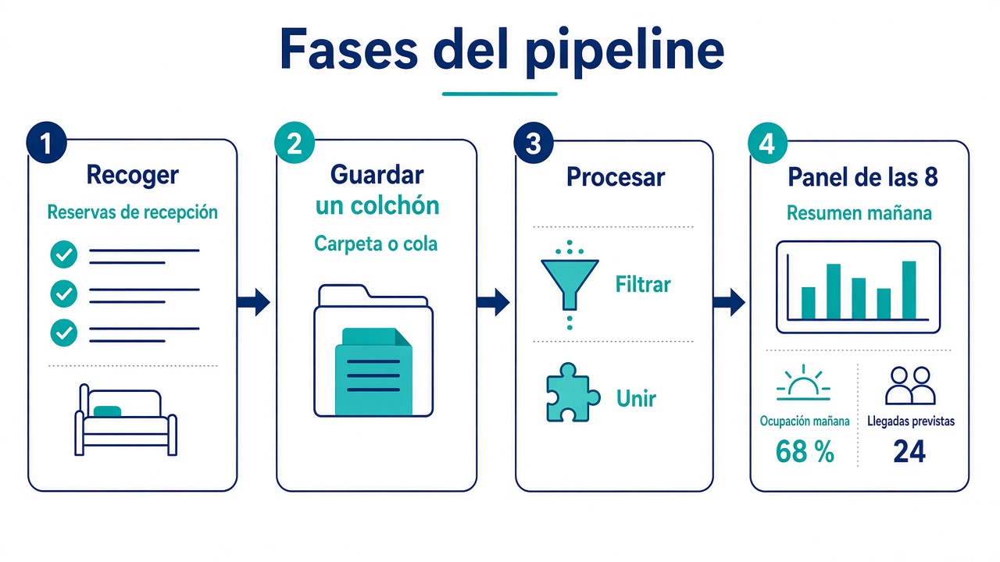
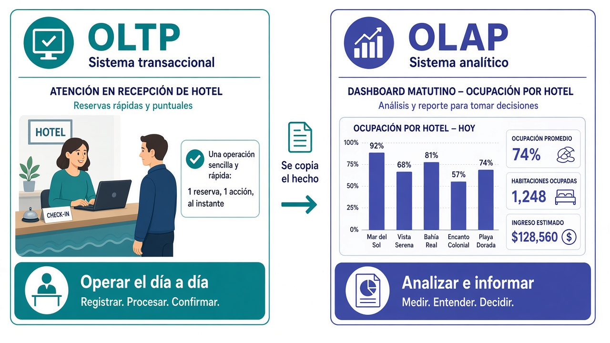
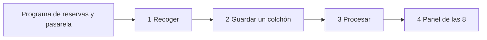
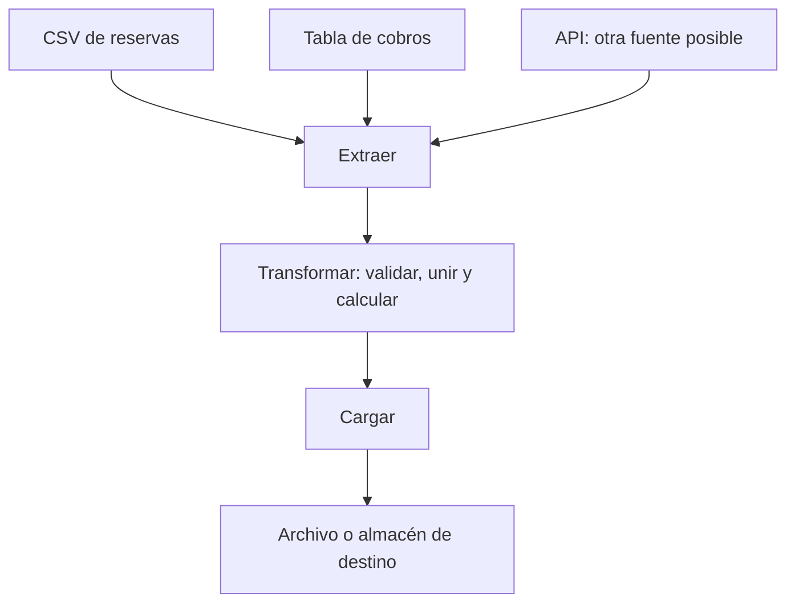
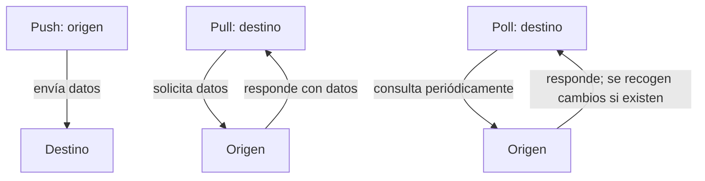
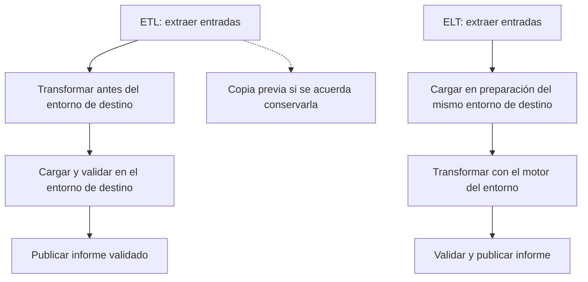
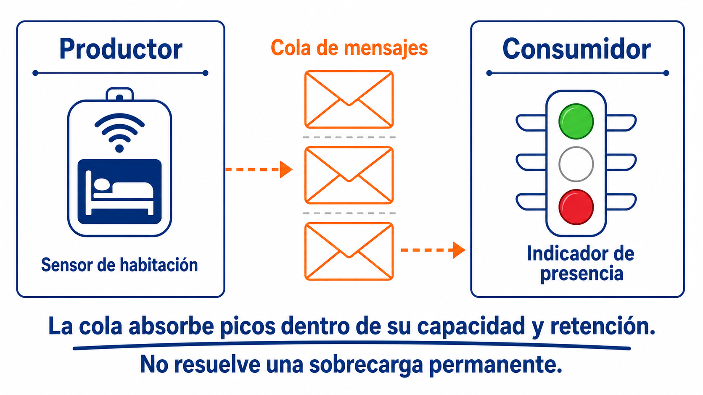
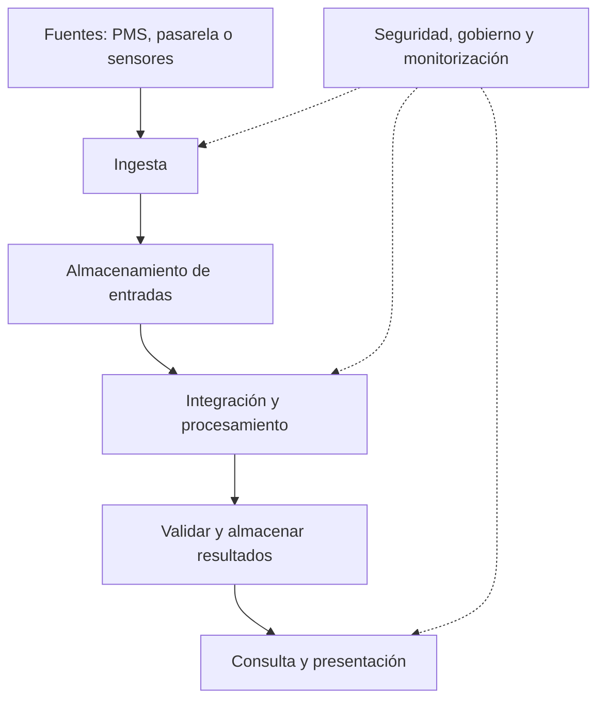

# 1.6. Ingesta de datos

!!! info "Ruta de estudio"
    **Esencial:** explicar extracción, transformación, carga, ETL/ELT y controles de calidad.

    **Práctica guiada:** ejecutar Hola ETL en una carpeta propia y comparar pandas con DuckDB.

    **Ampliación:** analizar retención de eventos, colas, CDC y catálogo de herramientas. No sustituye al recorrido común; su detalle adicional solo se exige si el profesor lo anuncia antes (véase [cómo trabajar la unidad](index.md#como-trabajar-la-unidad)).

## Qué vamos a construir y cómo comprobarlo

La arquitectura de 1.5 sitúa los componentes. Este apartado explica el recorrido que conecta los sistemas de origen con el lugar donde analizamos los datos. Ingestar consiste en incorporar datos a un destino; un pipeline puede incluir además validaciones, transformaciones y publicación de resultados.

En el ejemplo de reservas y cobros hay que tomar tres decisiones antes de programar: qué representa cada fila, qué campo relaciona ambos orígenes y qué hacer con una reserva sin cobro. Si decidimos incluir solo reservas cobradas, una unión interna conserva únicamente las coincidencias. Esa regla debe aparecer en el enunciado y comprobarse en el resultado.

También debemos revisar la relación entre las tablas. Si una reserva tiene dos pagos, la unión produce dos filas para esa reserva. Sumar los pagos puede ser correcto, pero contar esas filas como dos reservas sería incorrecto. En los ejercicios se trabaja con los datos suministrados; en un sistema real hay que comprobar esta relación antes de agregar.

Una ejecución correcta requiere más que terminar sin errores: comprobad filas leídas, filas rechazadas, duplicados y totales. Definid además qué sucede si repetís la carga. Una carga idempotente puede repetirse sin duplicar el resultado, por ejemplo actualizando por una clave estable. En 1.7 elegiremos el formato de los datos que el pipeline escribe.


Este apartado es el criterio **b)** del [RA1](ra1.md){target="_blank" rel="noopener"}: cómo **entran** los datos en el sistema. Todavía no hace falta saber Kafka, Spark ni Parquet. Sí hace falta entender el problema con un ejemplo y, después, ponerle nombre a cada idea.

Si este paso falla, el modelo y el cuadro de mando trabajan sobre arena: la cifra queda bien presentada y es mentira.

!!! info "Cómo se lee esta página"
    Primero la **teoría** (qué es ingerir, pipeline, ETL/ELT, quién inicia). Luego el taller **Hola ETL** (las tres letras; **no** es el panel de las 8). Después **colas y examen** (semáforo ≠ cuadro de gerencia). Los **logos**, al final: familia, no producto. El vídeo ofrece un recorrido introductorio; los talleres fijan las reglas concretas de cada ejercicio.

## Vídeo: el viaje de la reserva y el cobro de Ana

Sigue la reserva y el cobro de Ana para comprender cómo recogemos datos de distintos sistemas, los relacionamos y publicamos un resultado fiable. El recorrido explica las cargas incrementales, cómo evitar duplicados, las diferencias entre ETL y ELT y el papel de las colas en la entrada de eventos. La comparación utiliza el mismo destino y aclara cuándo publicar un informe validado y qué datos conservar para recalcularlo. **Duración: 14 minutos y 53 segundos.**

<video controls playsinline preload="metadata" poster="../../assets/ut1/ingesta-etl-elt-portada.jpg" aria-label="Ingesta: el viaje de la reserva y el cobro de Ana" style="width: 100%; max-width: 960px; height: auto; border-radius: 12px;">
  <source src="../../assets/ut1/ingesta-etl-elt.mp4" type="video/mp4">
  Tu navegador no permite reproducir este vídeo. Puedes descargarlo en el enlace siguiente.
</video>

El vídeo incluye subtítulos visibles y narración con voz sintética en español. Complementa las explicaciones y las prácticas del apartado.

[Descargar el vídeo](../assets/ut1/ingesta-etl-elt.mp4) · [Leer la transcripción](../assets/ut1/ingesta-etl-elt.txt) · [Descargar los subtítulos](../assets/ut1/ingesta-etl-elt.es.srt)

## Introducción

**Ingerir datos** es el proceso de coger información que ya existe en varios sitios —un fichero, una base de datos, una web, un sensor— y llevarla a **otro** sistema, donde se podrá guardar o procesar.

El contexto es el **[caso del grupo hotelero](caso-hotel.md){target="_blank" rel="noopener"}** (Santander, Laredo, Comillas, Potes). Resumen para no perderse:

- Recepción registra las reservas en el **programa de reservas** del hotel (en la jerga, PMS: *Property Management System*).
- La pasarela de pago sabe qué estancias se han cobrado.
- En las habitaciones hay sensores de presencia.
- Dirección quiere, cada mañana a las 8, **ocupación e importe cobrado por hotel**.

Esos datos **ya existen**. No están, de entrada, en el sitio donde gerencia los mira. Llevarlos de un sitio al otro es ingesta.



Dos recorridos con fuentes y objetivos distintos. El panel requiere datos adicionales de habitaciones para calcular ocupación. El recorrido superior ilustra una transformación previa a la carga del cierre. También podemos cargar las entradas en una zona de preparación del almacén y transformarlas allí, como veremos al comparar ETL y ELT.

Hasta que el dato no entra, el resto de la [arquitectura](arquitectura.md){target="_blank" rel="noopener"} está vacía. Un buen proceso de ingesta tiene que ser:

- **Flexible:** mañana aparece otra fuente (una OTA —web tipo Booking que vende habitaciones—, un Excel de un hotel nuevo) y no tiráis el diseño.
- **Ágil:** si gerencia cambia la pregunta, no tardáis tres meses en volver a meter los datos.

La productividad del equipo depende más de esto que del logo de la herramienta.

Finanzas cierra el día a las **23:00**. Los sensores publican cada medio minuto. Recepción no puede parar. **No** son el mismo tubo: el panel de las 8 es el lote; el semáforo es el flujo.

Antes de elegir un programa, diseñáis **hacia atrás**:

1. ¿Qué tiene que ver gerencia a las 8? (destino)
2. ¿Hay que cruzar reservas con cobros, seleccionar los estados que requiere el informe sin perder las cancelaciones necesarias para otros análisis, unificar el nombre del canal? (transformación)
3. ¿El dato vive en el programa de reservas, en la pasarela, en una carpeta FTP (un sitio en red donde se dejan ficheros) o en los sensores? (origen)

Sin esa pregunta de negocio, unificar veinte fuentes es un proyecto largo que no sabéis cuándo termina.

Los datos extraídos pueden llegar a una carpeta de trabajo, a una zona de entrada de un **lago de datos** (*data lake*) o a tablas de preparación de un **almacén analítico** (*data warehouse*). Un lago puede conservar originales y resultados preparados; un warehouse puede incluir una zona de carga y otra con tablas validadas para informes. Son las finalidades explicadas en [1.3](almacenamiento.md){target="_blank" rel="noopener"}, no una regla que obligue a pasar primero por un lago.

Para distinguir ETL y ELT fijaremos el **entorno de destino**: ¿transformamos antes de cargar en él o después, dentro de él? Independientemente de esa elección, gerencia debe consultar una salida validada. Guardar una entrada no significa que ya esté lista para tomar decisiones.

## Pipeline de datos

Un **pipeline** (tubería) es una forma de organizar el trabajo en **fases**. No es un producto que compráis. Describe los pasos y, si hace falta, las tecnologías entre un origen y un destino.

En lo más simple: recoger, guardar, procesar y **dejar algo útil**. El panel de las 8 enseña el cierre de **ayer**, no un pronóstico.



Aunque a menudo se intercambian los términos, **pipeline** y **ETL** no son lo mismo:

- Toda ETL es un pipeline (mueve datos en fases).
- **No** todo pipeline es una ETL. Un sensor que deja un mensaje en una cola y un filtro que tira duplicados también es tubería, aunque no hagáis un cruce ni una carga a un almacén de informes.

### Fases del pipeline

Sumar mil reservas no suele ser una carga grande por sí sola. El riesgo aparece cuando consultas analíticas, volúmenes o concurrencia compiten con la operación de recepción. Medimos esa interferencia antes de decidir si separar el entorno analítico.

Por eso se **copia** el hecho a otro sitio. Operar en recepción frente a informar a gerencia (OLTP / OLAP) ya está en [1.4](procesamiento.md){target="_blank" rel="noopener"}: el pipeline los **separa** para que uno no tumbe al otro.



La imagen ilustra las finalidades, con porcentajes ficticios. El taller de esta página produce detalle de reservas con cobro, no esos porcentajes de ocupación.



1. **Recoger.** Copiáis el hecho fuera de recepción: un fichero, una consulta a la base de datos, un mensaje.
2. **Guardar un colchón.** Si el panel va lento, el dato no se pierde. Puede ser una carpeta, una zona bruta o una cola de mensajes.
3. **Procesar.** Filtráis, unís y agregáis según las reglas del informe. Los controles de calidad también se aplican al recibir datos y antes de publicar el resultado.
4. **Dejar algo útil.** El panel, un Excel, una base de informes.

Un mismo **job** (trabajo programado: “a las 02:00, lanza esta tubería”) que “lo hace todo” parece más simple el día 1. El martes que el programa de reservas añade una columna, se rompe recoger, cruzar y pintar a la vez.

Las fuentes no hablan igual. Un canal llega como `web` y otro como `WEB`. Un número llega como texto `"10"`. Hay huecos.

Dejar el dato **listo** para usarlo se llama **data wrangling** (preparación o limpieza de datos). No es un programa: es el oficio de pasar del bruto al dato que ya tiene sentido.

### Pipeline iterativo

Este proceso de recoger, guardar, procesar y analizar **se itera**. Gerencia pregunta: “¿cancelan más los del viernes?”. Primero comprobáis si las fechas y cancelaciones necesarias están en las entradas conservadas o en otras tablas del entorno. Si están, podéis recalcular sin extraerlas otra vez; si faltan, revisáis si la fuente permite recuperarlas. Esto se aplica tanto a ETL como a ELT.

Sobre una hipótesis de negocio se comprueba lo ya almacenado. Si falta información y puede obtenerse, se incorpora y se integra con lo existente. Si el problema está en una regla de cálculo, se corrige esa transformación y se valida de nuevo. Volver a ingerir solo tiene sentido cuando hacen falta datos que no se conservaron o deben actualizarse; un histórico que la fuente ya no guarda puede ser irrecuperable.

## ETL

Una **ETL** lleva datos desde unas fuentes hasta un **destino de referencia acordado**, transformándolos antes de cargarlos en ese destino. Puede conservar una copia de las entradas en una zona de trabajo previa; esa copia no convierte por sí sola el proceso en ELT respecto al destino acordado. Las siglas vienen del inglés:

1. **E** — *Extract* (extraer)
2. **T** — *Transform* (transformar)
3. **L** — *Load* (cargar)

Se puede hacer con un script, con Python o con una herramienta visual. En Big Data la herramienta tiene que ser **flexible** (varios formatos), **tolerante a fallos** (si cae a mitad, que se sepa) y capaz de **conectarse** a muchos orígenes.

Unificar veinte fuentes **gasta** el proyecto. La veracidad del dato se cuida aquí: si entra basura, el panel miente.



El esquema muestra el orden lógico: extraer, transformar y cargar en el destino acordado. No obliga a terminar de extraer todas las fuentes antes de procesar una fila: las fases pueden solaparse por bloques. La copia de originales, si se necesita, debe tener permisos y una política de conservación definidos.

### Extracción

Antes de extraer, documentad un pequeño contrato de entrada: campos obligatorios, tipos, identificadores y periodo esperado. Si la fuente es una API paginada, una sola respuesta puede contener únicamente parte de las reservas. Si es un fichero, debe estar completo antes de leerlo.

Una extracción incremental necesita reconocer altas, cambios y, cuando proceda, borrados. Puede utilizar una fecha de modificación o mecanismos de captura de cambios (**CDC**). Guardad el punto de avance solo después de una carga correcta. Si lo adelantáis antes de escribir, un fallo puede hacer que os saltéis registros en el siguiente intento.

Recopiláis los datos del origen y los lleváis a una zona de trabajo, sin cambiar todavía el programa de recepción.

Orígenes típicos:

- **CSV:** fichero de texto en tabla, columnas separadas por comas (o punto y coma). Excel lo abre.
- **Tabla SQL:** datos en filas y columnas dentro de un gestor ([PostgreSQL](https://www.postgresql.org/){target="_blank" rel="noopener"}, [MySQL](https://www.mysql.com/){target="_blank" rel="noopener"}, [SQL Server](https://www.microsoft.com/sql-server/){target="_blank" rel="noopener"}…).
- **API / REST:** pides datos por HTTP (el mismo protocolo del navegador) y sueles recibir **JSON** (texto con llaves `{ }` que un programa lee fácil).
- Un mensaje de un bus (Kafka u otra cola).

Dos reglas:

1. Tiene que ser **ligera**. Recepción casi no se entera.
2. **No** se modifica el dato operativo. Si colapsa el programa de reservas, la empresa pierde dinero *cobrando*.

Comprobáis que el lote **trae lo que dice traer** (columnas, tipos). Si no, se **aparta**: un job “en verde” con filas cojas envenena el panel.

Hay tres formas de iniciar el movimiento. No son tres productos.



Las flechas indican peticiones y datos. Quién inicia el intercambio no determina si el procesamiento es por lotes o continuo.

| | **Push** (empujar) | **Pull** (tirar) | **Poll** (preguntar) |
| --- | --- | --- | --- |
| Quién inicia | El **origen** envía | El **destino** va a buscar | El destino **mira** de vez en cuando; si hay cambio, tira |
| En el hotel | Cada alta de reserva se publica al momento | A las 02:00 lees la tabla de ocupaciones | Cada 15 min listas la carpeta FTP; solo bajas si cambió la fecha |
| Encaja | Evento, sensor, aviso automático (*webhook*: el origen llama a una URL tuya cuando pasa algo) | Lote nocturno, leer una base **SQL** (el lenguaje de las bases de datos en tablas) | Carpetas, buzones, **API** (un “mostrador” por internet que, si preguntas bien, te devuelve datos) |
| Riesgo | Te inundan, o el origen no sabe adónde empujar | Tiras en hora punta y tumbas la recepción | Preguntas poco = te enteras tarde; preguntas mucho = molestas |

No hay uno “más Big Data”. En la misma empresa conviven. Esas asociaciones son frecuentes en los ejemplos, pero no obligatorias: el mecanismo de transferencia no determina por sí solo el ritmo de procesamiento.

Más adelante hay un catálogo con nombre y para qué sirve cada herramienta. Primero claváis **quién da el primer paso**.

### Transformación

Para explicar una transformación, indicad qué cambia y qué debe conservarse. Normalizar `WEB` a `web` cambia la representación, pero mantiene el significado del canal. Unir reservas y cobros añade información relacionada. Agregar por hotel reduce el detalle: varias filas pasan a representar un total.

La eliminación de duplicados requiere una regla. Dos filas con el mismo importe no son necesariamente el mismo cobro; necesitamos un identificador del evento o una clave acordada. Cuando hay versiones de una reserva, debemos decidir si conservamos el historial o el estado más reciente.

Dejáis formato y contenido que el destino entiende. En el hotel suele ser:

- Cambiar codificación o mayúsculas (`WEB` → `web`).
- Quitar duplicados de `id_reserva`.
- Cruzar reservas con cobros.
- Agregar importe por hotel.
- Generar un identificador estable (`hotel-fecha`).
- Calcular un indicador (ocupación %).
- Quedarte solo con las filas que el informe necesita.

**Sí:** mejorar calidad, integrar, normalizar, crear una clave que no existía en origen.  
**No:** fabricar noches que nadie picó, borrar el canal porque “estorbaba”, ni una regla que un día sí y otro no.

En continuo, una transformación pesada (cruzar veinte fuentes) **no** va en el mismo milisegundo que el sensor. A veces la T gorda espera al lote.

### Carga

Hay tres patrones frecuentes: **añadir** registros nuevos, **sustituir** un conjunto delimitado —por ejemplo, el informe de un día— o **insertar/actualizar** por clave. La elección depende de si el origen publica hechos nuevos o corrige datos anteriores.

Imaginad que el proceso escribe medio informe y falla. Si el usuario lo consulta en ese momento, verá un total incompleto. Una solución es escribir en un destino provisional, comprobar recuentos y totales, y publicar el resultado solo cuando esté validado. El mecanismo concreto depende del almacén, pero la intención es que el consumidor distinga una versión completa de una carga en curso.

Escribís en el destino, **adaptándoos** a cómo ese destino espera recibir datos: una sentencia SQL masiva, un fichero que el almacén lee, una carpeta en la nube.

Cada destino tiene su vía rápida. Tres palancas que, si las ignoras, tiran una carga grande:

| Palanca | Si la ignoras |
| --- | --- |
| **Índices** (atajos de búsqueda, como el índice de un libro) | Reconstruirlos fila a fila en millones de reservas tira la carga |
| **Partición** (guardar en “cajones”: por fecha o por hotel) | Si partes mal, el panel barre todo |
| **Tamaño de la transacción** (cuántas filas confirmas de golpe) | Confirmar diez millones de golpe puede tumbar el destino; confirmar de una en una, eternizar la carga |

Cien filas de práctica **no** demuestran la carga.

Una carga completa copia el conjunto acordado; una incremental incorpora altas, cambios y, si procede, borrados desde el punto de control. Para datos pequeños, una recarga completa puede ser más sencilla y suficiente. Para históricos grandes, suele convenir una carga inicial y posteriores incrementales. Elegid según volumen, coste y capacidad de detectar cambios; no confundáis la fecha de extracción con la fecha del hecho.

El **formato** de lo que escribís (CSV, JSON, Parquet…) es parte de esta L: lo vemos justo después del [Hola ETL](#hola-etl){target="_blank" rel="noopener"}, cuando ya tenéis un `cruce`. El catálogo completo está en [1.7](formatos.md){target="_blank" rel="noopener"}.

## ELT

**ELT** sigue el orden extraer → **cargar** → transformar. La diferencia con ETL se entiende fijando el **mismo entorno de destino** en las dos alternativas: en ETL transformamos antes de cargar en él; en ELT cargamos las entradas en ese entorno y después las transformamos allí. Una tabla final del informe es una salida dentro del entorno, no un nuevo destino que debamos cambiar a mitad de la comparación.

Imaginad que el destino acordado es el almacén analítico del hotel y que finanzas necesita el mismo informe de cobros:

- **Opción ETL:** extraemos reservas y cobros, conservamos si procede una copia en una zona previa, los unimos y agregamos fuera del almacén —por ejemplo, con un script o con Pentaho— y cargamos el resultado validado en el almacén.
- **Opción ELT:** extraemos las mismas fuentes, las cargamos en tablas de preparación de ese almacén y utilizamos su motor SQL para unirlas y agregarlas. Tras comprobar el resultado, publicamos las tablas del informe.

En ambos casos finanzas recibe el mismo resultado validado. **Estar cargado en preparación y estar publicado para gerencia son estados distintos.** La zona de preparación tiene acceso restringido; no se convierte en un informe fiable por haber terminado la carga.

ELT puede utilizar un warehouse o un lago con un motor de cálculo, en instalaciones propias o en la nube. En un lago, los archivos por sí solos no transforman: un motor asociado, como [**Apache Spark**](https://spark.apache.org/), ejecuta el cálculo. [**PySpark**](https://spark.apache.org/docs/latest/api/python/) permite utilizar Spark desde Python. Un notebook puede coordinar esas operaciones, pero su presencia tampoco determina si el recorrido es ETL o ELT.

| Decisión | **ETL** | **ELT** |
| --- | --- | --- |
| Orden respecto al destino acordado | Extraer → transformar → cargar en ese destino | Extraer → cargar en ese destino → transformar allí |
| Dónde se transforma | En un motor previo a la carga: script, [Pentaho](pentaho.md) u otra herramienta | En el motor del entorno de destino, local o en la nube |
| Cuándo valorar esta opción | Cuando conviene aplicar las reglas fuera del destino, por sus requisitos de entrada, recursos o integración | Cuando el entorno permite cargar entradas en preparación y dispone de recursos y permisos para transformarlas allí |
| Calidad y publicación | Comprobar entradas, transformaciones y carga; publicar una salida validada | Comprobar entradas y carga, transformar y validar; publicar una salida validada |
| Conservar el original | Guardarlo en una zona previa si se necesita y está permitido; definir versiones y retención | Conservar las entradas cargadas si se necesitan y está permitido; evitar sobrescribirlas sin el historial requerido |
| Si cambia la pregunta | Reutilizar entradas conservadas y ajustar la transformación previa cuando haga falta | Reutilizar entradas conservadas y ajustar las transformaciones del entorno cuando haga falta |

La elección depende del recorrido y de los recursos disponibles. El nombre del producto, el tipo de almacén y el número de consumidores no bastan para decidirla. Además, una consulta nueva puede usar resultados ya preparados sin cambiar la ingesta. Si requiere datos que no están, en **ambos** diseños habrá que buscar otra fuente o una nueva extracción, si todavía es posible.



En el esquema, los dos recorridos son alternativas para el mismo encargo. En ELT también hay que decidir si las tablas de preparación conservan originales o se sustituyen con cada carga. **Cargar primero no garantiza conservar el histórico**, igual que transformar primero no obliga a perderlo.

- Ingeniería puede preparar las entradas para su exploración por personas autorizadas. El acceso al bruto depende de los permisos y de su finalidad; finanzas no debe usarlo como informe validado.
- Quien conoce el negocio ayuda a definir y comprobar las reglas de limpieza en ambos diseños. La ubicación de la transformación no determina quién puede participar.

Una plataforma en la nube puede facilitar ELT por su capacidad de cálculo, pero también puede ejecutar ETL. Pentaho puede transformar antes de cargar o participar en la carga y coordinación de tareas que transforman en el destino. En el aula lo utilizamos para el primer recorrido; **usar Pentaho no define por sí solo la arquitectura**. El cierre de facturación y el análisis de ocupación admiten distintas soluciones: justificamos cada una por sus requisitos, no por el nombre del departamento o por llamar «lago» al almacenamiento.

## Herramientas ETL

No hace falta una herramienta con las letras “ETL” en el nombre: un script también extrae, transforma y carga. Cuando el volumen y las fuentes crecen, conviene un programa que ya traiga conectores, planificación y registro de errores.

En Big Data no vale “cualquier copiar y pegar”. Tiene que:

- **Conectar** con muchos sitios y formatos: Excel, bases transaccionales (las del día a día), XML, CSV, JSON, HDFS, Hive, S3, peticiones HTTP / REST, APIs de terceros, logs…
- **Planificar** el trabajo: cada noche (*batch*), cuando llega un fichero (evento) o en continuo (*streaming*).
- **Transformar** a tres niveles:
    - simples: tipos, textos, codificaciones, un cálculo;
    - intermedias: sumar por hotel, *lookup* (buscar un código en otra tabla, p. ej. el nombre del canal);
    - complejas: un modelo de IA o código de otro lenguaje (eso se sale de esta UT).
- **Dejar rastro y gestionar errores:** qué corrió, qué falló, y qué hacer entonces. Sin eso, el job “en verde” es teatro.

([Hadoop](https://hadoop.apache.org/){target="_blank" rel="noopener"} es el ecosistema clásico de Big Data: varios PCs compartiendo disco y cálculo. [HDFS](https://hadoop.apache.org/docs/current/hadoop-project-dist/hadoop-hdfs/HdfsDesign.html){target="_blank" rel="noopener"} es su sistema de ficheros: una carpeta enorme repartida. [Hive](https://hive.apache.org/){target="_blank" rel="noopener"} permite consultar esos ficheros con SQL. [S3](https://aws.amazon.com/s3/){target="_blank" rel="noopener"} es el almacén de objetos de Amazon: carpetas en la nube. XML es otro formato de texto etiquetado, más viejo que JSON. Un *log* es el diario de lo que hace un programa. HTTP / REST son la forma habitual de pedir datos a una API por internet.)

Son programas (muchos con pantalla) para diseñar el flujo sin escribirlo todo a mano. En aula montáis **Pentaho**; el resto, si os los nombran, es la misma idea.

| Herramienta | Qué es, en una frase | En esta aula |
| --- | --- | --- |
| **[Pentaho Data Integration (PDI)](https://www.hitachivantara.com/en-us/products/pentaho-plus-platform.html){target="_blank" rel="noopener"}** | Suite de ETL visual. **Spoon** edita; **Pan** y **Kitchen** ejecutan. Código: [GitHub](https://github.com/pentaho/pentaho-kettle){target="_blank" rel="noopener"}. | La practicáis en [1.8](pentaho.md){target="_blank" rel="noopener"} |
| **[Talend Open Studio](https://www.qlik.com/us/products/talend-open-studio){target="_blank" rel="noopener"}** | Referencia histórica de ETL visual | Retirado el **31 de enero de 2024**; Qlik y Talend ya no lo alojan ni actualizan. No se instala en esta unidad. |
| Otras de catálogo | Informatica, ODI, MuleSoft… | Nombre; no las instaláis |

Las empresas no eligen “solo Pentaho” o “solo Python”. Mezclan:

- la **suite visual** para conectores y planificación;
- **[Python](https://www.python.org/){target="_blank" rel="noopener"}** para lo nuevo, lo no estructurado o lo que la pantalla no cubre:
    - **[pandas](https://pandas.pydata.org/){target="_blank" rel="noopener"}:** librería para trabajar con tablas en memoria (`DataFrame`). Es el Excel de Python.
    - **[PySpark](https://spark.apache.org/docs/latest/api/python/){target="_blank" rel="noopener"}:** interfaz de Spark para Python, capaz de ejecutar el cálculo localmente o repartirlo entre máquinas. En modo local, `local` utiliza un hilo de trabajo y `local[K]` utiliza K hilos en la misma máquina; esto último permite paralelismo local, no distribución entre máquinas. En una ejecución distribuida, las tareas se ejecutan en trabajadores de varias máquinas. Usar PySpark no demuestra por sí solo que se esté utilizando un clúster: hay que comprobar la configuración y dónde se ejecutan las tareas. Véanse los [modos de ejecución de Spark](https://spark.apache.org/docs/3.5.7/submitting-applications.html#master-urls) y [1.2](clusters.md){target="_blank" rel="noopener"}.
    - **[DuckDB](https://duckdb.org/){target="_blank" rel="noopener"}:** base analítica *embebida* (no hay servidor que instalar): SQL directo sobre CSV o Parquet en vuestro disco. Documentación: [duckdb.org/docs](https://duckdb.org/docs/){target="_blank" rel="noopener"}.
- **[Apache Airflow](https://airflow.apache.org/){target="_blank" rel="noopener"}:** un **orquestador**. No transforma el dato: dispara pasos (“primero extrae, luego cruza, luego carga”) y avisa si uno falla. No lo montáis en esta UT; sí sabéis para qué existe.

Sin planificación y sin registro de errores, da igual la herramienta.

## Hola ETL

Este taller enseña las **tres letras**, no pinta el panel de ocupación de las 8. El objetivo es más pequeño: reservas del canal `web` **con cobro**, y una etiqueta `hotel (web)`. Aquí fijamos como destino el archivo de salida: pandas o DuckDB transforman los datos antes de escribirlo, por eso hablamos de ETL. Que DuckDB ejecute SQL no convierte este recorrido en ELT. En [1.8](pentaho.md){target="_blank" rel="noopener"} el mismo cruce se vuelve informe agregado por hotel y canal.

Necesitáis un cuaderno de Python:

- **[Jupyter](https://jupyter.org/){target="_blank" rel="noopener"}:** en el PC, mezcla texto y código, celda a celda.
- **[Google Colab](https://colab.research.google.com/){target="_blank" rel="noopener"}:** lo mismo, en el navegador, sin instalar nada.

**[pandas](https://pandas.pydata.org/){target="_blank" rel="noopener"}** es la librería de Python para tablas. Un `DataFrame` es una hoja: filas y columnas con nombre. **[NumPy](https://numpy.org/){target="_blank" rel="noopener"}** (`numpy`) genera números al azar para fabricar el ejemplo.

En [1.7](formatos.md){target="_blank" rel="noopener"} generaréis **otro** `reservas.csv` (más filas, campo `entrada`, **sin** cobros). Estos dos ficheros no se reutilizan allí.

- `reservas.csv`: quién reservó, en qué hotel, por qué canal, noches e importe.
- `cobros.csv`: qué reservas **ya** están cobradas y por qué medio. No todas las reservas tienen fila. Eso es real.

- **E** = leer los dos ficheros.
- **T** = filtrar, cruzar por `id_reserva` y crear la etiqueta. Un *join* (cruce) une filas que comparten una clave.
- **L** = escribir un **JSON** (texto estructurado) para verlo en clase.

```python
import numpy as np
import pandas as pd

rng = np.random.default_rng(2026)
n = 8_000
hoteles = ["Santander", "Laredo", "Comillas", "Potes"]
reservas = pd.DataFrame({
    "id_reserva": np.arange(n, dtype="int32"),
    "hotel": rng.choice(hoteles, n),
    "canal": rng.choice(["web", "ota", "recepcion"], n),
    "noches": rng.integers(1, 8, n, dtype="int32"),
    "importe": rng.uniform(48, 420, n).round(2),
})
# ~70 % de las reservas tienen cobro
mask = rng.random(n) < 0.7
cobros = pd.DataFrame({
    "id_reserva": reservas.loc[mask, "id_reserva"].to_numpy(),
    "medio": rng.choice(["tarjeta", "efectivo", "bizum"], mask.sum()),
    "cobrado": reservas.loc[mask, "importe"].to_numpy(),
})
reservas.to_csv("reservas.csv", index=False)
cobros.to_csv("cobros.csv", index=False)
```

### pandas

Leed el código como una secuencia de tablas. `df_r` contiene todas las reservas; `web` contiene únicamente las del canal solicitado; `cruce` contiene las que además tienen correspondencia en cobros. El filtro y la unión pueden reducir el número de filas por motivos distintos.

En estos datos sintéticos, `id_reserva` es único en ambos ficheros. Podéis comprobarlo con `df_r["id_reserva"].is_unique` y `df_c["id_reserva"].is_unique`. Tras el cruce, verificad que todos los canales son `web`, que no aparecen claves ajenas a los cobros y que el fichero se puede volver a leer. El resultado no es un agregado por hotel: mantiene el detalle de las reservas seleccionadas.

Leemos CSV, filtramos, cruzamos y escribimos JSON. `merge(..., how="inner", validate="one_to_one")` es un **inner join**: solo las reservas que **sí** tienen cobro. Un `left` (*left join*) dejaría reservas web sin `medio`: útil para detectar reservas sin cobro asociado en esta extracción; eso no demuestra por sí solo que estén vencidas o impagadas; no es el objetivo de este taller.

```python
# E
df_r = pd.read_csv("reservas.csv")
df_c = pd.read_csv("cobros.csv")

# T
web = df_r[df_r["canal"] == "web"]
cruce = web.merge(df_c, on="id_reserva", how="inner", validate="one_to_one")
cruce["etiqueta"] = cruce["hotel"] + " (web)"

# L
cruce.to_json("web_cobrado.json", orient="records", force_ascii=False)
```

### Hola DuckDB

El equivalente SQL debe producir el mismo conjunto lógico que pandas. `FROM` selecciona los orígenes, `JOIN ... ON` relaciona las claves, `WHERE` aplica el filtro y `SELECT` define las columnas resultantes. El orden visual de las filas puede variar si no se solicita un `ORDER BY`; eso no implica que las dos soluciones calculen datos diferentes.

Para compararlas, ordenad por `id_reserva`, revisad los nombres y tipos de las columnas y contrastad recuentos e importes. Comparar únicamente el tamaño de los archivos no demuestra que el contenido sea equivalente.

**[DuckDB](https://duckdb.org/){target="_blank" rel="noopener"}** es una base de datos **analítica** y **embebida** (sitio oficial: [duckdb.org](https://duckdb.org/){target="_blank" rel="noopener"}; código: [github.com/duckdb/duckdb](https://github.com/duckdb/duckdb){target="_blank" rel="noopener"}):

- Analítica: está pensada para leer mucho y agregar (sumar por hotel), no para que recepción pique una reserva.
- Embebida: no instaláis un servidor. Es una librería (`pip install duckdb`). Corre **dentro** de Python, en vuestro proceso.
- Habla **SQL** directo sobre ficheros locales (CSV, Parquet, JSON) **sin** cargarlos antes en PostgreSQL.
- Su motor procesa datos en bloques de valores y su almacenamiento propio es **columnar**. Eso no cambia la organización física de los archivos externos que consulta: un CSV sigue siendo texto organizado en registros, aunque lo leamos con DuckDB.

Para calcular el **importe por hotel**, distinguimos dos situaciones:

| Archivo consultado | Qué puede ahorrar el motor | Qué implica leer ese formato |
| --- | --- | --- |
| **CSV** | Puede evitar convertir o materializar campos que la consulta no necesita; es decir, no tiene que construir todos sus valores para trabajar con ellos | Debe recorrer el texto y reconocer la estructura de los registros, incluidos separadores y comillas. Seleccionar dos columnas no permite saltarse físicamente las demás como en Parquet |
| **Parquet** | Puede leer las columnas necesarias para la consulta y omitir los bloques de otras columnas | La organización columnar y los metadatos permiten localizar esos bloques; los filtros también pueden evitar leer grupos de filas cuando sus estadísticas permiten descartarlos |

Por tanto, **usar un motor columnar no convierte un CSV en un archivo columnar**. La reducción de trabajo dentro del motor y la reducción de bytes leídos del archivo son cosas distintas. Esta diferencia es la que aplicamos en [Formatos de datos](formatos.md) y su cuestionario. Véase también la [documentación de DuckDB sobre lectura de Parquet](https://duckdb.org/docs/stable/data/parquet/overview).

Para ETL, eso significa: extraes (lees el CSV como tabla), transformas (un `SELECT` con `JOIN` y `WHERE`) y cargas (`COPY` a otro fichero).

Instalación: `pip install duckdb` (guía: [duckdb.org/docs/installation](https://duckdb.org/docs/installation/){target="_blank" rel="noopener"}).

Mismas tres letras que pandas, idioma SQL:

```python
import duckdb

duckdb.sql("""
COPY (
    SELECT
        r.id_reserva,
        r.hotel,
        r.canal,
        r.noches,
        r.importe,
        c.medio,
        c.cobrado,
        r.hotel || ' (web)' AS etiqueta
    FROM read_csv('reservas.csv', header=true) AS r
    INNER JOIN read_csv('cobros.csv', header=true) AS c
        USING (id_reserva)
    WHERE r.canal = 'web'
) TO 'web_cobrado_ddb.json' (FORMAT JSON)
""")
```

No comparéis los dos JSON como si fueran el mismo fichero:

- pandas (`orient="records"`) escribe un **array** `[ {...}, {...} ]`.
- DuckDB (`FORMAT JSON`) suele escribir **JSONL**: una reserva por línea.

Para **verlos** en clase valen los dos. Para una salida preparada del lago que se consulte por columnas, en este taller elegimos Parquet (siguiente apartado); un lago también puede conservar los JSON originales. El formato no determina si el recorrido es ETL o ELT. En [1.8](pentaho.md){target="_blank" rel="noopener"} veréis el **mismo cruce** en Spoon, pero el cliente pide un informe agregado, no este JSON.

### La L: formato de la carga

Escribir “un fichero” no basta. Aquí solo la decisión de la **L**, ahora que ya tenéis un `cruce`. Avro, ORC, Feather y los códecs están en [1.7](formatos.md){target="_blank" rel="noopener"}.

| Destino de esta carga | Formato | Por qué |
| --- | --- | --- |
| Verlo en clase | CSV / JSON (mejor **JSONL**: una reserva por línea) | Se depura; un array `[...]` enorme no se parte bien |
| Salida preparada para consulta columnar en el lago | **Parquet** | Permite seleccionar hotel e importe sin leer todas las columnas |
| El PMS de recepción | Ni Parquet ni JSON como almacén del cobro | Actualizar una fila es caro |

Si el cruce pesara y el destino fuera el lago, usad el `cruce` del **pandas** de arriba (`pip install pyarrow`):

```python
cruce.to_parquet("web_cobrado.parquet")
```

Si solo usasteis DuckDB, no existe `cruce`. Entonces:

```python
duckdb.sql("""
COPY (
    SELECT r.id_reserva, r.hotel, r.canal, r.noches, r.importe,
           c.medio, c.cobrado, r.hotel || ' (web)' AS etiqueta
    FROM read_csv('reservas.csv', header=true) AS r
    INNER JOIN read_csv('cobros.csv', header=true) AS c
        USING (id_reserva)
    WHERE r.canal = 'web'
) TO 'web_cobrado.parquet' (FORMAT PARQUET)
""")
```

Comprimir ocupa menos y viaja menos; cuesta CPU. El códec concreto, en [1.7](formatos.md){target="_blank" rel="noopener"}.

!!! tip "Antes de dar el procedimiento por cerrado"
    ¿El destino **escribe** muchos registros o **lee** tres columnas? ¿Se puede **partir** el fichero? El detalle de cada formato, en [1.7](formatos.md){target="_blank" rel="noopener"}.

!!! info "Si ya corristeis el taller"
    Lo que queda es el **otro tubo**: la cola del semáforo, lote frente a flujo, familias de herramientas y el examen (criterio **b)**). No volvéis a definir qué es ingerir.

## La ingesta por dentro

Un pipeline sencillo puede aplicar una transformación ligera (filtrar, enriquecer) **antes** de escribir. El cruce gordo y las sumas para el informe viven en un pipeline **siguiente**. No es pereza: es no bloquear la puerta.

La ingesta es la **primera** capa de la [arquitectura](arquitectura.md){target="_blank" rel="noopener"}. El día 1 **priorizáis** (no todas las fuentes importan), **validáis** cada lote aparte y **enrutáis**.

| Orígenes habituales | Destinos habituales |
| --- | --- |
| Una cola que ya recogió sensores (p. ej. [Kafka](https://kafka.apache.org/){target="_blank" rel="noopener"}) | Otra cola |
| Una tabla **SQL**, a menudo por **[JDBC](https://docs.oracle.com/javase/tutorial/jdbc/overview/index.html){target="_blank" rel="noopener"}** (el “enchufe” estándar de Java/muchas ETL para hablar con la base) | SQL o **NoSQL** (bases no solo en tablas: documentos, clave-valor… p. ej. **[MongoDB](https://www.mongodb.com/){target="_blank" rel="noopener"}**) |
| Una API REST que devuelve JSON | El lago: carpeta en **[HDFS](https://hadoop.apache.org/docs/current/hadoop-project-dist/hadoop-hdfs/HdfsDesign.html){target="_blank" rel="noopener"}** (Hadoop) o **[S3](https://aws.amazon.com/s3/){target="_blank" rel="noopener"}** (Amazon) |
| Una carpeta de ficheros | Una **plataforma de datos**: **[Snowflake](https://www.snowflake.com/){target="_blank" rel="noopener"}** o **[Databricks](https://www.databricks.com/){target="_blank" rel="noopener"}** son almacenes/analítica en la nube; no los montáis aquí |

Cuatro preguntas que recuerdan a las [5 V](por-que-big-data.md){target="_blank" rel="noopener"}, aplicadas al *cómo entra*:

| Pregunta | En el hotel |
| --- | --- |
| ¿A qué ritmo llega? | Sensor cada 30 s frente a cierre a las 23:00 |
| ¿Cuántos GB/día, y si abrís otro hotel? | Tamaño y crecimiento |
| ¿Lote, trozo o continuo? | Finanzas frente a recepción |
| ¿Tabla, JSON, imagen del DNI? | Formato (el DNI, a menudo, **no** se ingiere) |

En este caso separamos el CSV de cierre y los sensores porque tienen objetivos y plazos distintos. No es una prohibición universal: una plataforma puede gestionar ambas cargas si mantiene sus contratos separados.

Si el sensor de habitación no puede esperar al informe de las 8, hace falta **desacoplar** al que produce el dato del que lo consume: cada uno trabaja a su ritmo. El **panel de las 8** sigue siendo un lote nocturno. La cola es para el **semáforo** de recepción, no para ese panel.

Una **cola de mensajes** es un buzón intermedio. No es una base de datos de informes: solo guarda avisos un rato.



La cola absorbe retrasos temporales dentro de su capacidad y retención. No resuelve una sobrecarga permanente ni garantiza por sí sola que el indicador siga actualizado.

- Un **productor** deja el evento (la habitación se ocupó).
- Un **consumidor** lo recoge cuando puede (el semáforo de recepción, un script).
- Si el consumidor va lento, la cola **aguanta** un rato: es un **búfer**.
- Si además el sistema **frena al productor** para que no siga empujando, eso es *contrapresión* (*back pressure*). No son lo mismo: el búfer absorbe; la contrapresión pide que se afloje.

Con confirmación manual, una cola clásica conserva el mensaje entregado hasta que el consumidor confirma su procesamiento (**ack**). Si este falla antes, el mensaje puede volver a entregarse. La confirmación automática tiene otras consecuencias ante fallos. El orden también depende de las particiones, consumidores y reintentos: no supongáis un orden global entre todos los canales.

Herramientas de este oficio (el catálogo de familias va más abajo):

- **Apache Kafka:** un “bus” de mensajes. Sitio oficial: [kafka.apache.org](https://kafka.apache.org/){target="_blank" rel="noopener"}. Muchos productores publican en un canal (*topic*, como un tablón con nombre: `reservas.altas`) y muchos consumidores se suscriben. El mensaje no tiene por qué desaparecer al leerlo.
- **RabbitMQ:** un intermediario de mensajería con colas y confirmaciones. En una cola clásica con confirmación manual, la eliminación sigue a la confirmación del consumidor, no a la mera lectura. Véase la [documentación de confirmaciones](https://www.rabbitmq.com/docs/confirms).
- En la nube hay equivalentes: [**Kinesis**](https://aws.amazon.com/kinesis/){target="_blank" rel="noopener"} (Amazon), [**Event Hubs**](https://azure.microsoft.com/products/event-hubs/){target="_blank" rel="noopener"} (Azure), [**Pub/Sub**](https://cloud.google.com/pubsub){target="_blank" rel="noopener"} (Google).

En voz alta: “desacoplar al sensor del semáforo de recepción” → familia **mensajería**, no el volcado nocturno del panel de las 8.

### Lote o flujo

Un envío **push** también puede entregar un fichero al final del día. Un consumidor de flujo puede solicitar continuamente mensajes mediante **pull**. El polling es una forma periódica de consulta. Por tanto, quién inicia la transferencia y con qué ritmo se procesa son decisiones independientes.

En una cola, **confirmar** un mensaje significa comunicar que se ha procesado. Si el consumidor falla antes de confirmar, puede recibirlo otra vez. Para evitar duplicar un cobro, el destino necesita reconocer el identificador ya procesado o aplicar otra estrategia idempotente. La garantía de entrega del transporte no resuelve por sí sola todos los efectos en los destinos.

El detalle de ritmos está en [1.4](procesamiento.md){target="_blank" rel="noopener"}. Aquí, aplicados al hotel:

| | **Lote** (*batch*) | **Micro-lote** | **Continuo** (*streaming*) |
| --- | --- | --- | --- |
| Cuándo | Conjunto delimitado, al activarse el proceso | Eventos agrupados en intervalos cortos configurados | Procesamiento continuado de eventos |
| Retraso | El plazo acordado; aquí antes de las 8 | Intervalo más tiempo de proceso | Objetivo de latencia definido por el servicio |
| Encaja | Cierre a las 23:00, **panel de las 8** | Actualizar un indicador con lotes breves; una consulta a las 11 no es por sí sola un microlote | Sensores → **semáforo** |

**Síncrono:** esperáis a que el destino confirme. **Asíncrono:** soltáis el mensaje y seguís.

Familias: lote (Sqoop, script, Pentaho de noche); flujo (Kafka, NiFi). Spark cubre **los dos** ([1.5](arquitectura.md){target="_blank" rel="noopener"}); no hace falta “Spark Streaming” como producto aparte.

### Arquitectura

En la arquitectura, la ingesta incorpora datos desde las fuentes; las fuentes son los sistemas de origen. El siguiente esquema resume el recorrido del hotel. Comparad sus responsabilidades con las de [1.5](arquitectura.md), no los números de los dibujos: integración y procesamiento pueden compartir operaciones, y el almacenamiento interviene antes y después de transformar.



Este esquema resume responsabilidades; no establece otra numeración de capas ni clasifica por sí solo el recorrido como ELT. El almacenamiento de entradas puede ser una zona previa a una ETL o una zona de preparación dentro del destino de una ELT. Para distinguirlas, delimitad el entorno de destino y señalad dónde se transforma. En ambos casos puede haber originales y resultados preparados.

Puede ser una parte importante del esfuerzo del proyecto, según las fuentes y los controles necesarios. El día 1:

1. **Priorizáis** las fuentes (no todas importan igual).
2. **Validáis** cada lote o fichero por separado.
3. **Enrutáis** cada elemento a su destino correcto.

## Herramientas de Ingesta de datos

Citas la **familia**. El producto concreto cambia de año. No memoricéis logos; sí debéis poder decir *para qué sirve* cada una si os la nombran.

Las herramientas de ingesta para ecosistemas Big Data se agrupan así:

- **[Apache Sqoop](https://sqoop.apache.org/){target="_blank" rel="noopener"}:** puente **SQL ↔ Hadoop**. Copia tablas enteras (o incrementales) hacia HDFS/Hive/**[HBase](https://hbase.apache.org/){target="_blank" rel="noopener"}** (base NoSQL sobre Hadoop) y al revés. Se usa sobre todo por **comandos**. Es una herramienta del ecosistema histórico de Hadoop: la *idea* (volcado nocturno *pull*) sigue; el proyecto se retiró a [Apache Attic en 2021](https://attic.apache.org/projects/sqoop.html). No se instala en esta unidad.
- **[Apache Flume](https://flume.apache.org/){target="_blank" rel="noopener"}:** tubería de **logs y eventos** hacia HDFS o HBase, en flujo. Encaja con clics o sensores, no con “toda la tabla de reservas”.
- **[Apache NiFi](https://nifi.apache.org/){target="_blank" rel="noopener"}:** pantalla con **cajas y flechas** (un grafo). Cargas de un origen, pasas por procesos y vuelcas a otro. Vale lote y flujo.
- **[Logstash](https://www.elastic.co/logstash){target="_blank" rel="noopener"}** (Elastic): nació para meter logs en **[Elasticsearch](https://www.elastic.co/elasticsearch){target="_blank" rel="noopener"}** (un motor de búsqueda de documentos/texto, no una base de reservas). Hoy admite muchas entradas y salidas, también nube.
- **[AWS Glue](https://aws.amazon.com/glue/){target="_blank" rel="noopener"}:** ETL **gestionada** en Amazon: no instaláis servidor; lo lanzáis desde la consola. Descubre esquemas. **[Athena](https://aws.amazon.com/athena/){target="_blank" rel="noopener"}** no es Glue: es SQL sobre ficheros en S3; usa el **catálogo** de Glue para saber qué tablas hay.

Por otro lado hay sistemas de mensajería con funciones propias de ingesta **asíncrona**:

- **[Kafka](https://kafka.apache.org/){target="_blank" rel="noopener"}:** publicador/suscriptor, pensado para mucho volumen.
- **[RabbitMQ](https://www.rabbitmq.com/){target="_blank" rel="noopener"}:** cola clásica productor-consumidor.
- **[Kinesis](https://aws.amazon.com/kinesis/){target="_blank" rel="noopener"} / [Event Hubs](https://azure.microsoft.com/products/event-hubs/){target="_blank" rel="noopener"} / [Pub/Sub](https://cloud.google.com/pubsub){target="_blank" rel="noopener"}:** lo mismo en AWS, Azure y Google.

Finalmente, hay conectores que facilitan llevar datos de **SaaS** (software que usáis por internet: el PMS en la nube, el CRM, la pasarela) a un lago o a un warehouse, según los destinos admitidos, sin programar cada API:

- **[Fivetran](https://www.fivetran.com/){target="_blank" rel="noopener"}:** plataforma comercial con cientos de conectores; mueve datos casi “enchufar y listo”.
- **[Airbyte](https://airbyte.com/){target="_blank" rel="noopener"}:** la misma idea, con versión **open source** ([GitHub](https://github.com/airbytehq/airbyte){target="_blank" rel="noopener"}) y otra gestionada en cloud.

| Necesidad | Familia | Ejemplos |
| --- | --- | --- |
| Tabla SQL grande, de noche, hacia el lago | Puente por lotes (*pull*) | Job Spark, Pentaho; Sqoop solo como referencia histórica |
| Logs o clics que tienen que verse ya | Flujo; transferencia push o pull según el sistema | Flume, Kafka + consumidor, NiFi |
| Varias fuentes y un grafo en pantalla | ETL visual | NiFi, [Pentaho](pentaho.md){target="_blank" rel="noopener"} |
| Logs hacia un buscador | Tubería de logs | Logstash |
| ETL gestionado en un proveedor | Servicio cloud | Glue (AWS) |
| El productor no espera al consumidor | Mensajería | Kafka, RabbitMQ, Kinesis, Event Hubs, Pub/Sub |
| Muchas aplicaciones hacia un lago o un warehouse | Conectores de extracción y carga, utilizables en recorridos ELT | Airbyte, Fivetran |

El conector resuelve una parte del recorrido. Para describir la solución completa como ETL o ELT hay que indicar también dónde se realizan las transformaciones respecto al destino elegido.

## Consideraciones

En un supuesto de aula o de examen, claváis **estas** decisiones y las justificáis. Las preguntas de cada bloque son las que usa la [actividad 9](#actividades){target="_blank" rel="noopener"}.

### Origen y formato

- ¿Cuál es el origen: PMS, pasarela, carpeta FTP, sensores, API de una OTA?
- ¿Hay que **cruzar** dos sistemas (reservas + cobros)?
- ¿Estructurado (tabla), JSON o una imagen del DNI?
- ¿Qué volumen diario, y si abrís otro hotel?
- ¿Pueden aparecer fuentes nuevas mañana?

### Reloj / latencia

- ¿Quién inicia: push, pull o poll?
- ¿El dato que llega tarde sigue valiendo? El cierre de ayer sí; un indicador de presencia debe mostrar la antigüedad de la lectura y detectar sensores sin datos recientes.
- ¿Lote, micro-lote o continuo?
- ¿Síncrono (esperáis confirmación) o asíncrono (soltáis y seguís)?
- Si llega tarde, ¿hasta cuándo se considera válido?

### Actualizaciones

El martes el programa de reservas añade `motivo_cancelacion`:

- **¿Quién te avisa?** Comprobad cambios de esquema y campos extraídos. El job puede seguir en verde aunque no incorpore la nueva columna; otras herramientas pueden copiarla sin que el informe la utilice. Hay que verificar ambas cosas.
- **¿Guardas historial o sobrescribes?** Sobrescribir o borrar e insertar no conserva por sí solo el estado anterior. Para mantener historial hacen falta versiones, auditoría o un registro de cambios.
- **¿Reprocesas?** Buscad los campos y periodos necesarios en los resultados preparados y en las entradas conservadas. En ETL podéis volver a ejecutar la transformación previa con esas entradas; en ELT, las transformaciones del destino. Si basta consultar una tabla preparada, no hace falta repetir la carga. Solo volved a extraer cuando falte información o deba actualizarse.

Si el nuevo indicador necesita un campo descartado y ninguna copia lo conserva, habrá que intentar recuperarlo del origen. Puede suceder tanto en ETL como en ELT: sobrescribir una tabla de preparación también puede perder historial. Si el origen ya no lo conserva, documentad la limitación; una nueva extracción no reconstruye hechos desaparecidos.

### Transformaciones

- ¿ETL o ELT respecto a qué destino? Indicad si la transformación ocurre antes de cargar en ese destino o dentro de él. Un lago y un warehouse pueden disponer de zonas de carga y datos preparados; su nombre no determina el orden. En ambos diseños, decidid qué originales conservar para reprocesar.
- ¿Hace falta transformar **al recoger**, o puede esperar al procesar?
- En continuo, ¿una T pesada (ocupación %, cruce de veinte fuentes) cabe en el mismo milisegundo que el sensor?

### Destino

- ¿Una carpeta “tonta” o un almacén con SQL? ¿Uno o varios destinos?
- ¿Mismo formato que el origen o [formato de la L](#la-l-formato-de-la-carga){target="_blank" rel="noopener"} (Parquet, Avro, JSONL…)?
- ¿Cómo se va a consultar: por hotel, por fecha, al azar?

### Calidad y personas

- ¿Apartas el lote roto o lo cargas “en verde”?
- ¿Sabes de dónde salió esta cifra (linaje)?
- ¿Hay valores imposibles (`noches = -1`)?
- ¿El DNI se enmascara o **no entra**?
- ¿Quién ve el campo, y en qué estado (bruto, limpio, agregado)?

!!! example "Tres supuestos del grupo hotelero"
    1. “A las 02:00, la tabla de reservas → el lago.” → lote *pull*, no una cola.  
    2. “El indicador de presencia detectada en recepción, en pocos segundos.” → flujo + cola.
    3. “Reservas web ya cobradas → fichero para ver en clase.” → [Hola ETL](#hola-etl){target="_blank" rel="noopener"}. El informe agregado por hotel y canal es el [taller 2 de Pentaho](pentaho.md){target="_blank" rel="noopener"}.

!!! success "Criterio b) en un examen"
    Origen + push/pull/poll + reloj + entorno de destino + lugar de la transformación (ETL o ELT, si corresponde) + conservación y reprocesamiento + formato y controles de publicación. Justificad las decisiones: ni el nombre de una herramienta ni la etiqueta «lago» o «warehouse» determinan el recorrido.

## Referencias

- El mismo criterio, con otro hilo (productos y fabricantes) y otro taller pandas/DuckDB, está en los apuntes de Aitor Medrano: [Ingesta de datos. Pipeline y ETL](https://aitor-medrano.github.io/iabd/de/etl.html){target="_blank" rel="noopener"}. Aquí el caso es el grupo hotelero; allí, el catálogo. Las letras E–T–L no cambian.
- [DuckDB](https://duckdb.org/){target="_blank" rel="noopener"} · [pandas](https://pandas.pydata.org/){target="_blank" rel="noopener"} · [Apache Kafka](https://kafka.apache.org/){target="_blank" rel="noopener"} · [Apache NiFi](https://nifi.apache.org/){target="_blank" rel="noopener"} · [Apache Airflow](https://airflow.apache.org/){target="_blank" rel="noopener"}
- [Pentaho Data Integration](https://www.hitachivantara.com/en-us/products/pentaho-plus-platform.html){target="_blank" rel="noopener"} (código: [pentaho-kettle](https://github.com/pentaho/pentaho-kettle){target="_blank" rel="noopener"})

## Actividades

No sustituye a Moodle. Comprueba que lo sostienes en voz alta.

1. Gerencia quiere el panel de las 8. ¿Qué decides **primero**: la herramienta o la pregunta de negocio? Di las tres marchas atrás (destino → transformación → origen).
2. Una cola solo guarda altas de reserva, sin limpiar ni cruzar. ¿Es un pipeline? ¿Es una ETL? ¿Por qué?
3. Finanzas consulta solo tablas validadas. Se pueden transformar los datos antes de cargarlas, o cargar primero en una zona de preparación del almacén y transformarlos allí. Usad el **mismo almacén como entorno de destino de referencia** en ambas alternativas y describid una opción ETL y otra ELT. En ambas, explicad dónde conservar los originales, durante cuánto tiempo, quién puede acceder y cómo recalcular un indicador. La salida para finanzas debe tener el mismo significado y superar las mismas comprobaciones.
4. Con `reservas.csv` y `cobros.csv`: importe **cobrado** por hotel **solo** en canal `recepcion` (pandas y DuckDB). Cuenta también cuántas reservas de ese canal **aún no** tienen cobro (pista: un *left join* o un anti-join; el Hola ETL usaba *inner*).
5. Misma transformación del punto 4, **tres cargas**: JSON (verlo), Parquet (lago) y CSV. Anota tamaños y di cuándo usarías cada una. Recuerda: el JSON de pandas (array) no es el JSONL de DuckDB.
6. Dos procedimientos en el mismo hotel: (a) sensores cada 30 s para el semáforo de recepción; (b) cierre de cobros a las 23:00 para finanzas. Para cada uno: quién inicia, reloj, entorno de destino, formato y lugar de las transformaciones que propongáis. Justificad ETL o ELT respecto a ese destino; si describís solo transporte sin transformación, indicad que esa parte no constituye por sí sola un ETL completo. Mantened separados los objetivos y contratos de ambos recorridos.
7. El programa de reservas añade `motivo_cancelacion`, pero el informe no lo recoge y el job de las 02:00 sigue en verde. ¿Qué comprobación de esquema o de resultado falta? ¿Se extrajo y conservó ese campo? Explicad cómo corregir y reprocesar en ETL y en ELT. Distinguid entre un campo conservado pero no utilizado, uno disponible solo en el origen y un histórico que ya no se conserva en ningún sitio. ETL y ELT permiten reprocesar lo conservado, pero ninguno recupera un dato que nunca se guardó; el color verde por sí solo no acredita el nuevo requisito.
8. Misma transformación del punto 4, pero ahora **agrega**: por hotel, número de reservas cobradas y suma de `cobrado`. pandas y DuckDB. El resultado, un CSV. ¿Esa agregación la harías al recoger o al procesar? ¿Por qué?
9. Mañana el canal (OTA) manda un JSON nuevo y los sensores de Potes siguen a 30 s. Del apartado [Consideraciones](#consideraciones){target="_blank" rel="noopener"}, responded **al menos tres preguntas** de [Origen y formato](#origen-y-formato){target="_blank" rel="noopener"}, **tres** de [Reloj / latencia](#reloj-latencia){target="_blank" rel="noopener"} y **tres** de [Calidad y personas](#calidad-y-personas){target="_blank" rel="noopener"}. Nombrad la **familia** de ingesta, no hace falta un producto. No mezcléis el JSON de la OTA con el semáforo en un solo job.

## Autoevaluación del 1.6

Diez preguntas (A–D, **una** correcta) sobre los conceptos del apartado. No puntúan en Moodle. En **cada** una, **Comprobar respuesta**: si es correcta o no, y una explicación breve. Podéis repetir el test.

<div class="dwec-quiz" data-dwec-quiz data-src="../../assets/quizzes/ut1-1-6.json"></div>
