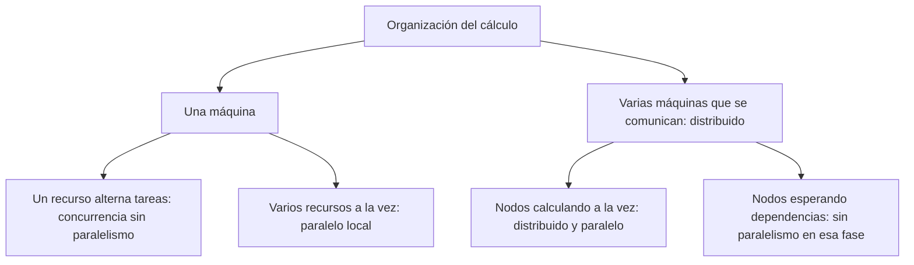
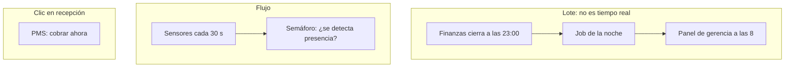

# 1.4. Procesamiento de datos

!!! info "Ruta de estudio"
    **Esencial:** distinguir concurrencia, paralelismo, distribución, lote, flujo, OLTP y OLAP.

    **Práctica guiada:** elegir el procesamiento del cierre y del indicador de presencia.

    **Ampliación:** razonar con SCV como guía, sin tratarlo como teorema. No sustituye al recorrido común; su detalle adicional solo se exige si el profesor lo anuncia antes (véase [cómo trabajar la unidad](index.md#como-trabajar-la-unidad)).

## Vídeo: un día en el hotel

Acompaña a Ana desde el pago en recepción hasta el cierre nocturno, las consultas de dirección y las señales de los sensores. Este recorrido conecta las distintas formas de procesar datos y explica qué trabajo hacemos, cuándo necesitamos el resultado y dónde lo calculamos. La narración enlaza las ideas paso a paso y deja pausas para asimilar los ejemplos. **Duración: 9 minutos y 41 segundos.**

<video controls playsinline preload="metadata" poster="../../assets/ut1/procesamiento-natural-portada.jpg" aria-label="Procesamiento de datos: un día en el hotel" style="width: 100%; max-width: 960px; height: auto; border-radius: 12px;">
  <source src="../../assets/ut1/procesamiento-natural.mp4" type="video/mp4">
  Tu navegador no permite reproducir este vídeo. Puedes descargarlo en el enlace siguiente.
</video>

El vídeo incluye subtítulos visibles y narración con voz sintética en español.

[Descargar el vídeo](../assets/ut1/procesamiento-natural.mp4) · [Leer la transcripción](../assets/ut1/procesamiento-natural.txt) · [Descargar los subtítulos](../assets/ut1/procesamiento-natural.es.srt)

## Tres preguntas para clasificar un procesamiento

En 1.3 elegimos cómo conservar los datos. Ahora vamos a transformarlos en un resultado: por ejemplo, sumar los cobros de ayer por hotel. Para describir ese trabajo necesitamos responder tres preguntas independientes.

1. **¿Dónde se ejecuta?** Puede utilizar un ordenador o varias máquinas; dentro de ellas puede aprovechar varios núcleos.
2. **¿Cuándo se ejecuta?** Puede procesar un conjunto cerrado por lotes o atender datos que llegan de forma continua.
3. **¿Para qué se ejecuta?** Puede registrar una operación del negocio o analizar muchas operaciones ya registradas.

Un informe nocturno puede ser analítico, por lotes y distribuido al mismo tiempo. Un servicio de reservas puede atender muchas operaciones concurrentes en una sola máquina. Por tanto, estas palabras describen dimensiones diferentes, no casillas excluyentes.

En particular, el paralelismo significa ejecutar trabajo simultáneamente y puede existir tanto dentro de una máquina como entre varias. En los ejemplos de esta unidad usaremos el portátil para ilustrar el paralelismo local y el clúster para ilustrar el procesamiento distribuido.

Una vez distinguidas estas decisiones, en 1.5 veremos cómo encajan el procesamiento, el almacenamiento y la consulta en una arquitectura completa.

Almacenar no basta: el criterio **d)** pide **procesar** lo guardado. El **a)** también entra: hay que caracterizar *cómo* se parte el trabajo y *con qué prisa* tiene que salir el número. Un dato en el lago que nadie transforma no sirve a gerencia.

En el [grupo hotelero](caso-hotel.md){target="_blank" rel="noopener"} eso ya está partido en dos relojes:

- **Recepción** opera ahora (PMS, cobro). No puede esperar.
- **Finanzas** cierra a las **23:00**; de madrugada corre el **lote**; a las **8** gerencia abre el panel de **ayer**.
- Los sensores (~30 s) alimentan el **semáforo** (“¿se detecta presencia?”), no el cuadro de las 8.

En clase lo aplicáis en la [tarea de los 500 GB](transicion-ut2.md){target="_blank" rel="noopener"}: concurrente, paralelo y distribuido, con un portátil que **no** puede tragarse el fichero.

!!! info "Cómo se lee esta página"
    Primero **dónde** corre el cálculo (un núcleo, varios núcleos, varias máquinas). Luego el **ritmo** (lote, clic, consulta, flujo). Después los **dos oficios** (operar / informar) y el **SCV** (compromisos entre velocidad, precisión y volumen). Cómo se combinan lote y flujo en el edificio va en [1.5](arquitectura.md){target="_blank" rel="noopener"}, no aquí.

## Concurrente, paralelo y distribuido

Tres palabras que en el pasillo se usan como sinónimos. No lo son. Si las mezcláis, no sabréis si os basta el portátil o hace falta un [clúster](clusters.md){target="_blank" rel="noopener"}.

| Tipo | Dónde corre | ¿A la vez de verdad? | En el hotel |
| --- | --- | --- | --- |
| **Concurrente** | Una o varias máquinas | **No necesariamente** | Un núcleo que se **turna**: el job y el antivirus |
| **Paralelo** | Varios recursos de cálculo, en una o varias máquinas | Sí | Diez núcleos suman noches de **Laredo** |
| **Distribuido** | **Varias máquinas** en red | Puede haberla; distribuir no exige simultaneidad | Un nodo por hotel: Santander, Laredo, Comillas, Potes |

Son dos preguntas distintas: dónde se ejecuta y si hay simultaneidad. La concurrencia permite que varias tareas progresen durante un intervalo.

**Concurrente.** Varias tareas progresan durante un mismo intervalo. Con un único recurso de ejecución pueden alternarse: una avanza mientras otra espera. La concurrencia es real, aunque no haya ejecución simultánea. **Paralelo** añade simultaneidad con varios recursos; puede darse dentro de una máquina o entre varias máquinas.

**Paralelo (multinúcleo).** Varios núcleos físicos, cada uno una CPU de verdad. Ahí sí hay paralelismo real.

**Multihilo de hardware (SMT):** un núcleo comparte recursos entre varios hilos de ejecución. No debe confundirse con crear varios hilos de software, que el sistema operativo planifica sobre los procesadores disponibles. Mientras un hilo espera un dato de memoria, el otro puede multiplicar. Si **los dos** necesitan la misma unidad a la vez, uno espera. Por eso un procesador “4 núcleos / 8 hilos” **no** es lo mismo que 8 núcleos físicos.

### Cuándo se puede paralelizar

Para combinar resultados parciales debemos conservar la información necesaria. La suma total es la suma de las sumas parciales. La media global, en cambio, se obtiene dividiendo la suma total entre el recuento total; no se calcula promediando sin más las medias de grupos de tamaños diferentes.

Por ejemplo, un hotel tiene 2 cobros con media de 100 € y otro tiene 8 con media de 200 €. La media global es `(2 × 100 + 8 × 200) / 10 = 180 €`, no 150 €. Un buen reparto conserva en cada nodo la suma y el recuento, y combina ambos al final.

**Sí (independiente):** sumar noches por hotel. Partís en cuatro trozos (Santander, Laredo, Comillas, Potes), cada núcleo (o cada nodo) suma el suyo, al final sumáis cuatro parciales. El último paso es barato.

**Con dependencia en esta implementación:** cada paso necesita el resultado del anterior (si el acumulado va *par* sumáis, si va *impar* restáis). Aunque cortéis la lista, el segundo trozo **no sabe** qué hacer hasta que acabe el primero. Sin reformular el algoritmo, más núcleos no acortan ese cuello: es lo que [1.2](clusters.md){target="_blank" rel="noopener"} llamaba “el clúster no hace magia”.

!!! tip "Pregunta para el examen"
    “Si solo hay un núcleo y el sistema cambia de programa cada X ms, ¿hace varias tareas al mismo tiempo?”  
    **No en el supuesto de un único recurso que alterna tareas.** Hay concurrencia por turnos, no ejecución simultánea de esas tareas.

## Distribuido (entre máquinas)

El procesamiento **distribuido** reparte trabajo entre máquinas y puede ejecutarlo en paralelo. Además de coordinar tareas, debe afrontar tres dificultades:

- Los datos **no** están todos en la misma RAM.
- La **red** tarda y a veces falla.
- Un nodo puede caer **a mitad** del trabajo (si se funde el disco de Potes, el job tiene que **reintentar**, no publicar el panel a medias).

En Hadoop de libro la consigna es “**lleva el cálculo al dato**”: copiar 200 GB al portátil para sumarlos es absurdo; mandáis la función al nodo que **ya** tiene el trozo. En un [cubo de objetos](almacenamiento.md){target="_blank" rel="noopener"} a menudo es al revés: el dato vive en el cubo y el motor **lee por red** ([1.2](clusters.md){target="_blank" rel="noopener"}). Las dos frases no se pisan: son **dos diseños**.

MapReduce y Spark viven aquí. En este módulo no tenéis que programarlos aún; sí debéis saber *por qué* existen. El i7 de la [tarea](transicion-ut2.md){target="_blank" rel="noopener"} **no** es un clúster.

## Estrategias: no todo es “tiempo real”

**Lote** significa trabajar con un conjunto delimitado. Aunque pueda ejecutarse de noche, sigue teniendo un plazo de entrega. **Streaming** procesa una secuencia que continúa creciendo. Los **microlotes** agrupan los eventos recibidos durante intervalos cortos y los procesan sucesivamente.

En flujo distinguimos la hora del evento de la hora de llegada. Un sensor puede medir a las 10:00 y entregar el mensaje a las 10:03. Si calculamos la presencia detectada de 10:00 a 10:01, debemos decidir cuánto esperamos y si corregimos el resultado cuando llega el dato tardío. Esta política forma parte del significado del indicador.

La tabla compara situaciones de trabajo, no cuatro categorías excluyentes. Lote y flujo describen el tratamiento de un conjunto acotado o de eventos continuos; interactivo describe la relación con el usuario; transaccional describe operaciones del negocio. Un sistema transaccional suele necesitar baja latencia y garantías ACID (atomicidad, consistencia, aislamiento y durabilidad), pero esas garantías no son una unidad de tiempo.

| Estrategia | ¿Urge el resultado? | En el hotel |
| --- | --- | --- |
| **Por lotes** (*batch*) | Hay un plazo acordado; no se responde a cada evento | Finanzas cierra a las 23:00; el job de madrugada; el **panel de las 8** (ayer) |
| **Por transacciones** | Normalmente baja latencia, según la operación | Picar el cobro en el **PMS**. Es el reloj del clic, no “ACID” |
| **Interactivo** | Sí, mientras miráis | A las 11 filtráis Laredo en el almacén: “¿cómo fue el cierre de ayer?”. La consulta es interactiva, pero la frescura sigue siendo la del último cierre |
| **Flujo** (*streaming*) | Sí, **al ritmo** en que llegan | Sensores cada ~30 s → **semáforo** de recepción |

!!! tip "Trampa de vocabulario (muy examinable)"
    Un **cobro** ocurre en tiempo real (recepción no espera).  
    Un **análisis** en tiempo real **no** es lo mismo: no estáis confirmando un cobro, estáis **consultando o resumiendo**.  
    El panel de las 8 **no** es tiempo real: es el lote de **ayer**.  
    La palabra inglesa *online* aquí solo significa “mientras usáis el sistema”, no “hay una transacción de dinero”.

**Streaming** añade otra dificultad: las cuentas se actualizan **conforme llegan** los datos. El estado puede mantenerse en memoria y en almacenamiento persistente, según el motor. Hay que dimensionarlo y definir cómo se recupera tras un fallo. No es “un lote, pero más rápido”: es otro contrato. Cómo se **combinan** lote y flujo (Lambda / Kappa) está en [1.5](arquitectura.md){target="_blank" rel="noopener"}.

## Dos trabajos: operar el día a día o analizar el histórico

En el hotel conviven **dos oficios** que parecen el mismo (“usar el ordenador con datos”) y no lo son.

**Oficio 1 — Operar.** Recepción registra la reserva y el cobro. Muchas personas a la vez, cada una toca **poca** información, y necesita una latencia baja y un plazo acordado según la operación. Si esto se atasca, hay cola en el mostrador.

**Oficio 2 — Analizar.** Gerencia pregunta “ocupación de agosto en Laredo frente a julio” o “importe cobrado por hotel”. Eso recorre **mucho** histórico, resume, compara. Nadie está esperando con la tarjeta en la mano, pero el número tiene que ser **defendible**.

Mezclar los dos en **la misma** tabla “para no duplicar” suele acabar así:

- recepción espera porque el informe está recorriendo el PMS, o
- el informe tarda una eternidad porque la tabla está pensada para cobrar, no para resumir.

Por eso se **copian** los hechos del oficio 1 hacia un almacén del oficio 2 (eso es la [ingesta](ingesta.md){target="_blank" rel="noopener"}). El segundo **no sustituye** al primero: **se alimenta** de él.

### Cómo se llaman en los libros: OLTP y OLAP

Cuando leáis documentación o un examen, esos dos oficios aparecen con siglas inglesas. No asumáis que las conocéis: son solo **nombres** de lo de arriba.

Porcentajes ficticios para ilustrar el análisis. Los CSV de cruce no permiten calcular ocupación: faltan habitaciones disponibles y ocupadas por periodo.

| | **OLTP** | **OLAP** |
| --- | --- | --- |
| Significa | *Online Transaction Processing*: procesar **operaciones** del día a día | *Online Analytical Processing*: procesar **consultas de análisis** |
| En el hotel | PMS: cobrar, reservar, check-in | Panel de las 8, ocupación por hotel |
| Pregunta típica | “Cobra *esta* estancia” | “Ocupación e importe por hotel” |
| Cuánto toca cada vez | Pocas filas | Muchas filas, resúmenes |
| Tiempo | Baja latencia según el servicio | Respuesta interactiva o plazo del proceso programado |
| Usuarios | Recepción, web | Gerencia, analistas |
| Relación | **Produce** los hechos | **Lee** esos hechos ya copiados e integrados |

*Online* vuelve a significar “en el sistema, ahora”, no “pago por internet”.

Un **cubo OLAP** organiza medidas (por ejemplo, importe cobrado) por dimensiones (tiempo, hotel, canal). Permite filtrar y agregar por esos ejes. Puede precalcular agregados o resolver consultas al solicitarlas, según el motor; no implica necesariamente que todos los cruces estén hechos ni que todo resida en RAM.

**No es el cubo de objetos** de [1.3](almacenamiento.md){target="_blank" rel="noopener"}: en S3, un *bucket* es un **contenedor de objetos**, cada uno identificado por una clave; no es un único fichero ni equivale a un disco en red. El **cubo OLAP**, en cambio, organiza medidas y dimensiones para el análisis. Puede calcular los resúmenes al consultar o tener algunos precalculados, según el motor. La palabra «cubo» se usa aquí para dos conceptos distintos.

En [1.3](almacenamiento.md){target="_blank" rel="noopener"} el **warehouse** es el sitio típico del oficio 2; el PMS relacional es el sitio típico del oficio 1.

## Principio SCV (solo para análisis) { #scv }

En algunos materiales se utiliza SCV para discutir el compromiso entre **velocidad**, **precisión** y **volumen** de un análisis. Lo emplearemos como una guía de razonamiento bajo recursos limitados, no como un teorema equivalente a CAP.

| Dimensión | Qué debemos concretar | Ejemplo |
| --- | --- | --- |
| Speed | Plazo máximo para obtener el resultado | Actualizar un indicador en segundos. |
| Consistency, usada aquí como precisión | Si aceptamos aproximaciones y con qué error | Estimar una media con una muestra representativa. |
| Volume | Cantidad de datos que intervienen | Analizar varios años de reservas. |

Esta C no es la consistencia de ACID ni la de CAP. Tampoco usar todos los registros garantiza exactitud: los datos pueden contener errores. Una ventana temporal puede dar un resultado exacto para esa ventana, aunque no describa todo el histórico.

Supongamos que una consulta tarda diez minutos y dirección necesita respuesta en diez segundos. Podemos preparar agregados previamente, elegir otro formato, mejorar el cálculo, aumentar recursos, limitar el periodo o utilizar una aproximación. Cada alternativa tiene costes y responde a una pregunta diferente. No hay una obligación universal de sacrificar una de las tres dimensiones.

El panel nocturno dispone de varias horas para validar el cierre. Un indicador continuo dispone de menos tiempo y necesita definir cómo trata los eventos tardíos. Ambos pueden calcular resultados exactos para su ámbito si el diseño y los recursos lo permiten.

!!! example "Decisión razonada"
    Para calcular el importe de ayer, una tabla ya agregada por fecha y hotel puede ofrecer una respuesta rápida y exacta sin releer todo el histórico. El trabajo se ha realizado antes: no ha desaparecido.

!!! success "Para el criterio d)"
    Explicad qué cálculo realizáis, sobre qué datos, en qué plazo y cómo comprobareis el resultado. Después justificad si necesitáis lote, flujo, ejecución local o distribuida.

## Actividad

No puntúa en Moodle. Una línea de por qué.

1. El portátil tiene 10 núcleos y sumáis noches de Laredo **en esa máquina**. ¿Paralelo local o distribuido? Suponed que varios núcleos calculan a la vez.
2. El job de madrugada parte el histórico en **cuatro nodos** (una partición por hotel). ¿Por qué es distribuido y cuándo sería también paralelo?
3. Recepción cobra una estancia; gerencia abre ocupación por hotel a las 8. ¿OLTP u OLAP en cada caso?
4. Una consulta sobre todo el histórico supera el plazo requerido. Proponed dos cambios de diseño y explicad qué coste o limitación introduce cada uno.

!!! tip "Comprobación"
    Paralelo local / distribuido, y también paralelo si los nodos calculan simultáneamente / OLTP luego OLAP / con los recursos del supuesto, habrá que reducir el trabajo, aceptar una aproximación o aumentar el tiempo disponible; también se puede revisar la arquitectura y el presupuesto.

## Autoevaluación del 1.4

Diez preguntas (A–D, **una** correcta) sobre los conceptos del apartado. No puntúan en Moodle. En **cada** una, **Comprobar respuesta**: si es correcta o no, y una explicación breve. Podéis repetir el test.

