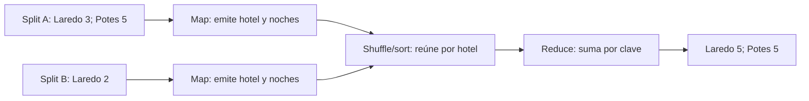

# 2.4. Computación distribuida

!!! info "Ruta de estudio"
    **Esencial:** seguir el cálculo map → shuffle/sort → reduce; distinguir tareas, simultaneidad y máquinas; comprobar resultados antes de comparar tiempos.

    **Práctica guiada:** ejecutar el agregado de noches con el CSV pequeño, contrastarlo por hotel y observar su ejecución en el entorno de 2.2.

    **Ampliación:** generar más datos y comparar configuraciones preparadas por el profesor. No se presupone que el portátil permita demostrar aceleración entre máquinas físicas.

En los apartados anteriores hemos separado almacenamiento y ejecución. Ahora comprobaremos **cómo se divide un cálculo, cómo se reúnen sus resultados y cuándo compensa hacerlo**. El criterio **b)** exige observar el procesamiento distribuido y medirlo; no basta con afirmar que añadir máquinas siempre acelera un programa.

La pregunta de gerencia será: **¿cuántas noches reservadas aparecen en el fichero para cada hotel?** No son necesariamente noches cobradas ni habitaciones ocupadas en una fecha: el CSV no contiene estado del pago ni calendario de ocupación.

En 2.2 conocimos las piezas y en 2.3 seguimos el archivo dentro de HDFS. Ahora preguntamos: **si repartimos la lectura, cómo obtenemos el mismo resultado y cómo sabemos si compensa**. La validación de la UT1 sigue vigente: ni una salida generada ni un tiempo menor bastan si cambia el significado del informe.

| Concepto | Qué describe | Qué debemos observar |
| --- | --- | --- |
| **División en tareas** | El cálculo se descompone en partes. | Splits, tareas map y tareas reduce. |
| **Paralelismo** | Hay tareas ejecutándose al mismo tiempo. | Intervalos de ejecución y recursos disponibles. |
| **Distribución** | Intervienen varios nodos coordinados. | Dónde se ejecutan los procesos y qué comunicación realizan. |
| **Aceleración** | El mismo trabajo correcto termina en menos tiempo. | Medidas comparables, no solo número de tareas. |

Puede haber paralelismo en una sola máquina. También puede haber fases de espera en un sistema distribuido. Los contenedores del portátil permiten estudiar servicios separados, pero comparten el hardware.

## MapReduce, con reservas (no con el Quijote)

Una suma por hotel puede dividirse porque la suma de enteros es asociativa: sumar primero cada grupo y después sus resultados produce el mismo total. MapReduce organiza ese trabajo en tres fases.

### Map: transformar cada registro

Partimos del [CSV de la práctica](../assets/practicas/hotel-hadoop/reservas.csv):

```csv
id_reserva,hotel,canal,noches,importe
1,Laredo,web,3,186.50
2,Laredo,ota,2,124.00
3,Potes,recepcion,5,410.00
```

El mapper selecciona `hotel` como clave y `noches` como valor. Emite `Laredo → 3`, `Laredo → 2` y `Potes → 5`, utilizando un tabulador entre clave y valor.

Cada tarea map procesa un **input split**, una división lógica de la entrada. Con texto divisible, los splits suelen guardar relación con los bloques HDFS, pero **bloque y split no son sinónimos**. El formato y la compresión pueden cambiar el reparto. Tampoco hay un mapper por máquina: una máquina puede ejecutar varias tareas, simultáneamente o por turnos.

El siguiente esquema utiliza solo las tres filas anteriores, repartidas en dos splits ilustrativos. No representa los veinte registros completos ni obliga a usar dos máquinas.



### Shuffle y sort: reunir la misma clave

Dos mappers pueden emitir `Laredo`. Hadoop envía todos los pares de esa clave al mismo reducer y los ordena por clave. Esta fase consume red, memoria y, a menudo, disco.

El **particionador** determina qué reducer recibe cada clave. Aunque configuremos diez reducers, todos los valores de Laredo siguen llegando al mismo. Si casi todos los registros pertenecen a ese hotel, aparece un desequilibrio de carga o *skew*: un reducer concentra casi todo el trabajo.

En esta suma no importa el orden de las reservas dentro de cada hotel. Sí importa que la misma clave llegue al mismo reducer. El shuffle ordena **por clave**, no por importe o número de noches, y el conjunto de archivos de salida no constituye necesariamente una ordenación global.

### Reduce: agregar y escribir

El reducer recibe claves consecutivas y acumula sus valores. Cuando cambia de hotel, escribe el total anterior y reinicia el acumulador. Para las tres líneas anteriores obtendría `Laredo → 5` y `Potes → 5`.

La salida se escribe en HDFS. Puede haber varios ficheros `part-*`: debemos leerlos todos. `_SUCCESS` indica finalización correcta, pero **no demuestra que nuestra fórmula sea correcta**. Eso se comprueba con un cálculo independiente.

Un **combiner** puede sumar parciales antes del shuffle y reducir tráfico. Es válido para esta suma, pero no para calcular una media como «media de las medias»: grupos de distinto tamaño pesarían igual. Para una media se transportan **suma y número de valores** y se divide al final.

El combiner es una optimización opcional: puede no ejecutarse o hacerlo varias veces. El cálculo debe seguir siendo correcto. No está configurado en el comando básico de esta práctica.

Por ejemplo, un grupo con noches `[2, 4]` tiene media 3 y otro con `[10]` tiene media 10. Promediar 3 y 10 da 6,5; la media de las tres reservas es `(2 + 4 + 10) / 3 = 5,33…`. Para combinar correctamente conservamos sumas y recuentos: `(6 + 10) / (2 + 1)`.

!!! note "Cuándo elegir otro modelo"
    MapReduce encaja en recorridos por lotes y agregaciones. Los algoritmos iterativos pueden pagar repetidamente el coste de materializar resultados. Spark permite reutilizar datos en memoria cuando hay capacidad, aunque también puede escribir a disco. Elegimos según el algoritmo y los recursos.

## YARN: quién presta la CPU

HDFS localiza los datos; **YARN administra los recursos**; MapReduce expresa cómo transformarlos.

| Pieza | Responsabilidad | Duración |
| --- | --- | --- |
| ResourceManager | Admite aplicaciones y administra recursos del clúster | Servicio permanente |
| NodeManager | Lanza y supervisa tareas en un nodo | Servicio permanente |
| ApplicationMaster | Coordina una aplicación y solicita recursos para sus tareas | Mientras dura la aplicación |
| Contenedor YARN | Asignación de RAM y núcleos virtuales | Mientras la necesita una tarea o el AM |

Un contenedor YARN y un contenedor Docker son conceptos distintos. Docker aloja los servicios del laboratorio; dentro, YARN administra las asignaciones de las tareas.

1. El cliente envía el trabajo y sus ficheros auxiliares.
2. YARN reserva recursos para el ApplicationMaster.
3. El AM solicita contenedores para maps y reduces, intentando aprovechar la cercanía de los datos.
4. Los NodeManagers ejecutan las tareas y comunican su estado.
5. El AM coordina la finalización y se publica la salida en HDFS.

El ResourceManager contiene un **Scheduler**, que asigna recursos, y un componente que gestiona las aplicaciones. No corrige errores de Python. El framework puede reintentar tareas fallidas: no debemos realizar cobros ni enviar correos desde un mapper, porque esos efectos externos podrían repetirse.

En Hadoop 1, JobTracker y TaskTracker asumían las funciones de ejecución. YARN separa recursos y programación y permite otros motores, como Spark. Añadir workers puede mejorar la concurrencia si existen tareas independientes y no domina otro cuello de botella.

## Comprobar el poder (qué hacer en el lab)

### Preparar una entrada común

Trabaja con `reservas.csv`, [mapper_noches.py](../assets/practicas/hotel-hadoop/mapper_noches.py) y [reducer_noches.py](../assets/practicas/hotel-hadoop/reducer_noches.py), en `docs/assets/practicas/hotel-hadoop`. **No sustituyas el CSV por uno de UT1 sin adaptar las columnas**: aquellos ejercicios pueden incluir `entrada` o `id_hotel` en otras posiciones.

| Campo | Contrato | Uso |
| --- | --- | --- |
| id_reserva | Identificador entero | Identifica la fila |
| hotel | Texto no vacío y sin tabuladores | Clave de agrupación; mantenemos los nombres exactos del fichero |
| canal | Texto no vacío | Se valida, aunque no interviene en la suma |
| noches | Entero positivo | Valor que sumamos |
| importe | Decimal finito y no negativo | Se valida, aunque no interviene en la suma |

Hay una reserva por línea física y una cabecera. El procesamiento por líneas de Streaming no admite sin adaptación campos CSV con saltos de línea internos.

### Verificar primero en local

Los scripts enlazados contienen el código completo. El mapper usa `csv.reader`, omite la cabecera y rechaza registros incompatibles en vez de descartarlos silenciosamente. El reducer conserva solo la clave actual y su suma.

En **PowerShell**, desde la carpeta de prácticas, ejecutad las fases separadas. Así se detecta un error del mapper antes de continuar con un resultado parcial. Estos comandos guardan las filas en memoria y se reservan para el CSV pequeño:

```powershell
$pares = Get-Content -Encoding utf8 reservas.csv | python mapper_noches.py
if ($LASTEXITCODE -ne 0) { throw "El mapper ha fallado; no se acepta la salida." }
$resultado = $pares | Sort-Object | python reducer_noches.py
if ($LASTEXITCODE -ne 0) { throw "El reducer ha fallado; no se acepta la salida." }
$resultado | Set-Content -Encoding utf8 noches_local.tsv
Get-Content noches_local.tsv
```

En **Bash**:

```bash
set -o pipefail
python3 mapper_noches.py < reservas.csv | LC_ALL=C sort | python3 reducer_noches.py > noches_local.tsv
estado=$?
if [ "$estado" -ne 0 ]; then
  echo "El proceso ha fallado; no se acepta noches_local.tsv." >&2
else
  cat noches_local.tsv
fi
```

La ordenación local agrupa las claves que recibirá el reducer, pero **no reproduce toda la distribución ni la comunicación del shuffle**. En Bash, `pipefail` permite detectar que una etapa anterior ha fallado. Una salida parcial puede existir aun con error: no se acepta ni se mide como ejecución correcta.

Usad nombres nuevos al repetir si queréis conservar resultados. Las claves del fichero son los cinco nombres conocidos; si se añaden otros textos, revisad también la ordenación y codificación. Ordenar ficheros grandes consume memoria, disco y tiempo.

Con las 20 reservas originales, debes obtener:

| Hotel | Noches |
| --- | ---: |
| Comillas | 11 |
| Laredo | 12 |
| Noja | 15 |
| Potes | 14 |
| Santander | 10 |
| **Total** | **62** |

Comprueba con este programa independiente, guardado como `comprobar.py` en esa carpeta:

```python
import csv
from collections import Counter

totales = Counter()
with open("reservas.csv", encoding="utf-8", newline="") as fichero:
    for fila in csv.DictReader(fichero):
        totales[fila["hotel"]] += int(fila["noches"])
print(dict(sorted(totales.items())))
esperados = {"Comillas": 11, "Laredo": 12, "Noja": 15, "Potes": 14, "Santander": 10}
assert dict(totales) == esperados
assert sum(totales.values()) == 62
```

El ejemplo anterior confirma la referencia del CSV original, pero todavía hay que contrastarla con la salida real. Descargad [comprobar_noches.py](../assets/practicas/hotel-hadoop/comprobar_noches.py) en la misma carpeta y ejecutad:

```text
python comprobar_noches.py reservas.csv noches_local.tsv
```

El comprobador obtiene los totales de la entrada de manera independiente y compara **cada hotel**, detectando claves ausentes, adicionales, repetidas o con un total incorrecto. No importa el orden de las líneas. Devuelve código 1 si encuentra un error.

También podéis usar pandas o DuckDB sobre **el mismo fichero**, comprobando el mapa completo hotel → noches. Las 62 noches corresponden exclusivamente al CSV pequeño original: con datos generados se recalcula la referencia, no se conserva ese número como objetivo.

### Ejecutar el mismo cálculo en Hadoop

Primero, desde el anfitrión y en la carpeta del Compose, comprobad que los servicios del [2.2](ecosistema.md) están disponibles y que el ejecutor tiene Python:

```text
docker compose ps
docker compose exec nodemanager python3 --version
docker compose exec namenode bash
```

Si falta Python, utilizad la imagen preparada por el profesor. `-files` distribuye los scripts, **no instala dependencias**. Copiad también comprobar_noches.py en la carpeta local montada como /practicas.

Ya en el Bash del NameNode, utilizad rutas propias de 2.4 para no sobrescribir las salidas de 2.2:

```bash
cd /practicas
hdfs dfs -mkdir -p /user/bda/ut24
hdfs dfs -put reservas.csv /user/bda/ut24/reservas_01.csv
mapred streaming \
  -D mapreduce.job.reduces=1 \
  -files mapper_noches.py,reducer_noches.py \
  -mapper "python3 mapper_noches.py" \
  -reducer "python3 reducer_noches.py" \
  -input /user/bda/ut24/reservas_01.csv \
  -output /user/bda/ut24/salida_noches_01
estado=$?
if [ "$estado" -ne 0 ]; then
  echo "Job fallido: revisad los logs antes de aceptar resultados." >&2
else
  hdfs dfs -cat '/user/bda/ut24/salida_noches_01/part-*'
fi
```

Comprobad el éxito de cada paso antes de continuar. Si la entrada ya existe, verificad que corresponde al mismo CSV y reutilizadla; no la sustituyáis a ciegas. Si la salida existe, elegid salida_noches_02. El parámetro reduce=1 hace explícita la configuración inicial: no implica que el cálculo requiera un reducer por hotel.

**Solo tras un job correcto**, descargad todas las partes de texto a una ruta escribible del contenedor y verificadlas:

```bash
hdfs dfs -getmerge '/user/bda/ut24/salida_noches_01/part-*' /tmp/noches_hadoop_01.tsv
python3 /practicas/comprobar_noches.py /practicas/reservas.csv /tmp/noches_hadoop_01.tsv
```

Cada registro de la salida de estos scripts termina en salto de línea. Concatenar sus partes TSV sirve para comprobarlas; no es una operación válida para fusionar Parquet. /practicas es de solo lectura, por eso la descarga se hace en /tmp.

Registrad en YARN el identificador de aplicación, estado, tareas e intentos, además de los cinco totales. **Intentos no equivale a tareas lógicas:** los reintentos pueden elevar ciertos contadores. Los tiempos de las tareas y sus nodos permiten observar dónde y cuándo se ejecutaron.

### Medir sin cambiar dos variables a la vez

El fichero pequeño sirve para verificar el algoritmo. No es una prueba convincente de rendimiento: iniciar servicios y tareas puede costar más que sumar sus veinte filas.

Para generar una entrada mayor, descargad [generar_reservas_grandes.py](../assets/practicas/hotel-hadoop/generar_reservas_grandes.py) y ejecutad desde el anfitrión, en la carpeta de prácticas:

```text
python generar_reservas_grandes.py --lineas 4500000 --salida reservas_grandes.csv
```

El tamaño depende del contenido generado; anotad los bytes que imprime y el número de registros solicitado. No subáis el archivo grande al repositorio. Cargadlo en una ruta HDFS propia, ejecutad el mismo agregado con salida nueva y pasad **esa entrada y esa salida** a comprobar_noches.py. Esta referencia se calcula fuera del intervalo que medimos del job.

Para inspeccionar bloques y copias, desde el Bash del NameNode:

```bash
hdfs dfs -put /practicas/reservas_grandes.csv /user/bda/ut24/reservas_grandes.csv
hdfs fsck /user/bda/ut24/reservas_grandes.csv -files -blocks -locations
```

No deduzcáis número de tareas, simultaneidad o máquinas a partir del tamaño del archivo. Revisad splits y ejecución real.

**Protocolo de comparación:**

1. Identificad la entrada con tamaño, registros y, cuando sea posible, una huella SHA-256. Usad los mismos bytes y programas en ambas configuraciones.
2. Definid **una variable**: por ejemplo, recursos de ejecución disponibles en un entorno preparado por el profesor. Anotad valores inicial y nuevo. Cambiar reducers es otro experimento; no prueba añadir máquinas.
3. Definid el intervalo: aquí medimos desde el envío de mapred streaming hasta su finalización. No incluimos generación, carga previa ni comprobación posterior. Si medís el proceso completo, declaradlo y mantenedlo en ambas pruebas.
4. Realizad un calentamiento y tres ejecuciones medidas por configuración, con salidas distintas. Registrad también esperas, otras cargas, cachés y cambios del entorno; evitad atribuir su efecto al recurso estudiado.
5. Comprobad cada resultado. Una ejecución fallida o con resultado diferente se registra como tal; no se usa como evidencia de aceleración.
6. Conservad los tres tiempos y comparad sus medianas. Si varían mucho, investigad la causa antes de concluir.

| Configuración | Entrada y recursos | Maps / reduces e intentos | Concurrencia y nodos | Tres tiempos y mediana | Resultado comprobado |
| --- | --- | --- | --- | --- | --- |
| A: situación inicial | Bytes, registros, recursos | Observación | Evidencias de ejecución | Medición | Comparación por hotel |
| B: una variable modificada | Mismos datos; cambio indicado | Observación | Evidencias de ejecución | Medición | Comparación por hotel |

La **aceleración** se calcula como `tiempo inicial / tiempo nuevo`. En un ejemplo hipotético, A tarda 118, 120 y 123 segundos; B, 79, 80 y 84. Las medianas son 120 y 80, por lo que la aceleración es **1,5** y el tiempo se reduce aproximadamente un **33,3 %**. No es una medición del laboratorio.

Una razón menor que 1 indica que la nueva configuración tarda más. El arranque, la lectura, el shuffle, las partes secuenciales y el desequilibrio de claves pueden limitar la ganancia.

**Comparación local frente a Hadoop.** Puede ser útil, pero cambia más que el número de máquinas: intervienen otro motor, almacenamiento y costes de inicio. Explicad el alcance; no la presentéis como un experimento que aísla una única causa.

!!! warning "Qué demuestra el mini-clúster"
    El Compose básico tiene un DataNode y un NodeManager en un ordenador. Permite observar roles y tareas, pero no demuestra reparto entre máquinas físicas ni aceleración al añadir servidores. Con pocos datos puede tardar más que el cálculo local. Registra y explica ese resultado: es una conclusión válida.

### Entrega y comprobaciones

Entrega la identificación y tamaño de la entrada, comandos, contadores, resultados comparados y una interpretación de los tiempos. Sin más workers, documenta lo observado y qué experimento adicional necesitarías. No presentes «varios maps» como prueba de que había varias máquinas.

Para cerrar: ¿qué cambia si todas las reservas son de Laredo?, ¿por qué no sumamos medias sin sus tamaños?, ¿por qué `_SUCCESS` no valida la fórmula? Las respuestas conectan el algoritmo con el comportamiento del sistema.

## Qué habéis demostrado y cómo continúa la unidad

Este apartado se centra en el **criterio b) del RA2**. La evidencia reúne cálculo correcto, tareas observadas y mediciones interpretadas según el entorno. Ejecutar varios maps en un NodeManager no prueba un reparto entre ordenadores físicos. El profesor concretará el entorno o demostración adicional necesario para observar ese reparto.

| Evidencia | Qué permite afirmar | Qué no permite afirmar por sí sola |
| --- | --- | --- |
| Totales por hotel contrastados | El agregado coincide con la referencia de esa entrada. | Que hubo ejecución distribuida o mejora de tiempo. |
| Tareas y nodos registrados | Dónde y cuándo se ejecutó el trabajo observado. | Que más tareas hicieron el proceso más rápido. |
| Tiempos comparables y resultados iguales | Cómo cambió el rendimiento bajo esas condiciones. | Que la mejora se repetirá para cualquier volumen o consulta. |

Cerramos el primer bloque: sabemos conservar archivos, ejecutar un agregado y comprobarlo. En [2.5 Familias NoSQL](nosql.md) cambia la necesidad: además de recorrer un histórico, queremos localizar y actualizar información concreta. Compararemos modelos según esas operaciones; no porque el volumen obligue a abandonar las bases relacionales. Los datos y el laboratorio de MongoDB serán independientes.

## Referencias

- [Tutorial oficial de MapReduce](https://hadoop.apache.org/docs/r3.4.2/hadoop-mapreduce-client/hadoop-mapreduce-client-core/MapReduceTutorial.html).
- [Hadoop Streaming](https://hadoop.apache.org/docs/r3.4.2/hadoop-streaming/HadoopStreaming.html).
- [Arquitectura YARN](https://hadoop.apache.org/docs/r3.4.2/hadoop-yarn/hadoop-yarn-site/YARN.html).
- [2.2 Ecosistema Hadoop](ecosistema.md) y [2.3 HDFS](hdfs.md).

## Actividades

Justificad las respuestas con el caso hotelero. Conservad entrada, configuración, operaciones, resultados y explicación. Las condiciones de entrega se concretan en Moodle.

1. **Seguir tres reservas.** Con las tres filas del comienzo, escribid las emisiones map, agrupad por clave y calculad la salida reduce. Explicad por qué usar importe en lugar de noches daría otro indicador aunque el job terminara correctamente.
2. **Tareas, simultaneidad y máquinas.** Una ejecución tiene seis tareas map, un único NodeManager y como máximo dos maps activos a la vez. Explicad qué reparto se observa y qué no se ha demostrado. No deduzcáis un tiempo exacto sin medir.
3. **Validar por hotel.** Ejecutad el cálculo local y comprobar_noches.py. En una copia de la salida, restad una noche a Laredo y sumad una a Potes. El total sigue siendo 62: comprobad que el verificador lo rechaza y explicad por qué.
4. **Contrastar Hadoop.** Ejecutad el mismo agregado en el entorno de aula, descargad todos los part-* y verificadlos. Identificad rutas locales y HDFS y conservad el identificador de aplicación. Si el entorno no funciona, documentad el error; no presentéis la salida local como ejecución Hadoop.
5. **Entender el desequilibrio.** Imaginad que el 95 % de los registros corresponde a Laredo. ¿Por qué añadir reducers puede ayudar poco? Explicad qué concentra la carga y qué evidencias buscaríais.
6. **Combinar correctamente.** Calculad la media de los grupos [2, 4] y [10] mediante suma y recuento. Comparadla con la media de sus medias. Explicad por qué la corrección no debe depender de que se ejecute el combiner.
7. **Interpretar medidas.** Calculad medianas, aceleración y reducción de tiempo del ejemplo 118/120/123 frente a 79/80/84. Indicad qué condiciones deben cumplirse para aceptar la comparación y qué revisar si la configuración nueva tarda más.
8. **Medir — ampliación.** Con la entrada mayor y las configuraciones preparadas por el profesor, aplicad el protocolo. Si solo disponéis del Compose básico, presentad sus observaciones y diseñad el experimento adicional necesario para probar otras máquinas.
9. **Reintentos.** Un mapper registra un cobro en un servicio externo y después falla. ¿Qué puede ocurrir al repetirlo? Explicad por qué separaríamos ese efecto del agregado analítico.

??? success "Orientaciones para revisar las respuestas"
    **1–2.** Las emisiones son Laredo→3, Laredo→2 y Potes→5; los totales, Laredo 5 y Potes 5. Seis tareas con dos activas requieren turnos; no demuestran seis máquinas ni una aceleración determinada.

    **3–4.** Igual total global no implica igual reparto por hotel. El verificador debe rechazar los cambios compensados. La salida de Hadoop se contrasta sobre la misma entrada y leyendo todas las partes; el orden de los hoteles puede cambiar.

    **5–6.** Con el particionado por hotel, todas las emisiones de Laredo llegan al mismo reducer. La media correcta es 16/3, aproximadamente 5,33; promediar 3 y 10 da 6,5 y pondera mal los grupos.

    **7–8.** Las medianas son 120 y 80 segundos; aceleración 1,5 y reducción aproximada del 33,3 %. Requiere trabajo equivalente, resultados correctos y condiciones documentadas. Una medida más lenta también es información útil.

    **9.** El cobro podría repetirse. El agregado de la práctica no debe producir efectos externos; los reintentos del framework no convierten una operación de negocio en exactamente una ejecución.

## Autoevaluación del 2.4

Diez preguntas (A–D, **una** correcta). No puntúan en Moodle. **Comprobar respuesta** muestra el resultado y explica el motivo. Revisad el apartado enlazado antes de repetir.

<div class="dwec-quiz" data-dwec-quiz data-src="../../assets/quizzes/ut2-2-4.json"></div>
