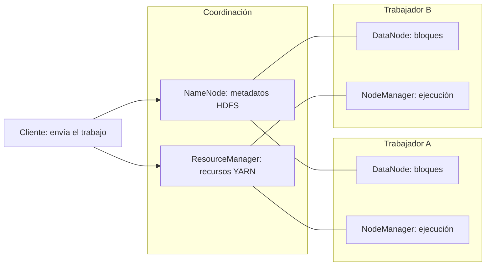
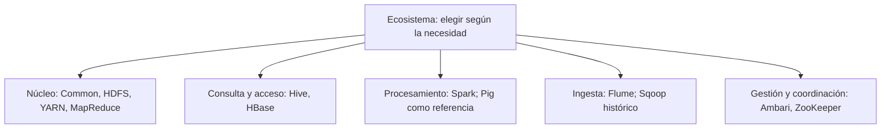
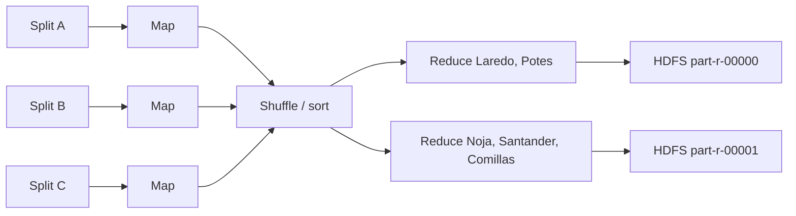
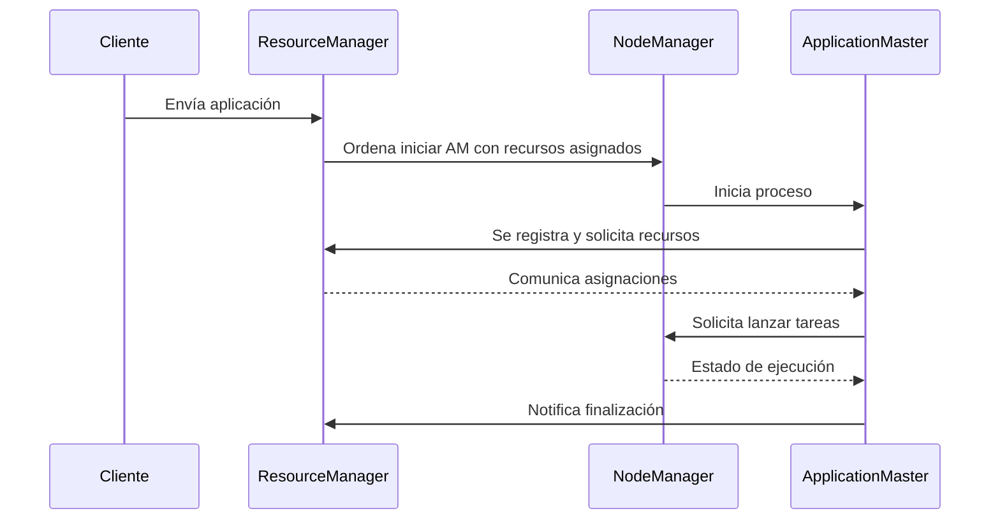

# 2.2. Ecosistema Hadoop

!!! info "Ruta de estudio"
    **Esencial:** distinguir HDFS, YARN y MapReduce; seguir una reserva desde el fichero hasta el resultado comprobado.

    **Práctica guiada:** arrancar el entorno indicado por el profesor, ejecutar un recuento y un agregado de noches y explicar sus resultados. No hay que instalar todos los módulos del ecosistema.

    **Ampliación:** dimensionamiento de servidores, reserva de recursos, federación, Hadoop 1 e historial avanzado. Las entregas evaluables se concretan en Moodle.

En [2.1](por-que-almacenamiento.md) justificamos tres necesidades del hotel: conservar el histórico, obtener el informe dentro del plazo y recuperar el servicio ante ciertos fallos. Ahora conoceremos las piezas de una solución que permite abordarlas: **Apache Hadoop**.

Hadoop reúne herramientas de almacenamiento y procesamiento. Puede utilizarse en grandes clústeres o en un entorno pequeño para aprender. **No es un requisito de cualquier problema Big Data:** su elección depende de los datos, las operaciones y los recursos.

Calcularemos **noches reservadas por hotel**, una pregunta más sencilla que el informe de cobros de Pentaho. Así podemos concentrarnos en guardar la entrada, asignar recursos y reunir el cálculo. Como en la UT1, comprobaremos el resultado: terminar sin errores no basta.

Las prácticas utilizan Hadoop **3.x**. Anotad la versión efectiva con `hadoop version` y la imagen indicada por el profesor: la etiqueta `apache/hadoop:3` puede cambiar. Las referencias a Hadoop 1 permiten interpretar materiales antiguos.

### Recorrido mínimo de la sesión

1. Preparad los archivos juntos y verificad servicios, versiones y Python antes de Streaming.
2. Comprobad un DataNode y un NodeManager registrados; identificad qué hace cada servicio.
3. Ejecutad wordcount en una salida nueva y leed sus partes.
4. Calculad noches por hotel y contrastad las 62 noches y los cinco subtotales con 2.4.
5. Guardad comandos, configuración y resultados; continuad con la comparación común de 2.4. Las instalaciones tradicionales y los extras no se ejecutan como pasos adicionales del Compose.

## Qué promete (y por qué importa al RA2)

Separad tres preguntas: **dónde conservar el histórico**, **quién asigna recursos** y **cómo organizar el cálculo**. HDFS responde a la primera, YARN a la segunda y MapReduce a la tercera.

| Propiedad | Qué aporta y qué debemos comprobar | Criterio |
| --- | --- | --- |
| **Fiabilidad** | Prestar el servicio según sus requisitos: datos accesibles, resultados correctos y plazo cumplido. | **a)** / **c)** |
| **Tolerancia a fallos** | Réplicas y reintentos pueden recuperar ciertos fallos si hay copias, recursos y servicios disponibles. | **c)** |
| **Escalabilidad** | Añadir DataNodes puede aportar almacenamiento; añadir NodeManagers, ejecución. Hay que medir su efecto. | **e)** |
| **Portabilidad** | Reutilizar programas en entornos compatibles, revisando versiones, dependencias, rutas y permisos. | Apoyo a **a)** |

La tolerancia a fallos contribuye a la fiabilidad. Tener varios nodos con datos no protege automáticamente a un coordinador único ni recupera un borrado propagado. Mantenemos la distinción de la UT1 entre réplica y copia de seguridad.

**Escalar horizontalmente** consiste en añadir nodos; ampliar RAM o CPU de una máquina es escalado vertical. Un nodo puede alojar almacenamiento, ejecución o ambos. Incorporar Hive para consultar con SQL amplía funcionalidades, pero no añade por sí solo disco ni CPU.

En el aula separaremos estas funciones. Una mejora de rendimiento o una recuperación solo queda demostrada cuando se observa bajo condiciones concretas.

## Procesamiento en el mismo clúster que el dato

Hadoop puede aprovechar la **localidad de los datos**: intentar ejecutar una tarea en un nodo que disponga del bloque necesario, o cerca de él. Así puede reducirse la transferencia de entrada frente a llevar todo el histórico al portátil.

No desaparece la red: hay coordinación, lecturas remotas cuando no se consigue localidad y transferencias de resultados parciales en el *shuffle*. La planificación y los recursos determinan dónde se ejecuta cada tarea.

En un trabajador pueden convivir **DataNode**, que almacena y sirve bloques, y **NodeManager**, que lanza y supervisa procesos de ejecución. También pueden estar separados. **El DataNode no ejecuta los maps.**

Este esquema representa un despliegue posible. No fija un número mínimo de máquinas ni describe la distribución física del portátil.



### Tres roles de máquina

Un **rol** es una responsabilidad, no necesariamente una máquina exclusiva. En el portátil agrupamos servicios; en otros despliegues pueden separarse para dimensionar recursos y fallos.

| Rol | Responsabilidad | Cómo dimensionarlo |
| --- | --- | --- |
| **Coordinación o maestro** | NameNode mantiene metadatos HDFS; ResourceManager administra recursos YARN. | Según archivos, bloques, aplicaciones y disponibilidad requerida. |
| **Trabajador o worker** | DataNode guarda bloques; NodeManager permite ejecutar tareas. Pueden convivir. | Según capacidad, discos, CPU, memoria y red. |
| **Cliente o edge** | Carga entradas, envía aplicaciones y consulta resultados. | Según sus programas; no necesita una copia de todo el histórico. |

El **proceso NameNode** mantiene el mapa de archivos y bloques, no los bloques de datos de los usuarios. Si la misma máquina ejecuta un DataNode, ese otro proceso sí puede almacenarlos. Tener varios coordinadores tampoco configura automáticamente alta disponibilidad.

!!! note "Qué significa commodity"
    Es hardware estándar, no especializado. En producción se dimensionan servidores y red para la carga y los fallos previstos. Un ordenador de aula permite estudiar servicios, pero no reproduce las garantías de máquinas con dominios de fallo separados.

### Números de catálogo (para situaros, no para memorizar)

Como ejemplos orientativos, un diseño podría utilizar trabajadores con 64–128 GB de RAM, dos CPU de 6–8 núcleos y 12–24 discos de 4–12 TB; coordinadores con 128–256 GB de RAM, dos CPU de 8–16 núcleos y dos SSD de 2–4 TB; o un cliente con 256 GB de RAM y dos discos de 2–3 TB. **No son requisitos mínimos ni una receta de compra.** Un trabajador que calcula también necesita CPU y RAM.

El NameNode mantiene metadatos en memoria y los persiste en almacenamiento. El número de archivos y bloques influye en su dimensionamiento. Para los trabajadores también importan los bytes leídos por segundo y la concurrencia.

**JBOD** permite utilizar discos independientes. Muchos diseños HDFS lo combinan con réplicas entre nodos. RAID protege frente a ciertos fallos locales, pero no sustituye protección entre máquinas ni copias de seguridad. La elección depende del diseño; no la realiza YARN.

Un trabajador con DataNode y NodeManager configurados puede aportar almacenamiento y ejecución. Si añadimos solo uno de los servicios, la aportación cambia. Debemos observar el recurso incorporado y medir su efecto.

## El núcleo: cuatro piezas

| Pieza | Oficio |
| --- | --- |
| **Hadoop Common** | Librerías y utilidades compartidas (configuración, IPC, autenticación) |
| **HDFS** | Sistema de **ficheros** repartido. El detalle: [2.3](hdfs.md) |
| **YARN** | *Yet Another Resource Negotiator*: administra recursos de ejecución según solicitudes y políticas |
| **MapReduce** | Modelo: **mapear** y **reducir** pares clave/valor |

Para el analista, el clúster **parece** una carpeta enorme (`hdfs dfs -ls /`). Por debajo puede haber uno o muchos nodos, según el despliegue. Las aplicaciones se escriben **sin** programar sockets ni saber la topología: el científico se centra en la pregunta (“noches por hotel”), no en la red.

Eso no significa que el clúster sea “como un USB enorme”. Hay un NameNode, hay réplicas, hay *splits*. Pero **el código del job** no abre un socket a `datanode-17`. Hadoop lo hace.

## El ecosistema (módulos que se añaden)

Leed la tabla como un recorrido del dato: **entrada → almacenamiento → procesamiento → consulta → coordinación**. Algunos proyectos aparecen por su importancia histórica; que estén en un diagrama no significa que deban instalarse todos. Comprobad compatibilidad y mantenimiento antes de utilizarlos en un proyecto nuevo.

En el caso del hotel, distinguimos el fichero original, su catálogo o metadatos, el motor que calcula y la herramienta que presenta el resultado. Un catálogo no guarda necesariamente los bytes; un motor SQL no sustituye automáticamente el almacenamiento.

Para comprender el ecosistema, relacionad cada herramienta con su función y una necesidad. No hay que dominar todos los productos: incorporar Hive no convierte HDFS en un motor SQL ni sustituye automáticamente el almacenamiento.

El mapa agrupa herramientas por función. Sus líneas indican familias, **no dependencias obligatorias ni una instalación completa**.



| Módulo | Qué resuelve | Encaje en el hotel |
| --- | --- | --- |
| **Hive** | Consulta SQL con metadatos y un motor de ejecución sobre datos almacenados. | Consultar noches por hotel sin escribir directamente un mapper; hay que definir cómo interpretar los ficheros. |
| **HBase** | Base NoSQL de familias de columnas, con acceso por clave y actualizaciones; habitualmente usa HDFS. | Valorar consultas y cambios de registros de sensores según sus claves y necesidades. |
| **Pig** | Pig Latin expresa transformaciones de alto nivel que se traducen a trabajos. | Referencia para reconocer flujos de limpieza; no se instala en esta práctica. |
| **Sqoop — histórico** | Transfería datos entre bases relacionales y Hadoop. Retirado a Apache Attic en 2021. | Reconocer antiguos volcados de reservas; no se propone para nuevos trabajos. |
| **Flume** | Recoge y transporta eventos mediante flujos configurados. | Llevar logs al almacenamiento con las garantías de la configuración elegida. |
| **ZooKeeper** | Primitivas de coordinación para sistemas que lo integran. | Participar en mecanismos de elección; instalarlo no configura por sí solo alta disponibilidad. |
| **Spark** | Motor de lotes, consultas y flujos; puede reutilizar datos en memoria y también usa disco. | Estudiar cálculos iterativos, como modelos de cancelación, según carga y recursos. |
| **Ambari** | Instalación, configuración y supervisión de servicios compatibles. | Administrar el despliegue; no sustituye los motores ni las comprobaciones. |

**HBase, HDFS y Parquet son diferentes.** HDFS almacena archivos; Parquet define un formato columnar; HBase ofrece operaciones sobre registros y celdas con familias de columnas. Actualizar por clave puede justificar HBase. Conservar eventos de sensores como histórico en ficheros también puede ser adecuado: depende del uso.

**Spark puede ejecutarse en modo local o distribuido**, con YARN u otros gestores compatibles, y leer HDFS, objetos o archivos locales. No requiere que todo quepa en RAM ni garantiza ser diez veces más rápido. Reutilizar datos puede beneficiar a algoritmos iterativos; hay que medir la mejora y contrastar resultados.

**Distribuciones y servicios gestionados.** Cloudera —CDH es una denominación histórica— y servicios como Amazon EMR, Azure HDInsight o Google Dataproc reúnen componentes y administración. La disponibilidad y compatibilidad dependen de la oferta y versión utilizadas. En aula no hace falta contratar un servicio cloud.

!!! note "Funcionalidad y capacidad"
    Hive facilita consultas SQL; Spark aporta otro motor; un DataNode añade capacidad HDFS; un NodeManager incorpora ejecución. Un clúster requiere configuración y mantenimiento incluso con herramientas de administración o servicios gestionados.

Ahora nos centraremos en MapReduce, el motor elegido para las prácticas del bloque. Entenderemos el recorrido antes de ampliar el catálogo.

## MapReduce (el modelo que paraleliza)

MapReduce es un paradigma de programación **funcional** en **dos fases** (más el *shuffle* / *sort* en medio). Es uno de los modelos de ejecución del ecosistema. Parte el dato, procesa en paralelo, **reordena**, combina y agrega. El formato de trabajo es **clave → valor**.

Sirve para agregados, logs, minería “de una pasada”, conteos. **No** encaja con análisis interactivo (“dame ya el top 10 mientras cambio el filtro”) ni con algoritmos que dan **muchas vueltas** al mismo dataset: los resultados intermedios del map usan almacenamiento local y las salidas entre jobs suelen materializarse en el sistema de ficheros. Con datasets grandes, eso es una penalización. En IA, duele.

Un job contiene tareas map y, cuando corresponde, reduce. También podemos encadenar varios jobs: la salida de uno sirve de entrada al siguiente.

### Ejemplo de aula: noches por hotel

Cada noche el PMS deja en HDFS un fichero con líneas `id_reserva,hotel,canal,noches,importe`. Dirección pregunta: *¿cuántas noches reservadas aparecen por hotel?*

Imaginad tres fragmentos lógicos de entrada (*splits*) y tres tareas map. Esta tabla es un ejemplo reducido, no el CSV completo. **Split y bloque HDFS no son sinónimos**, y cada tarea no requiere una máquina distinta:

| Fragmento (tarea map) | Líneas que ve | Emisiones |
| --- | --- | --- |
| A (Laredo / Potes) | `Laredo,web,3` · `Potes,ota,5` · `Laredo,recepcion,1` | `Laredo→3`, `Potes→5`, `Laredo→1` |
| B (Santander / Noja) | `Santander,ota,4` · `Noja,web,3` | `Santander→4`, `Noja→3` |
| C (resto) | `Potes,web,2` · `Noja,ota,2` · `Comillas,web,4` | `Potes→2`, `Noja→2`, `Comillas→4` |

Hasta que no se **reduzca**, hay **duplicados** de clave: dos `Laredo`, dos `Potes`, dos `Noja`.

- **Map:** cada tarea procesa su split y emite pares. No suma todavía.
- **Shuffle / sort:** el clúster **junta** todas las `Laredo` en el mismo *reducer* (el gesto de un `GROUP BY`).
- **Reduce:** suma las noches de Laredo (`3+1=4`), de Potes (`5+2=7`), etc. Escribe el resultado otra vez en HDFS.



El reparto de hoteles entre reducers del dibujo es ilustrativo: lo determina el particionador. Todas las emisiones de una misma clave deben reunirse.

Pasos reales:

1. Lectura desde HDFS de los ficheros de entrada como pares clave/valor (a menudo la **línea** es el valor; la clave puede ser el *offset*).
2. Cada línea va a un *mapper*. Hay una tarea map por split; formato y compresión influyen en el reparto. Una tarea puede tener varios intentos si hay reintentos.
3. El *mapper* parsea el hotel (clave) y las noches (valor) y emite `(hotel, noches)`.
4. Para facilitar la agregación, se **ordenan y barajan** los datos por clave. Aquí viajan por la red: puede ser costoso incluso si la entrada del mapper era local, porque las claves se reúnen entre tareas.
5. El *reducer* suma los valores de noches asociados a cada hotel y genera un fichero por **partición** de salida.
6. Las partes se ven como `part-r-00000` (el nombre depende de la API y configuración) más un `_SUCCESS` si el job acabó bien.

El resultado debe ser correcto aunque el combiner no se ejecute. Para medias se combinan sumas y recuentos, no medias de grupos de distinto tamaño.

A veces hay una fase **Combine** entre el map y el shuffle: un “mini-reduce” **en el mismo nodo** del *mapper*. Si el mapper A emite `Laredo→3` y `Laredo→1`, el *combiner* puede emitir ya `Laredo→4` y **ahorrar red**. No todos los problemas admiten *combiner* (la media no es asociativa de esa forma; la suma sí).

Lanzar un job permite observar tareas, pero no demuestra por sí solo aceleración ni reparto entre máquinas físicas. Más abajo hay un *Hola job*; el [2.4](computacion-distribuida.md) insiste en medirlo contra un `GROUP BY` local.

## YARN: quién presta la CPU

**YARN** administra los recursos solicitados por las aplicaciones y separa esa gestión de la coordinación de cada trabajo. Así pueden convivir motores como MapReduce, Tez o Spark.

En nuestro recorrido, el cliente envía el job; YARN permite obtener recursos; las tareas leen HDFS, calculan y escriben el resultado. La localidad depende de la planificación y de los recursos disponibles.

### Tres procesos (y uno opcional)

| Proceso | Responsabilidad | Duración |
| --- | --- | --- |
| **ResourceManager (RM)** | Administra recursos y admite aplicaciones. Hay un RM activo; la alta disponibilidad puede incluir otro en espera. | Servicio permanente |
| **NodeManager (NM)** | Lanza y supervisa contenedores en su nodo. Puede compartir máquina con un DataNode o estar separado. | Servicio permanente |
| **ApplicationMaster (AM)** | Coordina una aplicación, solicita recursos y sigue sus tareas. Depende del motor. | Mientras dura la aplicación |
| **Job History Server** | Permite consultar información de trabajos MapReduce terminados. | Servicio adicional, ausente del Compose básico |

### ResourceManager

El RM aplica políticas de colas y recursos. Una aplicación aceptada puede esperar capacidad: no es lo mismo que una tarea en ejecución que tarda mucho.

- El **Scheduler** asigna recursos según solicitudes, disponibilidad y políticas. No comprueba las fórmulas ni decide por sí solo los reintentos de cada tarea.
- El **ApplicationsManager** admite aplicaciones y gestiona el inicio y los intentos del AM dentro de los límites configurados.
- El **AM del motor**, en colaboración con los NM, coordina las tareas y su recuperación.

En el aula hay una cola `root.default` con capacidad del 100 %. `maximum-applications=10000` limita la admisión: no significa diez mil ejecuciones simultáneas. `maximum-am-resource-percent=0.1` limita recursos destinados a AM: **no reserva capacidad para gerencia** ni limita todo un job al 10 %.

### NodeManager

El NM comunica su estado, inicia contenedores y supervisa procesos y recursos. Conserva registros locales; agregarlos en almacenamiento remoto requiere configuración. Los logs permiten distinguir falta de memoria, dependencias ausentes y datos inválidos.

Si un NM desaparece, se pierde su capacidad. Las tareas pueden reintentarse si aplicación, políticas y recursos restantes lo permiten. **Con un único NM no existe otro ejecutor al que trasladar el trabajo.**

Supervisar recursos no detecta cualquier bucle infinito. Los límites y tiempos de espera dependen de la configuración. En este laboratorio están desactivadas dos comprobaciones de memoria del NM.

### Contenedor

Un **contenedor YARN** es una asignación de recursos para ejecutar un proceso, por ejemplo memoria y núcleos virtuales. **No es un contenedor Docker.** Docker aloja servicios como el NM; YARN organiza procesos de aplicaciones en ese entorno.

AM y tareas MapReduce necesitan recursos. Otros motores pueden ejecutar varias tareas en un mismo proceso ejecutor. Por eso no hay una equivalencia universal entre número de contenedores y tareas simultáneas.

!!! example "Un límite de recursos no es una promesa de rendimiento"
    Supongamos 20 nodos con 256 GiB físicos. Reservamos 32 GiB por nodo para sistema y servicios y configuramos 224 GiB y 12 núcleos virtuales para YARN. Cada contenedor pide 32 GiB y 2 núcleos virtuales. Por memoria caben `224 / 32 = 7`; por CPU, `12 / 2 = 6`. Con un planificador que considere ambos recursos, el límite sería **6 por nodo y 120 en total**, antes de descontar AM, otras aplicaciones y restricciones.

    Este supuesto no describe el portátil. El laboratorio utiliza `DefaultResourceCalculator`, que considera memoria en la comparación de recursos. Planificar considerando memoria y CPU requiere un calculador adecuado, como `DominantResourceCalculator`, y configuración coherente.

    Añadir recursos puede elevar el techo. La mejora real depende también de las colas, las dependencias y el trabajo: debe medirse.

### ApplicationMaster

El AM conoce el progreso de su aplicación, solicita recursos y coordina el lanzamiento de tareas con los NM. Un reintento puede resolver un fallo transitorio; no corrige una fórmula errónea ni un error que se reproduce con el mismo registro.

Necesita su propio contenedor y libera recursos al terminar. RM y NM permanecen disponibles para nuevos trabajos.

### Secuencia de un job



El cliente prepara la entrada y envía el trabajo. El AM consigue recursos y solicita ejecutar tareas. Estas leen y escriben los datos. Al finalizar, revisamos **el estado y el contenido de la salida**, no solo la liberación de recursos.

**Reserva de recursos — ampliación.** Permite planificar capacidad para cargas y ventanas temporales previstas. Exige configuración y estimaciones: no garantiza por sí sola terminar a las 8:00. El Compose básico no la configura.

**Federación — ampliación.** Coordina el acceso a varios subclústeres YARN. No se monta en el laboratorio ni reúne automáticamente sus sistemas de almacenamiento.

### Hadoop 1 (para leer textos antiguos)

Hadoop 2 introdujo YARN y mantuvo compatibilidad con muchas aplicaciones anteriores. Migrar requiere comprobar API, dependencias, compilación y configuración.

En la v1, el *JobTracker* vivía en el maestro (junto al NameNode) y los *TaskTracker* en los trabajadores (junto a los DataNodes). Eso **era** el cómputo antes de YARN. Un solo JobTracker era **punto único de fallo** y de escala: por eso se partió en RM + AM + NM.

## Cómo se instala (aula, no la VM de otro ciclo)

Tres caminos. El profesor dirá cuál:

1. **VM Linux** del centro, en modo *pseudo-distribuido*: un solo host hace de **coordinador y trabajador**. Entendéis los **procesos**. En producción hay un maestro (o HA) y varios trabajadores.
2. **Docker** con la imagen oficial `apache/hadoop:3`.
3. **Cloud**, si el profesor proporciona un entorno y permisos. También exige configuración y control de costes.

No hace falta la OVA ni el usuario de otro ciclo. Si instaláis a mano en Ubuntu, el artículo típico es “Apache Hadoop en Ubuntu 22.04”; la versión de Hadoop la marca el aula (3.3.x / 3.4.x). El raíz suele ser `/opt/hadoop` y `$HADOOP_HOME/etc/hadoop` guarda los XML.

### Mini-clúster Docker de este módulo

Este laboratorio simula las funciones de un clúster en **un ordenador**. Necesitáis Docker con contenedores Linux, memoria suficiente y los ficheros de la carpeta de prácticas descargados juntos. Los comandos `docker compose` se ejecutan en el host; los comandos `hdfs`, `yarn` y `mapred`, en el Bash del NameNode salvo indicación contraria.

El directorio local está montado como `/practicas`, solo para lectura, y los datos HDFS se guardan en volúmenes. `docker compose down` detiene el laboratorio y conserva esos volúmenes; `down -v` los elimina. Si ya teníais un clúster creado sin volúmenes, exportad sus ficheros antes de recrearlo con esta configuración.

Después del arranque y antes de Streaming, ejecutad `docker compose exec nodemanager python3 --version`. Si no hay intérprete, el docente debe proporcionar una imagen Hadoop con Python 3 en los nodos ejecutores. No basta con tener Python instalado en Windows. Los primeros jobs Java no requieren Python.

Ficheros en [hotel-hadoop](../assets/practicas/hotel-hadoop/compose.yaml): proyecto `hotel-hadoop`, hostnames `namenode` / `resourcemanager`. **No** copies el proyecto ni los contenedores `iabd-*` de otro temario.

[compose.yaml](../assets/practicas/hotel-hadoop/compose.yaml):

```yaml
# Mini-clúster de aula (un NameNode, un DataNode, RM y NM).
# Nombres propios del IES: no copies el proyecto iabd-hadoop.

name: hotel-hadoop

services:
  namenode:
    image: "${HOTEL_HADOOP_IMAGE:-apache/hadoop:3}"
    hostname: namenode
    command: ["hdfs", "namenode"]
    ports:
      - "9870:9870"
    env_file:
      - ./config.env
    environment:
      ENSURE_NAMENODE_DIR: "/tmp/hadoop-root/dfs/name"
    working_dir: /practicas
    volumes:
      - .:/practicas:ro
      - hdfs_name:/tmp/hadoop-root/dfs/name

  datanode:
    image: "${HOTEL_HADOOP_IMAGE:-apache/hadoop:3}"
    hostname: datanode
    command: ["hdfs", "datanode"]
    volumes:
      - hdfs_data:/tmp/hadoop-root/dfs/data
    env_file:
      - ./config.env

  resourcemanager:
    image: "${HOTEL_HADOOP_IMAGE:-apache/hadoop:3}"
    hostname: resourcemanager
    command: ["yarn", "resourcemanager"]
    ports:
      - "8088:8088"
    env_file:
      - ./config.env

  nodemanager:
    image: "${HOTEL_HADOOP_IMAGE:-apache/hadoop:3}"
    hostname: nodemanager
    command: ["yarn", "nodemanager"]
    env_file:
      - ./config.env

volumes:
  hdfs_name:
  hdfs_data:
```

[config.env](../assets/practicas/hotel-hadoop/config.env) (la imagen oficial traduce estas variables a XML):

```text
CORE-SITE.XML_fs.defaultFS=hdfs://namenode:8020
HDFS-SITE.XML_dfs.namenode.rpc-address=namenode:8020
HDFS-SITE.XML_dfs.replication=1
MAPRED-SITE.XML_mapreduce.framework.name=yarn
MAPRED-SITE.XML_yarn.app.mapreduce.am.env=HADOOP_MAPRED_HOME=/opt/hadoop
MAPRED-SITE.XML_mapreduce.map.env=HADOOP_MAPRED_HOME=/opt/hadoop
MAPRED-SITE.XML_mapreduce.reduce.env=HADOOP_MAPRED_HOME=/opt/hadoop
YARN-SITE.XML_yarn.resourcemanager.hostname=resourcemanager
YARN-SITE.XML_yarn.nodemanager.pmem-check-enabled=false
YARN-SITE.XML_yarn.nodemanager.vmem-check-enabled=false
YARN-SITE.XML_yarn.nodemanager.delete.debug-delay-sec=600
YARN-SITE.XML_yarn.nodemanager.aux-services=mapreduce_shuffle
CAPACITY-SCHEDULER.XML_yarn.scheduler.capacity.maximum-applications=10000
CAPACITY-SCHEDULER.XML_yarn.scheduler.capacity.maximum-am-resource-percent=0.1
CAPACITY-SCHEDULER.XML_yarn.scheduler.capacity.resource-calculator=org.apache.hadoop.yarn.util.resource.DefaultResourceCalculator
CAPACITY-SCHEDULER.XML_yarn.scheduler.capacity.root.queues=default
CAPACITY-SCHEDULER.XML_yarn.scheduler.capacity.root.default.capacity=100
CAPACITY-SCHEDULER.XML_yarn.scheduler.capacity.root.default.user-limit-factor=1
CAPACITY-SCHEDULER.XML_yarn.scheduler.capacity.root.default.maximum-capacity=100
CAPACITY-SCHEDULER.XML_yarn.scheduler.capacity.root.default.state=RUNNING
CAPACITY-SCHEDULER.XML_yarn.scheduler.capacity.root.default.acl_submit_applications=*
CAPACITY-SCHEDULER.XML_yarn.scheduler.capacity.root.default.acl_administer_queue=*
CAPACITY-SCHEDULER.XML_yarn.scheduler.capacity.node-locality-delay=40
CAPACITY-SCHEDULER.XML_yarn.scheduler.capacity.queue-mappings=
CAPACITY-SCHEDULER.XML_yarn.scheduler.capacity.queue-mappings-override.enable=false
HDFS-SITE.XML_dfs.namenode.name.dir=file:///tmp/hadoop-root/dfs/name
HDFS-SITE.XML_dfs.datanode.data.dir=file:///tmp/hadoop-root/dfs/data
```

Guardad juntos `compose.yaml`, `config.env`, los dos ficheros de datos y los cuatro scripts de la sección de Streaming. Comprobad que no se hayan descargado como páginas HTML.

Arranque desde el anfitrión, en la carpeta de esos archivos. La ruta siguiente corresponde al repositorio; si descargasteis los materiales en otra carpeta, entrad en ella:

```text
cd docs/assets/practicas/hotel-hadoop
docker compose config
docker compose up -d
docker compose ps
docker compose exec namenode bash
```

UIs desde el **host** (el Windows del aula):

- NameNode / explorador HDFS: [http://localhost:9870](http://localhost:9870)
- YARN (jobs y contenedores): [http://localhost:8088](http://localhost:8088)

`ENSURE_NAMENODE_DIR` le dice a la imagen que **prepare** el directorio del NameNode la primera vez (equivale, en espíritu, a no tener que formatear a mano en este compose). En una VM clásica **sí** formateáis vosotros.

El laboratorio tiene **un DataNode y un NodeManager**. `dfs.replication=1` solicita una copia por bloque: no demuestra tolerancia por réplica. Un factor mayor sin más DataNodes no crea copias en otras máquinas. El factor de producción depende del diseño.

`pmem-check` y `vmem-check` a `false` desactivan esas comprobaciones del NM. No proporcionan memoria ilimitada ni impiden que Docker o el sistema terminen un proceso sin recursos. Son ajustes del laboratorio, no una política general de producción.

En el Bash del NameNode, comprobad:

```bash
hadoop version
hdfs dfsadmin -report
yarn node -list
ls /practicas
```

Debe aparecer un DataNode vivo y un NodeManager registrado. Si no aparecen, revisad desde el anfitrión `docker compose logs datanode nodemanager`. Salid del Bash con `exit` antes de ejecutar comandos Docker. Para terminar la sesión: `docker compose down`, sin `-v` si queréis conservar HDFS.

### Preparación docente antes de la sesión

Descargad juntos los archivos de `hotel-hadoop`. Para la comparación de 2.4, añadid también [compose.dos-workers.yaml](../assets/practicas/hotel-hadoop/compose.dos-workers.yaml). Antes de dar el entorno al grupo, comprobad:

1. Docker con contenedores Linux, puertos disponibles y memoria/CPU suficientes para los servicios y las tareas YARN. Registrad los límites de Docker y los recursos anunciados por cada NodeManager; más contenedores no crean más hardware.
2. Misma imagen Hadoop en todos los servicios. Anotad su identificador o digest, `hadoop version`, versión de Java y `python3 --version` en NameNode y NodeManagers. El NameNode también necesita Python para la comprobación de salida.
3. Un wordcount correcto y el agregado de 20 reservas validado con `comprobar_noches.py`: cinco hoteles y 62 noches. Esta prueba confirma también que el ejecutor dispone de Python y que recibe los scripts.
4. La comparación A/B de 2.4 ensayada antes de clase, con tareas realmente ejecutadas en ambos trabajadores en B. Si faltan intérprete o recursos, corregid el entorno antes de asignarlo.

El Compose permite seleccionar una imagen de aula compatible mediante `HOTEL_HADOOP_IMAGE`; si no se define, utiliza `apache/hadoop:3`. Para fijar la imagen disponible, el docente establece en PowerShell `$env:HOTEL_HADOOP_IMAGE = "nombre-o-digest-validado"`, sustituyendo el texto por la referencia real, antes de arrancar. La imagen debe mantener el arranque y la traducción de `config.env` del laboratorio e incluir Python 3 en los servicios indicados. No utilicéis una imagen distinta solo por tener Hadoop en su nombre. Conservad la referencia elegida en la ficha de entorno y usadla durante toda la comparación.

Una comprobación de configuración no sustituye estas ejecuciones. Si el equipo de un alumno no puede sostener el entorno, el docente realizará la demostración común de 2.4 y 2.8; cada alumno entregará sus observaciones e interpretación.

### Ficheros XML (`$HADOOP_HOME/etc/hadoop`)

Cada propiedad configura una responsabilidad. `fs.defaultFS` indica a los clientes el sistema de ficheros por defecto; `dfs.replication` solicita copias por bloque; `mapreduce.framework.name` selecciona YARN; la dirección del ResourceManager permite localizar al coordinador de recursos. Cambiar una propiedad en un contenedor no actualiza mágicamente todos los demás: la configuración debe ser coherente entre servicios.

Tanto en la VM como en Docker el raíz suele ser `/opt/hadoop`. En *pseudo-distribuido* veréis `localhost` o el hostname de **esa** máquina. No copies el hostname de otro instituto.

**`core-site.xml`** — cuál es el sistema de ficheros y **quién** es el NameNode:

```xml
<configuration>
  <property>
    <name>fs.defaultFS</name>
    <value>hdfs://namenode:8020</value>
  </property>
</configuration>
```

En una VM de un solo host es habitual `hdfs://localhost:9000` (o el 8020, según la guía). **En el Docker de este módulo el RPC es `hdfs://namenode:8020`**, como el XML de arriba. `fs.defaultFS` es el nombre moderno; `fs.default.name` sale en textos viejos: mismo oficio.

**`hdfs-site.xml`** — ejemplo de instalación tradicional con carpetas propias. Docker usa las rutas `/tmp/hadoop-root/dfs/...` de `config.env`: no las sustituyáis por estas:

```xml
<configuration>
  <property>
    <name>dfs.replication</name>
    <value>1</value>
  </property>
  <property>
    <name>dfs.namenode.name.dir</name>
    <value>/opt/hadoop-data/hdfs/namenode</value>
  </property>
  <property>
    <name>dfs.datanode.data.dir</name>
    <value>/opt/hadoop-data/hdfs/datanode</value>
  </property>
</configuration>
```

En un clúster **de verdad**, el maestro solo configura `name.dir`; cada *worker*, su `data.dir`. Mezclar ambos en el mismo XML del aula es comodidad *pseudo-distribuida*.

**`yarn-site.xml`** — quién es el RM y el *shuffle* de MapReduce:

```xml
<configuration>
  <property>
    <name>yarn.resourcemanager.hostname</name>
    <value>resourcemanager</value>
  </property>
  <property>
    <name>yarn.nodemanager.aux-services</name>
    <value>mapreduce_shuffle</value>
  </property>
  <property>
    <name>yarn.nodemanager.aux-services.mapreduce_shuffle.class</name>
    <value>org.apache.hadoop.mapred.ShuffleHandler</value>
  </property>
</configuration>
```

Sin `mapreduce_shuffle`, los *maps* no pueden **entregar** sus datos intermedios a los *reduces*. El job se queda a medias y el log habla de *shuffle*.

**`mapred-site.xml`** — MapReduce **corre sobre YARN** (no sobre el JobTracker de la v1):

```xml
<configuration>
  <property>
    <name>mapreduce.framework.name</name>
    <value>yarn</value>
  </property>
</configuration>
```

En Docker, las variables `HADOOP_MAPRED_HOME` del `config.env` evitan el error clásico *“HADOOP_MAPRED_HOME not set”* al lanzar el AM de MapReduce.

La **primera** vez, en una VM, hay que **formatear** el NameNode. **Borra metadatos**. No lo repitas a la ligera (perderíais el mapa de bloques; los datos en los DataNodes quedarían huérfanos):

```text
hdfs namenode -format
```

En el compose de este módulo, `ENSURE_NAMENODE_DIR` cubre ese primer arranque.

Si el entorno no arranca, comunicad el error y los logs al profesor. Un entorno cloud debe prepararse previamente; no hace falta contratarlo para seguir el apartado.

## Arrancar y mirar

Los comandos `start-dfs.sh` y `start-yarn.sh` siguientes corresponden a una **instalación tradicional**. En el Compose ya se arranca un servicio por contenedor: usad `docker compose ps` y `docker compose logs nombre_servicio`. No ejecutéis un segundo arranque dentro del contenedor. `jps` muestra únicamente procesos Java del entorno desde el que se invoca, no todos los del clúster.

En una instalación clásica (scripts en `$HADOOP_HOME/sbin`):

```text
start-dfs.sh      # NameNode, DataNodes y Secondary NameNode
jps               # ¿qué procesos Java hay?
start-yarn.sh     # ResourceManager + NodeManager
```

`start-dfs.sh` no arranca YARN. `start-yarn.sh` no arranca HDFS. Son **dos** arranques. Si el job falla con *connection refused* al RM, comprobad servicio, dirección, puerto y conectividad.

El **Secondary NameNode** no es un NameNode de reserva en caliente. Es un proceso que **fusiona** periódicamente la imagen (*fsimage*) y el diario de ediciones (*edits*) para que el NameNode no tarde una eternidad al reiniciar. El detalle de HA (NameNode activo + standby) está en el [2.3](hdfs.md).

`jps` es el “¿está vivo?” de aula. En un *pseudo-distribuido* sano deberíais ver, más o menos:

- `NameNode`
- `DataNode`
- `SecondaryNameNode`
- `ResourceManager`
- `NodeManager`

Y, si lo habéis arrancado, `JobHistoryServer`.

- HDFS UI: puerto **9870**. Explorador de ficheros, *live nodes*, capacidad.
- YARN UI: puerto **8088**. Aplicaciones, contenedores, cola del *scheduler*.

En Docker no usáis `start-dfs.sh`: cada **servicio** del compose *es* un proceso (`hdfs namenode`, `yarn resourcemanager`…). El equivalente de `jps` es `docker compose ps` más entrar al contenedor.

## Primer job: el *wordcount* (y el nuestro)

Primero verificamos la entrada: el fichero local debe existir en `/practicas`, la copia HDFS debe contener las mismas líneas y el directorio de salida debe ser nuevo. El cliente carga la entrada, pero las tareas leen desde HDFS. Si aparece `FileNotFound`, comprobad si el mensaje se refiere a la ruta local o a la ruta HDFS: son espacios diferentes.

Los comandos con `$HADOOP_HOME` y `\` al final de línea se ejecutan en **Bash del contenedor**. El patrón del jar debe localizar un único archivo de ejemplos de la instalación.

El “Hola mundo” histórico de Hadoop cuenta **palabras** de un texto. Hadoop trae ejemplos ya compilados en `$HADOOP_HOME/share/hadoop/mapreduce/hadoop-mapreduce-examples-*.jar` (`wordcount`, `pi`, *grep*…).

En este módulo **no** usamos el Quijote como caso de gerencia. Contáis palabras de [opiniones.txt](../assets/practicas/hotel-hadoop/opiniones.txt) (reseñas de Laredo, Potes, Santander, Noja y Comillas) o noches de [reservas.csv](../assets/practicas/hotel-hadoop/reservas.csv). El jar de ejemplo cuenta palabras: **no calcula noches por hotel**. Ese agregado utiliza los scripts específicos.

Comandos de HDFS (el detalle de cada uno está en el [2.3](hdfs.md)):

```text
cd /practicas
hdfs dfs -mkdir -p /user/bda
hdfs dfs -put opiniones.txt /user/bda/
hdfs dfs -ls /user/bda
```

El *wordcount* (el patrón del jar debe coincidir con un único fichero de ejemplos de vuestra instalación):

```text
yarn jar $HADOOP_HOME/share/hadoop/mapreduce/hadoop-mapreduce-examples-*.jar \
  wordcount /user/bda/opiniones.txt /user/bda/salida_wc
```

Para estos jobs, con `mapreduce.framework.name=yarn`, `hadoop jar` también envía la ejecución a YARN. El comando por sí solo no demuestra distribución: otro programa o configuración puede ejecutar localmente.

### Cómo leer el log

Esta traza ilustrativa muestra etapas habituales; no es una medición del portátil. Los *timestamps* y el `application_…` cambian; los **oficios** no:

```text
INFO client.DefaultNoHARMFailoverProxyProvider: Connecting to ResourceManager at resourcemanager:8032
INFO mapreduce.JobResourceUploader: Disabling Erasure Coding for path: /tmp/hadoop-yarn/staging/root/.staging/job_1710000000000_0001
INFO input.FileInputFormat: Total input files to process : 1
INFO mapreduce.JobSubmitter: number of splits:1
INFO impl.YarnClientImpl: Submitted application application_1710000000000_0001
INFO mapreduce.Job: The url to track the job: http://resourcemanager:8088/proxy/application_1710000000000_0001/
INFO mapreduce.Job: Running job: job_1710000000000_0001
INFO mapreduce.Job: Job job_1710000000000_0001 running in uber mode : false
INFO mapreduce.Job:  map 0% reduce 0%
INFO mapreduce.Job:  map 100% reduce 0%
INFO mapreduce.Job:  map 100% reduce 100%
INFO mapreduce.Job: Job job_1710000000000_0001 completed successfully
```

Qué os está diciendo, línea a línea:

| Trozo del log | Oficio |
| --- | --- |
| `Connecting to ResourceManager` | El cliente intenta conectar al RM; si falla, revisad servicio, dirección y red |
| `Total input files` / `number of splits` | Cuántos ficheros y **cuántos *maps*** (un *split* ≈ un map) |
| `Submitted application application_…` | YARN ha aceptado el job. Esa URL es la de **8088** |
| `uber mode : false` | *Uber* = job tan pequeño que corre **dentro** del AM. Aquí no |
| `map 100% reduce 0%` | Los *maps* han acabado; el *shuffle* / *reduce* aún no |
| `completed successfully` | El framework informa de éxito; falta comprobar el resultado |

Un fichero de opiniones de **pocos KB** lanza **un** *map*: el arranque (AM, contenedores, JVM) **pesa más** que el cálculo. El criterio **b)** requiere observar reparto, resultados y tiempos; más bloques no garantizan simultaneidad ni varias máquinas físicas. Aun así, el oficio (enviar, partir, reducir, escribir) es el mismo.

Después del éxito aparecen los **Counters**. No los memoricéis todos; sí debéis **saber leer** estos:

```text
Job Counters
        Launched map tasks=1
        Launched reduce tasks=1
        Data-local map tasks=1
File System Counters
        HDFS: Number of bytes read=…
        HDFS: Number of bytes written=…
Map-Reduce Framework
        Map input records=10
        Map output records=…
        Combine input records=…
        Combine output records=…
        Reduce input groups=…
        Reduce output records=…
```

| Contador | Pregunta de aula |
| --- | --- |
| `Launched map tasks` | ¿Cuántos *mappers*? ¿Coincide con los *splits*? |
| `Data-local map tasks` | ¿El map corrió **en el nodo que tenía el bloque**? Si es 0, revisad topología y planificación; en este laboratorio los servicios viven en contenedores separados y no se garantiza localidad |
| `Map input records` | Líneas (o registros) que entraron al map |
| `Combine output records` | Comparad entradas y salidas del combiner y bytes del shuffle; puede ejecutarse varias veces. Menos registros no cuantifica por sí solo el ahorro de red |
| `Reduce input groups` | Claves distintas que vio el *reducer* (palabras distintas, hoteles distintos) |
| Bytes HDFS leídos / escritos | Volumen real, no “el CSV pesa X en Windows” |

Como **ampliación**, en una instalación con History Server configurado, puede iniciarse así. No es un paso del Compose básico:

```text
mapred --daemon start historyserver
```

La interfaz 8088 permite seguir aplicaciones. El detalle histórico de MapReduce exige ese servicio y almacenamiento configurados. Su ausencia en el Compose básico no significa que el job haya fallado. Moodle concreta las evidencias.

### Qué hay en HDFS al acabar

Si el job fue bien, la carpeta de salida contiene:

- `_SUCCESS` — marcador vacío: “este job **terminó**”. Los sistemas posteriores (Hive, un cron) lo miran antes de leer.
- `part-r-00000` — el resultado (un *reducer* → un `part`). Si hubiera más *reducers*, `part-r-00001`, etc.

Este job rechaza una salida que ya exista. Para repetir, elegid otra ruta, como `salida_wc_02`, y conservad la anterior hasta comparar. Si después decidís eliminar una salida de prueba, este comando **borra esa carpeta HDFS**:

```text
hdfs dfs -rm -r /user/bda/salida_wc
```

Listar y leer:

```text
hdfs dfs -ls /user/bda/salida_wc
hdfs dfs -cat /user/bda/salida_wc/part-r-00000
hdfs dfs -head /user/bda/salida_wc/part-r-00000
```

`-ls` comprueba los archivos; `-cat` lee su contenido y `-head` muestra el comienzo. Para validar, leed todos los `part-*` y contrastad recuentos. `_SUCCESS` acredita finalización técnica, no la corrección de la pregunta de negocio.

### El estimador de π (paralelismo visible)

Este ejemplo permite observar tareas, pero con muy pocas muestras el tiempo está dominado por el arranque. Para comparar paralelismo manteniendo la carga, contrastad `pi 8 25000` y `pi 4 50000`: ambas configuraciones usan 200 000 muestras. El número de maps cambia; el trabajo total de muestreo se mantiene. Registrad además si YARN pudo ejecutarlos simultáneamente.

Otro ejemplo del mismo jar:

```text
yarn jar $HADOOP_HOME/share/hadoop/mapreduce/hadoop-mapreduce-examples-*.jar \
  pi 8 24
```

Estima π con **8** *maps* y **24** muestras por map. Si cambiáis a `pi 4 50`:

- **8 → 4:** menos tareas map; la simultaneidad depende de los recursos.
- **24 → 50:** más muestras **por** map (más trabajo en cada uno, otra precisión).

No es “el botón mágico de Hadoop”. Es un job que reparte una estimación numérica. El ejemplo oficial usa **cuasi-Monte Carlo**, con una secuencia de muestras determinista; repetir los mismos parámetros no obliga a obtener un valor diferente. Lo que puede variar entre ejecuciones es el tiempo. Ocho tareas pueden ejecutarse por turnos. Las dos variantes pequeñas usan 192 y 200 muestras; no aíslan el efecto del número de tareas.

## MapReduce en Python: Hadoop Streaming

Aquí **Streaming** nombra la comunicación de los procesos por entrada y salida estándar. Sigue siendo un trabajo **por lotes** sobre una entrada finita: no es procesamiento continuo de eventos. El mapper escribe solo pares válidos en `stdout`; los mensajes de diagnóstico van a `stderr`, para no contaminar los datos del reducer.

El API nativo de MapReduce está escrito en **Java**. **Hadoop Streaming** permite cualquier lenguaje que lea `stdin` y escriba `stdout` (la tubería Unix `|`). Hadoop manda el crudo al *mapper*; tras el *shuffle*, al *reducer*.

Oficio: no reescribís el *framework*. Escribís dos programas con responsabilidades concretas y **el clúster** los reparte.

Los scripts de esta página están en [hotel-hadoop](../assets/practicas/hotel-hadoop/mapper.py): [mapper.py](../assets/practicas/hotel-hadoop/mapper.py), [reducer.py](../assets/practicas/hotel-hadoop/reducer.py), y el par de **noches por hotel** ([mapper_noches.py](../assets/practicas/hotel-hadoop/mapper_noches.py), [reducer_noches.py](../assets/practicas/hotel-hadoop/reducer_noches.py)).

### Mapper (palabra → 1)

Lee línea a línea el trozo que le toca. Emite `palabra<TAB>1`. Limpia puntuación (`str.translate` + `string.punctuation`) y pasa a minúsculas para que `Laredo` y `laredo` sean la **misma** clave.

```python
#!/usr/bin/env python3
import string
import sys

tabla = str.maketrans("", "", string.punctuation)

for linea in sys.stdin:
    linea = linea.strip()
    if not linea:
        continue
    for palabra in linea.translate(tabla).lower().split():
        if palabra:
            print(f"{palabra}\t1")
```

Prueba **local en Bash**, sin clúster (la variante de PowerShell aparece después):

```text
python mapper.py < opiniones.txt
```

Salida (recorte):

```text
el	1
hotel	1
de	1
laredo	1
tiene	1
vistas	1
al	1
mar	1
```

Si esto no funciona **en el portátil**, no lo subáis a YARN. Streaming no depura vuestro `SyntaxError`.

### Reducer que no se come la RAM

Un patrón que **veréis en muchos apuntes**: meter **todas** las palabras en un `dict` e incrementar. Funciona con diez reseñas. Puede agotar la memoria del proceso reducer si acumula demasiadas claves. Esa memoria corresponde al cálculo, no al servicio DataNode.

```python
# Ejemplo limitado: acumula todas las claves en memoria.
dict_palabras = {}
for linea in sys.stdin:
    linea = linea.strip()
    palabra, cuenta = linea.split("\t", 1)
    dict_palabras[palabra] = dict_palabras.get(palabra, 0) + int(cuenta)
for palabra, n in dict_palabras.items():
    print(f"{palabra}\t{n}")
```

Hadoop **ya agrupa claves consecutivas** después del *sort*. Basta acumular la clave **actual** (el patrón de `itertools.groupby`, o el bucle de [reducer.py](../assets/practicas/hotel-hadoop/reducer.py)):

```python
#!/usr/bin/env python3
import sys

actual, total = None, 0
for linea in sys.stdin:
    linea = linea.strip()
    if not linea:
        continue
    palabra, n = linea.split("\t", 1)
    try:
        n = int(n)
    except ValueError:
        continue
    if palabra != actual:
        if actual is not None:
            print(f"{actual}\t{total}")
        actual, total = palabra, n
    else:
        total += n
if actual is not None:
    print(f"{actual}\t{total}")
```

El reducer de palabras mostrado es didáctico y descarta valores no enteros. Los scripts del agregado de noches rechazan registros y pares inválidos con error para evitar perder datos silenciosamente.

Tubería local **completa**. El `sort` imita el shuffle de Hadoop (en el clúster **no** lo ponéis vosotros):

```text
python mapper.py < opiniones.txt | sort | python reducer.py
```

Debéis ver `desayuno`, `laredo`, `parking`… con sus cuentas. Si el `sort` falta, el reducer de clave actual **rompe** (ve `laredo`, luego `potes`, luego `laredo` otra vez y emite dos líneas de Laredo).

### Noches por hotel (el job que sí entiende gerencia)

El recuento de palabras permite probar Streaming. Volvemos al hotel con el agregado:

```text
python mapper_noches.py < reservas.csv | sort | python reducer_noches.py
```

El *mapper* salta la cabecera (`id_reserva,…`), interpreta las cinco columnas CSV, valida los campos y emite `Laredo\t3`. El *reducer* suma. El [2.4](computacion-distribuida.md) os pide **contrastar** esa salida con un `GROUP BY` en DuckDB o pandas sobre el mismo CSV.

Las tuberías anteriores con `< fichero` son de **Bash**. En PowerShell, para el fichero pequeño, utilizad:

```powershell
Get-Content opiniones.txt | python mapper.py | Sort-Object | python reducer.py
Get-Content reservas.csv | python mapper_noches.py | Sort-Object | python reducer_noches.py
```

Con el CSV de 20 reservas se esperan **Comillas 11, Laredo 12, Noja 15, Potes 14 y Santander 10: 62 noches en total**. Son noches reservadas, no cobradas ni porcentaje de ocupación. La comprobación independiente se desarrolla en [2.4](computacion-distribuida.md). En ambas pruebas debe usarse el CSV de esta carpeta, no uno de UT1 con otras columnas.

### Lanzar en el clúster

Entrad en el Bash del NameNode, donde la carpeta de prácticas está montada, y verificad que Python 3 existe también en el NodeManager. Al invocar explícitamente `python3`, los scripts no necesitan permiso de ejecución. Guardad los ficheros como UTF-8.

```bash
cd /practicas
hdfs dfs -mkdir -p /user/bda
hdfs dfs -put -f opiniones.txt /user/bda/opiniones.txt
mapred streaming \
  -files mapper.py,reducer.py \
  -input /user/bda/opiniones.txt \
  -output /user/bda/salida_stream_01 \
  -mapper "python3 mapper.py" \
  -reducer "python3 reducer.py"
hdfs dfs -cat '/user/bda/salida_stream_01/part-*'
```

`-files` distribuye los ficheros a los directorios de trabajo de las tareas. Las rutas de entrada y salida son HDFS; los scripts se toman del directorio local del cliente. Sin distribuirlos o instalarlos en los workers, no basta con que estén en el NameNode. En documentación antigua veréis `-file`; aquí utilizamos la opción genérica `-files` antes de las opciones de Streaming.

El mismo envío puede realizarse con el jar de Streaming:

```bash
hadoop jar "$HADOOP_HOME"/share/hadoop/tools/lib/hadoop-streaming-*.jar -help
```

Para repetir, elegid otra carpeta de salida y conservad la anterior hasta comparar. No supongáis un nombre fijo para la parte de salida: listad el directorio y leed `part-*`.

El agregado de noches utiliza el mismo mecanismo:

```bash
hdfs dfs -put -f reservas.csv /user/bda/reservas.csv
mapred streaming \
  -files mapper_noches.py,reducer_noches.py \
  -input /user/bda/reservas.csv \
  -output /user/bda/salida_noches_01 \
  -mapper "python3 mapper_noches.py" \
  -reducer "python3 reducer_noches.py"
```

**Diagnóstico:** salida ya existente → nueva ruta; `python3` ausente → revisar imagen del worker; registro inválido → comprobar contrato del CSV; aplicación esperando → revisar recursos YARN. Un estado final correcto debe acompañarse de los totales esperados del [2.4](computacion-distribuida.md).

## Relación con el RA2

| Criterio | Qué aporta este apartado | Qué falta demostrar |
| --- | --- | --- |
| **a)** | Relacionar almacenamiento, recursos y cálculo con el hotel. | Justificar la elección con la carga concreta. |
| **b)** | Ejecutar jobs, observar tareas y contrastar resultados. | Medir en 2.4 bajo condiciones comparables y expresar los límites. |
| **c)** | Comprender réplicas, reintentos y coordinación. | Probar fallos con una configuración adecuada; el Compose no tiene DataNodes redundantes. |
| **d)** | Conservar entradas y su significado para otras consultas. | Verificar lectores, metadatos y datos necesarios para el nuevo uso. |
| **e)** | Distinguir nuevas funcionalidades de nuevos recursos. | Observar qué capacidad o función aporta una ampliación. |

!!! success "En voz alta"
    HDFS conserva la entrada, YARN administra recursos y MapReduce organiza el cálculo. Compruebo la salida y explico los límites de la prueba. Añadir una herramienta o un nodo solo ayuda si su función y configuración responden a la necesidad.

En [2.3](hdfs.md) profundizaremos en archivos y protección. En [2.4](computacion-distribuida.md) volveremos al agregado para observar el reparto y medirlo. MongoDB, en 2.5–2.9, utiliza otro entorno y otros datos: no hay un traslado automático de estas salidas.

## Referencias (para profundizar, no para copiar la práctica)

- [Documentación de Apache Hadoop](https://hadoop.apache.org/docs/current/)
- [Arquitectura YARN](https://hadoop.apache.org/docs/r3.4.2/hadoop-yarn/hadoop-yarn-site/YARN.html) y [Capacity Scheduler](https://hadoop.apache.org/docs/r3.4.2/hadoop-yarn/hadoop-yarn-site/CapacityScheduler.html).
- [Tutorial MapReduce](https://hadoop.apache.org/docs/r3.4.2/hadoop-mapreduce-client/hadoop-mapreduce-client-core/MapReduceTutorial.html).
- [Ejecución de Spark](https://spark.apache.org/docs/latest/cluster-overview.html) y [persistencia](https://spark.apache.org/docs/3.5.7/rdd-programming-guide.html).
- [Sqoop en Apache Attic](https://attic.apache.org/projects/sqoop.html).
- [Código del ejemplo de estimación de π](https://github.com/apache/hadoop/blob/rel/release-3.4.2/hadoop-mapreduce-project/hadoop-mapreduce-examples/src/main/java/org/apache/hadoop/examples/QuasiMonteCarlo.java).
- Tom White, *Hadoop: The Definitive Guide* (O’Reilly)
- El detalle de bloques, réplicas y comandos `hdfs dfs` sigue en el [2.3](hdfs.md)
- Medir el poder del modelo (criterio **b)**) se cierra en el [2.4](computacion-distribuida.md)

<span id="para-practicar-moodle-manda-la-nota"></span>

## Actividades

Conservad entrada, comandos, configuración, resultado y explicación. Las capturas apoyan el razonamiento; no lo sustituyen. Las entregas evaluables se concretan en Moodle.

1. **Dibujar el recorrido.** Explicad dónde intervienen HDFS, YARN, MapReduce y los scripts al calcular noches. Distinguid DataNode de NodeManager y contenedor Docker de contenedor YARN.
2. **Comprobar el entorno.** Arrancad la opción indicada por el profesor. En Docker, revisad servicios, versión, DataNode y NodeManager registrados e interfaces 9870 y 8088. Indicad qué demuestra el portátil y qué no. Explicad por qué el Secondary NameNode de una instalación tradicional no es un servidor en espera.
3. **Contar palabras.** Cargad opiniones.txt y ejecutad wordcount. Registrad rutas local y HDFS, aplicación y tareas. Leed todas las partes del resultado. Explicad qué ocurre al reutilizar la salida; repetid en una nueva ruta sin borrar la anterior.
4. **Comparar tareas.** Ejecutad π con 8 × 24 y 4 × 50 muestras e interpretad sus parámetros. Después comparad 8 × 25.000 y 4 × 50.000: ambas usan 200.000 muestras. Registrad tiempo, recursos y simultaneidad; no deduzcáis aceleración solo del número de maps.
5. **Calcular y comprobar.** Ejecutad el recuento de palabras con Streaming y después el agregado de noches, localmente y en Hadoop cuando Python esté disponible en el ejecutor. Contrastad todos los totales sobre el mismo CSV con el procedimiento de 2.4. Explicad por qué no acreditan cobros ni ocupación.
6. **Interpretar el éxito.** Un job termina con éxito pero devuelve menos noches que el cálculo independiente. Indicad qué revisar: entrada, contrato, filtros, campos y partes de salida leídas. ¿Qué demuestra `_SUCCESS`?
7. **Elegir una ampliación.** El histórico no cabe, las tareas esperan recursos y un analista pide SQL. Relacionad estas tres necesidades con posibles ampliaciones, información pendiente y comprobaciones. ¿Instalar Hive aumenta el disco?
8. **Diagnosticar.** Relacionad una aplicación con entrada, salida, estado y contadores. Explicad cómo investigar una ruta inexistente, Python ausente o una aplicación esperando recursos. Como ampliación, consultad History Server si está configurado.

??? success "Orientaciones para comprobar las respuestas"
    **1–2.** HDFS guarda; YARN administra recursos; el motor organiza el cálculo. DataNode sirve bloques y NM supervisa ejecución. Docker aloja servicios y YARN asigna recursos. Un ordenador con un DataNode no demuestra continuidad ante la pérdida de esa máquina.

    **3–4.** Las rutas local y HDFS son distintas. Estado y contadores describen la ejecución; el contenido se comprueba aparte. Las primeras variantes usan 192 y 200 muestras; las siguientes, 200.000 cada una. Las tareas pueden ejecutarse por turnos.

    **5–6.** El CSV suma 62 noches: Comillas 11, Laredo 12, Noja 15, Potes 14 y Santander 10. Hay que leer todas las partes y contrastar el cálculo. No contiene confirmaciones de pago ni calendario de ocupación.

    **7–8.** Un DataNode puede añadir almacenamiento; un NM, ejecución; Hive, consulta SQL. Cada cambio requiere configuración y comprobación. Revisad la ruta correcta, el intérprete en el ejecutor, los recursos y los logs antes de repetir.

## Autoevaluación del 2.2

Diez preguntas (A–D, **una** correcta). No puntúan en Moodle. **Comprobar respuesta** muestra el resultado y una explicación. Revisad el apartado enlazado antes de repetir.

<div class="dwec-quiz" data-dwec-quiz data-src="../../assets/quizzes/ut2-2-2.json"></div>
