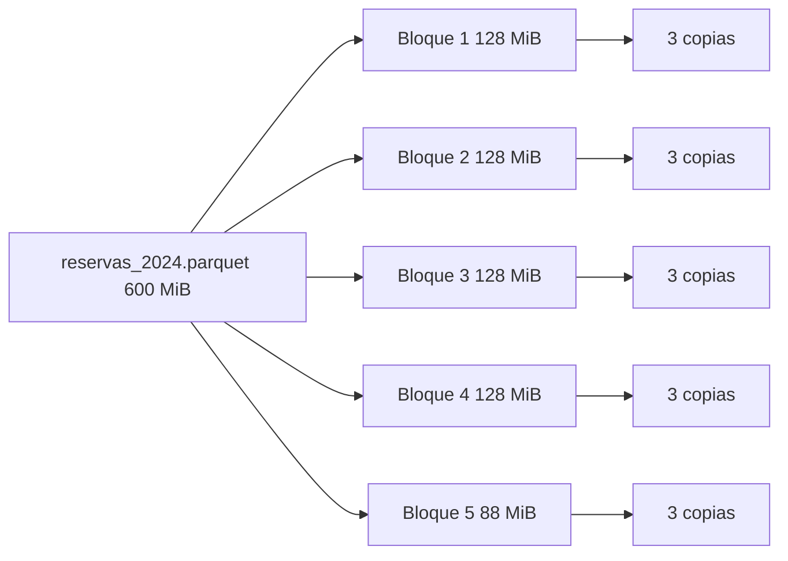
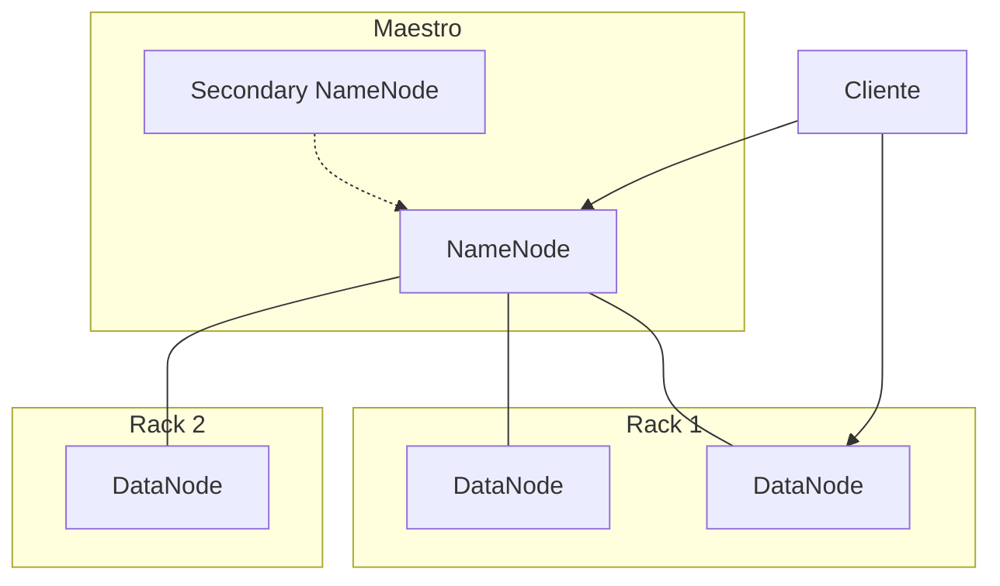
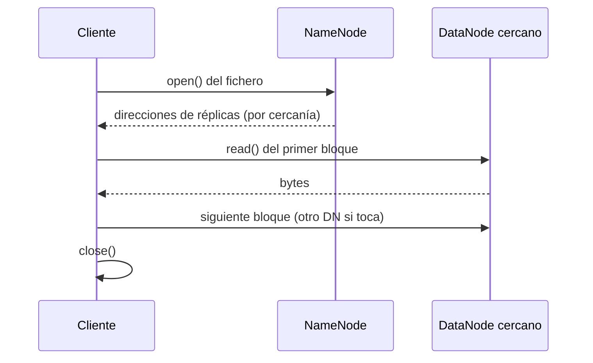
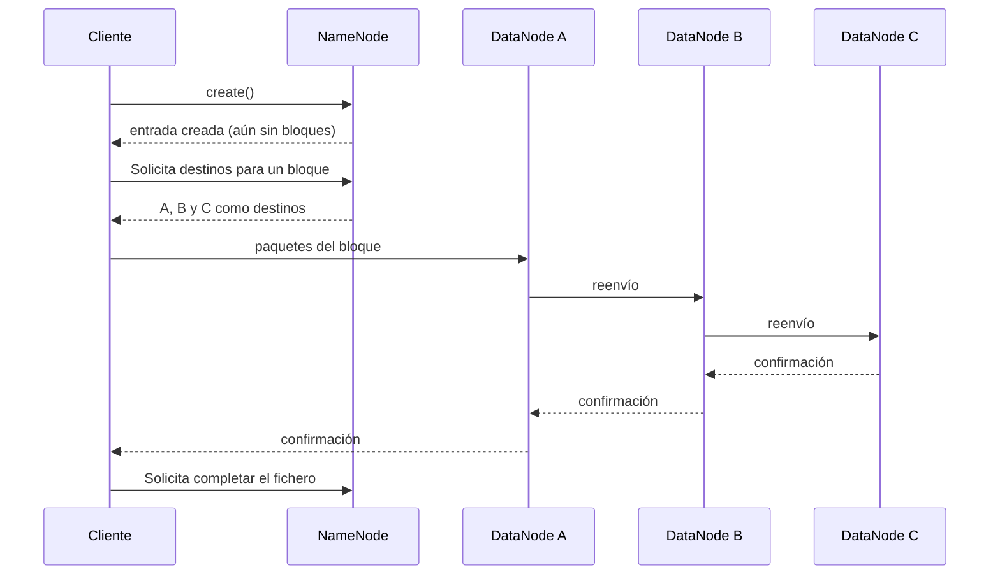

# 2.3. HDFS

!!! info "Ruta de estudio"
    **Esencial:** distinguir archivos, bloques y réplicas; explicar el papel del NameNode y los DataNodes y seguir una lectura y una escritura.

    **Práctica guiada:** utilizar el entorno de 2.2 para subir, consultar, copiar y descargar datos, comprobando contenido, rutas y estado.

    **Ampliación:** ficheros grandes, inspección interna, snapshots, checkpoint manual, Python y Hue. Las pruebas de fallo o ampliación necesitan un entorno preparado por el profesor. Moodle concreta las entregas.

En [2.2](ecosistema.md) distinguimos almacenamiento, recursos y cálculo. Ahora seguiremos el recorrido de **reservas.csv**: dónde se guarda, cómo lo recupera un programa y qué necesita el sistema para conservarlo ante un fallo.

**HDFS** (*Hadoop Distributed File System*) es el sistema de ficheros de Hadoop. Organiza archivos en bloques y puede distribuirlos entre DataNodes. Se diseñó para grandes archivos y accesos de alto rendimiento, inspirado en el *Google File System* (2003). **Almacena bytes; no interpreta reservas ni calcula sus totales.**

Su tolerancia a fallos depende de copias sanas, servicios disponibles y configuración. Añadir nodos puede ampliar capacidad, pero no garantiza acelerar un cálculo ni conservar datos ante cualquier avería. Son las condiciones que aprendimos a comprobar en la UT1 y en 2.1.

En este apartado estudiamos **archivos replicados**. El tamaño predeterminado habitual es **128 MiB por bloque** y el factor de réplica de fábrica es **3**; ambos son configurables. Nuestro laboratorio solicita **una copia**, porque tiene un único DataNode. Hadoop también admite otras políticas, como codificación de borrado, que quedan fuera de esta práctica.

HDFS favorece **escribir y leer muchas veces**. Permite añadir al final mediante operaciones compatibles y eliminar archivos; no ofrece una modificación arbitraria de una fila en medio del fichero. La expresión WORM es una simplificación del patrón de uso, no una prohibición absoluta de añadir datos. Para cargar archivos podemos utilizar `hdfs dfs -put` o una herramienta compatible; Sqoop, citado en materiales antiguos, es una referencia histórica.

## Qué no hace bien (y qué sí)

Relacionad el acceso con la herramienta. El informe nocturno recorre muchos registros secuencialmente: encaja en HDFS. Recepción busca y modifica una reserva concreta en milisegundos: necesita un motor de base de datos. HDFS conserva los ficheros sobre los que ese motor o un procesamiento analítico puede trabajar; no ofrece por sí solo consultas por `id_reserva`.

No ofrece buen rendimiento para:

- **Accesos de baja latencia.** No es la caja de recepción. Guarda *inputs* para procesos de cómputo.
- **Ficheros pequeños** (salvo que los agrupéis). A igualdad de volumen, muchos archivos diminutos requieren más metadatos que un número menor de archivos grandes. Conviene agruparlos según el uso, sin convertir una cifra de tamaño en regla universal.
- **Varios escritores** a la vez sobre el mismo archivo.
- **Modificaciones arbitrarias** (el byte 17 del medio, como en un Word).

HDFS no ofrece por sí solo un `UPDATE` fila a fila. El fichero admite **añadir al final** o **borrarse**; el bloque ya escrito no se abre para cambiar un byte.

!!! note "HBase y Hive"
    Encima de HDFS, **HBase** y **Hive** ofrecen modelos de acceso diferentes: HBase permite operaciones sobre registros por clave; Hive consulta tablas y admite modificaciones en las configuraciones y tipos de tabla compatibles. El fichero de debajo no se edita por el medio; la capa de encima **reescribe** o **versiona**. No confundáis “puedo hacer `UPDATE` en Hive” con “HDFS edita el bloque”.

**No** es el sitio para el clic de recepción, ni para diez escritores sobre el mismo CSV, ni para un JSON de 2 KB por cada reserva suelta (juntadlos).

## Bloques

Si guardamos un fichero de 600 MiB con bloques de 128 MiB, se divide en cuatro bloques de 128 MiB y uno de 88 MiB. Con replicación 3 se solicitan tres copias de cada bloque: aproximadamente 1800 MiB de contenido físico, más metadatos y otros costes. El último bloque no reserva necesariamente 128 MiB completos para almacenar solo 88 MiB.

Una réplica no es un fragmento diferente: cada copia permite reconstruir **el mismo bloque**. Para leer el fichero completo necesitamos una copia accesible de **cada** bloque.

Un **bloque** es la unidad en que HDFS organiza la ubicación y replicación de un fichero. El tamaño habitual por defecto es **128 MiB** (134 217 728 bytes). No es la cantidad mínima de una lectura: un cliente puede pedir solo parte de un bloque. Los paquetes de transferencia y los fragmentos usados para checksum son unidades distintas.

Los ficheros no vacíos se organizan en uno o más bloques; un fichero vacío no necesita un bloque de datos. Subís `reservas_2024.parquet` de **600 MiB** → **5** bloques (4 × 128 MiB + un resto). Esos bloques se **reparten** por los DataNodes.

Si el fichero es **no vacío y menor** de 128 MiB, ocupa **un** bloque **lógico**, pero en disco solo los **bytes reales**. Un archivo de 1 MB almacena aproximadamente **1 MB por réplica**, más metadatos y checksums; no reserva un bloque completo de 128 MiB.

Con factor **3** y destinos suficientes para satisfacerlo, el fichero de 600 MiB necesita **15 copias de bloque**: tres por cada uno de los cinco bloques. El factor solicitado y las copias efectivamente disponibles pueden diferir; se comprueban por separado.



El esquema supone que existen destinos suficientes; **tres copias son tres en total**, no el original más otras tres. El último bloque ocupa sus 88 MiB por copia, más costes auxiliares. Estos bloques de almacenamiento no son los *splits* lógicos de MapReduce.

Los permisos de lectura y escritura siguen la filosofía **POSIX** (usuario, grupo, otros: `rwx`). Buena práctica: crear `/user/` en la raíz, como el `/home` de Linux. En este módulo usamos `/user/bda/`. En el laboratorio individual mantenemos `/user/bda/` para que los comandos coincidan entre apartados. El nombre de una carpeta no cambia la identidad del cliente HDFS. En un entorno compartido, el profesor asignará usuario, ruta y permisos.

<span id="tres-maquinas-vista-de-conjunto"></span>

## Tres roles, no necesariamente tres máquinas

| Rol | Oficio |
| --- | --- |
| **NameNode** | Coordinador del espacio de nombres y las ubicaciones de bloques |
| **DataNode** | Almacena y sirve bloques a los clientes |
| **Secondary NameNode** | Puntos de control de los metadatos (`fsimage` + `edits`). **No** es un NameNode de reserva |



El dibujo ilustra una instalación con varios DataNodes y dos racks; no reproduce el Compose de aula, que tampoco incluye Secondary NameNode. Con la política habitual y topología configurada, tres copias pueden repartirse entre dos racks. Sobrevivir al fallo de un rack requiere copias accesibles fuera de él y los servicios de coordinación disponibles. Un rack no equivale automáticamente a otra sede o edificio.

## Trabajando con HDFS (`hdfs dfs`)

Distinguid el sistema local del contenedor y el sistema distribuido. En `hdfs dfs -put reservas.csv /user/bda/`, el primer argumento es un fichero local; el segundo es una ruta HDFS. En `-cp`, ambos argumentos son HDFS. En `-get`, copiamos de HDFS al entorno local desde el que ejecutamos el comando.

En el Compose, `/practicas` está montado solo para lectura. Para las descargas y pruebas que escriben ficheros locales, preparad un directorio de trabajo escribible en el Bash del NameNode:

```bash
mkdir -p /tmp/practica-hdfs
cp /practicas/reservas.csv /practicas/opiniones.txt /tmp/practica-hdfs/
cd /tmp/practica-hdfs
```

Los ficheros de `/tmp` no son los del host. Si queréis conservar una descarga fuera del contenedor, usad `docker compose cp namenode:/tmp/practica-hdfs/fichero .` desde el host, sustituyendo `fichero` por su nombre real.

Desde el terminal se usa el comando `hdfs` y un segundo parámetro. Ante la duda: [documentación oficial de la *shell*](https://hadoop.apache.org/docs/current/hadoop-project-dist/hadoop-common/FileSystemShell.html).

```text
hdfs comando
```

!!! tip "hadoop fs frente a hdfs dfs"
    `hadoop fs` habla con un sistema de ficheros **genérico** (local, HDFS, FTP, S3…). En versiones viejas existía `hadoop dfs`; hoy está **obsoleto** a favor de **`hdfs dfs`**. En el aula, para HDFS: `hdfs dfs`.

`dfs` pide otro argumento (con guion): un gesto al estilo de la *shell* de Linux.

```text
hdfs dfs -ls /
```

Sin ruta, `-ls` lista el directorio de trabajo del usuario (a menudo `/user/<quien>`); no siempre es la raíz. Por eso en clase escribimos la ruta **completa**.

### Los comandos que más usaréis

| Acción | Flag | Oficio en el hotel |
| --- | --- | --- |
| Subir | `-put` / `-copyFromLocal` | Dejar `reservas.csv` en el lago |
| Bajar | `-get` / `-copyToLocal` | Traer un `part-r-00000` al portátil |
| Fusionar al bajar | `-getmerge` | Varios `part-*` → un solo fichero local |
| Ver | `-cat` / `-text` / `-head` / `-tail` | Mirar sin bajar el CSV entero |
| Carpetas | `-mkdir` / `-rmdir` | `/user/bda/reservas` |
| Contar | `-count` | Carpetas, ficheros, bytes, ruta |
| Copiar / mover / borrar | `-cp` / `-mv` / `-rm` | Renombrar, limpiar *tmp* |

Borrado **recursivo**: elimina una carpeta y su contenido. Para repetir un job utilizad preferentemente una salida nueva y conservad la anterior hasta compararla. El siguiente comando solo se usa cuando habéis decidido eliminar esa salida de prueba:

```text
hdfs dfs -rm -r /user/bda/salida_wc
```

### Recorrido de aula (explicad cada línea)

Este recorrido empieza con destinos que no existen. Si ya lo realizasteis, elegid otra carpeta HDFS y otros nombres locales para conservar las evidencias; no añadáis sobrescritura sin revisar lo que reemplazáis.

Ficheros: [reservas.csv](../assets/practicas/hotel-hadoop/reservas.csv) y [opiniones.txt](../assets/practicas/hotel-hadoop/opiniones.txt).

```text
hdfs dfs -mkdir -p /user/bda/datos
hdfs dfs -put reservas.csv /user/bda/datos/
hdfs dfs -put reservas.csv /user/bda/datos/reservas_copia.csv
hdfs dfs -ls /user/bda/datos
hdfs dfs -count /user/bda/datos
hdfs dfs -mv /user/bda/datos/reservas_copia.csv /user/bda/datos/reservas_renombrada.csv
hdfs dfs -head /user/bda/datos/reservas_renombrada.csv
hdfs dfs -get /user/bda/datos/reservas_renombrada.csv ./reservas_local.csv
```

| Comando | Qué ha pasado |
| --- | --- |
| `-mkdir -p` | Crea `/user/bda/datos` (el `-p` no falla si ya existe el padre) |
| primer `-put` | Sube con el **mismo** nombre |
| segundo `-put` | Sube **renombrando** en destino |
| `-ls` | Lista (tamaño, réplica, fecha, ruta) |
| `-count` | Número de directorios, de ficheros y **bytes** |
| `-mv` | Renombra / mueve **dentro** de HDFS (no baja al PC) |
| `-head` | Primeros 1024 bytes; útil para texto, no para interpretar un Parquet binario |
| `-get` | Copia al disco **local** |

`hdfs dfs -cat /user/bda/datos/reservas.csv | more` pagina en el terminal. `-text` interpreta determinados formatos compatibles; no es un lector universal de Parquet. `-getmerge` concatena contenido: puede servir para partes de texto, pero **no fusiona correctamente archivos Parquet** ni elimina cabeceras repetidas de CSV.

<span id="crc-el-viaje-no-corrompio"></span>

### CRC: detectar corrupción durante la lectura

Las lecturas HDFS comprueban checksums de forma habitual. La opción `-crc` de una descarga conserva además un fichero local de checksum; no es lo que activa por primera vez la verificación:

```text
hdfs dfs -get -crc /user/bda/datos/reservas.csv reservas_con_crc.csv
ls -la reservas_con_crc.csv .reservas_con_crc.csv.crc
cmp reservas.csv reservas_con_crc.csv
```

Aparece el fichero oculto `.reservas_con_crc.csv.crc` junto a la descarga. `cmp` compara los bytes con el original local: si son iguales, no muestra diferencias y termina con código 0. HDFS mantiene checksums de fragmentos del contenido y puede detectar corrupción. El checksum detecta diferencias; no permite reconstruir por sí solo los bytes correctos: para eso necesitamos otra fuente sana, como una réplica accesible. Tampoco comprueba que las noches, fechas o importes tengan significado correcto: esa validación pertenece al contenido.

## NameNode y DataNode (en profundidad)

### NameNode

- En la configuración básica hay un NameNode activo. La alta disponibilidad requiere otros NameNodes y mecanismos específicos; no viene dada por instalar un Secondary.
- Los clientes se **conectan a él** para abrir / crear. Él **no** sirve los bytes.
- Mantiene el **árbol** (espacio de nombres) y el **mapa de bloques**: qué DataNodes tienen cada trozo.
- Los metadatos viven en **RAM** (rápido) y en **disco** (no se pierden al apagar). Por eso el maestro pide **mucha memoria**.
- Los bloques **nunca pasan** por el NameNode. El tráfico va entre cliente y DataNodes (o entre DataNodes en la tubería de réplica).
- Sin HA, su caída interrumpe las operaciones que necesitan sus metadatos. Que sigan existiendo bloques no basta para prestar normalmente el servicio. Hay que proteger también los metadatos.

Cuando un cliente quiere leer o escribir, el NameNode le dice **en qué nodos** está el bloque. También vigila que los nodos **no estén caídos** y que la réplica se **mantenga**.

La memoria del NameNode depende especialmente del número de ficheros y bloques, no solo de los terabytes. Un millón de ficheros diminutos puede exigir muchos más metadatos que unos pocos ficheros grandes con los mismos bytes. Por eso agrupar eventos en ficheros razonables forma parte del diseño.

### Secondary NameNode

El nombre induce a error: **no es un NameNode de reserva que tome el mando automáticamente**. Su función de checkpoint combina la imagen de metadatos y las operaciones acumuladas. La alta disponibilidad utiliza NameNodes activo y standby con configuración específica. Confundir ambos mecanismos llevaría a atribuir al laboratorio una recuperación que no tiene.

- Guarda copias de trabajo de **`fsimage`** (foto del árbol) y **`edits`** (diario de cambios, *deltas*).
- **No** es un nodo de respaldo en caliente. Si el NameNode muere, el Secondary **no** toma el relevo solo.
- Suele correr en **otra** máquina, para no competir por disco y CPU con el maestro.

Confusión clásica de examen: *Secondary* ≠ *standby*. El standby de HA es **otro NameNode**; el Secondary **compacta** metadatos para que el arranque no dure una eternidad.

### DataNode

- Puede haber uno o muchos. En el Compose básico hay uno: no ofrece otra réplica ante su pérdida.
- Almacena y sirve bloques a los clientes. El NameNode recibe informes y coordina, pero no transporta los datos del usuario.
- **Reportan** al NameNode la lista de bloques que tienen (*block report*) y un *heartbeat* (“sigo vivo”).
- Pueden usar **varios discos** (JBOD, [2.2](ecosistema.md)).
- Guardan **checksums (CRC)** de fragmentos del contenido de los bloques. Si no cuadra al leer, el cliente intenta otra réplica disponible y se informa al maestro.

### Racks

La topología identifica dominios de fallo, por ejemplo racks con alimentación o red compartidas. Distribuir copias entre ellos puede evitar que un único fallo deje inaccesibles todas las copias de un bloque.

Hay que configurar y comprobar la topología: `hdfs dfsadmin -printTopology` permite inspeccionarla. Los nombres de hoteles del caso no implican por sí solos sedes físicas diferentes. En el portátil todos los contenedores dependen del mismo equipo.

## Proceso de lectura

Separad el **camino de metadatos** del **camino de datos**. El NameNode informa de qué bloques componen el fichero y dónde hay copias. Los bytes viajan directamente desde los DataNodes al cliente. Así el coordinador no tiene que transportar todas las lecturas del clúster.

Los bytes **no** pasan por el NameNode. El cliente lee **directo** del DataNode. Por eso HDFS **escala**: el tráfico se **reparte**.



Paso a paso:

1. El cliente abre el fichero con `open()` del sistema de ficheros distribuido.
2. Eso llama al NameNode por **RPC**. El maestro devuelve, para el **primer** bloque, las direcciones de los DataNodes que tienen copia. Las ordena por **proximidad** (datacenter / rack / nodo). Si cliente y copia están en la misma máquina puede haber localidad de nodo; el acceso directo sin pasar por el proceso DataNode exige la configuración de *short-circuit reads* correspondiente.
3. El cliente recibe un `FSDataInputStream` (flujo con búsqueda). Invoca `read()`. El flujo se conecta al DataNode **más cercano** del primer bloque.
4. Se leen los datos con `read()`. Al terminar el bloque, el flujo **cierra** esa conexión y busca el mejor DataNode para el **siguiente**.
5. Se repite. Para el programa, es un flujo **leído de seguido**; el salto de nodo es transparente.
6. Al acabar, `close()`.

Si hay error de red o de checksum, el cliente intenta otra copia accesible. Si ninguna está disponible, la lectura falla; el checksum no reconstruye datos. Recuerda los que fallaron (no insistir) e informa al NameNode de bloques **corruptos**.

!!! warning "NameNode sin datos"
    El maestro da el **mapa**. Si imagináis que 8 TB de reservas “atraviesan” el NameNode, el dibujo está mal y el clúster no escalaría.

## Proceso de escritura

El cliente solicita crear el fichero y recibe destinos para el primer bloque. Envía paquetes al primer DataNode y estos se propagan por la cadena de réplicas. Las confirmaciones vuelven hacia el cliente. El NameNode decide ubicación y mantiene metadatos; no es una estación intermedia por la que pasan todos los bytes.

Si un miembro de la cadena falla, el sistema intenta continuar con los destinos disponibles y recuperar el nivel de réplica. Eso requiere nodos sanos y espacio: solicitar factor 3 con un único DataNode no crea tres máquinas ni garantiza tres copias independientes.

La creación, la tubería de réplicas y el cierre:



1. El cliente crea el fichero con `create()` del `DistributedFileSystem`.
2. RPC al NameNode: crea la entrada **sin** bloques todavía. Comprueba permisos y si la creación permite sobrescribir una entrada existente. En nuestros ejercicios elegimos destinos nuevos. Los destinos de los bloques se solicitan durante la escritura. **No decide los splits de MapReduce**: son responsabilidad del formato de entrada del trabajo.
3. El cliente recibe un `FSDataOutputStream` que habla con DataNodes y NameNode.
4. Al escribir, el flujo pide una lista de candidatos. Forman un **pipeline**. Réplica 3 → tres nodos. El cliente manda el paquete al **primero**; ese guarda y **reenvía** al segundo; el segundo al tercero.
5. Cuando **todos** confirman, vuelve un acuse al flujo. El bloque **cuenta**.
6. `close()`: se vacían los paquetes que quedaban, se esperan acuses y se solicita al NameNode completar el archivo. El cliente no sustituye los informes de bloques que mantienen sus ubicaciones.

Ante un fallo, el cliente intenta reconstruir la tubería según las políticas y los destinos disponibles. La operación puede continuar con menos copias o fallar: no debe prometerse recuperación automática de cualquier escritura. Comprobad el error, el cierre y las copias efectivas antes de aceptar el archivo.

## HDFS por dentro (metadatos)

La imagen del sistema de ficheros y el registro de operaciones permiten reconstruir nombres, permisos y asociación con bloques. Los informes de los DataNodes permiten conocer las ubicaciones actuales. Por eso copiar solo un directorio de bloques no equivale a tener una copia utilizable de todo el sistema: los metadatos también importan.

Los cambios del clúster viven en ficheros del NameNode. La carpeta se configura en `$HADOOP_HOME/etc/hadoop/hdfs-site.xml` (`dfs.namenode.name.dir`). El XML siguiente ilustra una instalación tradicional; el [Compose](../assets/practicas/hotel-hadoop/config.env) usa `/tmp/hadoop-root/dfs/name`. No sustituyáis sus rutas.

```xml
<property>
  <name>dfs.namenode.name.dir</name>
  <value>file:///opt/hadoop-data/hdfs/namenode</value>
</property>
```

(En textos viejos veréis `dfs.name.dir`: mismo oficio.) Dentro hay un `current/` con prefijos:

| Prefijo | Oficio |
| --- | --- |
| `edits_000…` | Histórico de cambios ya cerrados |
| `edits_inprogress_…` | Cambios **en curso** (memoria / diario abierto) |
| `fsimage_000…` | Imagen persistida de los metadatos; no es la snapshot de una carpeta de usuario |

Al arrancar, el NameNode carga una imagen coherente y aplica los cambios posteriores del diario. Un checkpoint consolida metadatos para limitar ese trabajo. En una configuración sin HA, el Secondary puede realizar checkpoints periódicos según tiempo o transacciones; no mantiene una copia independiente de los archivos de usuario.

Un diario largo puede aumentar el tiempo de recuperación. Consolidar metadatos, mantener copias de bloques y conservar snapshots de carpetas resuelven necesidades diferentes.

`VERSION` en esa carpeta identifica el **clusterID** / *block pool*. Os servirá al bajar al disco del DataNode.

### Bloques en disco: `fsck` y el `blk_*`

`fsck` inspecciona salud y ubicación; no sustituye una copia de seguridad ni repara cualquier problema. **Under-replicated** significa que hay menos copias que las solicitadas, pero puede seguir habiendo una legible. **Missing** indica que faltan copias disponibles de algún bloque. Anotad cuál de las dos situaciones aparece antes de concluir que se perdió el fichero.

Los identificadores y rutas que siguen son ejemplos de una instalación. En el Compose consultad `hdfs getconf -confKey dfs.datanode.data.dir`; la ruta configurada es `/tmp/hadoop-root/dfs/data`. No editéis directamente `blk_*`: usad la API de HDFS.

Para **ver varios bloques** con el tamaño predeterminado hace falta un fichero que **ocupe más de 128 MiB**. El [reservas.csv](../assets/practicas/hotel-hadoop/reservas.csv) de aula cabe en **un** bloque: útil para comandos, suficiente para comprobar salud y ubicaciones. Generad uno grande en local (no va a git) con [generar_reservas_grandes.py](../assets/practicas/hotel-hadoop/generar_reservas_grandes.py) o usad un Parquet de prácticas que ya pese. En el host, desde `docs/assets/practicas/hotel-hadoop`, podéis ejecutar `python generar_reservas_grandes.py --lineas 4500000`. Anotad el tamaño que imprime; ajustad las filas si necesitáis más bloques. Dentro del NameNode, el fichero estará en `/practicas/reservas_grandes.csv`: ejecutad el siguiente `-put` desde `/practicas` o utilizad esa ruta absoluta.

```text
hdfs dfs -mkdir -p /user/bda/prueba-hdfs
hdfs dfs -put /practicas/reservas_grandes.csv /user/bda/prueba-hdfs
```

`fsck` comprueba la **salud** del sistema. Con `-files` y `-blocks` lista ficheros y bloques:

```text
hdfs fsck /user/bda/prueba-hdfs -files -blocks -locations
```

Esta traza abreviada e ilustrativa representa un fichero de 678.260.987 bytes con seis bloques. No es la salida medida del generador anterior. Los identificadores, tamaños y ubicaciones dependen del archivo y del entorno; anotad los vuestros:

```text
Connecting to namenode via http://namenode:9870/fsck?ugi=root&files=1&blocks=1&path=%2Fuser%2Fbda%2Fprueba-hdfs
FSCK started ...

/user/bda/prueba-hdfs <dir>
/user/bda/prueba-hdfs/reservas_grandes.csv 678260987 bytes, replicated: replication=1, 6 block(s):  OK
0. BP-481169443-172.18.0.2-1710000000000:blk_1073750565_9750 len=134217728 Live_repl=1
1. BP-481169443-172.18.0.2-1710000000000:blk_1073750566_9751 len=134217728 Live_repl=1
2. BP-481169443-172.18.0.2-1710000000000:blk_1073750567_9752 len=134217728 Live_repl=1
3. BP-481169443-172.18.0.2-1710000000000:blk_1073750568_9753 len=134217728 Live_repl=1
4. BP-481169443-172.18.0.2-1710000000000:blk_1073750569_9754 len=134217728 Live_repl=1
5. BP-481169443-172.18.0.2-1710000000000:blk_1073750570_9755 len=7172347 Live_repl=1

Status: HEALTHY
 Number of data-nodes:  1
 Number of racks:       1
```

Lectura:

- `678260987 bytes` ≈ 646,84 MiB (678,26 MB decimales).
- `6 block(s)`: 5 × **134217728** (128 MiB) + un resto de 7.172.347 bytes.
- `BP-…` es el **Block Pool ID**.
- `Live_repl=1` en el portátil (un DataNode). En otro diseño se compara con el factor solicitado y las copias realmente disponibles.
- `HEALTHY`: el diagnóstico de disponibilidad de bloques es favorable; no garantiza tres copias, recuperación de un borrado ni datos de negocio válidos. Revisad también las advertencias de réplica.

En la UI 9870, el explorador muestra información de bloques y el *Block Pool ID*. Podéis relacionarla con los informes de `fsck`.

Como **ampliación de solo lectura**, desde el anfitrión entrad en el DataNode:

```text
docker compose exec datanode bash
```

Dentro de ese Bash, consultad la ruta y los archivos reales del Compose:

```bash
hdfs getconf -confKey dfs.datanode.data.dir
ls /tmp/hadoop-root/dfs/data/current
find /tmp/hadoop-root/dfs/data -name 'blk_*'
```

Los archivos `blk_*` guardan contenido y sus compañeros `.meta` incluyen información de checksum. Usad el identificador de vuestro `fsck` para localizar un bloque, sin copiar identificadores de la traza. **No editéis ni borréis esos archivos directamente.**

Si inspeccionáis con `head` el primer bloque de un CSV sin comprimir, podría verse la cabecera; no permite interpretar un Parquet o un archivo comprimido. La lectura normal debe hacerse mediante HDFS, que reconstruye el archivo y comprueba su integridad. En el laboratorio los bloques residen en un DataNode, no necesariamente en discos o máquinas distintos.

## Un job completo: YARN pide, HDFS sirve

Ya distinguís recursos y bloques. Unamos ambos recorridos con el agregado de noches reservadas del hotel, manteniendo la separación de responsabilidades de [2.2](ecosistema.md).

1. **Preparar la entrada.** El cliente comprueba el CSV y su ruta HDFS. El formato de entrada del job define splits lógicos; sus ubicaciones preferidas pueden derivarse de los bloques.
2. **Enviar el trabajo.** Se envía la aplicación al ResourceManager. Se asignan recursos para el ApplicationMaster y un NodeManager lo inicia.
3. **Solicitar ejecución.** El AM pide recursos para las tareas. El planificador considera solicitudes, colas, disponibilidad y preferencias de localidad; no decide la fórmula.
4. **Lanzar tareas.** El AM solicita a los NM ejecutar los procesos. Puede haber varias tareas por nodo, simultáneamente o por turnos.
5. **Leer.** El cliente HDFS de la tarea obtiene ubicaciones del NameNode y lee datos de DataNodes. La lectura puede ser local o remota; ambas son válidas.
6. **Seguir el estado.** NM informa al RM; AM sigue su aplicación; DataNodes envían heartbeats e informes de bloques al NameNode. Un mensaje ausente no prueba inmediatamente una avería: se aplican tiempos de espera y políticas.
7. **Reunir claves.** Los maps producen intermedios en almacenamiento local. Los reducers obtienen sus particiones durante el shuffle, que puede comenzar mientras otros maps siguen ejecutándose.
8. **Escribir.** Cada reducer escribe su salida mediante HDFS; este aplica la política de almacenamiento configurada. Las confirmaciones recorren la tubería de vuelta al cliente escritor.
9. **Finalizar y comprobar.** Se completa el job y se liberan recursos. Leemos todos los `part-*` y contrastamos totales con el mismo CSV. `_SUCCESS` no demuestra que la fórmula o el significado sean correctos.

| Localidad | Qué significa | Qué no implica |
| --- | --- | --- |
| `NODE_LOCAL` | La tarea puede leer una copia en su mismo nodo. | Ausencia de toda comunicación ni acceso directo sin configuración. |
| `RACK_LOCAL` | La copia está en otro nodo del mismo rack. | Un tiempo fijo ni una garantía de velocidad. |
| `OFF_SWITCH` | La lectura requiere otro rack. | Un fallo: puede ser una decisión necesaria del planificador. |

La localidad puede ahorrar transferencias de entrada, pero el shuffle sigue comunicando tareas. En el Compose, DataNode y NodeManager están en contenedores separados y la localidad no está garantizada. Esto no vuelve incorrecto el resultado.

```text
YARN: recursos y ejecución          HDFS: almacenamiento
ResourceManager                    NameNode
  Scheduler                          espacio de nombres y ubicaciones
NodeManager                        DataNode
  procesos y recursos                bloques y checksums
ApplicationMaster
  coordinación de una aplicación
```

| Pieza | Responsabilidad |
| --- | --- |
| ResourceManager / Scheduler | Administrar y asignar recursos |
| NodeManager | Lanzar y supervisar ejecución en su nodo |
| ApplicationMaster | Coordinar una aplicación |
| Contenedor YARN | Asignación de recursos a un proceso |
| Tarea map / reduce | Ejecutar una parte del cálculo |
| NameNode | Gestionar metadatos y ubicaciones |
| DataNode | Conservar y servir bloques |

Este recorrido explica el funcionamiento. El criterio de procesamiento se apoya además en ejecuciones y medidas comparables en [2.4](computacion-distribuida.md); el dibujo por sí solo no lo demuestra.

## Administración

Antes de cambiar parámetros, recoged una línea base: DataNodes vivos, capacidad disponible y bloques con réplica insuficiente. Después de añadir un nodo, comparad esos valores. El nodo aporta capacidad; el reparto de datos existentes puede requerir balanceo. Un factor de replicación mayor consume más espacio, y no puede satisfacerse si no hay suficientes destinos independientes.

| Comando | Oficio |
| --- | --- |
| `hdfs dfsadmin -report` | Resumen (capacidad, nodos vivos). Parecido a la UI |
| `hdfs fsck /user/bda` | Salud de una ruta |
| `hdfs dfsadmin -printTopology` | Nodos y **rack** de cada uno |
| `hdfs dfsadmin -listOpenFiles` | Ficheros abiertos (escrituras a medias) |
| `hdfs dfsadmin -safemode enter` | **Modo seguro**: no se modifica el espacio de nombres |
| `hdfs dfsadmin -safemode leave` | Salir del modo seguro |

El modo seguro se usa para **checkpoints** a mano o cuando el NameNode arranca y aún **no** ha oído a bastante DataNodes. Escribir en safemode **falla**. En la UI veréis *Safe mode is ON*.

Checkpoint **manual — ampliación administrada**. Requiere permisos y un laboratorio dedicado: afecta a las escrituras del sistema. El profesor debe preparar esta prueba; no es necesaria para completar los comandos básicos:

```text
hdfs dfsadmin -safemode enter
hdfs dfsadmin -saveNamespace
hdfs dfsadmin -safemode leave
```

`saveNamespace` fuerza un `fsimage` nuevo. Después, en `dfs.namenode.name.dir/current/`, deberíais ver un `fsimage_…` **más reciente** que el de antes. También consolida metadatos, aunque este comando lo ejecuta el NameNode: no es arrancar el proceso Secondary. Mientras *Safe mode is ON*, un `-put` debe fallar: es la prueba de que el modo **impide** cambios.

### Snapshots (foto del lago)

Una *snapshot* conserva la vista de una carpeta en un instante mediante referencias a bloques. Permite recuperar cambios y borrados mientras se conserva el almacenamiento, pero **no es una copia independiente del clúster**: perder sus discos puede hacer perder también las snapshots. Primero se **habilita** sobre la carpeta; luego se **crea** la foto.

```text
hdfs dfs -mkdir -p /user/bda/snaps
hdfs dfs -put /practicas/reservas.csv /user/bda/snaps/
hdfs dfsadmin -allowSnapshot /user/bda/snaps
hdfs dfs -createSnapshot /user/bda/snaps foto1
```

La captura vive en una carpeta oculta:

```text
/user/bda/snaps/.snapshot/foto1/
```

En esta carpeta de prueba, verificad primero que la snapshot contiene el fichero. Después eliminad la copia actual y recuperadla:

```text
hdfs dfs -cat /user/bda/snaps/.snapshot/foto1/reservas.csv
hdfs dfs -rm /user/bda/snaps/reservas.csv
hdfs dfs -ls /user/bda/snaps
hdfs dfs -cp /user/bda/snaps/.snapshot/foto1/reservas.csv /user/bda/snaps/
```

Carpetas que admiten instantáneas:

```text
hdfs lsSnapshottableDir
```

Para desactivar: **borrar** las fotos y luego `disallowSnapshot`:

```text
hdfs dfs -deleteSnapshot /user/bda/snaps foto1
hdfs dfsadmin -disallowSnapshot /user/bda/snaps
```

Contrastad el contenido restaurado con el original. Usad otros nombres de snapshot al repetir y conservad las evidencias antes de limpiar. Los pasos administrativos requieren el usuario autorizado del laboratorio.

Criterio **c)** en versión “me equivoqué al borrar”, no solo “se fundió un disco”.

## UI del NameNode (puerto 9870)

La UI sirve para inspeccionar estado y metadatos. Poder abrirla no demuestra que podamos leer bloques desde el navegador: las operaciones WebHDFS pueden redirigir al DataNode. En este Compose sus nombres y puertos son internos. Para los ejercicios de lectura y escritura utilizad `hdfs dfs` dentro de la red del laboratorio.

Los cambios de propietario siguientes los ejecuta el administrador HDFS. Deben adaptarse al usuario que realiza la operación; no se resuelve un problema de permisos dando escritura universal a todos.

El explorador (`http://localhost:9870/explorer.html#/`) navega el árbol. Si creáis o borrais **desde el navegador** y sale:

```text
Permission denied: user=dr.who, access=WRITE, inode="/":...:supergroup:drwxr-xr-x
```

el usuario HTTP estático habitual es **`dr.who`**. Para que las operaciones de la UI utilicen `bda`, el administrador debe preparar la carpeta y configurar ese usuario:

1. Preparar una carpeta propiedad de `bda`:

```text
hdfs dfs -mkdir -p /user/bda/pruebas
hdfs dfs -chown bda /user/bda/pruebas
hdfs dfs -chmod 750 /user/bda/pruebas
```

2. Fijar el usuario estático en `core-site.xml` y reiniciar el servicio correspondiente:

```xml
<property>
  <name>hadoop.http.staticuser.user</name>
  <value>bda</value>
</property>
```

El usuario y sus grupos efectivos deben coincidir con los permisos de la carpeta. Este cambio de identidad no resuelve por sí solo la conectividad con los DataNodes ni sustituye autenticación en un despliegue real.

La UI complementa los comandos para ver bloques y estado. Si no está disponible, los informes de consola siguen siendo evidencias útiles; Moodle concreta lo que debe entregarse.

## HDFS y Python

Esta **ampliación** permite acceder desde un programa, pero no cambia el papel de HDFS. Una biblioteca escribe y lee bytes; pandas o PyArrow interpretan los formatos, como vimos en la UT1.

Hace falta un cliente preparado por el profesor: intérprete, dependencias, permisos y conectividad. El Compose básico no proporciona automáticamente un cliente Python accesible desde Windows. La práctica básica de consola sigue siendo independiente de esta ampliación.

Antes del ejemplo, cargad la entrada desde el Bash del NameNode:

```bash
hdfs dfs -mkdir -p /user/bda
hdfs dfs -put /practicas/opiniones.txt /user/bda/opiniones.txt
```

Si la entrada ya existe desde 2.2, comprobad su contenido y reutilizadla. Para las salidas, elegid nombres nuevos en cada ejecución o acordad expresamente una sobrescritura de prueba.

### HdfsCLI (WebHDFS, puerto **9870**)

```text
pip install hdfs
```

```python
from hdfs import InsecureClient

cliente = InsecureClient("http://namenode:9870", user="bda")

with cliente.read("/user/bda/opiniones.txt", encoding="utf-8") as r:
    texto = r.read()
print(texto[:200])

cliente.write("/user/bda/mini.csv", "hotel,noches\nLaredo,3\n", encoding="utf-8", overwrite=False)
with cliente.read("/user/bda/mini.csv", encoding="utf-8") as r:
    assert r.read() == "hotel,noches\nLaredo,3\n"
```

Sin Kerberos usamos `InsecureClient` en una red de aula controlada. Este código debe ejecutarse en un entorno que resuelva y alcance tanto `namenode:9870` como los DataNodes a los que redirige WebHDFS. **Publicar solo 9870 en Windows no basta para leer o escribir datos**. El usuario `bda` debe tener permisos sobre la ruta. El docente puede proporcionar un entorno cliente conectado a la red Docker; no se presupone que el host tenga esa configuración.

### PyArrow (RPC nativo)

Esta ampliación requiere más que `pip install`: el entorno necesita Java, bibliotecas Hadoop como `libhdfs`, classpath y conectividad con NameNode y DataNodes. Utilizad un entorno de cliente Hadoop preparado por el docente. Un error al cargar `libhdfs` indica una dependencia local; uno de conexión indica red o servicio. Son diagnósticos diferentes.

PyArrow permite usar un sistema de ficheros HDFS para leer y escribir formatos compatibles, como Parquet. [hdfs_hotel.py](../assets/practicas/hotel-hadoop/hdfs_hotel.py).

**Desde Windows, con este Compose, ninguna de las dos vías está preparada automáticamente.** WebHDFS necesita llegar al NameNode y a los DataNodes de sus redirecciones. PyArrow necesita además las bibliotecas nativas y RPC: el NameNode se anuncia como `namenode:8020`, una dirección interna de Docker. Publicar solo 9870 no resuelve esas dependencias ni esa red.

Usad el bloque de abajo cuando el profesor os dé una máquina donde `namenode` resuelve y Hadoop está en el `CLASSPATH`:

```text
pip install pyarrow pandas
export CLASSPATH=$($HADOOP_HOME/bin/hadoop classpath --glob)
```

```python
import pandas as pd
from pyarrow import fs

# Este compose: namenode:8020. Otras guías usan 9000. La UI sigue en el 9870.
hdfs = fs.HadoopFileSystem(host="namenode", port=8020)

with hdfs.open_input_stream("/user/bda/opiniones.txt") as reader:
    print(reader.read(200).decode("utf-8", errors="replace"))

df = pd.DataFrame(
    {"hotel": ["Laredo", "Potes"], "noches": [12, 9], "canal": ["web", "ota"]}
)
df.to_parquet("/user/bda/noches_resumen.parquet", filesystem=hdfs, index=False)
recuperado = pd.read_parquet("/user/bda/noches_resumen.parquet", filesystem=hdfs)
pd.testing.assert_frame_equal(df, recuperado)
print("Filas, columnas, tipos y valores verificados")
```

El puerto del RPC **no** es el 9870 de la UI. Mezclarlos es el error de la tarde.

Sin Pandas, el mismo Parquet con PyArrow puro:

```python
import pyarrow as pa
import pyarrow.parquet as pq

tabla = pa.table(
    {
        "hotel": ["Laredo", "Potes", "Noja"],
        "apellidos_recepcion": ["García", "Ruiz", "Sainz"],
        "edad_lab": [18, 19, 20],
    }
)
pq.write_table(tabla, "/user/bda/hoteles.parquet", filesystem=hdfs)
recuperada = pq.read_table("/user/bda/hoteles.parquet", filesystem=hdfs)
assert tabla.equals(recuperada)
```

Estos DataFrames son ejemplos sintéticos para comprobar escritura y lectura, no el resultado del agregado de 62 noches. Otras bibliotecas, como mrjob o Pydoop, aparecen en materiales del ecosistema: su compatibilidad debe verificarse antes de usarlas. En esta ampliación importa explicar la conexión y comprobar el contenido recuperado.

## Hue

Hue añade una interfaz web para personas; no reemplaza el sistema de almacenamiento ni aumenta sus garantías. Una operación que falla por permisos desde consola puede fallar también desde Hue. Al observar una pantalla, identificad siempre qué servicio ejecuta la consulta y con qué usuario.

**Hue** (*Hadoop User Experience*) es un front-end web para servicios como HDFS y Hive. Es una ampliación: no forma parte del Compose básico. En muchas VM de ciclo viene instalado (`/opt/hue-…`); arranque típico:

```text
./build/env/bin/hue runserver
```

Ejemplo de arranque de una imagen Hue, no de integración con nuestro clúster:

```text
docker run -it -p 8888:8888 gethue/hue:latest
```

Arrancar esa imagen no la conecta automáticamente con HDFS: necesita configuración, red y credenciales compatibles. El servidor de desarrollo no es una receta de despliegue de producción.

La URL y el usuario os los da el **profesor** (suele ser `:8000` o `:8888`). No uses las credenciales de otro centro. Sirve para **ver** el mismo `/user/bda` que `hdfs dfs -ls`, subir un CSV a golpes de ratón y, si Hive está enchufado, lanzar un `SELECT` sin abrir Beeline.

Hue **no** sustituye a `fsck` ni a entender la tubería. Es el *front* para no asustar a gerencia; el RA2 se demuestra en el terminal.

## Crecer (criterio e) y decidir después (d)

Añadir un DataNode correctamente configurado puede aumentar el espacio físico. Después se comprueban capacidad, nodos vivos y distribución de bloques; el balanceador se ejecuta cuando corresponde. **No añade automáticamente recursos de ejecución YARN ni acelera el job.**

Podemos conservar entradas para nuevas preguntas, con metadatos, permisos, lectores compatibles y una política de retención. También pueden reutilizarse tablas preparadas. Aplicar estructura al leer es una posibilidad, no una condición obligatoria para todo archivo en HDFS.

Si un programa consulta solo `hotel` e `importe`, el formato importa: Parquet puede permitir leer columnas seleccionadas; un CSV debe recorrerse e interpretarse aunque se utilicen pocos campos. HDFS no convierte un formato de texto en columnar.

!!! tip "Comprobar tolerancia"
    En un entorno preparado, verificad primero que **cada bloque** tiene copias sanas en al menos dos DataNodes. Detened uno sin eliminar sus datos y probad lectura y contenido. Registrad interrupción, recuperación y estado de copias. La disponibilidad requiere también el NameNode y la conectividad.

    En el Compose básico, parar el único DataNode deja los bloques inaccesibles. Reiniciarlo con su volumen intacto puede recuperar el acceso; eso no demuestra recuperación por otra réplica. Perder el volumen puede perder los datos.

## Relación con el RA2

| Criterio | Qué se trabaja | Evidencia y límite |
| --- | --- | --- |
| **a)** | Conservar y dar acceso a archivos para procesarlos. | Entrada recuperable e interpretada por un lector adecuado; HDFS no calcula el informe. |
| **c)** | Réplicas, checksums, coordinación y recuperación de borrados. | Probar un fallo concreto; una snapshot no protege frente a perder todo el almacenamiento. |
| **d)** | Conservar datos para usos posteriores. | Metadatos, formato y contenido suficientes para una consulta nueva. |
| **e)** | Incorporar capacidad mediante DataNodes. | Comparar capacidad y reparto antes y después; no confundirlos con CPU o velocidad. |

!!! success "En voz alta"
    El NameNode mantiene metadatos; los DataNodes guardan bloques. Para leer necesito una copia accesible de cada bloque. El factor solicitado no demuestra que las copias existan. Compruebo el contenido, las ubicaciones y qué fallo puede soportar la configuración.

## Referencias

- [HDFS Architecture](https://hadoop.apache.org/docs/current/hadoop-project-dist/hadoop-hdfs/HdfsDesign.html) y [FileSystem Shell](https://hadoop.apache.org/docs/current/hadoop-project-dist/hadoop-common/FileSystemShell.html)
- [Snapshots HDFS](https://hadoop.apache.org/docs/r3.4.2/hadoop-project-dist/hadoop-hdfs/HdfsSnapshots.html).
- [API de HdfsCLI](https://hdfscli.readthedocs.io/en/latest/api.html) y [HadoopFileSystem de PyArrow](https://arrow.apache.org/docs/python/generated/pyarrow.fs.HadoopFileSystem.html).
- Tom White, *Hadoop: The Definitive Guide* (O’Reilly)
- El núcleo YARN y el primer job: [2.2](ecosistema.md). Medir el poder del modelo: [2.4](computacion-distribuida.md)

<span id="para-practicar-moodle-manda-la-nota"></span>

## Actividades

El recorrido básico se realiza en el entorno de 2.2. Las ampliaciones requieren los servicios y permisos indicados por el profesor. Moodle concreta las entregas.

1. **Bloques y copias.** Dibujad el fichero de 600 MiB con bloques de 128 MiB y tres copias por bloque. Calculad bloques lógicos, copias y bytes de contenido físico. Explicad qué cambia si solo existe un DataNode y por qué un fichero no vacío de 1 MiB no ocupa 128 MiB por copia.
2. **Subir y recuperar.** Desde el Bash del NameNode, preparad `/tmp/practica-hdfs` y `/user/bda/ejercicios`. Subid opiniones.txt, copiadlo con `-cp`, renombrad la copia, mostrad el principio y descargadla con `-get -crc` a un nombre nuevo. Comparad con `cmp` el original y la descarga. Indicad cuáles son rutas locales y cuáles HDFS. Conservad evidencias antes de limpiar únicamente vuestra carpeta de prueba.
3. **Seguir una lectura y una escritura.** Dibujad por separado consultas al NameNode, bytes entre cliente y DataNodes y confirmaciones de escritura. Usad la configuración real del aula y después explicad qué cambiaría con tres copias disponibles. ¿Qué ocurre si ninguna copia de un bloque es legible?
4. **Interpretar el estado.** Ejecutad `hdfs dfsadmin -report` y `hdfs fsck /user/bda/ejercicios -files -blocks -locations`. Registrad tamaño, factor solicitado, copias vivas y ubicaciones. Explicad la diferencia entre una réplica insuficiente y un bloque sin copia disponible. ¿HEALTHY demuestra que las reservas son válidas?
5. **Snapshot — ampliación.** En `/user/bda/snaps`, seguid el ejemplo de foto1: verificad la vista anterior, borrad solo el fichero de prueba y recuperadlo. Comprobad el contenido y cread foto2 si lo indica el profesor. Explicad qué conserva cada vista y qué ocurriría al perder el almacenamiento del clúster.
6. **Metadatos — ampliación.** En el laboratorio dedicado, inspeccionad las rutas configuradas y VERSION sin modificar archivos internos. Con permiso administrativo, registrad estado, entrad en safemode, cread un checkpoint y salid del modo seguro. Explicad fsimage, edits y por qué Secondary no es standby.
7. **Python — ampliación preparada.** Leed opiniones.txt y mostrad un fragmento. Con PyArrow, escribid las tres filas sintéticas del descargable y volved a leer el Parquet para comparar filas, columnas, tipos y valores. Si el entorno preparado utiliza HdfsCLI, cread el Parquet localmente con pandas/PyArrow, subidlo, descargadlo con HdfsCLI y comparadlo localmente. HdfsCLI transporta bytes: no crea por sí solo el formato Parquet. Identificad si un error corresponde a red, permisos, biblioteca o contenido.
8. **Justificar la ampliación y la recuperación.** Proponed cómo medir el espacio ganado al añadir un DataNode y qué necesitaríais para demostrar lectura tras perder otro. Si el entorno no permite ejecutarlo, presentad el diseño de la prueba, no un resultado supuesto.

??? success "Orientaciones para revisar las respuestas"
    **1.** Son cinco bloques: cuatro de 128 MiB y uno de 88 MiB. Con tres copias efectivas, hay quince copias de bloque y 1.800 MiB de contenido, sin costes auxiliares. Un DataNode no satisface tres copias independientes del mismo bloque.

    **2–3.** `-put` lee del sistema local y escribe en HDFS; `-get` hace el recorrido inverso; `-cp` copia dentro de HDFS. NameNode informa de metadatos; los bytes circulan con los DataNodes. Las confirmaciones vuelven por la cadena. Sin una copia legible de cada bloque, no puede leerse el archivo completo.

    **4–6.** Copias insuficientes no equivale a ausencia de copias. HEALTHY no valida fechas ni importes. Una snapshot conserva una vista anterior en el mismo almacenamiento; un checkpoint consolida metadatos. Secondary no realiza una conmutación automática de servicio.

    **7–8.** Escribir sin error no demuestra equivalencia: hay que volver a leer y comparar. Añadir almacenamiento no añade por sí solo CPU de ejecución. La tolerancia exige copias comprobadas, servicios accesibles y una prueba de fallo delimitada.

### Evidencias y límites de la práctica

Recoged **estado inicial → operación → resultado → explicación**. Conservad comandos, contenido comprobado y configuración. Las capturas deben permitir explicar qué se observó.

La prueba con réplicas requiere al menos dos DataNodes y copias sanas efectivas de cada bloque en ellos. Los contenedores de un portátil comparten máquina y no protegen frente a perderla. La elección de primario de MongoDB se estudia en [2.8](replicas-shards.md): es otro mecanismo y otro entorno.

## Autoevaluación del 2.3

Diez preguntas (A–D, **una** correcta). No puntúan en Moodle. **Comprobar respuesta** muestra el resultado y una explicación. Revisad el enlace de cada pregunta antes de repetir.

<div class="dwec-quiz" data-dwec-quiz data-src="../../assets/quizzes/ut2-2-3.json"></div>
