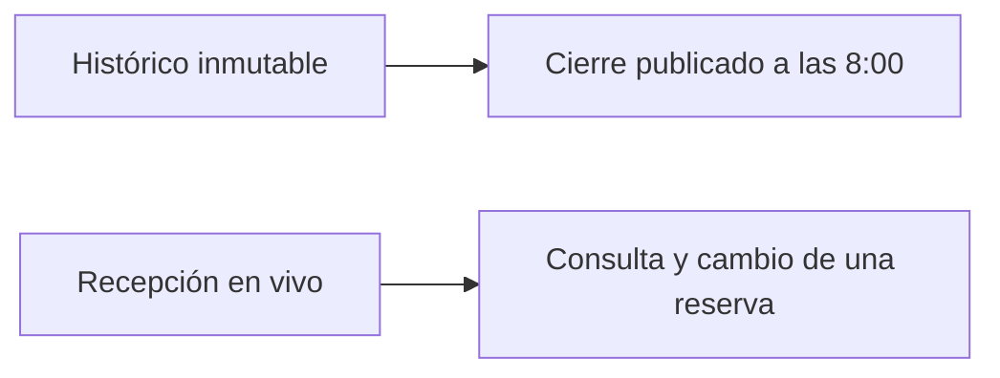

# Práctica Integradora de la UT2

Esta práctica cierra la **UT2**. Durante unas **20 horas** vais a gestionar el almacenamiento y el procesamiento del [grupo hotelero de Cantabria](../ut1/caso-hotel.md): el histórico que se recorre entero en el cierre y la recepción que sigue cambiando reservas. El encargo desarrolla el **[RA2](ra2.md)** en sus criterios **a)** a **e)**.

Los apartados [2.1](por-que-almacenamiento.md) a [2.9](pymongo.md) siguen siendo la referencia técnica y trabajan con ficheros pequeños para poder revisar cada comando. Aquí conectáis esas funciones con un conjunto ficticio de cerca de **1 GB** y con dos usos distintos del mismo negocio. Cada alumno trabaja en un repositorio propio, creado desde la [plantilla](#el-repositorio). En Moodle se entregan la URL y el identificador del commit. Esta página no sustituye a la [autoevaluación](autoevaluacion.md).

!!! info "Ruta de estudio"
    **Esencial:** elegir dos almacenes con funciones distintas, comprobar un cálculo repartido, probar un fallo definido, mantener la recepción ante la caída de un miembro y mostrar qué aporta añadir un módulo.

    **Práctica:** un repositorio propio, con la combinación elegida y un expediente de predicción, operación, salida e interpretación para cada criterio. Las herramientas de la unidad valen; también una alternativa que documentéis y que permita esas pruebas.

    **Ampliación:** perfil de 5 a 10 GB, una segunda máquina física u otro motor. Su detalle adicional solo se exige si el profesor lo anuncia antes (véase [cómo trabajar la unidad](index.md#como-trabajar-la-unidad)).

## El encargo

Recepción registra operaciones en **Santander**, **Laredo**, **Comillas** y **Potes**. Finanzas cierra a las **23:00**. Gerencia abre el panel a las **8:00** del día siguiente y necesita el cierre ya comprobado. Mientras tanto, recepción tiene que localizar una reserva y modificarla sin esperar a ese panel.

> «A las 8:00 necesito noches e importe por hotel, cancelaciones por canal y el recuento de lecturas de sensores del cierre. Esos datos ya no se reescriben: se recorren enteros. A la vez, recepción sigue consultando y cambiando reservas. Si un nodo deja de responder, el servicio que corresponda tiene que seguir o recuperarse de forma explicada, y el sistema tiene que poder crecer añadiendo un módulo.»



El informe de las 8:00 no es el estado de recepción en ese instante. Conservad en el resultado la fecha de cierre y la hora de generación, como en el [caso](../ut1/caso-hotel.md). Esta práctica no vuelve a construir el flujo de Pentaho de la [UT1](../ut1/tarea-clase.md).

## Qué tenéis que demostrar

| Criterio | Qué se pide en este encargo | Evidencia mínima |
| --- | --- | --- |
| **a)** | Justificar por qué cada dato va a un almacén y cómo se procesa dentro del plazo. | Volumen medido, operación, plazo de las 8:00 y motivo de la elección. |
| **b)** | Comprobar un cálculo repartido sobre el histórico del cierre. | Mismo agregado en local y en el sistema repartido, tareas o etapas observadas y tiempos comparables. |
| **c)** | Probar la respuesta ante un fallo concreto. | Estado inicial, interrupción, qué sigue disponible y cómo se recupera. |
| **d)** | Conservar el histórico y usarlo después para una pregunta que no estaba en el primer informe. | Datos intactos, metadatos y una consulta nueva con el total contrastado. |
| **e)** | Mostrar que el sistema crece al añadir un módulo. | Recurso incorporado, qué capacidad o función aporta y qué queda igual en el resultado. |

Una captura sin la operación y sin la interpretación no acredita el criterio. Si el entorno no permite observar una propiedad, registrad el límite y el experimento que haría falta. No presentéis una predicción como una medida.

## Los datos

Los datos son **ficticios** y son otro conjunto, distinto de los ficheros pequeños de los apartados 2.2 a 2.9. El generador y el contrato de totales viajan en la plantilla, en `datos/generar_cierre.py` y `datos/totales_esperados.json`. Los mismos archivos están en el sitio: [generar_cierre.py](../assets/practicas/hotel-ut2/generar_cierre.py) y [totales_esperados.json](../assets/practicas/hotel-ut2/totales_esperados.json).

La semilla es **2026** y el perfil por defecto es `aula`. Quien ejecuta el generador sin cambiar argumentos obtiene los mismos totales. El bruto se escribe en `datos/bruto/` y no se sube. No hace falta escribir las filas a mano, ni inventar otro volumen, otra semilla u otros hoteles.

```text
python datos/generar_cierre.py --salida datos/bruto
python datos/generar_cierre.py --salida datos/bruto --comprobar datos/totales_esperados.json
```

Los cuatro hoteles de este encargo son los del [caso](../ut1/caso-hotel.md): Santander, Laredo, Comillas y Potes. En los talleres, el CSV de Hadoop tiene cinco hoteles y **62 noches**, e incluye **Noja**; alguna consulta de MongoDB menciona también **Reinosa**. Esos totales pertenecen a aquellos ficheros. No los contrastéis con `totales_esperados.json`.

El perfil de aula ocupa **1 037 243 783 bytes** (1,037 GB) en bruto, antes de copias, índices y ficheros temporales:

| Conjunto | Papel en el encargo | Filas del perfil aula |
| --- | --- | --- |
| Reservas | Histórico que se recorre en el cierre y documento que recepción actualiza | 3.000.000 |
| Cobros | Importe cobrado de cada reserva confirmada. No se suma el precio `importe` de la reserva | 2.639.775 |
| Opiniones | Texto y valoración que no cabe tratar como una tabla estrecha | 1.000.000 |
| Sensores | Lecturas de zona; el cierre cuenta cuántas hay por hotel | 15.000.000 |

`totales_esperados.json` fija, para esa semilla, las noches y el importe por hotel, las cancelaciones por canal y los recuentos de sensores. Contrastad vuestro cierre con ese fichero antes de interpretar tiempos o fallos. Un resultado distinto obliga a revisar la lectura, el filtro del cierre y la agregación; no se corrige cambiando el esperado.

El perfil de **5 a 10 GB** es una ampliación. Usadlo solo si el equipo tiene memoria y disco suficientes y el profesor lo ha anunciado. En un laboratorio de particiones documentales, podéis bajar el tamaño de *chunk* para ver el reparto sin cargar varios gigabytes en esa base. Anotad el valor usado: el reparto observado depende de esa configuración.

Dejad sitio para las copias del almacén y para la salida del cálculo. Un bruto de 1 GB no cabe en la planificación como si fuera el único byte que va a ocupar el disco.

## Tecnologías que podéis elegir

Podéis usar las herramientas de la unidad o una alternativa que investiguéis. En el expediente tenéis que decir qué función cubre cada pieza. La combinación elegida tiene que permitir **detener un nodo** y **añadir un módulo**. Un único Postgres, o un almacén de objetos con un solo proceso y sin reparto ni copias, no cubre los criterios **c)** y **e)**.

| Función | Qué resuelve en el hotel | Ejemplos válidos si justificáis la elección |
| --- | --- | --- |
| Histórico de ficheros | Conservar reservas, cobros y sensores para recorrerlos en el cierre | HDFS, MinIO, S3, Azure Blob, Ceph, ficheros Parquet sobre uno de esos almacenes |
| Cierre de las 8:00 | Repartir el cálculo y reunir un total comprobable | MapReduce y YARN, Spark, Hive, Trino o Presto |
| Recepción | Consultar y modificar una reserva concreta | MongoDB, Cassandra o Scylla, CouchDB, OpenSearch o Elasticsearch si el acceso encaja con el modelo |
| Copia ante un fallo | Seguir o recuperar el servicio al perder un miembro | Réplica de bloques en HDFS, *replica set* de MongoDB, factor de replicación de Cassandra, MinIO distribuido |
| Crecimiento | Añadir capacidad o una función | DataNode, trabajador de Spark, partición de Cassandra, *shard* de OpenSearch, nodo de almacenamiento de objetos |
| Apoyo | Acelerar una lectura repetida, sin convertirse en el archivo de negocio | Redis u otra caché, solo como apoyo |

Flink encaja si las lecturas de sensores forman un camino cercano al tiempo real, separado del lote de las 8:00. No hace falta Kafka, Airflow ni un lago completo para terminar el encargo. Si los usáis, indicad qué criterio cubren y qué parte del expediente seguiría en pie sin ellos.

Estas tres combinaciones son recorridos coherentes, no una lista cerrada:

1. **HDFS con MapReduce**, más **MongoDB** en *replica set* y, para el criterio **e)**, una partición o un nodo añadido.
2. **MinIO o S3 con Parquet**, consulta con **Hive o Trino** y, si lo justificáis, Spark; la recepción en MongoDB, Cassandra o Scylla.
3. **Sensores en Cassandra o Scylla** y el cierre de ficheros con Spark o Hive.

El laboratorio Hadoop del módulo puede tener un solo DataNode. En ese caso podéis aprender los comandos, y tenéis que decir que **no** habéis observado la tolerancia por réplica de bloques. Para el criterio **c)** usad un montaje con copias efectivas o dejad constancia de que la prueba queda pendiente de otro entorno. Varios contenedores en un ordenador tampoco demuestran que el servicio sobreviva a la pérdida de ese ordenador, ni que el trabajo se acelere entre máquinas físicas.

## Recorrido

Las horas son orientativas y suman unas 20. El profesor concreta en Moodle el calendario de las sesiones.

| Bloque | Horas | Criterios | Qué queda hecho |
| --- | --- | --- | --- |
| 1. Dos almacenes | 3 | **a)**, **d)** | Histórico e información viva separados, con el volumen medido y la primera carga contrastada |
| 2. Cierre repartido | 5 | **b)** | El mismo agregado en local y en el motor repartido, la comparación de uno y dos trabajadores, y la misma pregunta en un segundo motor |
| 3. Fallo en el histórico | 2 | **c)** | Un nodo de ficheros detenido, con el efecto anotado y la recuperación |
| 4. Recepción con copias | 5 | **a)**, **c)**, **d)** | Alta o cambio de una reserva, caída de un miembro y lectura posterior |
| 5. Crecer por módulos | 3 | **e)** | Un módulo añadido y la misma pregunta de negocio repetida |
| 6. Una pregunta posterior | 2 | **d)**, **c)** | Una consulta nueva sobre el histórico ya guardado, y la diferencia entre réplica y copia de seguridad |

### 1. Dos almacenes

Medid el bruto generado y el espacio que ocupará con las copias previstas. Asignad el histórico de reservas, cobros, opiniones y sensores al almacén que se recorre entero. Asignad la reserva que recepción consulta y modifica al almacén que admite ese acceso. Explicad por qué un único sitio empeoraría el plazo de las 8:00 o la operación de recepción.

Cargad los datos y contrastad recuentos con `totales_esperados.json` antes de seguir. Guardar el fichero no demuestra que el motor entienda sus campos: anotad formato, esquema o metadatos y el programa que los lee.

### 2. Cierre repartido

Calculad noches e importe por hotel, cancelaciones por canal y el recuento de sensores del cierre. Haced primero el mismo agregado con una herramienta local, sobre el mismo corte, y guardad esos totales como referencia. Después ejecutadlo en el motor repartido.

Registrad tareas o etapas, nodos y tres tiempos por configuración, con una ejecución de calentamiento fuera de la mediana. Comparad una y dos trabajadores, o el equivalente en la tecnología elegida. Si añadir un trabajador no reduce el tiempo, el criterio **b)** sigue cubierto: explicad el coste de arranque o de la mezcla, como en [2.4](computacion-distribuida.md). Un total distinto del esperado anula la comparación de tiempos.

Repetid una de las preguntas en un segundo motor, aunque sea de forma acotada. El segundo resultado tiene que coincidir con el primero. Así se ve que el criterio depende del cálculo repartido y comprobable, no de un producto concreto.

### 3. Fallo en el histórico

Elegid un fallo que el diseño declara soportar: un DataNode, un nodo de almacenamiento de objetos o el proceso que guarda una copia del fichero. Anotad el estado antes de detenerlo, detened solo ese miembro y comprobad si el cierre puede leer los datos o qué parte queda interrumpida. Documentad la recuperación y el tiempo empleado.

Si la prueba solo detiene un contenedor del mismo ordenador, escribid esa limitación junto al resultado. Añadir el nodo de nuevo, cuando el producto lo permita, sirve también para preparar el bloque 5.

### 4. Recepción con copias

Modelad la reserva que recepción necesita recuperar y modificar. Una inserción con un campo nuevo, por ejemplo una mascota o una hora de llegada, tiene que convivir con las reservas ya guardadas. Relacionadlo con [2.7](modelado.md) y [2.9](pymongo.md) si usáis documentos; si elegís otro modelo, explicad la operación equivalente.

Levantad las copias que hayáis justificado. Detened un miembro que no sea el único dato existente, comprobad qué operación sigue y cuál espera, y volved a leer la reserva modificada. Conservad la preferencia de lectura o de confirmación que use el cliente. Esta prueba acredita el fallo de un miembro de recepción; no sustituye al fallo del histórico del bloque 3 si son sistemas distintos.

### 5. Crecer por módulos

Añadid un módulo real del diseño: otro DataNode, otro trabajador, otra partición o *shard*, u otro nodo del almacén de objetos. Repetid una pregunta de negocio ya contrastada y mostrad que el total no cambia. Explicad qué ha aumentado: espacio, paralelismo, reparto o una función nueva. Un nodo añadido que no acelera el cierre puede ser una evidencia válida de **e)** si medís qué capacidad sí aporta.

La evidencia común de [2.8](replicas-shards.md#evidencia-comun-del-criterio-e-observar-la-ampliacion) sigue disponible cuando el equipo no admite la ampliación. Completadla con la interpretación individual que pide el [RA2](ra2.md#evidencias-minimas-comunes-de-b-y-e). En esta práctica, además, el módulo tiene que pertenecer al diseño que habéis elegido para el hotel.

### 6. Una pregunta posterior

Con el histórico ya cargado, responded una pregunta que no formaba parte del primer panel. Puede ser el importe cobrado de un canal en un hotel y un mes, o las lecturas de sensores por encima de un umbral en una sede. No reescribáis el histórico para poder contestarla: usad metadatos y un lector compatible. Contrastad el nuevo total con un cálculo independiente sobre el mismo corte.

En el mismo bloque, provocad o describid con una prueba pequeña la diferencia entre réplica y copia de seguridad. Una réplica puede propagar un borrado o una corrección errónea. La copia de seguridad tiene que permitir volver a una versión anterior. Decid cuál de las dos habéis probado y cuál queda solo diseñada.

## Cómo se documenta cada prueba

Para cada criterio, el expediente contiene cuatro piezas, en este orden:

1. **Predicción.** Qué esperáis que ocurra, con el total de referencia si la prueba calcula.
2. **Operación.** Comando, trabajo o fragmento de código, con la versión y el nodo.
3. **Salida.** El resultado literal, recortado si es largo, suficiente para contrastar el total o el estado.
4. **Interpretación.** Qué criterio queda acreditado, qué límite tiene la prueba y qué no se puede afirmar.

Indicad las ayudas recibidas, incluidas las de una herramienta de inteligencia artificial. La valoración recae en la decisión de diseño, en el experimento y en la interpretación. Un *mapper* o una consulta generados no sustituyen esa explicación: tenéis que poder repetir la comprobación y decir por qué el total coincide o deja de coincidir.

!!! warning "Qué permite afirmar el laboratorio"
    Contenedores en un solo ordenador muestran funciones, tareas y la parada de un proceso. No demuestran la supervivencia del servicio si se pierde el ordenador entero, ni una aceleración entre máquinas físicas. Escribid junto a cada prueba qué habéis observado y qué corresponde al diseño.

## Relación con los apartados de la unidad

| Apartado | Qué reutilizáis aquí |
| --- | --- |
| [Transición de los 500 GB](../ut1/transicion-ut2.md) y [2.1](por-que-almacenamiento.md) | Medir volumen, plazo y continuidad antes de elegir herramientas |
| [2.2](ecosistema.md), [2.3](hdfs.md) y [2.4](computacion-distribuida.md) | Ficheros, bloques y un cálculo repartido con el total contrastado |
| [2.5](nosql.md), [2.6](mongodb.md) y [2.7](modelado.md) | Elegir el modelo de recepción y justificar campos y consultas |
| [2.8](replicas-shards.md) | Caída de un miembro y crecimiento por particiones o nodos |
| [2.9](pymongo.md) | Acceso desde un programa, si la recepción se hace en Python |

## El repositorio

Cada alumno crea el suyo desde la plantilla [bda-ut2-hotel](https://github.com/iesataulfoargentasor/bda-ut2-hotel){target="_blank" rel="noopener"}. En **Owner** elegid vuestro usuario. El nombre del repositorio es **`bda-ut2-hotel`**. La cuenta `iesataulfoargentasor` publica la plantilla; el trabajo queda en vuestra cuenta.

[Crear vuestra copia de la plantilla](https://github.com/iesataulfoargentasor/bda-ut2-hotel/generate){target="_blank" rel="noopener"}

La dirección debe quedar `github.com/VUESTRO_USUARIO/bda-ut2-hotel`. Puede ser pública o privada. Si es privada, añadid como colaborador al usuario que indique el profesor y comprobad que ha aceptado la invitación antes de la evaluación.

La plantilla ya trae el archivo para escribir la combinación, un archivo de evidencia por bloque, el generador, `totales_esperados.json` y carpetas para scripts, datos y avances. La combinación sale vacía: no viene decidida. GitHub guarda ese expediente y los programas. No ejecuta el clúster. El bruto, de 1 037 243 783 bytes, se queda en el equipo: la plantilla ignora `datos/bruto/` y `datos/generado/`. Sí se suben `totales_esperados.json`, los scripts, la combinación y las evidencias.

En Moodle entregad la **URL del repositorio** y el **identificador completo del commit** que queréis que se evalúe. Comprobad en el navegador que ese commit está publicado. Un commit solo en el portátil no queda entregado.

Al cerrar cada sesión, copiad `avances/PLANTILLA.md` a `avances/sesion-01.md`, `sesion-02.md`, etc., y registrad el cambio con un mensaje reconocible, por ejemplo `Bloque 1: carga contrastada con los totales esperados`.

## Actividades

Las seis actividades coinciden con los bloques y con los archivos `evidencias/` de la plantilla. Conservad en local las entradas y las salidas grandes el tiempo que indique el profesor. En el repositorio dejad el extracto que permite contrastar cada resultado.

1. **Separar.** Medid el bruto, asignad cada conjunto a su almacén y cargadlo. Entregad los recuentos frente a `totales_esperados.json` y un párrafo por almacén con la operación que justifica esa elección.
2. **Cerrar.** Calculad el cierre en local y en el motor repartido. Entregad tareas o etapas, la mediana de tres tiempos y la comparación al añadir capacidad de ejecución. Incluid el segundo motor y la coincidencia de totales.
3. **Detener un nodo del histórico.** Entregad estado inicial, fallo, efecto sobre la lectura y recuperación. Si la prueba comparte un solo ordenador, escribid qué fallo no queda demostrado.
4. **Atender recepción.** Entregad el alta o el cambio, la lectura que sigue funcionando y la parada de un miembro de las copias. Mostrad que las reservas anteriores siguen siendo legibles.
5. **Añadir un módulo.** Entregad el antes y el después del recurso, la pregunta repetida y qué capacidad cambia sin cambiar el total.
6. **Preguntar después.** Entregad la consulta nueva, su contraste y la distinción, probada o diseñada, entre réplica y copia de seguridad.

??? note "Revisar después de intentarlo"
    **1.** El bruto medido y el espacio con copias son cifras distintas. Un fichero colocado en HDFS o en un cubo todavía necesita formato y lector. Recepción y cierre pueden compartir negocio y usar almacenes distintos.

    **2.** Los totales del motor repartido coinciden con el cálculo local y con `totales_esperados.json`. Tres tiempos y una pasada de calentamiento permiten comparar. Una agregación en un solo proceso no acredita **b)** por sí sola.

    **3.** El fallo nombra un miembro concreto. La recuperación incluye el tiempo y el estado final de los datos. Detener un contenedor del mismo portátil no acredita la pérdida de ese portátil.

    **4.** El campo nuevo no impide leer las reservas ya guardadas. La parada de un miembro deja escrito qué operación continúa. Confirmación y lectura son opciones del cliente; no equivalen a haber probado todos los fallos.

    **5.** El recurso añadido se ve en el sistema, no solo en un diagrama. El total de negocio se mantiene. Más capacidad, más reparto y más rendimiento son conclusiones distintas.

    **6.** La pregunta nueva usa el histórico ya depositado. Un cálculo independiente contrasta el resultado. La réplica puede copiar también un error; la copia de seguridad conserva una versión anterior.

Al terminar, tenéis que poder explicar a otro grupo dónde queda cada dato, qué total habéis contrastado, qué fallo habéis provocado y qué módulo habéis añadido. Seguid con la [autoevaluación](autoevaluacion.md) para repasar los conceptos. El cuestionario no sustituye a este expediente.
