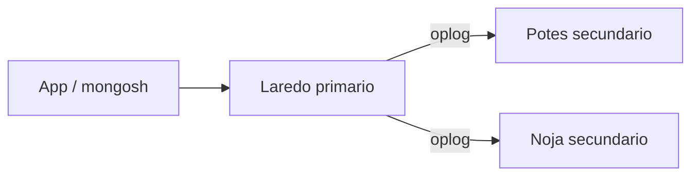
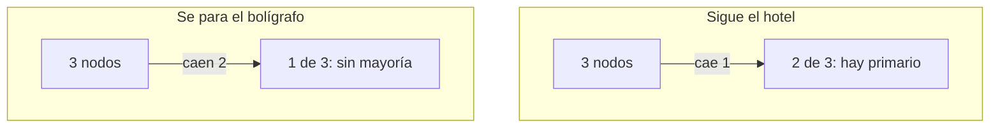
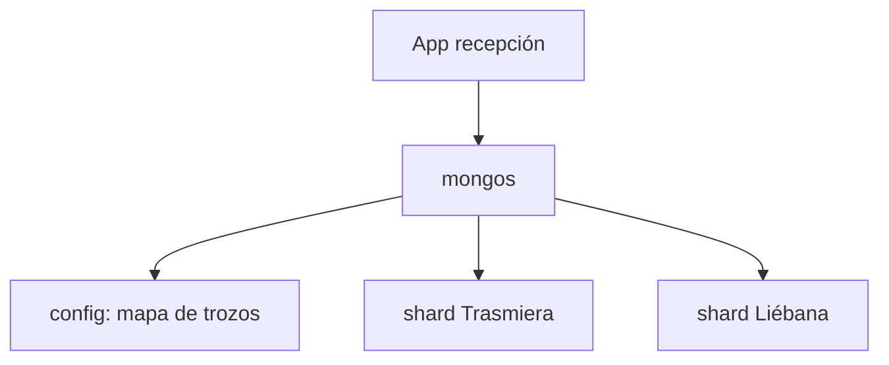

# 2.8. Réplicas y particiones

Un viernes de agosto se va la luz en Laredo. En Potes el mostrador **sigue cobrando**. Eso es el criterio **c)** del RA2: el dato no vive en un solo enchufe.

En Semana Santa las tres sedes escriben a la vez y un solo `mongod` se ahoga. Entonces **no** copiáis el mismo libro tres veces: **partís** las reservas (Trasmiera a un lado, Liébana al otro) y recepción habla con un **enrutador**. Eso es el **e)**: crecéis enchufando un módulo.

Dos oficios que en [2.5](nosql.md) ya se nombraron y que aquí se **montan**:

| Oficio | Qué guarda cada máquina | Analogía del hotel |
| --- | --- | --- |
| **Replicar** | El **mismo** dataset | Tres mostradores con la **misma** carpeta de reservas |
| **Particionar** (*sharding*) | Un **trozo** distinto | Un archivo por comarca |

En producción se combinan: cada trozo es, a su vez, un **conjunto de réplicas**. Atlas gratuito suele traer réplicas ya hechas; **no** podéis `rs.initiate` ni apagar nodos allí. El lab de este apartado es Docker **en el aula**.

## Tres mostradores, una carpeta

Los nombres Laredo, Potes y Noja representan miembros del conjunto. **Cada miembro guarda una copia de todos los documentos**, no solamente las reservas de su localidad. Si Laredo contiene una reserva de Potes, sus secundarios también la replican. El reparto por datos aparece después, con sharding.

Un **replica set** es un grupo de procesos `mongod` que se ponen de acuerdo en **un** dataset. El cliente no “elige IP a ojo”: se apunta al **conjunto**. Si el que escribía se calla, los que quedan **votan** y otro toma el bolígrafo.



Nombres de aula (no son los de otro ciclo): set **`hotelrs`**, nodos `rs-laredo`, `rs-potes`, `rs-noja`. Laredo sale con más *priority* para que, si está vivo, vuelva a ser primario.

### Quién escribe, quién copia, quién solo vota

Un árbitro participa en elecciones pero no guarda una copia de los datos. No sustituye a un secundario para leer ni para recuperar contenido perdido. En esta práctica utilizamos tres miembros con datos para poder observar tanto la elección como la replicación.

| Pieza | Oficio en el hotel |
| --- | --- |
| **Primario** | El único mostrador que **escribe** (altas, cobros, `update`) |
| **Secundario** | Copia el diario y puede **leer** si se lo pedís |
| **Árbitro** | Entra a la sala de votación y **no** guarda reservas. Barato para tener número **impar** de votos |

Un secundario **no** acepta `insertOne`. Si lo intentáis, Mongo se niega: no hay dos bolígrafos a la vez.

Miembros que no son “un Potes normal”:

- **Retrasado** (`priority: 0` y un retraso en segundos): la carpeta de **ayer**. Si recepción borra mal una noche, tenéis un punto de restauración. No se presenta a primario.
- **Oculto** (`hidden: true`): no aparece en la lista que usa la *app*. Sitio para el analista que barre el invierno sin pisar al mostrador.
- **Sin voto** (`votes: 0`): copia datos pero **no** decide elecciones. Útil como espejo lejano.

El árbitro **no** sustituye a un secundario con disco: si perdéis el primario y os queda árbitro + un secundario, hay mayoría para elegir… pero **un solo** sitio con datos. En aula preferid **tres nodos con disco**.

## El diario (antes que los votos)

El **oplog** registra operaciones para que los secundarios sigan el historial del primario. Su ventana es limitada: un secundario desconectado demasiado tiempo puede necesitar una sincronización inicial. El oplog y las réplicas no sustituyen una copia de seguridad, porque también propagan borrados y errores de aplicación.

La copia **no** es “cada noche un `mongodump`”. El primario anota cada cambio en un diario: el ***oplog*** (*operations log*), colección `local.oplog.rs`.

Es una colección ***capped***: tamaño fijo (en muchos despliegues, del orden del **5 %** del disco, configurable). Lo nuevo **empuja** a lo viejo. Si un secundario se desconecta **más tiempo** del que cabe en el diario, al volver **no** puede ponerse al día: hay que resincronizarlo (vuelve a copiar el dataset).

La réplica es **asíncrona**: Potes puede ir un segundo por detrás. Eso importa cuando prometéis al huésped “ya está cobrado” y luego leéis en Noja.

```javascript
// En el primario, dentro del set
use local
db.oplog.rs.stats()
db.oplog.rs.find().sort({ $natural: -1 }).limit(3)
```

`rs.printReplicationInfo()` resume **cuántas horas** de diario os caben. Si el retraso supera la ventana disponible, el secundario puede necesitar una sincronización inicial; no significa que el equipo quede inutilizable.

## Elección: mayoría de los que *están configurados*

Ejemplo: con tres votantes, la mayoría es dos; con cuatro, es tres. Añadir un cuarto votante no permite perder dos y continuar escribiendo. Un miembro configurado con `votes: 0` no entra en ese cálculo. Además de votos suficientes, hace falta un candidato elegible y suficientemente actualizado.

Durante la elección puede haber una pausa de escrituras. «Alta disponibilidad» significa recuperar el servicio dentro de las condiciones previstas, no ausencia de cualquier interrupción. Registrad el tiempo observado sin presentarlo como una constante universal.

Si Laredo no responde unos **diez segundos** (orden de magnitud; no memoricéis el milisegundo), Potes y Noja intentan elegir primario.

**Mayoría** = más de la mitad de los miembros **votantes configurados** (los del `rs.conf()`), no “los que hoy contestan”. Tres nodos: hace falta que **dos** se vean. Se cae uno → el set **sigue**. Se caen dos → el que queda **no** se autoproclama: preferís **parar escrituras** a tener dos primarios.



Dos centros de datos y un tercero (otro edificio o un árbitro) evitan que un corte de comarca os deje sin votos. Un solo armario con los tres portátiles **no** es tolerancia geográfica: es un lab.

### Rollback: lo que solo vio Laredo

Si Laredo aceptó un `insert` con `w: 1`, se apagó **antes** de que Potes lo copiara, y Potes ganó la elección, ese insert **no** está en el set nuevo. Al volver, Laredo **deshace** lo que no llegó al resto (*rollback*). El criterio **c)** no es “nunca se pierde un `w: 1`”: es “el hotel **sigue** y el dato **mayoritario** sobrevive”.

## Laboratorio: set `hotelrs` (tres sedes)

Compose en [`docs/assets/practicas/hotel-rs/`](../assets/practicas/hotel-rs/compose.yaml). Imagen `mongo:7`, puertos **27017–27019**, volúmenes con nombre. Trabajáis **dentro** de la red Docker: los hostnames `rs-laredo` los resuelve Compose, no el `localhost` de Windows.

```powershell
cd docs/assets/practicas/hotel-rs
docker compose up -d
docker compose exec rs-laredo mongosh
```

En ese `mongosh`:

```javascript
load("/scripts/iniciar-rs.js")
rs.status()
```

Hasta que un miembro ponga `"stateStr": "PRIMARY"`, esperad unos segundos y repetid `rs.status()`. `db.hello()` (no el viejo `isMaster`) dice si **este** proceso es primario y a quién seguir.

Anotad en `rs.status()`:

- `set`: debe ser `hotelrs`
- `members[i].name` y `stateStr` (`PRIMARY` / `SECONDARY`)
- `electionDate` cuando hayáis forzado un relevo

### Escribir en Laredo, leer en Potes

Comprobad primero con `db.hello()` qué miembro es primario; los nombres no garantizan el cargo. En el primario:

```javascript
use hotel
db.reservas.insertOne(
  {_id: "prueba-replica-01", hotel: "Laredo", canal: "web", noches: 2, importe: 124},
  {writeConcern: {w: "majority", wtimeout: 5000}}
)
```

Desde **otra terminal del host**, dentro de la carpeta `hotel-rs`:

```powershell
docker compose exec rs-potes mongosh "mongodb://localhost:27017/?directConnection=true"
```

En ese shell, si Potes es secundario:

```javascript
db.hello()
use hotel
db.getMongo().setReadPref("secondary")
db.reservas.find({_id: "prueba-replica-01"})
db.reservas.insertOne({_id: "prueba-escritura-secundario", hotel: "Potes"})
```

La lectura puede necesitar esperar a que se aplique la réplica. La escritura directa al secundario debe rechazarse: cambiar la preferencia de lectura no lo convierte en primario. Las opciones iniciales del cliente pueden permitir o impedir la lectura antes de `setReadPref`; anotad lo observado y la URI, sin asumir un error universal.

`rs.help()` enumera operaciones de administración. No repitáis `rs.initiate()` sobre un conjunto ya inicializado. Compass desde Windows puede inspeccionar un miembro mediante `mongodb://localhost:27017/?directConnection=true`, pero esa conexión directa **no ofrece descubrimiento ni cambio automático de primario**. Para probar failover con un driver, ejecutad el cliente en la red que resuelve los tres hostnames.

## Qué puede prometer recepción

Son tres decisiones independientes: **readPreference** elige dónde leer; **readConcern** determina qué datos puede observar la lectura; **writeConcern** define qué confirmación espera una escritura. Usar un secundario no elige automáticamente el nivel de lectura, y confirmar una escritura no obliga a que todos los secundarios ya la hayan aplicado.

### Preferencia de lectura

| `readPreference` | Gesto |
| --- | --- |
| `primary` | Selecciona el primario; es la preferencia por defecto, no una garantía suficiente de lectura linealizable |
| `primaryPreferred` | Primario si está; si no, un secundario (el mostrador no se queda en blanco) |
| `secondary` | Solo copias: informes, no el “¿ya está?” del huésped |
| `secondaryPreferred` | Copia si hay; si no, primario |
| `nearest` | Selecciona entre miembros elegibles dentro de la ventana de latencia; puede ser un secundario atrasado |

En el *shell*: `db.getMongo().setReadPref("secondaryPreferred")`. En [2.9](pymongo.md) el *driver* lo lleva en el cliente.

### Preocupación de escritura

En MongoDB 7 el valor implícito es `majority` en muchas topologías, incluido el conjunto de tres miembros con datos de esta práctica; existen excepciones, por ejemplo ciertas configuraciones con árbitros. Para que el ejercicio sea inequívoco, indicamos la opción explícitamente. Consultad las reglas de [write concern](https://www.mongodb.com/docs/manual/reference/write-concern/).

`wtimeout` limita la espera de confirmaciones, **no revierte una escritura ya aplicada**. Si vence, el resultado puede ser incierto para el cliente. Antes de repetir una operación de negocio, comprobad su identificador y diseñad el reintento para no duplicarla.

`writeConcern` es **cuántas copias** deben asentir antes de devolver OK.

| `w` | Promesa |
| --- | --- |
| `0` | *Fire-and-forget*: la *app* no espera. Peligroso en cobros |
| `1` | El **primario** confirma la escritura. Un secundario puede ir detrás |
| `"majority"` | Se alcanza la confirmación mayoritaria exigida entre miembros con datos y voto; no exige todas las copias |

`j: true` pide *journal* en disco. `wtimeout` evita esperar eternamente si Noja está colgado.

```javascript
db.reservas.insertOne(
  { hotel: "Noja", canal: "ota", noches: 1, importe: 89 },
  { writeConcern: { w: "majority", wtimeout: 5000 } }
)
```

Se relaciona con [CAP](../ut1/almacenamiento.md): el lado que no alcanza la mayoría no puede confirmar esa escritura. No se exige escribir en todos los miembros, y la garantía debe describirse junto con las opciones de lectura y el fallo considerado.

### Preocupación de lectura

| `readConcern` | Qué veis |
| --- | --- |
| `local` | Lo que este nodo tiene (puede no ser mayoritario) |
| `available` | Prioriza la disponibilidad de lectura y puede observar documentos huérfanos durante migraciones de shards |
| `majority` | Datos que **ya no se van a deshacer** en un rollback típico |
| `linearizable` | Lectura “como si hubiera un solo mostrador”; cara |
| `snapshot` | Vista coherente de un instante; se usa en transacciones y en ciertas lecturas compatibles |

Para el aula, comparad escritura con mayoría y lectura local de un secundario. Esta última puede estar atrasada: solo es adecuada si el informe admite ese retraso. `readConcern: "majority"` no significa necesariamente «la versión más reciente». Para leer vuestras escrituras y respetar dependencias, estudiad también las sesiones causalmente consistentes y sus opciones.

## Prueba del c): apagar el primario

Primero verificad tres miembros sanos y la reserva `prueba-replica-01` confirmada con mayoría. Registrad qué nodo es primario.

Hay dos experimentos diferentes:

1. **Relevo controlado:** ejecutad `rs.stepDown(60)` en el primario. Renuncia temporalmente al cargo, pero su proceso sigue encendido. Observad la elección; no hay ningún contenedor que arrancar de nuevo.
2. **Caída de proceso:** desde el host, detened el servicio que sea primario. Si es Laredo, el comando es:

```powershell
docker compose stop rs-laredo
```

Desde uno de los dos nodos restantes, comprobad `rs.status()` hasta que aparezca otro primario. Conectaos a ese primario, consultad la reserva conocida e insertad otra con un `_id` distinto y confirmación mayoritaria. Anotad el intervalo en que no se podía escribir.

Recuperad el miembro detenido desde el host:

```powershell
docker compose start rs-laredo
```

Debe reincorporarse y sincronizarse. Por su prioridad puede recuperar más adelante el cargo de primario. Si detuvisteis otro miembro, adaptad el nombre en ambos comandos.

**Evidencia mínima:** estado antes, fallo provocado, elección, lectura del dato previo, escritura nueva y recuperación del miembro. Esto prueba tolerancia a la caída de un proceso del conjunto; todos los contenedores dependen todavía del mismo ordenador.

!!! warning "No mezclar laboratorios"
    El servidor independiente del 2.6 y `hotel-rs` publican 27017. Detened `hotel-mongo` antes de arrancar el conjunto; detenerlo conserva su volumen. No borréis los volúmenes para cambiar de ejercicio.

## Cuando copiar ya no basta: partir

La capacidad útil de un replica set no se suma como si cada miembro guardara una parte diferente. Tres copias de 100 GB siguen representando 100 GB de datos lógicos, además de índices y registros. En sharding sí repartimos documentos entre grupos y replicamos dentro de cada grupo. Escala y redundancia se consiguen con mecanismos distintos.

Tres copias del **mismo** disco no aumentan las escrituras: las **multiplican**. Si el cuello es “no cabemos” o “Laredo satura el primario”, hace falta **particionar**.

Mongo hace ***auto-sharding*** por **rangos** (o por **hash**) de una **shard key**. Unidad que se mueve: el ***chunk*** (trozo). Un proceso, el ***balancer***, los reparte. No es instantáneo: con muchos GB puede tardar.



| Pieza | Oficio |
| --- | --- |
| **Shard** | Un replica set con **parte** de `reservas`. En serio: **set**, no un `mongod` huérfano |
| **Config** | Metadatos: qué rango vive en qué shard. En serio: **tres** nodos |
| **mongos** | Centralita: la *app* **solo** habla con él. El *driver* cambia de `mongos` si uno cae; **no** habla con cada `mongod` |

El *shard* **primario** de una base es el que guarda las colecciones **aún no** partidas. `sh.status()` lo enseña.

### La clave: `hotel` os junta el atasco

La elección combina cardinalidad, frecuencia de valores, crecimiento y consultas. Un hash de `_id` suele distribuir altas, pero una consulta solo por `hotel` puede necesitar consultar todos los shards. Usamos `_id` porque el JSONL de aula **no contiene `id_reserva`**: MongoDB genera `_id` al importar. Particionar por un campo ausente no reparte las reservas como esperamos.

La shard key necesita **cardinalidad** alta (muchos valores distintos) y que las escrituras **no** caigan todas en el mismo trozo.

| Clave | Qué pasa en el hotel |
| --- | --- |
| `{ hotel: 1 }` | Casi todo agosto es **Laredo** → un shard se fríe (*hotspot*) |
| `{ checkin: 1 }` | Los inserts de “hoy” van todos al **último** rango |
| `{ _id: "hashed" }` | El hash **reparte** altas; un `find` por hotel **recorre** shards (*broadcast*) |

Regla práctica: si el 90 % de los `find` filtran por un campo, ese campo **pide** ir en la clave (o en un prefijo compuesto). Si no está, `mongos` pregunta **a todos**.

Colección vacía: `shardCollection` crea el índice. Colección con datos: creáis el índice **antes**.

```javascript
sh.shardCollection("hotel.reservas", { _id: "hashed" })
// rango, si de verdad filtráis por comarca y hay dos mitades vivas:
// sh.shardCollection("hotel.reservas", { comarca: 1, _id: 1 })
```

Tercer argumento histórico: `unique` (el índice de la clave es único). En el hotel, `_id` hashed **no** se declara único a la ligera: un índice hashed no puede declararse único; la unicidad debe diseñarse de acuerdo con las reglas de índices de colecciones particionadas.

No montéis un clúster partido para 500 documentos. El **e)** se **ve** en `sh.status()` y, con volumen, en `getShardDistribution`.

## Laboratorio opcional: Trasmiera y Liébana

El [Compose de sharding](../assets/practicas/hotel-shards/compose.yaml) incluye un `mongos` en el puerto 27117, un miembro de configuración y dos shards de dos miembros cada uno. Todos los procesos `mongod` usan explícitamente 27017 dentro de la red. **Es un laboratorio de reparto, no de alta disponibilidad completa**: un conjunto de dos votantes necesita ambos, y el único config server es un punto de fallo.

Desde la raíz del repositorio, en el host:

```powershell
cd docs/assets/practicas/hotel-shards
docker compose up -d
docker compose exec cfg-santander mongosh --eval "load('/scripts/iniciar-cfg.js')"
docker compose exec cfg-santander mongosh --eval "db.hello()"
```

Esperad `isWritablePrimary: true`. Después inicializad cada shard y comprobad igualmente que tiene primario; no basta con que su contenedor esté encendido:

```powershell
docker compose exec trasmiera-a mongosh --eval "load('/scripts/iniciar-trasmiera.js')"
docker compose exec trasmiera-a mongosh --eval "rs.status()"
docker compose exec liebana-a mongosh --eval "load('/scripts/iniciar-liebana.js')"
docker compose exec liebana-a mongosh --eval "rs.status()"
```

Con los tres conjuntos listos:

```powershell
docker compose restart recepcion
docker compose exec recepcion mongosh --eval "load('/scripts/anadir-shards.js')"
```

Los scripts de inicio se ejecutan **una vez** sobre volúmenes nuevos. En reanudaciones, consultad el estado en lugar de volver a inicializar.

Importad **antes de crear las colecciones de comparación**, desde el host con Database Tools, sobre una colección `hotel.reservas` vacía en este laboratorio:

```powershell
mongoimport --host 127.0.0.1 --port 27117 --db hotel --collection reservas --file ../reservas_mongo.jsonl
docker compose exec recepcion mongosh
```

En el shell del router:

```javascript
use hotel
db.reservas.countDocuments({}) // 15 si se importó una vez
sh.enableSharding("hotel")
db.reservas.aggregate([{ $out: "reservas_rango" }])
db.reservas.aggregate([{ $out: "reservas_hash" }])
db.reservas_rango.createIndex({ hotel: 1 })
db.reservas_hash.createIndex({ _id: "hashed" })
sh.shardCollection("hotel.reservas_rango", { hotel: 1 })
sh.shardCollection("hotel.reservas_hash", { _id: "hashed" })
sh.status()
db.reservas_rango.getShardDistribution()
db.reservas_hash.getShardDistribution()
```

Las dos copias contienen los mismos documentos. `reservas` queda como referencia sin particionar. Este bloque prepara destinos nuevos: `$out` no puede repetirse sobre un destino ya particionado. Para un segundo experimento, usad nombres nuevos y anotadlos. No vaciéis datos para conseguir una captura determinada.

### Chunks que no se mueven solos (aún)

Con solo 15 documentos puede no haber suficiente volumen para que el balanceador mueva datos. La distribución inicial depende de la clave y de si la colección estaba vacía al particionarse. Observad `sh.status()` sin asumir un número fijo de chunks.

Para distinguir **dividir un rango** y **moverlo**, haced una prueba controlada sobre la colección por rangos recién creada:

```javascript
sh.splitAt("hotel.reservas_rango", { hotel: "Potes" })
sh.moveChunk("hotel.reservas_rango", { hotel: "Potes" }, "liebana")
db.reservas_rango.getShardDistribution()
db.reservas_rango.countDocuments({}) // debe seguir siendo 15
```

Primero inspeccionad la ubicación: si el rango ya está en `liebana`, elegid `trasmiera` como destino para observar un movimiento. Si el punto de corte ya existe, no volváis a dividirlo. `splitAt` crea un límite; `moveChunk` solicita el traslado de un rango concreto. `splitFind` busca un punto intermedio dentro de un chunk, pero no lo usamos sobre un hash pasando un identificador de negocio como si fuera su valor hash.

Comparad también el agregado de noches antes y después: mover datos debe preservar resultados. Una captura de distribución prueba ubicación, no mejora de rendimiento. El router consulta los metadatos de configuración y encamina operaciones; no almacena las reservas ni equivale exactamente al NameNode.

Para ampliar capacidad se añade un shard compatible y se supervisa el balanceo. Para alta disponibilidad habría que revisar también miembros de cada set, config servers, routers y dominios físicos de fallo.

## Cómo se cierra el apartado

Si Laredo se apaga y Potes cobra, tenéis **c)**. Si añadís Liébana y `mongos` sigue siendo la URI de la *app*, tenéis **e)**. Si la shard key es `hotel` y agosto entero vive en un nodo, habéis **partido el mapa** y **no** la carga.

!!! success "En voz alta"
    “El cobro sale con `w: majority`. El informe de ocupación puede ir a Noja. Si cae el primario, hay elección. Si no cabemos, `mongos` y una clave que *reparta*, no el nombre del hotel.”

## Relación con el RA2

| Criterio | Aquí |
| --- | --- |
| **c)** | `stepDown` / apagón + `rs.status()` con otro primario + `insertOne` vivo |
| **e)** | Segundo shard, *chunks*, la *app* no cambia de oficio (sigue al *router*) |
| **a)** | El JSON de reservas **sigue** siendo el del [2.6](mongodb.md); solo cambia *dónde* vive |

## Para practicar (Moodle manda)

1. **Set de tres miembros.** Partid de `hotel-rs` y utilizad la reserva identificada de la práctica. Entregad estado inicial, lectura de secundario con preferencia explícita, escritura rechazada en secundario, relevo controlado y caída de proceso con recuperación. Como ampliación, añadid `rs-santona`, declarad si vota y recalculad la mayoría: pasar de tres a cuatro votantes no aumenta a dos las caídas tolerables.
2. **Promesas.** Misma reserva con `w: 1` y con `w: "majority"`. Explicad en tres líneas qué le diríais a recepción si Laredo se apaga en cada caso.
3. **Clave mala.** En un folio (o comentario en el script): por qué `{ hotel: 1 }` es un *hotspot* en agosto y qué clave usaríais para las altas. No hace falta el clúster partido para **razonarlo**.
4. (Ampliación) Comparad `reservas_rango` y `reservas_hash` siguiendo la secuencia anterior. Entregad distribución, movimiento de un rango y verificación de que se conservan los 15 documentos y las sumas. Justificad qué consultas se benefician de cada clave y cuáles pueden visitar todos los shards.

## Referencias

- [Replica set](https://www.mongodb.com/docs/manual/replication/) y [elecciones](https://www.mongodb.com/docs/manual/core/replica-set-elections/) (manual de MongoDB)
- [Write concern](https://www.mongodb.com/docs/manual/reference/write-concern/) y [read preference](https://www.mongodb.com/docs/manual/core/read-preference/)
- [Sharding](https://www.mongodb.com/docs/manual/sharding/) y [elección de shard key](https://www.mongodb.com/docs/manual/core/sharding-shard-key/)
- [2.5 Familias](nosql.md) · [2.6 MongoDB](mongodb.md) · [2.7 Modelado](modelado.md) · [2.9 PyMongo](pymongo.md)
