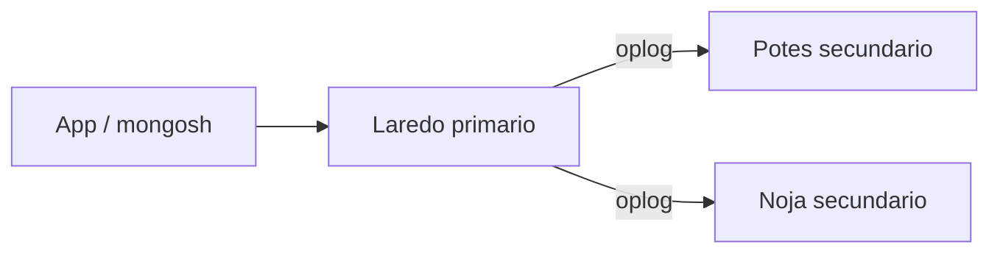
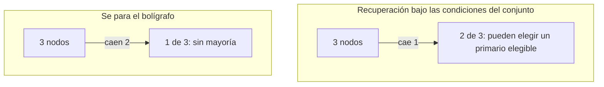
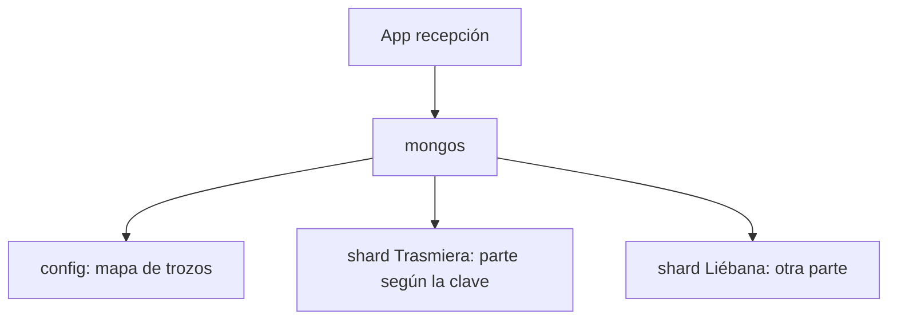

# 2.8. Réplicas y particiones

!!! info "Ruta de estudio"
    **Esencial:** distinguir copias y particiones, calcular mayorías y separar preferencias de lectura, confirmaciones y visibilidad.

    **Práctica común:** conjunto de tres miembros; comprobar una escritura, una lectura de secundario, un relevo y la recuperación tras detener un proceso.

    **Ampliación:** laboratorio de particionado, registro de shards y movimiento de un rango. Sus conjuntos reducidos no ofrecen alta disponibilidad completa. Las entregas se concretan en Moodle.

En [2.6](mongodb.md) consultamos y modificamos documentos; en [2.7](modelado.md) comprobamos que un rediseño conserva su significado. Ahora preguntamos **dónde viven los datos y qué sucede cuando falla un componente o añadimos recursos**.

Si deja de responder el primario, otro miembro puede asumir su función cuando hay mayoría, un candidato elegible y los datos necesarios. Puede haber una pausa. El objetivo del criterio **c)** es provocar un fallo concreto y comprobar la recuperación; no afirmar que un cobro externo se completa por disponer de réplicas.

Si capacidad o carga superan lo que ofrece el diseño actual, revisamos consultas, índices, recursos y distribución. El particionado permite repartir documentos entre shards; añadir uno es una posible ampliación del criterio **e)**, pero su efecto depende de la clave, las consultas y el balanceo. Más nodos no implican automáticamente más velocidad.

Dos oficios que en [2.5](nosql.md) ya se nombraron y que aquí se **montan**:

| Oficio | Qué guarda cada máquina | Analogía del hotel |
| --- | --- | --- |
| **Replicar** | El **mismo** dataset | Tres mostradores con la **misma** carpeta de reservas |
| **Particionar** (*sharding*) | Un **trozo** distinto | Un archivo por comarca |

En producción se combinan: cada trozo es, a su vez, un **conjunto de réplicas**. En Atlas las réplicas las administra el servicio y los controles dependen del plan; no se ejecuta este laboratorio administrando sus miembros como procesos propios. El lab de este apartado es Docker **en el aula**.

## Tres mostradores, una carpeta

Los nombres Laredo, Potes y Noja representan miembros del conjunto. **Cada miembro guarda una copia de todos los documentos**, no solamente las reservas de su localidad. Si Laredo contiene una reserva de Potes, sus secundarios también la replican. El reparto por datos aparece después, con sharding.

Un **replica set** es un grupo de procesos `mongod` que se ponen de acuerdo en **un** dataset. El cliente no “elige IP a ojo”: se apunta al **conjunto**. Si el que escribía se calla, los que quedan **votan** y otro toma el bolígrafo.



Nombres de aula (no son los de otro ciclo): set **`hotelrs`**, nodos `rs-laredo`, `rs-potes`, `rs-noja`. Laredo tiene mayor prioridad para favorecer su elección si está disponible y es elegible. El cargo se comprueba con `hello` y `rs.status()`, no se deduce del nombre.

### Quién escribe, quién copia, quién solo vota

Un árbitro participa en elecciones pero no guarda una copia de los datos. No sustituye a un secundario para leer ni para recuperar contenido perdido. En esta práctica utilizamos tres miembros con datos para poder observar tanto la elección como la replicación.

| Pieza | Oficio en el hotel |
| --- | --- |
| **Primario** | El único mostrador que **escribe** (altas, cobros, `update`) |
| **Secundario** | Copia el diario y puede **leer** si se lo pedís |
| **Árbitro** | Participa en la elección sin guardar datos; no sustituye una copia ni confirma su persistencia |

Un secundario no acepta una escritura ordinaria como `insertOne`; debe dirigirse al primario. Durante fallos de red hay transiciones y resultados inciertos: la confirmación exigida importa, como veremos con `w: 1` y `majority`.

Miembros que no son “un Potes normal”:

- **Retrasado** (`priority: 0` y `secondaryDelaySecs`): aplica cambios con un retraso configurado. Puede ayudar a recuperar un estado anterior si se actúa dentro de esa ventana; no sustituye una copia de seguridad ni garantiza conservarlo indefinidamente.
- **Oculto** (`hidden: true`, prioridad 0): no se ofrece en el descubrimiento normal del cliente. Puede dedicarse a tareas específicas mediante conexión directa; hay que valorar su carga y retraso.
- **Sin voto** (`votes: 0`, prioridad 0): copia datos, pero no decide elecciones ni puede ser primario.

El árbitro **no** sustituye a un secundario con disco: si perdéis el primario y os queda árbitro + un secundario, hay mayoría para elegir… pero **un solo** sitio con datos. En aula preferid **tres nodos con disco**.

## El diario (antes que los votos)

El **oplog** registra operaciones para que los secundarios sigan el historial del primario. Su ventana es limitada: un secundario desconectado demasiado tiempo puede necesitar una sincronización inicial. El oplog y las réplicas no sustituyen una copia de seguridad, porque también propagan borrados y errores de aplicación.

La copia **no** es “cada noche un `mongodump`”. El primario anota cada cambio en un diario: el ***oplog*** (*operations log*), colección `local.oplog.rs`.

Es una colección **capped especial**, con tamaño configurado y una ventana de historial dependiente del ritmo de cambios. Puede crecer más allá de ese tamaño para no eliminar operaciones necesarias para el punto de confirmación mayoritaria. No memoricéis «5 % del disco» como capacidad universal ni «24 horas» como retención garantizada.

Un secundario también puede obtener operaciones de otro secundario. Si las operaciones que necesita ya no están disponibles, puede requerir una sincronización inicial. La capacidad del diario y la conservación de backups resuelven problemas distintos.

La réplica es **asíncrona**: Potes puede ir un segundo por detrás. Eso importa cuando prometéis al huésped “ya está cobrado” y luego leéis en Noja.

```javascript
// En el primario, dentro del set
use local
db.oplog.rs.stats()
db.oplog.rs.find().sort({ $natural: -1 }).limit(3)
```

`rs.printReplicationInfo()` resume **cuántas horas** de diario os caben. Si el retraso supera la ventana disponible, el secundario puede necesitar una sincronización inicial; no significa que el equipo quede inutilizable.

## Elección: mayoría de los que *están configurados*

Ejemplo: con tres votantes, la mayoría es dos; con cuatro, es tres. Añadir un cuarto votante no permite perder dos y continuar escribiendo. Un miembro configurado con `votes: 0` no entra en ese cálculo. Además de votos suficientes, hace falta un candidato elegible y suficientemente actualizado.

Durante la elección puede haber una pausa de escrituras. «Alta disponibilidad» significa recuperar el servicio dentro de las condiciones previstas, no ausencia de cualquier interrupción. Registrad el tiempo observado sin presentarlo como una constante universal.

Si Laredo no responde unos **diez segundos** (orden de magnitud; no memoricéis el milisegundo), Potes y Noja intentan elegir primario.

**Mayoría** = más de la mitad de los miembros **votantes configurados** (los del `rs.conf()`), no “los que hoy contestan”. Tres nodos: hace falta que **dos** se vean. Se cae uno → el set **sigue**. Se caen dos → el que queda **no** se autoproclama: preferís **parar escrituras** a tener dos primarios.



Distribuid votos y datos según los fallos que queráis tolerar. Un tercer emplazamiento puede ayudar, pero no garantiza mayoría ante cualquier corte; un árbitro no aporta datos. Tres contenedores en un ordenador permiten probar procesos separados, no sobrevivir a la pérdida de ese ordenador.

### Rollback: lo que solo vio Laredo

Si Laredo aceptó un `insert` con `w: 1`, se apagó **antes** de que Potes lo copiara, y Potes ganó la elección, ese insert **no** está en el set nuevo. Al volver, Laredo **deshace** lo que no llegó al resto (*rollback*). El ejercicio debe declarar la confirmación utilizada y comprobar qué documento permanece. Una escritura confirmada con mayoría en esta topología está protegida frente al rollback habitual de la elección; no frente a cualquier pérdida de discos, borrado o fallo de aplicación.

## Laboratorio: set `hotelrs` (tres sedes)

Compose en [`docs/assets/practicas/hotel-rs/`](../assets/practicas/hotel-rs/compose.yaml). Imagen `mongo:7`, puertos **27017–27019**, volúmenes con nombre. Trabajáis **dentro** de la red Docker: los hostnames `rs-laredo` los resuelve Compose, no el `localhost` de Windows.

Antes de empezar, desde la terminal del PC, comprobad `docker info`. Iniciad el motor si no está disponible. **Detened `hotel-mongo` de 2.6 antes de arrancar este conjunto**, porque ambos publican 27017; detenerlo conserva su volumen. Revisad espacio, memoria y puertos con el docente: se ejecutan tres servidores a la vez.

El repositorio debe incluir `compose.yaml` e `iniciar-rs.js` en la misma carpeta. `docker compose config` permite revisar el archivo sin arrancar los servicios. Los comandos siguientes parten de la raíz del repositorio:

```powershell
cd docs/assets/practicas/hotel-rs
docker compose up -d
docker compose exec rs-laredo mongosh "mongodb://localhost:27017/?directConnection=true"
```

| Desde dónde | Dirección de Laredo / Potes / Noja |
| --- | --- |
| Red de Compose | `rs-laredo:27017`, `rs-potes:27017`, `rs-noja:27017` |
| PC anfitrión, inspección directa | `127.0.0.1:27017`, `127.0.0.1:27018`, `127.0.0.1:27019` |

Los puertos publicados no cambian los nombres anunciados por el conjunto. Un cliente del PC no podrá descubrir miembros con nombres Docker si no los puede resolver; `directConnection=true` permite inspeccionar uno, pero no aporta failover del cliente.

Si la conexión inicial se rechaza porque el servidor aún arranca, revisad `docker compose logs --tail 30` y repetid la conexión cuando esté listo. Un contenedor encendido no demuestra que `mongod` ya acepte operaciones.

En ese `mongosh`, **solo en la primera inicialización de estos volúmenes**:

```javascript
load("/scripts/iniciar-rs.js")
rs.status()
```

Hasta que un miembro ponga `"stateStr": "PRIMARY"`, esperad unos segundos y repetid `rs.status()`. `db.hello()` (no el viejo `isMaster`) dice si **este** proceso es primario y a quién seguir.

Anotad en `rs.status()`:

- `set`: debe ser `hotelrs`
- `members[i].name` y `stateStr` (`PRIMARY` / `SECONDARY`)
- `electionDate` cuando hayáis forzado un relevo

Este laboratorio usa `hotel_replica_lab`, independiente de los originales de 2.6. Si consultáis el oplog con `use local`, volved después a `hotel_replica_lab`. Registrad `db.version()` y `db.getName()`.

### Escribir en Laredo, leer en Potes

Comprobad primero con `db.hello()` qué miembro es primario; los nombres no garantizan el cargo. Si no es Laredo, abrid una consola directa en el servicio que sí lo sea. En el primario:

```javascript
use hotel_replica_lab
db.reservas.insertOne(
  {_id: "prueba-replica-01", hotel: "Laredo", canal: "web", noches: 2, importe: 124},
  {writeConcern: {w: "majority", wtimeout: 5000}}
)
```

El identificador de prueba es fijo para reconocer la operación. Si repetís la inserción y ya existe, consultadlo: un error de clave duplicada no significa que la primera escritura fallara. Para otra ejecución completa usad identificadores nuevos y anotadlos.

Desde **otra terminal del host**, dentro de la carpeta `hotel-rs`:

```powershell
docker compose exec rs-potes mongosh "mongodb://localhost:27017/?directConnection=true"
```

En ese shell, comprobad que Potes sigue siendo secundario; si es el primario, elegid otro miembro para esta parte. Ejecutad los comandos uno a uno, porque la última escritura debe producir un error esperado:

```javascript
db.hello()
use hotel_replica_lab
db.getMongo().setReadPref("secondary")
db.reservas.find({_id: "prueba-replica-01"})
db.reservas.insertOne({_id: "prueba-escritura-secundario", hotel: "Potes"})
```

La lectura puede necesitar esperar a que se aplique la réplica. La escritura directa al secundario debe rechazarse: cambiar la preferencia de lectura no lo convierte en primario. Las opciones iniciales del cliente pueden permitir o impedir la lectura antes de `setReadPref`; anotad lo observado y la URI, sin asumir un error universal.

`rs.help()` enumera operaciones de administración. No repitáis `rs.initiate()` sobre un conjunto ya inicializado. Compass desde Windows puede inspeccionar un miembro mediante `mongodb://localhost:27017/?directConnection=true`, pero esa conexión directa **no ofrece descubrimiento ni cambio automático de primario**. Para probar failover con un driver, ejecutad el cliente en la red que resuelve los tres hostnames.

## Qué puede prometer recepción

Son tres decisiones independientes: **readPreference** elige dónde leer; **readConcern** determina qué datos puede observar la lectura; **writeConcern** define qué confirmación espera una escritura. Usar un secundario no elige automáticamente el nivel de lectura, y confirmar una escritura no obliga a que todos los secundarios ya la hayan aplicado.

### Preferencia de lectura

| `readPreference` | Gesto |
| --- | --- |
| `primary` | Selecciona el primario; es la preferencia por defecto, no una garantía suficiente de lectura linealizable |
| `primaryPreferred` | Primario si está; si no, un secundario (el mostrador no se queda en blanco) |
| `secondary` | Solo copias: informes, no el “¿ya está?” del huésped |
| `secondaryPreferred` | Copia si hay; si no, primario |
| `nearest` | Selecciona entre miembros elegibles dentro de la ventana de latencia; puede ser un secundario atrasado |

En el *shell*: `db.getMongo().setReadPref("secondaryPreferred")`. En [2.9](pymongo.md) el *driver* lo lleva en el cliente.

### Preocupación de escritura

En MongoDB 7 el valor implícito es `majority` en muchas topologías, incluido el conjunto de tres miembros con datos de esta práctica; existen excepciones, por ejemplo ciertas configuraciones con árbitros. Para que el ejercicio sea inequívoco, indicamos la opción explícitamente. Consultad las reglas de [write concern](https://www.mongodb.com/docs/manual/reference/write-concern/).

`wtimeout` limita la espera de confirmaciones, **no revierte una escritura ya aplicada**. Si vence, el resultado puede ser incierto para el cliente. Antes de repetir una operación de negocio, comprobad su identificador y diseñad el reintento para no duplicarla.

`writeConcern` define qué confirmación debe recibirse antes de comunicar éxito; incluye condiciones de replicación y, si se solicita, journal. No es una transacción de negocio ni una garantía de que todos los lectores vean inmediatamente el cambio.

| `w` | Promesa |
| --- | --- |
| `0` | *Fire-and-forget*: la *app* no espera. Peligroso en cobros |
| `1` | El **primario** confirma la escritura. Un secundario puede ir detrás |
| `"majority"` | Se alcanza la confirmación mayoritaria exigida entre miembros con datos y voto; no exige todas las copias |

`j: true` solicita confirmación del journal. Con WiredTiger y la configuración predeterminada del conjunto, las escrituras mayoritarias esperan la persistencia correspondiente; comprobad la configuración antes de generalizar. `wtimeout` limita la espera de confirmación, no todo el tiempo de red o selección del servidor.

```javascript
db.reservas.insertOne(
  { _id: "prueba-concern-01", hotel: "Noja", canal: "ota", noches: 1, importe: 89 },
  { writeConcern: { w: "majority", wtimeout: 5000 } }
)
```

Se relaciona con [CAP](../ut1/almacenamiento.md): el lado que no alcanza la mayoría no puede confirmar esa escritura. No se exige escribir en todos los miembros, y la garantía debe describirse junto con las opciones de lectura y el fallo considerado.

### Preocupación de lectura

| `readConcern` | Qué veis |
| --- | --- |
| `local` | Lo que este nodo tiene (puede no ser mayoritario) |
| `available` | Prioriza la disponibilidad de lectura y puede observar documentos huérfanos durante migraciones de shards |
| `majority` | Datos confirmados mayoritariamente, protegidos frente al rollback habitual; pueden no ser los más recientes |
| `linearizable` | En el primario, ofrece la garantía linealizable bajo sus condiciones; puede esperar y conviene limitarla con `maxTimeMS` |
| `snapshot` | Vista coherente de un instante; se usa en transacciones y en ciertas lecturas compatibles |

Para el aula, comparad escritura con mayoría y lectura local de un secundario. Esta última puede estar atrasada: solo es adecuada si el informe admite ese retraso. `readConcern: "majority"` no significa necesariamente «la versión más reciente». Para leer vuestras escrituras y respetar dependencias, estudiad también las sesiones causalmente consistentes y sus opciones.

## Prueba del c): apagar el primario

Primero verificad tres miembros sanos y la reserva `prueba-replica-01` confirmada con mayoría. Registrad qué nodo es primario.

Hay dos experimentos diferentes:

1. **Relevo controlado:** ejecutad `rs.stepDown(60)` en el primario. Renuncia temporalmente al cargo, pero su proceso sigue encendido. Observad la elección; no hay ningún contenedor que arrancar de nuevo.
2. **Caída de proceso:** desde el host, detened el servicio que sea primario. Si es Laredo, el comando es:

```powershell
docker compose stop rs-laredo
```

Desde uno de los dos nodos restantes, comprobad `rs.status()` hasta que aparezca otro primario. Conectaos directamente a ese primario, seleccionad `hotel_replica_lab` y verificad contenido, no solo existencia:

```javascript
use hotel_replica_lab
db.reservas.findOne({_id: "prueba-replica-01"})
db.reservas.insertOne(
  {_id: "prueba-replica-02", hotel: "Potes", canal: "web", noches: 1, importe: 90},
  {writeConcern: {w: "majority", wtimeout: 5000}}
)
```

La primera reserva debe conservar `noches: 2` e `importe: 124`; la segunda debe confirmarse. Registrad hora de la parada, primer nuevo primario observado y primera escritura confirmada. Si consultáis el estado cada pocos segundos, vuestra medida tiene esa resolución; no es una medición exacta de toda la indisponibilidad. Una reconexión manual demuestra recuperación del servicio, no que un cliente se reconecte automáticamente.

Recuperad el miembro detenido desde el host:

```powershell
docker compose start rs-laredo
```

Debe reincorporarse y sincronizarse. Por su prioridad puede recuperar más adelante el cargo de primario. Si detuvisteis otro miembro, adaptad el nombre en ambos comandos.

Al reincorporarse, esperad a que aparezca sano como secundario o primario y comprobad los dos identificadores en su copia. Los cargos pueden cambiar de nuevo por prioridad.

| Momento | Qué registrar |
| --- | --- |
| Antes | Tres miembros sanos, primario y documento confirmado con mayoría |
| Durante | Proceso detenido, miembros accesibles y observaciones con hora |
| Después del relevo | Nuevo primario, mismo documento previo y nueva escritura confirmada |
| Recuperación | Miembro reincorporado y ambos documentos presentes |

**Evidencia mínima:** estado antes, fallo provocado, elección, lectura del dato previo, escritura nueva y recuperación del miembro. Esto prueba tolerancia a la caída de un proceso del conjunto; todos los contenedores dependen todavía del mismo ordenador.

!!! warning "No mezclar laboratorios"
    El servidor independiente del 2.6 y `hotel-rs` publican 27017. Detened `hotel-mongo` antes de arrancar el conjunto; detenerlo conserva su volumen. No borréis los volúmenes para cambiar de ejercicio.

## Cuando copiar ya no basta: partir

La capacidad útil de un replica set no se suma como si cada miembro guardara una parte diferente. Tres copias de 100 GB siguen representando 100 GB de datos lógicos, además de índices y registros. En sharding sí repartimos documentos entre grupos y replicamos dentro de cada grupo. Escala y redundancia se consiguen con mecanismos distintos.

Replicar introduce trabajo adicional y no reparte automáticamente las escrituras de aplicación entre varios primarios de un mismo set. Si un nodo no cumple el objetivo, revisamos índices, consultas, conservación y recursos; particionar es una alternativa cuando la carga puede repartirse de forma útil.

Mongo hace ***auto-sharding*** por **rangos** (o por **hash**) de una **shard key**. Unidad que se mueve: el ***chunk*** (trozo). Un proceso, el ***balancer***, los reparte. No es instantáneo: con muchos GB puede tardar.



| Pieza | Oficio |
| --- | --- |
| **Shard** | Un replica set con **parte** de `reservas`. En serio: **set**, no un `mongod` huérfano |
| **Config** | Metadatos: qué rango vive en qué shard. En serio: **tres** nodos |
| **mongos** | Centralita: la *app* **solo** habla con él. El *driver* cambia de `mongos` si uno cae; **no** habla con cada `mongod` |

En MongoDB 7, el **primary shard de una base** aloja sus colecciones no particionadas. No es lo mismo que el **miembro primario** de un replica set: uno identifica un grupo de almacenamiento y el otro un proceso que acepta escrituras. `sh.status()` permite situarlos.

Los nombres Trasmiera y Liébana identifican shards de aula, no una asignación automática de reservas por comarca. El reparto depende de la clave y los rangos.

### La clave: `hotel` os junta el atasco

La elección combina cardinalidad, frecuencia de valores, crecimiento y consultas. Un hash de `_id` suele distribuir altas, pero una consulta solo por `hotel` puede necesitar consultar todos los shards. Usamos `_id` porque el JSONL de aula **no contiene `id_reserva`**: MongoDB genera `_id` al importar. Particionar por un campo ausente no reparte las reservas como esperamos.

La shard key necesita **cardinalidad** alta (muchos valores distintos) y que las escrituras **no** caigan todas en el mismo trozo.

| Clave | Qué pasa en el hotel |
| --- | --- |
| `{ hotel: 1 }` | Casi todo agosto es **Laredo** → un shard se fríe (*hotspot*) |
| `{ checkin: 1 }` | Si las inserciones se concentran en fechas crecientes, pueden cargar el último rango; no ocurre solo por ser una fecha |
| `{ _id: "hashed" }` | El hash **reparte** altas; un `find` por hotel **recorre** shards (*broadcast*) |

Una clave debe equilibrar distribución y consultas dirigidas. Filtrar por hotel es frecuente, pero seis nombres aportan poca cardinalidad y uno puede concentrar carga. Incluir un campo en una clave compuesta no garantiza por sí solo buen reparto ni que cualquier filtro alcance un único shard. Un hash tampoco separa documentos con el mismo valor de clave.

En el caso simple de una colección vacía, `shardCollection` puede crear el índice de la clave; con datos, preparad antes un índice compatible. Este bloque es **ilustrativo**: no lo ejecutéis sobre la referencia de la práctica. La secuencia del laboratorio utiliza `reservas_rango` y `reservas_hash`.

```javascript
sh.shardCollection("hotel.reservas", { _id: "hashed" })
// rango, si de verdad filtráis por comarca y hay dos mitades vivas:
// sh.shardCollection("hotel.reservas", { comarca: 1, _id: 1 })
```

Tercer argumento histórico: `unique` (el índice de la clave es único). En el hotel, `_id` hashed **no** se declara único a la ligera: un índice hashed no puede declararse único; la unicidad debe diseñarse de acuerdo con las reglas de índices de colecciones particionadas.

El pequeño conjunto sirve para aprender los mecanismos; no justifica desplegar sharding en producción por su volumen. Observad metadatos, ubicación y conservación de resultados. Para afirmar una mejora de capacidad o rendimiento, identificad el recurso añadido y medid bajo condiciones comparables.

## Laboratorio opcional: Trasmiera y Liébana

Utilizad la carpeta completa `docs/assets/practicas/hotel-shards`, con sus scripts junto al archivo Compose. Descargar solo el YAML no proporciona los archivos que monta.

El [Compose de sharding](../assets/practicas/hotel-shards/compose.yaml) incluye un `mongos` en el puerto 27117, un miembro de configuración y dos shards de dos miembros cada uno. Todos los procesos `mongod` usan explícitamente 27017 dentro de la red. **Es un laboratorio de reparto, no de alta disponibilidad completa**: un conjunto de dos votantes necesita ambos, y el único config server es un punto de fallo.

Este laboratorio tiene seis procesos (cinco `mongod` y un `mongos`); reservad recursos y evitad ejecutarlo junto al de réplicas si el equipo no puede sostener ambos. Desde la carpeta `hotel-rs`, `docker compose stop` conserva sus volúmenes. La prueba de particionado usa otros volúmenes y sus propios datos.

Desde la raíz del repositorio, en el host:

```powershell
cd docs/assets/practicas/hotel-shards
docker compose up -d
docker compose exec cfg-santander mongosh --eval "load('/scripts/iniciar-cfg.js')"
docker compose exec cfg-santander mongosh --eval "db.hello()"
```

Esperad `isWritablePrimary: true`. Después inicializad cada shard y comprobad igualmente que tiene primario; no basta con que su contenedor esté encendido:

```powershell
docker compose exec trasmiera-a mongosh --eval "load('/scripts/iniciar-trasmiera.js')"
docker compose exec trasmiera-a mongosh --eval "rs.status()"
docker compose exec liebana-a mongosh --eval "load('/scripts/iniciar-liebana.js')"
docker compose exec liebana-a mongosh --eval "rs.status()"
```

Con los tres conjuntos listos:

```powershell
docker compose restart recepcion
docker compose exec recepcion mongosh --eval "load('/scripts/anadir-shards.js')"
```

El registro de shards muestra la lista antes y después de cada incorporación. Conservad esa evidencia: ambos procesos pueden estar arrancados antes, pero solo pasan a formar parte del clúster cuando `mongos` los registra. No confundáis número de contenedores con número de shards registrados.

Los scripts `iniciar-*.js` se ejecutan **una vez** sobre volúmenes nuevos. En reanudaciones, consultad el estado en lugar de volver a inicializar. `anadir-shards.js` sí comprueba los ya registrados y evita añadirlos otra vez.

Importad **antes de crear las colecciones de comparación**, desde el host con Database Tools, sobre una colección `hotel.reservas` vacía en este laboratorio:

```powershell
mongoimport --host 127.0.0.1 --port 27117 --db hotel --collection reservas --file ../reservas_mongo.jsonl
docker compose exec recepcion mongosh
```

En el shell del router:

```javascript
use hotel
db.reservas.countDocuments({}) // 15 si se importó una vez
sh.enableSharding("hotel")
db.reservas.aggregate([{ $out: "reservas_rango" }])
db.reservas.aggregate([{ $out: "reservas_hash" }])
db.reservas_rango.createIndex({ hotel: 1 })
db.reservas_hash.createIndex({ _id: "hashed" })
sh.shardCollection("hotel.reservas_rango", { hotel: 1 })
sh.shardCollection("hotel.reservas_hash", { _id: "hashed" })
sh.status()
db.reservas_rango.getShardDistribution()
db.reservas_hash.getShardDistribution()
```

Las dos copias contienen los mismos documentos. `reservas` queda como referencia sin particionar. Este bloque prepara destinos nuevos: `$out` no puede repetirse sobre un destino ya particionado. Para un segundo experimento, usad nombres nuevos y anotadlos. No vaciéis datos para conseguir una captura determinada.

Antes de mover datos, ejecutad el [comprobador de particiones](../assets/practicas/hotel-shards/comprobar-particiones.js), incluido en la carpeta y montado por Compose. Desde la terminal del PC, en `hotel-shards`:

```text
docker compose exec recepcion mongosh hotel --quiet --file /scripts/comprobar-particiones.js
```

No modifica datos: compara documentos completos, `_id`, tipos BSON de los campos principales y noches por hotel de ambas copias con `reservas`. El original debe tener **15 reservas y 46 noches**, diferentes de las 20 reservas y 62 noches del laboratorio Hadoop.

| Hotel | Noches reservadas |
| --- | --- |
| Comillas | 4 |
| Laredo | 11 |
| Noja | 4 |
| Potes | 13 |
| Reinosa | 6 |
| Santander | 8 |

Igualar solo el total puede ocultar errores compensados entre hoteles. El comprobador verifica la equivalencia con la referencia del laboratorio, no certifica que una referencia modificada sea idéntica al fichero original.

### Chunks que no se mueven solos (aún)

Con solo 15 documentos puede no haber suficiente volumen para que el balanceador mueva datos. La distribución inicial depende de la clave y de si la colección estaba vacía al particionarse. Observad `sh.status()` sin asumir un número fijo de chunks.

Para distinguir **dividir un rango** y **moverlo**, haced una prueba controlada sobre la colección por rangos recién creada:

```javascript
sh.splitAt("hotel.reservas_rango", { hotel: "Potes" })
sh.moveChunk("hotel.reservas_rango", { hotel: "Potes" }, "liebana")
db.reservas_rango.getShardDistribution()
db.reservas_rango.countDocuments({}) // debe seguir siendo 15
```

Primero inspeccionad la ubicación: si el rango ya está en `liebana`, elegid `trasmiera` como destino para observar un movimiento. Si el punto de corte ya existe, no volváis a dividirlo. `splitAt` crea un límite; `moveChunk` solicita el traslado de un rango concreto. `splitFind` busca un punto intermedio dentro de un chunk, pero no lo usamos sobre un hash pasando un identificador de negocio como si fuera su valor hash.

Repetid el comprobador después del movimiento. Comparad también todos los documentos y el agregado de noches antes y después: mover datos debe preservar contenido, tipos e identificadores, no solo el total. Una captura de distribución prueba ubicación, no mejora de rendimiento. El router consulta los metadatos de configuración y encamina operaciones; no almacena las reservas ni equivale exactamente al NameNode.

Para ampliar capacidad se añade un shard compatible y se supervisa el balanceo. Para alta disponibilidad habría que revisar también miembros de cada set, config servers, routers y dominios físicos de fallo.

## Cómo se cierra el apartado

La réplica mantiene copias y permite recuperarse ante los fallos previstos por el conjunto. El particionado reparte datos; necesita una clave adecuada y también puede utilizar réplicas dentro de cada shard. El modelo de 2.7 sigue importando: repartir documentos no corrige sus reglas de negocio.

!!! success "En voz alta"
    “Identifico qué fallo he provocado, qué confirmación tenía el dato y cómo se recupera el servicio. Distingo copias de partes. Al añadir o mover un shard, compruebo tanto su ubicación como la conservación de la información.”

## Relación con el RA2

| Criterio | Evidencia y alcance |
| --- | --- |
| **c)** | Estado inicial, caída de un proceso, pausa observada, elección, conservación del documento y recuperación. No prueba resistencia a perder el ordenador. |
| **e)** | Shards registrados antes y después, ubicación de rangos y movimiento comprobado. No implica aceleración ni crecimiento ilimitado. |
| **a)** | Datos consultables y resultados conservados al cambiar su ubicación. Los JSONL del laboratorio de shards mantienen el contenido de 2.6, en otro entorno. |

## Actividades

Guardad comandos, conexión utilizada, configuración, resultados y explicación. Las entregas evaluables se concretan en Moodle. El laboratorio de particionado es ampliación; si no se ejecuta, documentad el diseño sin presentarlo como una prueba realizada.

1. **Tres miembros y mayoría.** Dibujad el conjunto `hotelrs`, señalad quién almacena datos y quién vota. Calculad la mayoría con tres y con cuatro votantes. Explicad por qué agregar un cuarto votante no permite perder dos. Como ampliación, diseñad la incorporación de `rs-santona` antes de modificar el entorno.
2. **Lectura y escritura.** Ejecutad la prueba identificada. Mostrad la confirmación mayoritaria y la lectura en un secundario con preferencia explícita. Probad el rechazo de escritura directa en el secundario. Explicad por qué esa preferencia no cambia su cargo.
3. **Relevo y caída.** Haced primero un relevo controlado y después, con el conjunto sano, una parada del primario actual. Identificad cuál requiere arrancar un proceso. Contrastad el dato previo, la nueva escritura y la recuperación; conservad las horas observadas.
4. **Promesas de recepción.** Comparad `w:1` y `w:"majority"` frente a una caída antes de replicar. Utilizad identificadores distintos. Que ambas escrituras sobrevivan en vuestra prueba no demuestra que tengan la misma garantía; explicar un riesgo no exige provocar pérdida real.
5. **Resultado incierto.** Una escritura devuelve un error de espera de confirmación. ¿Puede haberse aplicado? Diseñad una comprobación por identificador y un reintento que no duplique la operación. Distinguid «no confirmado» de «deshecho».
6. **Tres decisiones.** Para un informe que admite retraso, proponed preferencia de lectura, read concern y write concern del proceso que genera los datos. Explicad qué aporta cada uno y por qué `majority` no equivale a «última versión».
7. **Clave y consultas.** El 90 % de las altas pertenece a Laredo. Comparad `hotel`, una fecha creciente y `_id` hashed. Justificad reparto y coste de una consulta solo por hotel; el hash de `hotel` no elimina la concentración en ese mismo valor.
8. **Particionar — ampliación.** Registrad los shards y preparad las colecciones de comparación. Mostrad ubicación antes y después de dividir y mover un rango. Contrastad los documentos originales, sus identificadores y noches por hotel. Si el rango ya estaba en el destino, elegid el otro shard y anotadlo.
9. **Dominios de fallo.** Explicad qué sucede si cae un proceso del replica set, un miembro de un shard de dos votantes, el único config server o el ordenador. Indicad qué mejora requeriría cada caso y qué no habéis probado.
10. **Oplog y backup.** Un secundario tarda en volver y su historial pendiente ya no está en el oplog. Explicad cómo puede recuperarse y por qué ni la réplica ni ampliar el oplog sustituyen una copia de seguridad ante un borrado erróneo.

??? success "Orientaciones para revisar las respuestas"
    **1–3.** Las mayorías son dos de tres y tres de cuatro. Una preferencia selecciona lecturas, no habilita escrituras en un secundario. `stepDown` mantiene el proceso encendido; `stop` lo detiene. El documento previo y la nueva escritura deben contrastarse después del relevo.

    **4–6.** `w:1` puede confirmar un dato que todavía no está en otra copia. Una escritura mayoritaria de esta topología resiste el rollback habitual de elección. Un timeout no revierte lo aplicado; antes de reintentar hay que resolver la incertidumbre. `readPreference` elige miembro, `readConcern` visibilidad y `writeConcern` confirmación.

    **7–8.** Muchas reservas con el mismo hotel pueden concentrarse en un rango. Hash distribuye valores distintos, no divide un valor repetido. Filtrar solo por hotel con `_id` hashed puede visitar todos los shards. Dividir crea un límite; mover cambia la ubicación. Ambos deben conservar los resultados.

    **9–10.** El conjunto de tres miembros puede tolerar una caída bajo las condiciones comprobadas; un set de dos votantes pierde la mayoría al caer uno. Un único config server y un único ordenador son puntos de fallo del laboratorio. Un secundario demasiado atrasado puede necesitar sincronización inicial; los borrados también se replican.

## Autoevaluación del 2.8

Diez preguntas (A–D, **una** correcta). No puntúan en Moodle. **Comprobar respuesta** muestra el resultado y explica el motivo. Revisad el apartado enlazado antes de repetir.

<div class="dwec-quiz" data-dwec-quiz data-src="../../assets/quizzes/ut2-2-8.json"></div>

Al terminar, salid de `mongosh` con `exit` y ejecutad `docker compose stop` en la carpeta del laboratorio que queráis detener. No uséis `down -v` para cambiar de apartado: elimina los volúmenes. Para volver a 2.6 o 2.9, detened primero el entorno que ocupe su puerto y arrancad el servidor correspondiente. Los datos de cada entorno no se fusionan al cambiar de conexión.

## Referencias

- [Replica set](https://www.mongodb.com/docs/manual/replication/) y [elecciones](https://www.mongodb.com/docs/manual/core/replica-set-elections/) (manual de MongoDB)
- [Write concern](https://www.mongodb.com/docs/manual/reference/write-concern/) y [read preference](https://www.mongodb.com/docs/manual/core/read-preference/)
- [Sharding](https://www.mongodb.com/docs/manual/sharding/) y [elección de shard key](https://www.mongodb.com/docs/manual/core/sharding-shard-key/)
- [2.5 Familias](nosql.md) · [2.6 MongoDB](mongodb.md) · [2.7 Modelado](modelado.md) · [2.9 PyMongo](pymongo.md)
